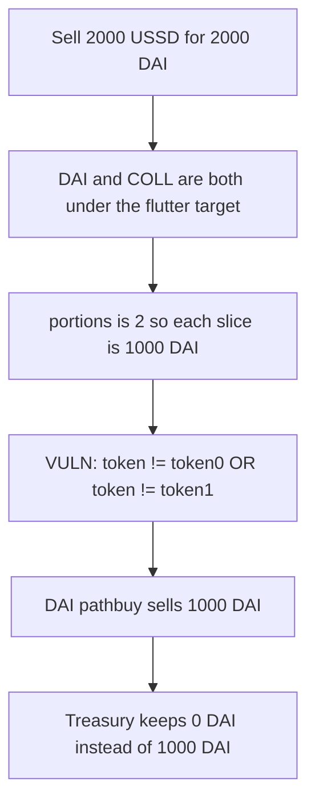

# USSD SellUSSDBuyCollateral — the DAI skip is an OR, so 1000 DAI is sold

> **Vulnerability classes:** vuln/logic/wrong-condition · vuln/logic/incorrect-state-transition

<!-- non-defihacklabs -->
<!-- source-auditvault: https://github.com/Auditware/AuditVault/blob/main/findings/19131-h-2-ussdrebalancersolsellussdbuycollateral-the-check-of-whet.md -->
<!-- date: 2023-05 -->

## Key info

| | |
|---|---|
| **Protocol** | USSD (Autonomous Secure Dollar) |
| **Finding** | Sherlock 2023-05 H-2, AuditVault 19131 |
| **Vulnerable code** | `USSDRebalancer.SellUSSDBuyCollateral` |
| **Harm** | 1000 DAI of freshly bought collateral is sold; the corrected check keeps that 1000 DAI |
| **Chain** | local synthetic (audited Ethereum contracts) |

## TL;DR

After selling USSD for DAI, `SellUSSDBuyCollateral` is supposed to leave DAI alone and spend the bought DAI only on other underweight collaterals. The skip is written with `||`. A token cannot be both `token0` and `token1`, so the condition is true for DAI as well. DAI's `pathbuy` runs for `daibought/portions`.

In this reduction the rebalancer buys 2000 DAI, splits it across two underweight collaterals, and sells 1000 DAI along the DAI path. The treasury finishes with 0 DAI and 1000 COLL. The same call with `&&` sells 0 DAI on that path and keeps 1000 DAI beside the 1000 COLL.

## The vulnerable code

The condition is the audited line. The comment says not to touch DAI. The operator does the opposite.

```solidity
// @> VULN: `||` is true for every token, so DAI is not skipped and pathbuy sells it.
if (collateral[i].token != uniPool.token0() || collateral[i].token != uniPool.token1()) {
    // don't touch DAI if it's needed to be bought (it's already bought)
    IUSSD(USSD).UniV3SwapInput(collateral[i].pathbuy, daibought/portions);
}
```

The fix the report gives, which the control runs:

```solidity
if (collateral[i].token != uniPool.token0() && collateral[i].token != uniPool.token1()) {
    IUSSD(USSD).UniV3SwapInput(collateral[i].pathbuy, daibought/portions);
}
```

## Root cause

`token != token0 || token != token1` is the negation of `token == token0 && token == token1`. No collateral is both pool tokens, so the body always runs. DAI is `token1` of the USSD/DAI pool. It still enters `UniV3SwapInput` with its `pathbuy` and an input of `daibought/portions`.

Here `daibought` is 2000e18 and `portions` is 2, so the DAI path sells 1000e18 DAI that the AND check does not sell.

## Preconditions

The USSD/DAI pool has USSD as `token0` and DAI as `token1`. The treasury's USSD balance is 2000e18, which the first leg sells 1:1 for 2000e18 DAI. DAI and a second collateral are both under the flutter target, so both are counted in `portions`. No caller privilege is required. `rebalance()` is permissionless and calls this function when the peg is above the threshold. The reduction calls `SellUSSDBuyCollateral` directly with that state already set.

## Attack walkthrough

1. The treasury sells 2000 USSD and receives 2000 DAI.
2. DAI's weight is under the flutter target, and so is COLL. `portions` is 2.
3. The OR check passes for DAI. `UniV3SwapInput` sells 1000 DAI along DAI's pathbuy.
4. The other 1000 DAI buys COLL.
5. The treasury holds 0 DAI and 1000 COLL. The sink holds the 1000 DAI that was sold.

The control, given the same balances and the AND check, holds 1000 DAI and 1000 COLL, and the sink holds 0.

## Diagrams



## Impact

One thousand DAI that the rebalancer had just bought, and that the comment says must stay, is sold. The collateral basket is 1000 DAI short of the corrected result and the peg-up buy is aimed at the wrong asset. With an empty `pathbuy` on mainnet the same branch reverts inside the router. This reduction shows the amount the branch moves when the path is taken: 1000 DAI sold versus 0.

## Remediation

Replace `||` with `&&`, so a collateral that is either pool token is skipped. DAI then stays as the DAI that was just bought, and only non-pool collaterals are swapped.

## How to reproduce

```bash
cd 19131-h-2-ussdrebalancersolsellussdbuycollateral-the-check-of-whet_exp
forge test -vv
```

The exploit test asserts 1000 DAI sold and 0 DAI left. The control test asserts 0 DAI sold and 1000 DAI left.

## Sources

- AuditVault finding: https://github.com/Auditware/AuditVault/blob/main/findings/19131-h-2-ussdrebalancersolsellussdbuycollateral-the-check-of-whet.md
- Sherlock judging: https://github.com/sherlock-audit/2023-05-USSD-judging/issues/193
- Contest report: https://github.com/sherlock-audit/2023-05-USSD-judging
- Audited rebalancer: https://github.com/USSDofficial/ussd-contracts/blob/f44c726371f3152634bcf0a3e630802e39dec49c/contracts/USSDRebalancer.sol#L199
