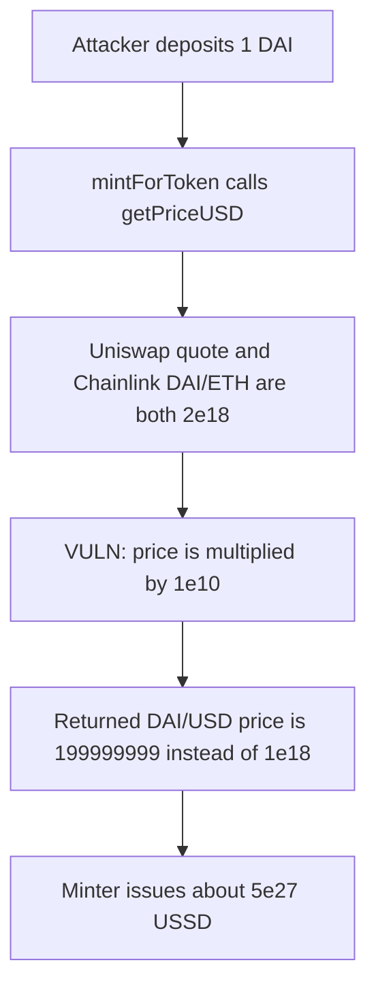

# USSD StableOracleDAI — an extra 1e10 on an 18-decimal DAI/ETH feed

> **Vulnerability classes:** vuln/oracle/wrong-feed · vuln/arithmetic/decimal-mismatch · vuln/logic/price-calculation

<!-- non-defihacklabs -->
<!-- source-auditvault: https://github.com/Auditware/AuditVault/blob/main/findings/19133-h-4-the-price-from-stableoracledai-is-returned-with-the-inco.md -->
<!-- date: 2023-05 -->

## Key info

| | |
|---|---|
| **Protocol** | USSD (Autonomous Secure Dollar) |
| **Finding** | Sherlock 2023-05 H-4, AuditVault 19133 |
| **Vulnerable code** | `StableOracleDAI.getPriceUSD` |
| **Harm** | 1 DAI mints `5000000025000000125000000625` USSD instead of 1 USSD |
| **Chain** | local synthetic (audited Ethereum contracts) |

## TL;DR

`StableOracleDAI.getPriceUSD` assumes the Chainlink DAI/ETH answer is 8 decimals and multiplies it by `1e10`. The feed is already 18 decimals. With both legs at `2e18`, the returned DAI/USD price is `199999999` instead of `1e18`. `mintForToken` then mints about 5.000000024e9 times too much USSD for a 1 DAI deposit.

## The vulnerable code

The return expression is the audited line. The Uniswap quote and the Chainlink answer are both 18-decimal `2e18` in this reduction, which is the shape the report describes (the other protocol feeds are 8 decimals; DAI/ETH is not).

```solidity
(, int256 price,,,) = priceFeedDAIETH.latestRoundData();
// @> VULN: `price` is 18 decimals; `* 1e10` treats it as 8 and collapses DAI/USD.
return (wethPriceUSD * 1e18) / ((DAIWethPrice + uint256(price) * 1e10) / 2);
```

Fair form, which the control uses:

```solidity
return (wethPriceUSD * 1e18) / ((DAIWethPrice + uint256(price)) / 2);
```

## Root cause

The average in the denominator mixes a 18-decimal Uniswap DAI-per-ETH quote with a Chainlink DAI/ETH answer that the author scaled as if it were 8 decimals. `uint256(price) * 1e10` dominates the sum. Integer division then yields `199999999` rather than `1e18`.

`mintForToken` does `ussdOut = daiAmount * 1e18 / price`. For `daiAmount = 1e18`:

- fair price `1e18` mints `1e18` USSD
- buggy price `199999999` mints `5000000025000000125000000625` USSD

## Preconditions

The oracle is wired to a DAI/ETH source that already returns 18 decimals, which is what Chainlink publishes for that pair. No special caller privilege is required. One DAI and an approval of the minter are enough.

## Attack walkthrough

1. The attacker deposits 1 DAI through `mintForToken`.
2. The minter calls `StableOracleDAI.getPriceUSD`.
3. The return statement multiplies the 18-decimal Chainlink answer by `1e10`.
4. The minter mints `5000000025000000125000000625` USSD to the attacker. A fair oracle would have minted `1e18`.

The fixed oracle, given the same feeds, returns exactly `1e18`.

## Diagrams



## Impact

One unit of DAI buys about five billion times the USSD the peg promises. That is unbacked issuance against the collateral the oracle is supposed to price at one dollar.

## Remediation

Drop the `* 1e10` on the DAI/ETH leg, or scale each feed by its own `decimals()` instead of a hardcoded 8-decimal assumption.

## How to reproduce

```bash
cd 19133-h-4-the-price-from-stableoracledai-is-returned-with-the-inco_exp
forge test -vv
```

## Sources

- AuditVault finding: https://github.com/Auditware/AuditVault/blob/main/findings/19133-h-4-the-price-from-stableoracledai-is-returned-with-the-inco.md
- Sherlock contest: https://github.com/sherlock-audit/2023-05-USSD-judging/issues/236
- Audited oracle: https://github.com/sherlock-audit/2023-05-USSD/blob/main/ussd-contracts/contracts/oracles/StableOracleDAI.sol
