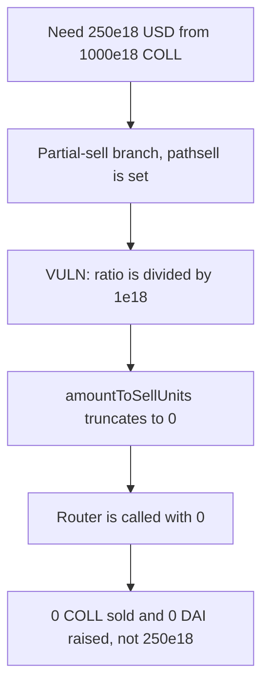

# USSD amountToSellUnits — a partial collateral sell moves 0 instead of 250e18

> **Vulnerability classes:** vuln/arithmetic/precision-loss · vuln/arithmetic/division-before-multiply

<!-- non-defihacklabs -->
<!-- source-auditvault: https://github.com/Auditware/AuditVault/blob/main/findings/19135-h-6-wrong-computation-of-the-amounttosellunit-variable-sherl.md -->
<!-- date: 2023-05 -->

## Key info

| | |
|---|---|
| **Protocol** | USSD (Autonomous Secure Dollar) |
| **Finding** | Sherlock 2023-05 H-6, AuditVault 19135 |
| **Vulnerable code** | `USSDRebalancer.BuyUSSDSellCollateral` |
| **Harm** | The rebalancer sells 0 COLL. The corrected formula sells 250e18 COLL and raises 250e18 DAI |
| **Chain** | local synthetic (audited Ethereum contracts) |

## TL;DR

On a peg-down, `BuyUSSDSellCollateral` should sell the fraction of a collateral whose USD value equals `amountToBuyLeftUSD`. The code does that ratio as `((amountToBuyLeftUSD * 1e18 / collateralval) / 1e18) / 1e18` and multiplies by the balance. This branch only runs when `collateralval > amountToBuyLeftUSD`, so the ratio is below 1 and the inner `/ 1e18` truncates it to 0.

With 1000e18 COLL priced at one dollar and 250e18 USD still to raise, the fair size is 250e18 COLL. The audited expression sells 0. No DAI is raised. The control uses `balance * amountToBuyLeftUSD / collateralval`, sells 250e18 COLL, and receives 250e18 DAI.

## The vulnerable code

The assignment is the audited line.

```solidity
// @> VULN: the ratio is divided by 1e18 before scaling by balance, so it truncates to 0.
amountToSellUnits = IERC20Upgradeable(collateral[i].token).balanceOf(USSD)
    * ((amountToBuyLeftUSD * 1e18 / collateralval) / 1e18) / 1e18;
```

The report reduces the intended size to `balance * amountToBuyLeftUSD / collateralval`. That is what the control executes:

```solidity
amountToSellUnits = balance * amountToBuyLeftUSD / collateralval;
```

## Root cause

`amountToBuyLeftUSD` and `collateralval` are both 18-decimal USD notionals. Their ratio does not need another 1e18 of scaling. The parentheses divide that ratio by 1e18 before the balance is applied.

For this call:

- balance = 1000e18 COLL
- collateralval = 1000e18
- amountToBuyLeftUSD = 250e6 * 1e12 = 250e18
- `(250e18 * 1e18 / 1000e18) / 1e18 = 0`
- amountToSellUnits = 0
- fair = `1000e18 * 250e18 / 1000e18 = 250e18`

## Preconditions

The collateral has a non-empty `pathsell` and its USD value is greater than the USD still needed, which is the partial-sell branch. One collateral, 18 decimals, oracle price 1e18. `BuyUSSDSellCollateral` is reached from permissionless `rebalance()` when the pool price is under the peg. The reduction calls it directly with `amountToBuy = 250e6`.

## Attack walkthrough

1. The caller requests 250e6, scaled to 250e18 USD.
2. COLL is worth 1000e18, so the partial-sell branch runs.
3. `amountToSellUnits` evaluates to 0. The router is called with 0.
4. No COLL moves. DAI raised is 0. The fair size computed alongside is 250e18.

The control, on the same balances, sells 250e18 COLL, leaves 750e18 COLL, and holds 250e18 DAI.

## Diagrams



## Impact

The peg-down sell moves none of the collateral it meant to sell. Here that is a 250e18 COLL shortfall and 250e18 DAI that is never raised, so the USSD buy that follows this leg has nothing to spend. The treasury keeps the full 1000e18 COLL.

## Remediation

Sell `balance * amountToBuyLeftUSD / collateralval`. Do not divide the USD ratio by 1e18 before multiplying by the token balance.

## How to reproduce

```bash
cd 19135-h-6-wrong-computation-of-the-amounttosellunit-variable-sherl_exp
forge test -vv
```

The exploit test asserts sold units 0 and fair units 250e18. The control test asserts 250e18 COLL sold and 250e18 DAI raised.

## Sources

- AuditVault finding: https://github.com/Auditware/AuditVault/blob/main/findings/19135-h-6-wrong-computation-of-the-amounttosellunit-variable-sherl.md
- Sherlock judging: https://github.com/sherlock-audit/2023-05-USSD-judging/issues/535
- Contest report: https://github.com/sherlock-audit/2023-05-USSD-judging
- Audited rebalancer: https://github.com/sherlock-audit/2023-05-USSD/blob/6d7a9fdfb1f1ed838632c25b6e1b01748d0bafda/ussd-contracts/contracts/USSDRebalancer.sol#L121
