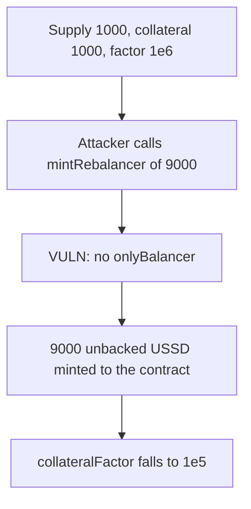

# USSD mintRebalancer — anyone can mint unbacked supply

> **Vulnerability classes:** vuln/access-control/missing-modifier · vuln/logic/state-update · vuln/logic/missing-check

<!-- non-defihacklabs -->
<!-- source-auditvault: https://github.com/Auditware/AuditVault/blob/main/findings/19137-h-8-lack-of-access-control-for-mintrebalancer-and-burnrebala.md -->
<!-- date: 2023-05 -->

## Key info

| | |
|---|---|
| **Protocol** | USSD (Autonomous Secure Dollar) |
| **Finding** | Sherlock 2023-05 H-8, AuditVault 19137 |
| **Vulnerable code** | `USSD.mintRebalancer` / `USSD.burnRebalancer` |
| **Harm** | 9,000 unbacked USSD minted; collateral factor falls from 1.0 to 0.1 |
| **Chain** | local synthetic |

## TL;DR

`mintRebalancer` and `burnRebalancer` are public. They were supposed to be `onlyBalancer`. An unprivileged caller mints 9,000 USSD onto the token contract against 1,000 of existing collateral. `collateralFactor()` is `assets * 1e6 / totalSupply`, so the peg reading falls from `1e6` to `1e5`. The same missing check lets anyone burn the contract's USSD inventory.

## The vulnerable code

```solidity
function mintRebalancer(uint256 amount) public {
    // @> VULN: no onlyBalancer — any caller mints unbacked USSD onto this contract.
    token.mint(address(this), amount);
}

function burnRebalancer(uint256 amount) public {
    // @> VULN: no onlyBalancer — any caller burns the protocol's USSD inventory.
    token.burn(address(this), amount);
}
```

The audited functions are `_mint(address(this), amount)` and `_burn(address(this), amount)` with no modifier. This reduction keeps that effect on a minimal ERC-20.

## Root cause

The rebalancer is the only component that should change USSD supply when it defends the peg. Without `onlyBalancer`, supply is a public input. `collateralFactor` divides by `totalSupply`, so every extra token makes the protocol look less collateralized and makes the rebalancer's next trade the wrong size. Minting `type(uint256).max - totalSupply()` also bricks every later mint; this PoC uses a 9x inflation so the factor change is exact.

## Preconditions

USSD has a non-zero supply and a recorded collateral balance. No role, signature, or token approval is required.

## Attack walkthrough

1. Supply is 1,000 and collateral is 1,000, so `collateralFactor` is `1e6`.
2. The attacker calls `mintRebalancer(9000e18)`.
3. The token contract's USSD balance rises by 9,000 and total supply becomes 10,000.
4. `collateralFactor` is now `1e5`.

The control adds `onlyBalancer`. The same call from a non-balancer reverts and the factor stays `1e6`.

## Diagrams



## Impact

Unbacked supply is created by anyone. The collateral factor the rebalancer uses to decide how much USSD to mint or burn is wrong by 10x in this case, and the same entry point can burn the protocol's own USSD inventory.

## Remediation

Restrict both functions with `onlyBalancer`.

## How to reproduce

```bash
cd 19137-h-8-lack-of-access-control-for-mintrebalancer-and-burnrebala_exp
forge test -vv
```

## Sources

- AuditVault finding: https://github.com/Auditware/AuditVault/blob/main/findings/19137-h-8-lack-of-access-control-for-mintrebalancer-and-burnrebala.md
- Sherlock contest: https://github.com/sherlock-audit/2023-05-USSD-judging/issues/777
- Audited functions: https://github.com/sherlock-audit/2023-05-USSD/blob/main/ussd-contracts/contracts/USSD.sol
