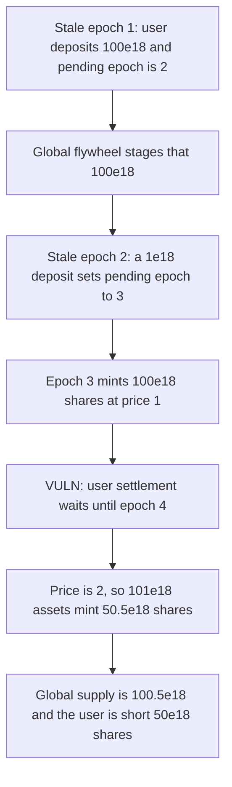

# Perennial BalancedVault — a second stale deposit pushes settlement one epoch later

> **Vulnerability classes:** vuln/logic/state-update

<!-- non-defihacklabs -->
<!-- source-auditvault: https://github.com/Auditware/AuditVault/blob/main/findings/19152-h-1-balancedvaultsol-loss-of-funds-global-settlement-flywhee.md -->
<!-- date: 2023-05 -->

## Key info

| | |
|---|---|
| **Protocol** | Perennial BalancedVault |
| **Finding** | Sherlock 2023-05 H-1, AuditVault 19152 |
| **Vulnerable code** | `deposit` writes `_pendingEpochs[account] = epoch + 1` on every stale deposit |
| **Harm** | The user is short 50e18 shares against the global mint |
| **Chain** | local synthetic (audited pending-epoch write) |

## TL;DR

While an epoch is stale, a deposit is queued and `_pendingEpochs[account]` is set to `epoch + 1`. The global flywheel promotes that queue on the next epoch and mints it on the epoch after that. The user flywheel mints only once `epoch > _pendingEpochs[account]`.

A second stale deposit overwrites `_pendingEpochs`. The global side still mints the original assets at the earlier price. The user side waits one more epoch. Here the price goes from 1 to 2. Global supply becomes 100.5e18. The user receives 50.5e18. The gap is 50e18 shares.

The control does not move an existing pending epoch later. The same calls mint the user 101e18 shares at the epoch-3 price.

## The vulnerable code

Every stale deposit, including a second one for the same account, stores a new epoch.

```solidity
// @> VULN: a later stale deposit overwrites _pendingEpochs and pushes user settlement past the global mint.
lastPushed = scheduled;
_pendingEpochs[account] = scheduled;
```

`scheduled` is `epoch + 1`. The user is settled only when the current epoch is strictly greater:

```solidity
if (_pendingEpochs[account] != 0 && epoch > _pendingEpochs[account]) {
    _balanceOf[account] += _toShares(_pendingDeposits[account], price);
}
```

## Root cause

One epoch number stands for every pending deposit of the account. A later deposit replaces it. The global queue is not keyed by that number, so it still converts the original assets on the original schedule. Share price is read at settlement time. A higher price mints fewer shares for the same assets.

## Preconditions

The epoch is stale both times `deposit` is called, and anyone may deposit for the account. The first deposit is 100e18 in epoch 1. The second is 1e18 in epoch 2. Price is 1 through epoch 3 and 2 at epoch 4. Epoch changes are `settleGlobal` calls. No timestamp warp is required.

## Attack walkthrough

1. Epoch 1 is stale. The user deposits 100e18. `_pendingEpochs` is 2.
2. `settleGlobal` enters epoch 2 and stages that 100e18 for the next global mint.
3. Epoch 2 is stale. A 1e18 deposit for the same account sets `_pendingEpochs` to 3.
4. `settleGlobal` enters epoch 3 and mints 100e18 shares at price 1. The user is not settled, because 3 is not greater than 3.
5. `settleGlobal` enters epoch 4. Price is 2. The 1e18 dust mints 0.5e18 shares. Supply is 100.5e18.
6. The user settles. 101e18 assets at price 2 mint 50.5e18 shares.
7. Supply minus the user balance is 50e18. On the fixed vault the second deposit leaves the epoch at 2, and the user is minted 101e18 shares at price 1.

## Diagrams



## Impact

The user receives 50.5e18 shares for assets the global flywheel turned into 100.5e18 shares. The difference is 50e18 shares with no holder. Later deposits and redemptions price against a total supply that is larger than the sum of balances.

## Remediation

Do not replace `_pendingEpochs[account]` with a later epoch when a pending deposit already exists. Keep the original epoch, or queue each deposit separately so a new one cannot delay an old one.

## How to reproduce

```bash
cd 19152-h-1-balancedvaultsol-loss-of-funds-global-settlement-flywhee_exp
forge test -vv
```

`test_pushed_epoch_shorts_the_user_50e18_shares` asserts the 50e18 gap. `test_control_keeps_the_epoch_and_mints_fair_shares` asserts the user receives 101e18 shares at the epoch-3 price.

## Sources

- AuditVault finding: https://github.com/Auditware/AuditVault/blob/main/findings/19152-h-1-balancedvaultsol-loss-of-funds-global-settlement-flywhee.md
- Sherlock issue: https://github.com/sherlock-audit/2023-05-perennial-judging/issues/45
- Audited deposit: https://github.com/sherlock-audit/2023-05-perennial/blob/main/perennial-mono/packages/perennial-vaults/contracts/balanced/BalancedVault.sol
