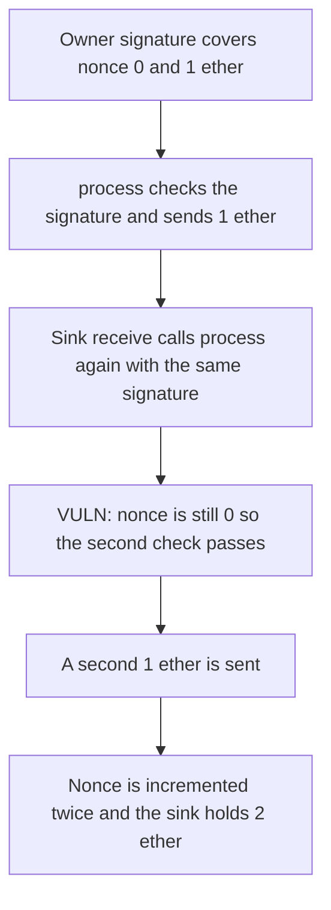

# BLS Wallet — one signature pays twice because the nonce moves too late

> **Vulnerability classes:** vuln/reentrancy/single-function · vuln/auth/signature-replay

<!-- non-defihacklabs -->
<!-- source-auditvault: https://github.com/Auditware/AuditVault/blob/main/findings/19279-operations-are-vulnerable-to-signature-replay-via-reentrancy.md -->
<!-- date: 2022-07 -->

## Key info

| | |
|---|---|
| **Protocol** | BLS Wallet |
| **Finding** | Sigma Prime, AuditVault 19279 |
| **Vulnerable code** | `process` increments `nonce` after the value call |
| **Harm** | One signature that authorizes 1 ether pays 2 ether |
| **Chain** | local synthetic (precomputed ECDSA signature) |

## TL;DR

A wallet operation is authorized by a signature over `(nonce, value)`. The nonce is checked, the call sends ether, and only then is the nonce incremented. The recipient is a contract. Its `receive` calls `process` again with the same signature before that increment.

The wallet is funded with 2 ether. The signature authorizes 1 ether at nonce 0. The nested call still sees nonce 0, so it pays another 1 ether. The sink holds 2 ether and the nonce ends at 2.

The control increments the nonce before the call. The nested `process` fails the signature check. The sink holds 1 ether and 1 ether stays in the wallet.

## The vulnerable code

The signature is checked against the current nonce. The payment happens next. The nonce write is last.

```solidity
require(recover(value, nonce, v, r, s) == OWNER, "sig");
(bool ok,) = to.call{value: value}("");
require(ok, "call");
// @> VULN: the nonce is incremented after the call, so a reentering process still sees the signed nonce.
uint256 bumped = nonce + 1;
nonce = bumped;
```

The sink replays once:

```solidity
if (!replayed) {
    replayed = true;
    try gateway.process(to, value, v, r, s) {} catch {}
}
```

## Root cause

The nonce is the replay lock, and it is updated after an untrusted call. A recipient that reenters observes the nonce the signature was made for. The check passes again. Moving the increment above the call invalidates the signature for every nested `process`.

## Preconditions

The signer key is known to this reproduction and the signature was produced offline with `cast wallet sign` over `keccak256(abi.encode(nonce, value))`, then the Ethereum signed-message prefix. The wallet holds 2 ether. The operation sends 1 ether to a contract that reenters exactly once. No aggregator or mempool is required.

## Attack walkthrough

1. The exploit funds the gateway with 2 ether and arms the sink with the precomputed signature for nonce 0 and 1 ether.
2. `ecrecover` of that signature is the owner.
3. `process` checks the signature at nonce 0 and sends 1 ether to the sink.
4. `receive` sets `replayed` and calls `process` again with the same signature.
5. The inner call still sees nonce 0, so it sends another 1 ether.
6. Both calls then increment the nonce. It ends at 2. The sink's balance rose by 2 ether.
7. On the fixed gateway the nonce becomes 1 before the call. The inner signature check fails. The sink receives 1 ether.

## Diagrams



## Impact

A signature that authorizes a 1 ether payment pays 2 ether. The wallet that was funded with 2 ether is left empty. Repeating the reentry would keep paying until the wallet balance is below the operation value.

## Remediation

Increment the nonce after the signature check and before the external call. Nested `process` calls then see the next nonce and the original signature no longer verifies.

## How to reproduce

```bash
cd 19279-operations-are-vulnerable-to-signature-replay-via-reentrancy_exp
forge test -vv
```

`test_one_signature_pays_twice` asserts the sink receives 2 ether. `test_control_nonce_before_call_pays_once` asserts the nested call is rejected and the sink receives 1 ether.

## Sources

- AuditVault finding: https://github.com/Auditware/AuditVault/blob/main/findings/19279-operations-are-vulnerable-to-signature-replay-via-reentrancy.md
- Sigma Prime report: https://github.com/sigp/public-audits/blob/master/reports/bls-wallet/review.pdf
- Review index: https://github.com/sigp/public-audits (BLS Wallet, July 2022, commit ce7f958)
