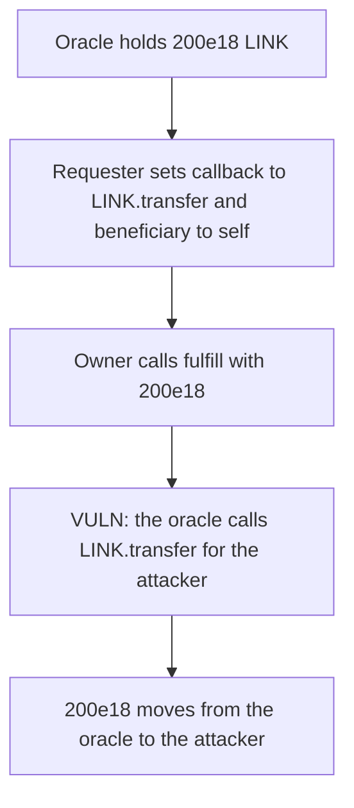

# Chainlink Oracle — a crafted request makes fulfill transfer the oracle's LINK

> **Vulnerability classes:** vuln/dependency/unsafe-external-call

<!-- non-defihacklabs -->
<!-- source-auditvault: https://github.com/Auditware/AuditVault/blob/main/findings/19293-users-can-form-malicious-requests-to-steal-tokens-from-oracl.md -->
<!-- date: 2019-06 -->

## Key info

| | |
|---|---|
| **Protocol** | Chainlink |
| **Finding** | Sigma Prime, AuditVault 19293 |
| **Vulnerable code** | `Oracle.fulfill` calls the requester-chosen address and selector |
| **Harm** | 200e18 LINK moves from the oracle to the requester |
| **Chain** | local synthetic (audited callback call) |

## TL;DR

`fulfill` performs `callback.addr.call(functionId, beneficiary, data)`. The requester chooses all three. Setting the address to the LINK token and the selector to `transfer(address,uint256)` turns a fulfillment of 200e18 into `LINK.transfer(attacker, 200e18)` with the oracle as `msg.sender`.

The oracle is minted 200e18. After `fulfill`, the attacker holds 200e18 and the oracle holds 0.

The control rejects a request whose callback is the LINK token. The request never lands and the oracle still holds 200e18.

## The vulnerable code

```solidity
function fulfill(uint256 data) external {
    // @> VULN: fulfill calls the requester-chosen address and selector, so a LINK.transfer drains the oracle.
    (bool ok,) = callback.call(abi.encodeWithSelector(functionId, beneficiary, data));
    require(ok, "callback");
}
```

`request` stores `callback`, `functionId`, and `beneficiary` with no check against the token.

## Root cause

The fulfillment call is an arbitrary call built from user input, executed by the oracle. `transfer` spends the caller's balance. The caller is the oracle, so the oracle's LINK is the balance that moves. `_data` from the oracle is the amount.

## Preconditions

The oracle holds at least as much LINK as the fulfilled value. Anyone may submit a request. The oracle owner fulfills it. Here the value is 200e18 and the beneficiary is the requester.

## Attack walkthrough

1. The oracle is minted 200e18 LINK.
2. The attacker requests a callback to the LINK token, selector `transfer`, beneficiary themselves.
3. `fulfill(200e18)` encodes that call and executes it.
4. `transfer` debits the oracle and credits the attacker 200e18.
5. The attacker holds 200e18. The oracle holds 0.
6. On the fixed oracle the same request reverts because the callback is the LINK token. The balance stays 200e18.

## Diagrams



## Impact

200e18 LINK that belonged to the oracle is transferred to the attacker. The same shape works for any token or two-argument function the oracle is authorized to call.

## Remediation

Do not let a requester choose an arbitrary callback address. Reject the LINK token, or only call the contract that created the request.

## How to reproduce

```bash
cd 19293-users-can-form-malicious-requests-to-steal-tokens-from-oracl_exp
forge test -vv
```

`test_crafted_request_pulls_200e18_from_the_oracle` asserts the 200e18 move. `test_control_rejects_link_callback` asserts the request reverts and the oracle keeps 200e18.

## Sources

- AuditVault finding: https://github.com/Auditware/AuditVault/blob/main/findings/19293-users-can-form-malicious-requests-to-steal-tokens-from-oracl.md
- Sigma Prime report: https://github.com/sigp/public-audits/blob/master/chainlink/chainlink-1/review.pdf
