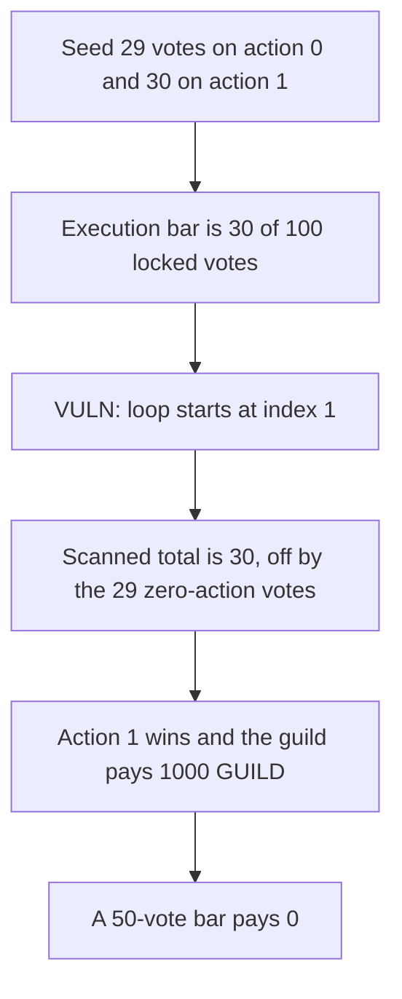

# DXdao ERC20Guild — the tally skips the zero action and pays 1000 GUILD

> **Vulnerability classes:** vuln/governance/proposal-manipulation · vuln/logic/wrong-condition · vuln/logic/incorrect-state-transition

<!-- non-defihacklabs -->
<!-- source-auditvault: https://github.com/Auditware/AuditVault/blob/main/findings/19343-voting-tally-does-not-count-the-zero-action-sigmaprime-none.md -->
<!-- date: 2023-07 -->

## Key info

| | |
|---|---|
| **Protocol** | DXdao ERC20Guild |
| **Finding** | Sigma Prime ERC20Guild review, AuditVault 19343 |
| **Vulnerable code** | `ERC20Guild.endProposal` vote loop |
| **Harm** | 1000 GUILD is paid to action 1. The scanned total is 30, off by the 29 zero-action votes. That total is also 20 short of a 50-vote majority |
| **Chain** | local synthetic (audited Ethereum contracts) |

## TL;DR

`endProposal` chooses a winner by scanning `totalVotes` from index 1. Index 0 is the "no action" reject option. The loop never adds those ballots to the scanned total. `setConfig` also never requires the execution threshold to be at least 50 percent of locked voting power, which is the assumption the default winner of 0 depends on.

In this reduction, locked power is 100 and the threshold is 30. Action 0 has 29 votes and action 1 has 30. The scanned total is 30, which is off by 29 from the full total of 59. Action 1 clears the 30-vote bar and beats action 0, so the guild pays 1000 GUILD. The same votes against a 50-vote bar, which the fixed `setConfig` is the only value it will store, leave the winner at 0 and pay nothing. The deciding total of 30 is short of that bar by 20, and that gap flips the payout.

## The vulnerable code

The loop is the audited code. The comment in the report says action 0 is "no action".

```solidity
uint256 winning = 0;
uint256 i = 1;
// @> VULN: tally starts at i = 1, so the zero action is never scanned
for (i = 1; i < proposals[proposalId].totalVotes.length; i++) {
    scanned += proposals[proposalId].totalVotes[i];
    if (
        proposals[proposalId].totalVotes[i] >= getVotingPowerForProposalExecution() &&
        proposals[proposalId].totalVotes[i] > proposals[proposalId].totalVotes[winning]
    ) winning = i;
}
```

The fix the report gives for `setConfig`, which the control runs:

```solidity
require(percent >= 50, "required assumption by endProposal default voting tally");
```

## Root cause

The tally treats action 0 as a default rather than as a ballot total it has to scan. With an execution threshold below half of `totalLocked`, an action can clear the bar without a majority of voting power. Here the bar is `100 * 30 / 100 = 30`. Action 1 has exactly 30, which is greater than action 0's 29, so it wins. The 29 reject votes are the amount the scanned total is short: `30 + 29 = 59`.

## Preconditions

The guild's execution percent is 30, below the 50 the report says `endProposal` assumes. The proposal has already ended. Action 0 has 29 votes and action 1 has 30. The guild holds 1000 GUILD, which action 1 is allowed to pay out. No caller privilege is required to end a proposal.

## Attack walkthrough

1. Seed action 0 with 29 and action 1 with 30.
2. `endProposal` starts the loop at index 1. The scanned total becomes 30.
3. 30 meets the execution bar and is greater than 29, so the winner is action 1.
4. The guild transfers 1000 GUILD to the payout sink.
5. The winning total is 20 short of the 50-vote majority bar. The control with that bar pays 0.

## Diagrams



## Impact

The sink receives 1000 GUILD that a majority of the 100 locked votes did not approve. The scanned vote total is 30 instead of 59, off by the 29 zero-action votes. Those 30 votes are also 20 short of the 50-vote majority the fixed configuration enforces, and that 20-vote gap is what changes the payout from 0 to 1000 GUILD.

## Remediation

Require `_votingPowerForProposalExecution >= 50` in `setConfig`, or tally from index 0 and keep a winner only when its votes are a majority of locked power. Sigma Prime records the fix on PR 192.

## Sources

- AuditVault finding: https://github.com/Auditware/AuditVault/blob/main/findings/19343-voting-tally-does-not-count-the-zero-action-sigmaprime-none.md
- Sigma Prime report: https://github.com/sigp/public-audits/blob/master/reports/dxdao/erc20-guild/review.pdf
- Audited commit: `DXgovernance/dxdao-contracts` `54410e2` (tag v1.0.0)
