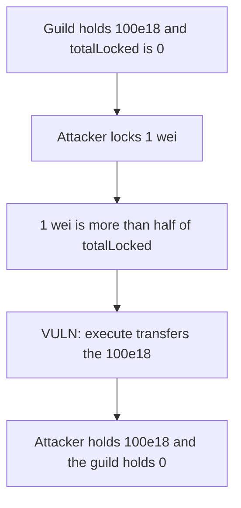

# DXdao guild — one wei of lock spends the treasury

> **Vulnerability classes:** vuln/governance/proposal-manipulation

<!-- non-defihacklabs -->
<!-- source-auditvault: https://github.com/Auditware/AuditVault/blob/main/findings/19345-low-totallocked-may-result-in-guild-takeover-sigmaprime-none.md -->
<!-- date: 2022-09 -->

## Key info

| | |
|---|---|
| **Protocol** | DXdao ERC20Guild |
| **Finding** | Sigma Prime, AuditVault 19345 |
| **Vulnerable code** | Execution compares the caller's lock with totalLocked and has no floor |
| **Harm** | A 1 wei lock transfers the guild's 100e18 |
| **Chain** | local synthetic |

## TL;DR

Executing a proposal requires the caller's lock to be more than half of `totalLocked`. There is no minimum on `totalLocked`. The attacker locks 1 wei and is the only locker, so that 1 wei is the entire electorate. `execute` transfers the guild's 100e18 to the attacker.

The control requires `totalLocked` of at least 1000e18. The same 1 wei lock reverts and the 100e18 stays in the guild.

## The vulnerable code

```solidity
require(locked[msg.sender] * 2 > totalLocked, "majority");
// @> VULN: execution has no minimum totalLocked, so 1 wei of lock spends the treasury.
asset.transfer(to, amount);
```

## Root cause

Majority is a fraction of whatever is currently locked. When that base is 1 wei, 1 wei is a majority. The transfer does not ask whether the locked base is large enough to represent the guild.

## Preconditions

The guild holds 100e18. Nobody else has a lock, or `totalLocked` has fallen to dust. The attacker locks 1 wei. No admin key is required.

## Attack walkthrough

1. The guild treasury is 100e18.
2. The attacker locks 1 wei. `totalLocked` is 1.
3. `1 * 2 > 1` is true, so the majority check passes.
4. `execute` transfers 100e18 to the attacker.
5. The guild balance is 0.
6. On the fixed guild the same call reverts because `totalLocked` is below 1000e18. The treasury stays 100e18.

## Diagrams



## Impact

The attacker receives 100e18 from the guild after locking 1 wei. Any later proposal the same majority can pass will move whatever the guild still holds.

## Remediation

Require `totalLocked` to be at least a configured minimum before a proposal can be created or executed. A 1 wei lock must not be a majority of a dust base.

## How to reproduce

```bash
cd 19345-low-totallocked-may-result-in-guild-takeover-sigmaprime-none_exp
forge test -vv
```

`test_one_wei_lock_moves_100e18` asserts the 100e18 transfer. `test_control_requires_1000e18_locked` asserts the transfer reverts.

## Sources

- AuditVault finding: https://github.com/Auditware/AuditVault/blob/main/findings/19345-low-totallocked-may-result-in-guild-takeover-sigmaprime-none.md
- Sigma Prime report: https://github.com/sigp/public-audits/blob/master/dxdao/erc20-guild/review.pdf
