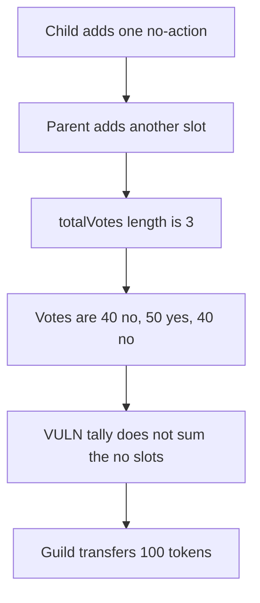

# DXdao: split no-votes let a 50-vote action take a 100 token treasury

> **Vulnerability classes:** `vuln/logic/missing-check`

<!-- non-defihacklabs -->
<!-- source-auditvault: https://github.com/Auditware/AuditVault/blob/main/findings/19346-duplicate-actions-unaccounted-for-during-voting-tally-sigmap.md -->
<!-- date: 2022-06 -->

## Key info

| Field | Value |
|---|---|
| **Loss** | Guild treasury of 100 tokens is transferred. Combined no votes were 80 against a yes of 50 |
| **Vulnerable contract** | `EnforcedBinaryGuild.createProposal` |
| **Attacker EOA** | `0x1111111111111111111111111111111111111111` |
| **Attack contract** | `Exploit` |
| **Attack tx** | `Exploit.run()` |
| **Chain / block / date** | Ethereum model · block 0 · 2022-06 |
| **Compiler** | solc 0.8.27, cancun, via IR |
| **Bug class** | Two no-action slots are tallied separately |

## TL;DR

`EnforcedBinaryGuild.createProposal` does `totalActions.add(1)` for the enforced no-vote, then `BaseERC20Guild` does `totalActions.add(1)` again because action 0 is already no. `totalVotes` has length 3. A 50-vote yes beats 40 and 40 on the two no slots, and the guild calls `transfer` of its 100 token balance. Summing the no slots would be 80 and the proposal would be rejected.

## The vulnerable code

```solidity
uint256 totalActions = 1;
totalActions = totalActions.add(1); // @> VULN: child adds a no-action the parent already adds
p.totalVotes = new uint256[](totalActions.add(1));
```

The parent line is the baseline. The child line is the duplicate. `endProposal` selects the maximum slot and does not add index 0 to the last index.

## Root cause

The no-action is inserted twice, once in the child and once in the parent, and the tally never reconciles those two indexes.

## Preconditions

- The proposal has one real action: transfer 100 tokens from the guild to the proposer.
- Votes are 40 on slot 0, 50 on slot 1, and 40 on slot 2.
- The guild holds 100 tokens.

## Attack walkthrough

1. Create the proposal. `totalVotes.length` is 3.
2. Cast the split no votes and the yes vote.
3. `endProposal` selects slot 1.
4. The guild calls `transfer` and its balance becomes 0.
5. The control creates a proposal without the extra add, puts 80 on the single no slot and 50 on yes, and `endProposal` reverts with `rejected`.

## Diagrams



## Impact

A proposal passes even though more weight voted no than yes, whenever the no weight is split across the two reject slots. Here that transfers the guild's entire 100 token treasury to the proposer. The contracts were later removed, which is the resolution recorded in the review.

## Remediation

Add the extra no-action in only one contract. If both slots remain, `endProposal` must sum index 0 and the last index before it picks a winner.

## How to reproduce

```bash
cd 19346-duplicate-actions-unaccounted-for-during-voting-tally-sigmap_exp
forge test -vv
```

Captured output is `output.txt`.

## Sources

- AuditVault finding: https://github.com/Auditware/AuditVault/blob/main/findings/19346-duplicate-actions-unaccounted-for-during-voting-tally-sigmap.md
- Sigma Prime DXdao ERC20 guild review: https://github.com/sigp/public-audits/blob/master/dxdao/erc20-guild/review.pdf
- Taxonomy on the finding: genome duplicate-mutable-accounts, variant, role-bypass, account-ownership, pda-derivation. Tags severity/high, sector/governance, sector/token, platform/sigmaprime, vuln/pda/duplicate-mutable-accounts. The pda labels are the finding's stored tags. The mechanism is the duplicate no-action slot in the guild tally.

