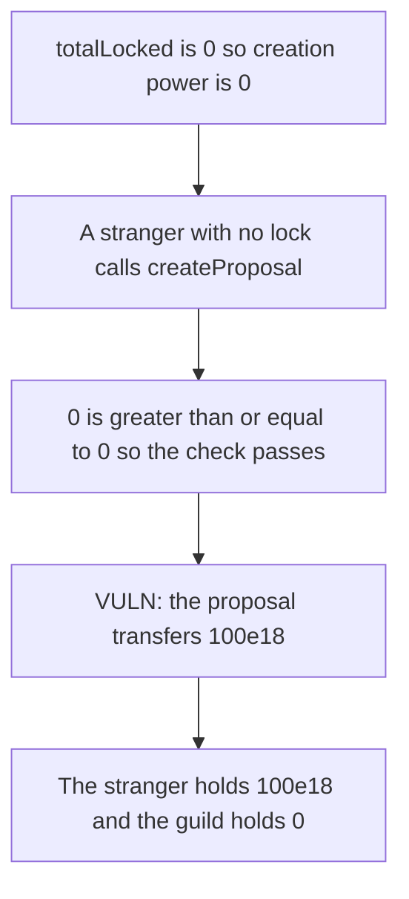

# DXdao guild — zero totalLocked lets a stranger pass a paying proposal

> **Vulnerability classes:** vuln/governance/proposal-manipulation

<!-- non-defihacklabs -->
<!-- source-auditvault: https://github.com/Auditware/AuditVault/blob/main/findings/19347-zero-totallocked-allows-everyone-to-create-proposals-sigmapr.md -->
<!-- date: 2022-09 -->

## Key info

| | |
|---|---|
| **Protocol** | DXdao ERC20Guild |
| **Finding** | Sigma Prime, AuditVault 19347 |
| **Vulnerable code** | `getVotingPowerForProposalCreation` is `totalLocked / 100` |
| **Harm** | A stranger with no lock passes a proposal that pays 100e18 |
| **Chain** | local synthetic |

## TL;DR

Creation power is `totalLocked / 100`. With nothing locked that value is 0. A stranger whose own lock is also 0 passes `locked >= power` and `createProposal` transfers the guild's 100e18.

The control requires the caller to hold a lock of at least 1 ether and `totalLocked` of at least 1 ether. The stranger is rejected and the 100e18 stays.

## The vulnerable code

```solidity
function getVotingPowerForProposalCreation() public view returns (uint256) {
    return totalLocked / 100;
}

require(locked[msg.sender] >= getVotingPowerForProposalCreation(), "create");
// @> VULN: creation power is zero when nothing is locked, so this pay runs for a stranger.
asset.transfer(to, amount);
```

## Root cause

The minimum is a percentage of the current locked base. A zero base produces a zero minimum. The comparison `0 >= 0` succeeds, so the proposal pays out.

## Preconditions

`totalLocked` is 0. The caller has no lock. The guild holds 100e18. No role is required.

## Attack walkthrough

1. The guild is funded with 100e18. `totalLocked` is 0.
2. Creation power reads as 0.
3. The stranger's lock is 0, which meets that power.
4. `createProposal` transfers 100e18 to the stranger.
5. On the fixed guild the same call reverts because the caller has no 1 ether lock. The guild still holds 100e18.

## Diagrams



## Impact

A stranger who never locked tokens receives 100e18 from the guild. Every later call with the same zero base can pay again until the guild is empty.

## Remediation

Floor the creation power at a non-zero lock. `totalLocked == 0` must not make `0 >= 0` a passing check.

## How to reproduce

```bash
cd 19347-zero-totallocked-allows-everyone-to-create-proposals-sigmapr_exp
forge test -vv
```

`test_zero_lock_pays_the_stranger_100e18` asserts the 100e18 payment. `test_control_requires_a_lock` asserts the call reverts.

## Sources

- AuditVault finding: https://github.com/Auditware/AuditVault/blob/main/findings/19347-zero-totallocked-allows-everyone-to-create-proposals-sigmapr.md
- Sigma Prime report: https://github.com/sigp/public-audits/blob/master/dxdao/erc20-guild/review.pdf
