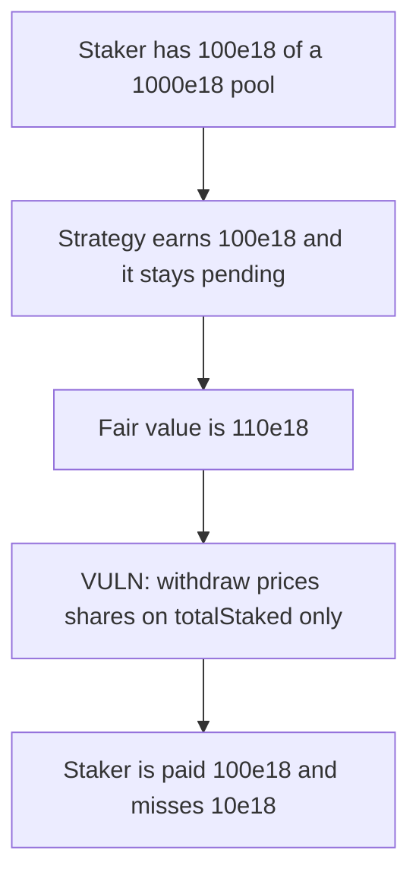

# Linkpool staking — withdraw pays 100e18 when the fair amount is 110e18

> **Vulnerability classes:** vuln/logic/reward-calculation

<!-- non-defihacklabs -->
<!-- source-auditvault: https://github.com/Auditware/AuditVault/blob/main/findings/19489-staker-potentially-missing-out-on-rewards-or-losses-sigmapri.md -->
<!-- date: 2022-02 -->

## Key info

| | |
|---|---|
| **Protocol** | Linkpool |
| **Finding** | Sigma Prime, AuditVault 19489 |
| **Vulnerable code** | `withdraw` prices shares with `totalStaked` and ignores `pendingReward` |
| **Harm** | The staker is paid 100e18 instead of the fair 110e18 |
| **Chain** | local synthetic |

## TL;DR

A staker's assets are `shares * totalStaked / totalShares`. Strategy profit sits in `pendingReward` until `updateStrategyRewards` adds it to `totalStaked`. `withdraw` does not call that update.

The staker has 100e18 of a 1000e18 pool, 10 percent. The strategy has earned 100e18. Fair value is 110e18. `withdraw` pays 100e18. The missing reward is 10e18, and `pendingReward` is still 100e18.

The control calls `updateStrategyRewards` first. The same staker is paid 110e18.

## The vulnerable code

```solidity
uint256 assets = sharesOf[who] * totalStaked / totalShares;
// @> VULN: the payout uses totalStaked and skips pendingReward, so the staker misses the strategy gain.
asset.transfer(who, assets);
```

Fair value uses the pending reward:

```solidity
return sharesOf[who] * (totalStaked + pendingReward) / totalShares;
```

## Root cause

`totalStaked` is the last folded-in base, not the strategy's current balance. Profit that has not been copied into `totalStaked` is invisible to `withdraw`, so the staker is paid as if the gain did not exist.

## Preconditions

The staker has 100 shares of 1000. `pendingReward` is 100e18 and `updateStrategyRewards` has not been called. No keeper is required. The staker withdraws directly.

## Attack walkthrough

1. Other stakers deposit 900e18. This staker deposits 100e18. Shares are 100 of 1000.
2. The strategy earns 100e18. It is recorded as `pendingReward` and is not added to `totalStaked`.
3. Fair assets are `100 * 1100 / 1000 = 110e18`.
4. `withdraw` computes `100 * 1000 / 1000 = 100e18` and transfers that.
5. Paid is 100e18. Fair minus paid is 10e18. `pendingReward` is still 100e18.
6. On the fixed pool the withdraw updates rewards first and pays 110e18.

## Diagrams



## Impact

The staker is paid 100e18 instead of 110e18. The 10e18 reward stays in the pool and is not credited to this withdrawal. Whoever withdraws after a later update takes a share of profit this staker already should have received.

## Remediation

Call `updateStrategyRewards` before pricing a withdrawal, so `totalStaked` includes the pending gain.

## How to reproduce

```bash
cd 19489-staker-potentially-missing-out-on-rewards-or-losses-sigmapri_exp
forge test -vv
```

`test_withdraw_pays_100e18_instead_of_110e18` asserts paid 100e18 and fair 110e18. `test_control_updates_rewards_and_pays_110e18` asserts the fixed withdraw pays 110e18.

## Sources

- AuditVault finding: https://github.com/Auditware/AuditVault/blob/main/findings/19489-staker-potentially-missing-out-on-rewards-or-losses-sigmapri.md
- Sigma Prime report: https://github.com/sigp/public-audits/blob/master/linkpool/linkpool-2/review.pdf
