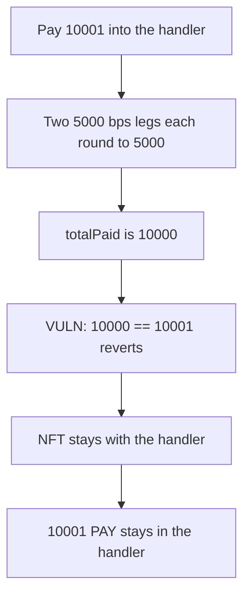

# Satori royalties — a 10001 purchase reverts and the NFT stays put

> **Vulnerability classes:** vuln/logic/wrong-condition · vuln/arithmetic/rounding · vuln/dos/frozen-funds

<!-- non-defihacklabs -->
<!-- source-auditvault: https://github.com/Auditware/AuditVault/blob/main/findings/19564-strict-equality-causes-token-purchase-failure-sigmaprime-non.md -->
<!-- date: 2023-06 -->

## Key info

| | |
|---|---|
| **Protocol** | Satori Sports token royalties |
| **Finding** | Sigma Prime, AuditVault 19564 |
| **Vulnerable code** | `TokenRoyaltiesHandler.purchased` |
| **Harm** | 10001 PAY stays in the handler and token 1 is not delivered |
| **Chain** | local synthetic |

## TL;DR

`purchased` splits `purchaseCost` across royalty receivers with `bps * cost / 10000`, then requires the sum to equal `purchaseCost` exactly. Two 5000 bps legs of a 10001 cost each round down to 5000. The sum is 10000, the equality reverts, and the NFT transfer never runs. The 10001 payment remains in the handler. The control uses `purchaseCost >= totalPaid`, delivers the NFT, and pays 5000 to each receiver, leaving 1 unit of rounding dust.

## The vulnerable code

```solidity
uint256 owed = bps[i] * purchaseCost / 10000;
paid += owed;
royalties.recordRoyalties(entities[i], owed);
// @> VULN: rounded legs sum to 10000, so == 10001 reverts and the NFT is not delivered
require(paid == purchaseCost, "Royalties payment not calculated correctly");
```

The control replaces the check with `require(purchaseCost >= paid)`.

## Root cause

Integer division rounds each royalty leg down. The legs are not required to sum back to the payment, but the function demands that they do. Any cost that is not a multiple of the basis-point denominator fails the purchase after the payment has already been taken into the handler.

## Preconditions

The royalty configuration is two entities at 5000 bps each. The purchase cost is 10001. The payment sits in the handler and the NFT is still owned by the handler. No special role is required.

## Attack walkthrough

1. 10001 PAY is minted into the handler.
2. `purchased(1, 10001)` computes 5000 and 5000.
3. `require(10000 == 10001)` reverts.
4. The NFT owner is still the handler. The caught call leaves the 10001 in place.

## Diagrams



## Impact

The buyer paid 10001 and does not receive the NFT. Those 10001 units remain in the handler. The same purchase under `>=` delivers the NFT and pays 5000 to each royalty receiver.

## Remediation

Replace the strict equality with `require(purchaseCost >= totalPaid)`, as the report recommends. Satori fixed the split on commit `923c35b` by moving the basis-point division to the UI.

## Sources

- AuditVault finding: https://github.com/Auditware/AuditVault/blob/main/findings/19564-strict-equality-causes-token-purchase-failure-sigmaprime-non.md
- Sigma Prime report: https://github.com/sigp/public-audits/blob/master/reports/satori-sports/satori-sports-token-royalties/review.pdf
