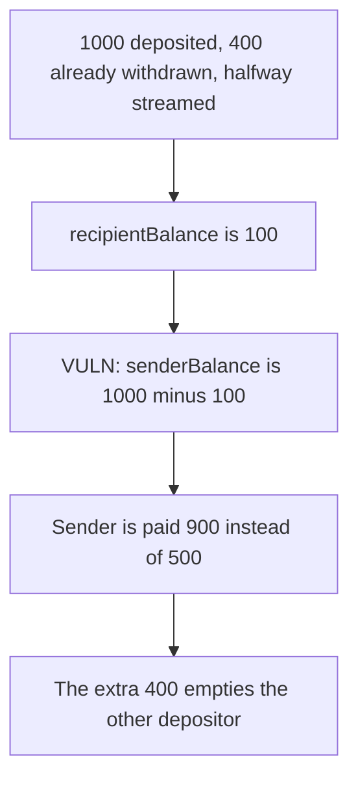

# Sushi Furo — cancelStream pays the sender 400 shares that already left

> **Vulnerability classes:** vuln/logic/reward-calculation · vuln/logic/incorrect-state-transition

<!-- non-defihacklabs -->
<!-- source-auditvault: https://github.com/Auditware/AuditVault/blob/main/findings/19584-miscalculation-of-amount-returnable-to-sender-sigmaprime-non.md -->
<!-- date: 2023-06 -->

## Key info

| | |
|---|---|
| **Protocol** | Sushi Furo streams |
| **Finding** | Sigma Prime, AuditVault 19584 |
| **Vulnerable code** | `FuroStream.cancelStream` sender balance |
| **Harm** | Sender is paid 900 instead of 500. The extra 400 is another depositor's shares |
| **Chain** | local synthetic |

## TL;DR

Halfway through a 1000-share stream, 500 shares have streamed and 400 were already withdrawn. `recipientBalance` is `500 - 400 = 100`. `senderBalance` is `1000 - 100 = 900`, because the withdrawn shares were subtracted twice, once inside the recipient balance and again by not adding them back only to the sender. The fair sender amount is 500. The extra 400 empties the contract, which also held another depositor's 400. The control subtracts the streamed amount and pays the sender 500, leaving 400 behind.

## The vulnerable code

```solidity
recipientBalance = ((depositedShares * timeDelta) / duration) - withdrawnShares;
// @> VULN: recipientBalance already subtracted withdrawnShares, so the sender is paid those shares again
uint256 senderBalance = depositedShares - recipientBalance;
```

The control uses `senderBalance = depositedShares - streamed`.

## Root cause

`recipientBalance` is the amount still payable, not the amount streamed. Subtracting it from the deposit returns the unstreamed shares plus everything already withdrawn. The contract does not hold those withdrawn shares anymore, so the overpayment is taken from other balances in the same contract.

## Preconditions

The stream started at timestamp 0 and ends at twice the current timestamp, so it is exactly halfway. Deposited shares are 1000e18, withdrawn shares are 400e18. The contract holds 1000e18, of which 400e18 belong to another depositor. No warp is used.

## Attack walkthrough

1. Open the stream and fund the contract with 1000e18.
2. `cancelStream` computes recipient 100e18 and sender 900e18.
3. Both are paid. The contract balance is 0.
4. The sender forwards the 400e18 overpayment. The other depositor's book is still 400e18 and the tokens are gone.

## Diagrams



## Impact

The sender receives 400e18 that had already been withdrawn. That 400e18 is the other depositor's balance. The control pays the sender 500e18 and the recipient 100e18 and leaves 400e18 in the contract.

## Remediation

Set `senderBalance` to `depositedShares - streamed`, where `streamed` does not subtract `withdrawnShares`. Sigma Prime records the fix in PR 16.

## Sources

- AuditVault finding: https://github.com/Auditware/AuditVault/blob/main/findings/19584-miscalculation-of-amount-returnable-to-sender-sigmaprime-non.md
- Sigma Prime report: https://github.com/sigp/public-audits/blob/master/reports/sushi/auction-maker-furo/review.pdf
- Audited commit: Sushi `a5d8d50`
