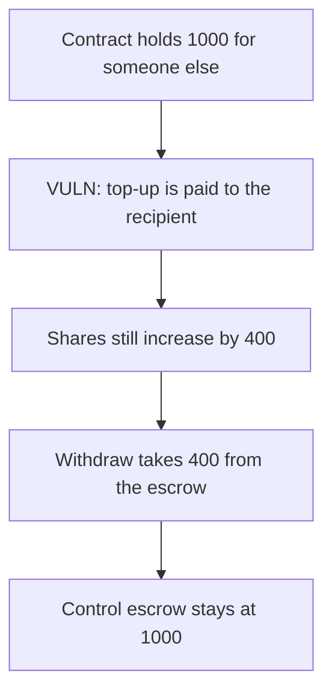

# FuroStream — a top-up is paid to the recipient and then withdrawn again

> **Vulnerability classes:** `vuln/logic/incorrect-state-transition` · `vuln/logic/missing-validation`

<!-- non-defihacklabs -->
<!-- source-auditvault: https://github.com/Auditware/AuditVault/blob/main/findings/19585-stream-updates-are-paid-directly-to-the-recipient-sigmaprime.md -->
<!-- date: 2022-05 -->

## Key info

| | |
|---|---|
| **Protocol** | Sushi FuroStream |
| **Finding** | Sigma Prime, AuditVault 19585 |
| **Vulnerable code** | `updateStream` deposits to `recipient` |
| **Harm** | The recipient withdraws 400 of another depositor's escrow. The control leaves that escrow at 1000. |
| **Chain** | local synthetic |

## TL;DR

`updateStream` sends the top-up tokens to the stream recipient and still adds the returned shares to the stream. The recipient already has the tokens. `withdraw` then pays those shares out of the contract, which is holding another depositor's balance. A 400 top-up moves 400 from that escrow to the recipient. Depositing the top-up to the stream contract, which is the fix, returns only the sender's own 400 and leaves the other 1000 in place.

## The vulnerable code

```solidity
depositedShares = _depositToken(
    stream.token,
    stream.sender,
    recipient, // should be address(this)
    topUpAmount,
    fromBentoBox
);
```

The deployed fix passes `address(this)`.

## Root cause

The deposit destination and the share accounting disagree. Shares are an obligation of the contract, but the tokens were delivered to the recipient.

## Preconditions

The stream contract already holds 1000 from another depositor. The caller is the stream recipient and tops up by 400. The top-up transfer is from the caller to the caller, so it does not increase their balance. The following withdraw does.

## Attack walkthrough

1. `updateStream(400)` calls `_depositToken` with the recipient.
2. The function still increases `depositedShares` by 400.
3. `withdraw` transfers 400 from the contract to the recipient.
4. The recipient's balance rises by 400. The contract is left holding 600 of the original 1000.
5. The control deposits the 400 into the contract and withdraws it back. The caller's balance is unchanged by that pair, and the other depositor's 1000 is intact.

## Diagrams



## Impact

The other depositor's escrow falls from 1000 to 600. The recipient gains 400 that the top-up never added to the contract. The control path does not touch that 1000.

## Remediation

Pass `address(this)` as the deposit recipient so the top-up tokens and the credited shares stay in the same place.

## How to reproduce

```bash
cd 19585-stream-updates-are-paid-directly-to-the-recipient-sigmaprime_exp
forge test -vv
```

## Sources

- AuditVault finding: https://github.com/Auditware/AuditVault/blob/main/findings/19585-stream-updates-are-paid-directly-to-the-recipient-sigmaprime.md
- Sigma Prime report: https://github.com/sigp/public-audits/blob/master/sushi/auction-maker-furo/review.pdf
- Fixed `updateStream` deposits to `address(this)`: https://etherscan.io/address/0x4ab2fc6e258a0ca7175d05ff10c5cf798a672cae#code
