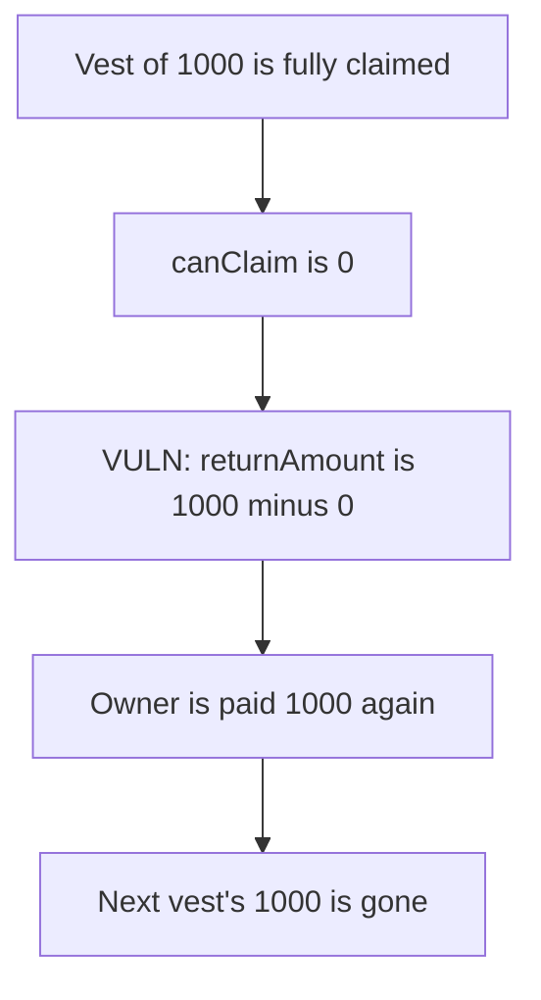

# Sushi Furo vesting — stopVesting pays the owner the 1000 already claimed

> **Vulnerability classes:** vuln/logic/reward-calculation · vuln/logic/incorrect-state-transition

<!-- non-defihacklabs -->
<!-- source-auditvault: https://github.com/Auditware/AuditVault/blob/main/findings/19587-miscalculation-of-the-returnable-amount-of-tokens-sigmaprime.md -->
<!-- date: 2023-06 -->

## Key info

| | |
|---|---|
| **Protocol** | Sushi Furo vesting |
| **Finding** | Sigma Prime, AuditVault 19587 |
| **Vulnerable code** | `Vesting.stopVesting` return amount |
| **Harm** | Owner is paid 1000 VEST that the recipient already claimed, taken from the next vest |
| **Chain** | local synthetic |

## TL;DR

This is `stopVesting`, not `cancelStream`. The schedule is 4 steps of 250, fully vested, and the recipient has claimed all 1000. `canClaim` is 0, so `returnAmount` is `1000 - 0`. The owner is paid the claimed tokens again. The 1000 comes out of the next vest's balance. The control subtracts `amountVested` instead of `canClaim` and returns 0, leaving the 1000 in the contract.

## The vulnerable code

```solidity
uint256 canClaim = _balanceOf(v) - v.claimed;
// @> VULN: canClaim is 0 after a full claim, so returnAmount is the whole schedule again
uint256 returnAmount = (v.cliffAmount + (v.steps * v.stepAmount)) - canClaim;
```

The control is `returnAmount = (cliffAmount + steps * stepAmount) - amountVested`.

## Root cause

`canClaim` is what the recipient could still take, not what has vested. Once the recipient has claimed everything, `canClaim` is 0 and subtracting it from the full schedule returns the full schedule. The tokens for that schedule are already gone, so the transfer spends whatever else the contract holds.

## Preconditions

The vest ended at the current timestamp, so it is fully vested without a time warp. Cliff is 0, steps are 4, step amount is 250e18, claimed is 1000e18. The contract's token balance is the next vest's 1000e18.

## Attack walkthrough

1. Open the fully claimed vest.
2. Fund the contract with the next vest's 1000e18.
3. `stopVesting` sets `returnAmount` to 1000e18 and transfers it to the owner.
4. The contract balance is 0. The owner forwards the 1000e18.

## Diagrams



## Impact

The owner receives 1000e18 that the recipient already claimed. The next vest cannot pay its beneficiary. The control returns 0 and the 1000e18 stays in the contract.

## Remediation

Subtract `amountVested` (`_balanceOf`) rather than `canClaim`. Sigma Prime records the fix in PR 17.

## Sources

- AuditVault finding: https://github.com/Auditware/AuditVault/blob/main/findings/19587-miscalculation-of-the-returnable-amount-of-tokens-sigmaprime.md
- Sigma Prime report: https://github.com/sigp/public-audits/blob/master/reports/sushi/auction-maker-furo/review.pdf
- Audited commit: Sushi `a5d8d50`
