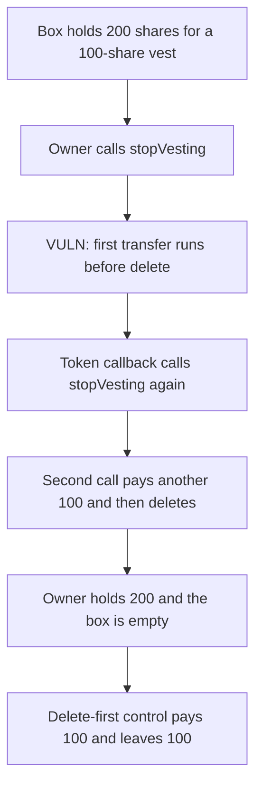

# Sushi Furo — stopVesting pays the vest twice

> **Vulnerability classes:** vuln/reentrancy/single-function · vuln/dependency/unsafe-external-call

<!-- non-defihacklabs -->
<!-- source-auditvault: https://github.com/Auditware/AuditVault/blob/main/findings/19588-reentrancy-vulnerabilities-may-drain-tokens-sigmaprime-none.md -->
<!-- date: 2023-06 -->

## Key info

| | |
|---|---|
| **Protocol** | Sushi Furo |
| **Finding** | Sigma Prime auction-maker-furo, AuditVault 19588 |
| **Vulnerable code** | `FuroVesting.stopVesting` before sushiswap/furo#17 |
| **Harm** | The vest owner receives 200 token shares. The vest only entitled them to 100. The other 100 was sitting in the same BentoBox balance. |
| **Chain** | local synthetic |

## TL;DR

`stopVesting` reads the vest, pays the unlocked shares and the unvested remainder through BentoBox, and only then executes `delete vests[vestId]`. Withdrawing from BentoBox transfers the token. A token that notifies the recipient can call `stopVesting` again while the vest row still exists, so both transfers run a second time.

## The vulnerable code

Pre-fix body from `sushiswap/furo` commit `b422ac07` (parent of PR 17):

```solidity
function stopVesting(uint256 vestId, bool toBentoBox) external {
    Vest memory vest = vests[vestId];
    if (vest.owner != msg.sender) revert NotOwner();
    uint256 canClaim = _balanceOf(vest) - vest.claimed;
    uint256 returnAmount = (vest.cliffAmount + (vest.steps * vest.stepAmount)) - canClaim;
    // @> VULN: both _transferToken calls run before delete vests[vestId]
    _transferToken(address(vest.token), address(this), ownerOf[vestId], canClaim, toBentoBox);
    _transferToken(address(vest.token), address(this), msg.sender, returnAmount, toBentoBox);
    delete vests[vestId];
}
```

PR 17 moves `delete vests[vestId]` above both transfers.

## Root cause

The vest accounting is a memory copy. The storage row is cleared only after the external withdrawals. `bentoBox.withdraw` transfers the underlying token when `toBentoBox` is false. That transfer calls back into the owner, and the owner is still `vest.owner`, so the `NotOwner` check passes again.

## Preconditions

The vesting contract's BentoBox balance is larger than this one vest. Here the box holds 200 shares and the vest pays 100. The token notifies the recipient. `toBentoBox` is false.

## Attack walkthrough

1. Credit 200 shares to the vesting contract. Seed vest 1 with `stepAmount = 100` and one step already passed, so `canClaim` is 100 and `returnAmount` is 0.
2. The owner calls `stopVesting(1, false)`.
3. The first `_transferToken` withdraws 100. The token calls `onTokens`.
4. `onTokens` calls `stopVesting` again. The row is still there, so another 100 is paid.
5. The inner call deletes the vest. The outer call's second transfer is 0.
6. The owner holds 200. The box holds 0.

The control deletes the vest first. The re-entered call hits `NotOwner` and is swallowed by the token's low-level call. The owner receives 100 and 100 shares stay in the box.

## Diagrams



## Impact

The caller of `stopVesting` is paid twice. Any other vest's shares that live in the same BentoBox balance are taken. In this reduction that is 100 shares on top of the 100 the vest actually owed.

## Remediation

Delete `vests[vestId]` before either `_transferToken`, which is what PR 17 does. A reentrancy guard on the external entry points is the additional mitigation the review asked for.

## How to reproduce

```bash
cd 19588-reentrancy-vulnerabilities-may-drain-tokens-sigmaprime-none_exp
forge test -vv
```

## Sources

- AuditVault finding: https://github.com/Auditware/AuditVault/blob/main/findings/19588-reentrancy-vulnerabilities-may-drain-tokens-sigmaprime-none.md
- Sigma Prime review: https://github.com/sigp/public-audits/blob/master/reports/sushi/auction-maker-furo/review.pdf
- Pre-fix vesting: https://github.com/sushiswap/furo/blob/b422ac07f33f43e262b86dce66c3e8d68f2f3c56/contracts/base/FuroVesting.sol
- Fix: https://github.com/sushiswap/furo/pull/17
