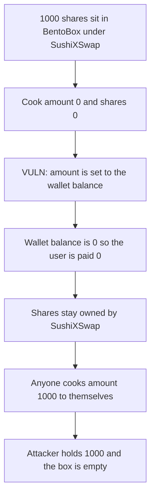

# SushiXSwap — zero withdraw reads the wallet, not BentoBox

> **Vulnerability classes:** vuln/logic/wrong-condition · vuln/access-control/missing-auth

<!-- non-defihacklabs -->
<!-- source-auditvault: https://github.com/Auditware/AuditVault/blob/main/findings/19616-wrong-balance-checked-before-withdrawal-sigmaprime-none-sush.md -->
<!-- date: 2023-05 -->

## Key info

| | |
|---|---|
| **Protocol** | SushiXSwap |
| **Finding** | Sigma Prime sushi-swap-stable-pool, AuditVault 19616 |
| **Vulnerable code** | `ACTION_DST_WITHDRAW_FROM_BENTOBOX` inside `cook` |
| **Harm** | 1000 bridged shares stay in BentoBox under SushiXSwap. The intended user receives 0. Anyone withdraws the 1000. |
| **Chain** | local synthetic |

## TL;DR

When `amount` is 0, the destination withdraw-from-BentoBox action sets `amount` to `IERC20(token).balanceOf(address(this))`. That is the swap contract's wallet, not its BentoBox shares. If `shares` is also 0, the withdraw pays nothing. The shares remain owned by SushiXSwap, and a later cook that passes the real amount takes them. `sgReceive` does not stop this: the original payload succeeds.

## The vulnerable code

The assignment is the one the deposit action still uses, applied to the withdraw action the review names:

```solidity
if (amount == 0) {
    // @> VULN: wallet balance, not bento.balanceOf(token, address(this))
    amount = Asset(token).balanceOf(address(this));
}
bento.withdraw(token, address(this), to, amount, shares);
```

The fix, which the current `ACTION_DST_WITHDRAW_OR_TRANSFER_FROM_BENTOBOX` uses, is: if both `amount` and `shares` are 0, set `shares = bento.balanceOf(token, address(this))`.

## Root cause

The zero shortcut was copied from the path that sweeps tokens the contract already holds. This action sweeps a BentoBox position. The wallet balance is the wrong number, and it is 0 in the case the shortcut exists for.

## Preconditions

A bridge payload deposits shares into BentoBox for SushiXSwap and then cooks a withdraw with `amount = 0` and `shares = 0`. The contract's ERC20 wallet balance for that token is 0. `cook` does not check `msg.sender`.

## Attack walkthrough

1. Credit 1000 shares to SushiXSwap in BentoBox.
2. Cook the zero shortcut to the intended user. `amount` becomes 0. The user receives 0. The 1000 shares are still there.
3. Cook the same action with `amount = 1000` and `to = attacker`. The `amount == 0` branch does not run.
4. The attacker holds 1000. The box balance is 0.

The control, on the same zero cook, loads the BentoBox balance into `shares`. The user receives 1000. A follow-up withdraw of 1000 reverts.

## Diagrams



## Impact

Tokens left in BentoBox under SushiXSwap are not delivered to the bridge recipient. Any later caller withdraws them. Here that is 1000 tokens.

## Remediation

When both `amount` and `shares` are 0, set `shares` from `bentoBox.balanceOf(token, address(this))` before withdrawing.

## How to reproduce

```bash
cd 19616-wrong-balance-checked-before-withdrawal-sigmaprime-none-sush_exp
forge test -vv
```

## Sources

- AuditVault finding: https://github.com/Auditware/AuditVault/blob/main/findings/19616-wrong-balance-checked-before-withdrawal-sigmaprime-none-sush.md
- Sigma Prime review: https://github.com/sigp/public-audits/blob/master/reports/sushi/sushi-swap-stable-pool/review.pdf
- Current cook, with the withdraw branch fixed: https://github.com/sushiswap/sushixswap/blob/master/contracts/SushiXSwap.sol
