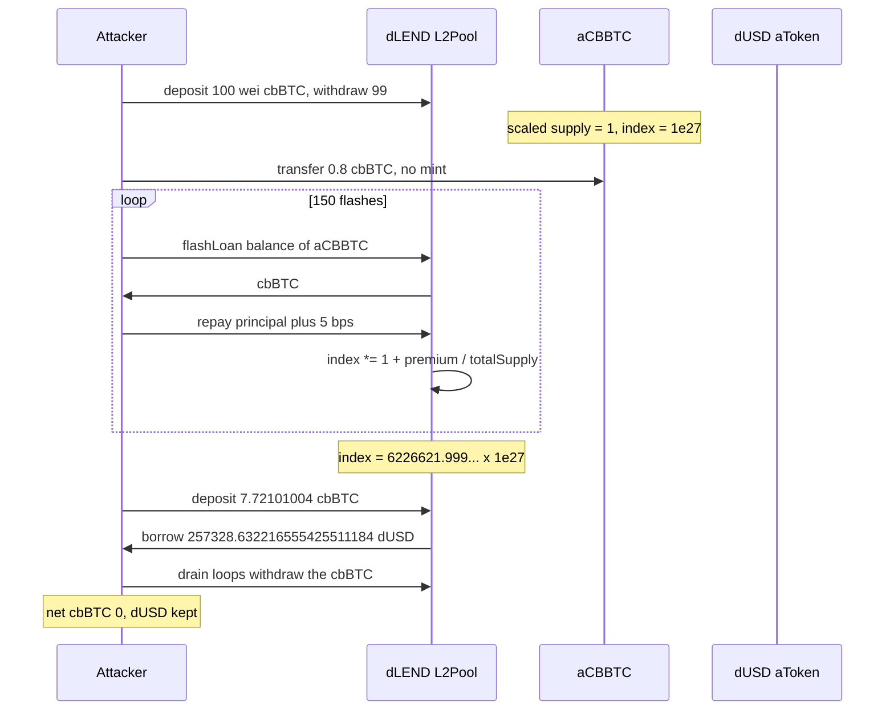

# dTRINITY dLEND — flash-premium divided by a 1-wei aToken supply inflates the cbBTC liquidity index

> **Vulnerability classes:** vuln/arithmetic · vuln/defi · vuln/logic
> **Reproduction:** the PoC compiles and runs in an isolated Foundry project at [this project folder](.). Full verbose trace: [output.txt](output.txt). **Offline pass.** `anvil_state.json` is present. The trace forks `<rpc url>` at block 24,676,807 [output.txt:460](output.txt). `[PASS] testExploit` and `[PASS] testNetCostIsZero`. Suite: `2 passed` in **3.31s** [output.txt:36355](output.txt).

---

## Key info

| | |
|---|---|
| **Loss** | **257,328.632216555425511184 dUSD** borrowed and kept [output.txt:456](output.txt), [output.txt:36341](output.txt). Headline in the test is ~257,328 US$. Full-attack net cbBTC is **0** [output.txt:36336](output.txt) |
| **Vulnerable contract** | dLEND pool (Aave V3.0.x `L2Pool` proxy) [`0x6598DaD18Bda89A0E58A1F427c8CeBc0dE90F153`](https://etherscan.io/address/0x6598DaD18Bda89A0E58A1F427c8CeBc0dE90F153). aCBBTC [`0x504D0Eacbf9ea5645A8A9da1b15f3708A5483AcC`](https://etherscan.io/address/0x504D0Eacbf9ea5645A8A9da1b15f3708A5483AcC). `sources/` is empty |
| **Collateral / debt** | cbBTC [`0xcbB7C0000aB88B473b1f5aFd9ef808440eed33Bf`](https://etherscan.io/address/0xcbB7C0000aB88B473b1f5aFd9ef808440eed33Bf) (8 decimals). dUSD [`0x07fFf99e1664d9B116fbC158c0E99785F81cA236`](https://etherscan.io/address/0x07fFf99e1664d9B116fbC158c0E99785F81cA236) (18 decimals) |
| **Attacker EOA (historical)** | [`0x08cfdff8ded5f1326628077f38d4f90df6417fd9`](https://etherscan.io/address/0x08cfdff8ded5f1326628077f38d4f90df6417fd9) |
| **Historical attack contract** | [`0xba5e1e36b0305772d35509c694782fb9118d4ecc`](https://etherscan.io/address/0xba5e1e36b0305772d35509c694782fb9118d4ecc) |
| **This PoC's attacker** | the test contract `0x7FA9385bE102ac3EAc297483Dd6233D62b3e1496` [output.txt:469](output.txt). Working capital is `deal` of 50 cbBTC, standing in for the Morpho flash the test comment describes |
| **Attack txs** | Index inflation [`0x8d33d688def03551cb77b0463f55ae5a670f5ebf3bbb5b8aa0e284c040ae7139`](https://etherscan.io/tx/0x8d33d688def03551cb77b0463f55ae5a670f5ebf3bbb5b8aa0e284c040ae7139). Borrow [`0xbec4c8ae19c44990984fd41dc7dd1c9a22894adccf31ca6b61b5aa084fc33260`](https://etherscan.io/tx/0xbec4c8ae19c44990984fd41dc7dd1c9a22894adccf31ca6b61b5aa084fc33260) |
| **Chain / block / date** | Ethereum / fork parent **24,676,807** [output.txt:460](output.txt). A cbBTC oracle round on that fork has `updatedAt` **1,773,741,986** (2026-03-17 10:06:26 UTC) next to price `7372473744858` [output.txt:36320](output.txt) |
| **Compiler** | PoC `pragma ^0.8.23`, trace compiled with **solc 0.8.36** [output.txt:1](output.txt). Pool sources are not in this folder. The trace executes `L2Pool` |
| **Bug class** | `FlashLoanLogic._handleFlashLoanRepayment` books the premium through `ReserveLogic.cumulateToLiquidityIndex`, which divides by `aToken.totalSupply()`. One scaled unit left in the reserve makes each premium multiply the index. At the final index, a normal deposit is a tiny scaled balance and still borrows the reserve's dUSD. Pre-V3.1: no `virtualUnderlyingBalance` |

## TL;DR

dLEND is an Aave V3.0.x fork. The attacker deposits 100 wei of cbBTC and withdraws 99, leaving one scaled unit [output.txt:524](output.txt), [output.txt:568](output.txt). A raw `transfer` of **0.8 cbBTC** (80,000,000 sats) to the aToken adds cash and mints no shares [output.txt:608](output.txt). Then **150** flash loans of the aToken's cbBTC balance run [output.txt:455](output.txt), [output.txt:10670](output.txt). Each premium is ~5 bps of the balance and is divided by a total supply of about 1 underlying wei, so `liquidityIndex` moves from **1e27** [output.txt:540](output.txt) to **6,226,621.999999999999999999979728276 × 1e27** = `6226621999999999999999999979728276` [output.txt:10675](output.txt), the value the test pins as the on-chain index at block 24,676,808.

Against that index the attacker deposits **7.72101004 cbBTC** and borrows **257,328.632216555425511184 dUSD** [output.txt:10743](output.txt). The LTV ceiling at the fork's oracle is **415,537.4897669 dUSD**, and the borrow is under it [output.txt:10741](output.txt). `testNetCostIsZero` then withdraws the donated cbBTC and the collateral. Net cbBTC change is **0**. The dUSD stays [output.txt:36336](output.txt), [output.txt:36341](output.txt).

## Background

Aave's liquidity index is a ray (1e27 = 1.0). A user's scaled balance is `underlying * RAY / index`. `withdraw` pays `scaled * index / RAY` and burns the scaled amount. Flash loans on V3.0 take a premium (here 5 bps: first premium **40,000** on **80,000,001** sats [output.txt:677](output.txt); last premium **43,093** on **86,186,017** sats [output.txt:10660](output.txt)) and add that premium into the index instead of minting new aTokens to someone.

`cumulateToLiquidityIndex` does `newIndex = oldIndex * (1 + premium / totalLiquidity)`. `totalLiquidity` is the aToken supply, not the token balance. A raw cbBTC transfer raises `balanceOf(aToken)` and does not raise supply. Supply stays on the order of one wei, so `premium / totalLiquidity` is tens of thousands, not 0.05%.

The first update is exact: index goes to **39,985 × 1e27** [output.txt:663](output.txt). `40000 / 39984 ≈ 1.00040016`, so the divisor really is ~1 underlying unit, not the 0.8 cbBTC donation. Later flashes compound until the loop's `>= ONCHAIN_INDEX_AFTER` check stops at step 150. The test allows 400 iterations and breaks early [test/dTRINITYdLEND_exp.sol](test/dTRINITYdLEND_exp.sol).

V3.1 stores a virtual underlying balance so this division cannot see a 1-wei supply. The test states this pool's `ReserveData` does not have that field.

The PoC is [test/dTRINITYdLEND_exp.sol](test/dTRINITYdLEND_exp.sol). `testExploit` stops at the borrow. `testNetCostIsZero` adds the two historical drain loops (`_drain`) and checks the cbBTC round-trip.

## The vulnerable code

**RECONSTRUCTED** from the `@Summary` in [test/dTRINITYdLEND_exp.sol](test/dTRINITYdLEND_exp.sol). `sources/` has no pool files. Names match the test; the trace shows `L2Pool.flashLoan` updating `liquidityIndex` on cbBTC and then `borrow` of dUSD.

```solidity
// FlashLoanLogic, Aave V3.0.x
function _handleFlashLoanRepayment(ReserveData storage reserve, uint256 premium) internal {
    // premium was pulled from the receiver onto the aToken
    reserve.cumulateToLiquidityIndex(IAToken(reserve.aTokenAddress).totalSupply(), premium);
    // totalSupply() is scaledSupply * index / RAY, not balanceOf(aToken)
}

// ReserveLogic
function cumulateToLiquidityIndex(uint256 totalLiquidity, uint256 amount) internal {
    uint256 ratio = (amount * RAY) / totalLiquidity; // totalLiquidity ~ 1
    liquidityIndex = uint128((ratio + RAY).rayMul(liquidityIndex));
}
```

What the trace shows instead of a source listing:

- Deposit 100, withdraw 99, index still **1e27** [output.txt:540](output.txt), [output.txt:568](output.txt).
- `cbBTC.transfer(aCBBTC, 80_000_000)` [output.txt:608](output.txt). No mint.
- Flash 1: amount **80,000,001**, premium **40,000**, index **3.9985e31** [output.txt:663](output.txt), [output.txt:677](output.txt).
- Flash 150: amount **86,186,017**, premium **43,093**, index **6226621999999999999999999979728276** [output.txt:10646](output.txt), [output.txt:10660](output.txt).
- A later drain `withdraw` still sees `scaledBalanceOf` **127** (`0x7f`) while moving underlying [output.txt:36326](output.txt). The index, not a large share balance, is what makes the underlying move.

## Root cause

1. **The index update divides by share supply, and share supply is not the cash.** Donating cbBTC to `0x504D0Eac…` raises the balance the flash loan will lend. It does not raise `totalSupply()`. The premium, which is 5 bps of that cash, is credited as if it belonged to one wei of shares.
2. **The premium is permissionless and repeatable in one transaction.** `flashLoan` → `executeOperation` (the receiver returns `true` and has approved the pool) → repayment → `cumulateToLiquidityIndex`. No position, no waiting period. Each new cash balance includes the previous premium, so the next premium is larger. 150 calls reach the historical index exactly [output.txt:10675](output.txt).
3. **Borrow accounting uses the same index.** Depositing 7.72101004 cbBTC at this index mints a negligible scaled balance, but the oracle still prices 7.72101004 cbBTC. LTV is 73% (`getConfiguration` bits, as the test hardcodes `ltvBps = 7300`) and the cbBTC price on the fork is **73,724.73744858 USD** (`7372473744858`, 8 decimals). Collateral value ≈ 569,229.44 USD. 73% is **415,537.4897669 dUSD** [output.txt:10741](output.txt). The pool then transfers **257,328.632216555425511184 dUSD** out of aToken `0x5CC74193…` [output.txt:10806](output.txt).
4. **The same index lets the attacker take the cbBTC back.** `testNetCostIsZero` runs the two `_drain` loops from the historical txs (15 pairs then 126 pairs). End balance of cbBTC is the original `deal` of 5e9 sats. Net change **0** [output.txt:36332](output.txt), [output.txt:36336](output.txt). The dUSD is not repaid.

## Preconditions

- The cbBTC reserve can be reduced to one scaled unit. The PoC does that with a 100-wei deposit and a 99-wei withdraw. Nobody else needs to be absent if the attacker is the last scaled holder; the fork at 24,676,807 allows it.
- The aToken accepts a raw ERC-20 `transfer`. It must not mint shares on receipt.
- Flash premium is non-zero. Here it is 5 / 10,000. A zero premium would not move the index.
- dUSD liquidity covers 257,328.632216555425511184. The borrow succeeds, so it did.
- Oracle price and LTV at this block support the debt. The assert allows up to 415,537.4897669 dUSD. A much lower cbBTC price would revert the borrow; the attack would still have inflated the index.
- The 50 cbBTC `deal` is a stand-in. The test comment says the historical attacker used a Morpho flash loan. `testNetCostIsZero` shows that capital is not consumed.

## Attack walkthrough (with on-chain numbers from the trace)

| # | Action | Amount | Trace |
|---|--------|--------|-------|
| 0 | Fork parent of the index tx | block 24,676,807 | [output.txt:460](output.txt) |
| 1 | `deal` 50 cbBTC to the test contract. dUSD before | 0 | [output.txt:454](output.txt), [output.txt:477](output.txt) |
| 2 | `deposit` 100 wei cbBTC, `withdraw` 99 wei | one scaled unit left; index stays 1e27 | [output.txt:524](output.txt), [output.txt:540](output.txt), [output.txt:568](output.txt) |
| 3 | Raw transfer to aCBBTC | 80,000,000 sats = 0.8 cbBTC | [output.txt:608](output.txt) |
| 4 | Flash 1 of `balanceOf(aCBBTC)` | amount 80,000,001; premium 40,000; index 39,985e27 | [output.txt:663](output.txt), [output.txt:677](output.txt) |
| 5 | Repeat until the on-chain index | **150** flashes. Last amount 86,186,017, premium 43,093 | [output.txt:455](output.txt), [output.txt:10660](output.txt), [output.txt:10670](output.txt) |
| 6 | Index assert | `6226621999999999999999999979728276` | [output.txt:10675](output.txt) |
| 7 | Deposit collateral and enable it | 772,101,004 sats = 7.72101004 cbBTC | [output.txt:10677](output.txt) |
| 8 | LTV check, then `borrow` dUSD, rate mode 2 | ceiling 415,537.4897669 dUSD; taken **257,328.632216555425511184** | [output.txt:10741](output.txt), [output.txt:10744](output.txt), [output.txt:10806](output.txt) |
| 9 | `testExploit` log | dUSD after = that borrow | [output.txt:456](output.txt), [output.txt:10835](output.txt) |
| 10 | `testNetCostIsZero` drain loops, then the same borrow | net cbBTC **0**; dUSD kept **257,328.632216555425511184** | [output.txt:36326](output.txt), [output.txt:36336](output.txt), [output.txt:36341](output.txt) |

**Identity**

| Piece | Value |
|---|---|
| Starting index | 1e27 |
| Index after flash 1 | 39,985e27 |
| Final index | 6,226,621.999999999999999999979728276 × 1e27 |
| dUSD taken | 257,328.632216555425511184 |
| cbBTC net on the full attack | 0 |

`[PASS] testExploit` at [output.txt:452](output.txt). `[PASS] testNetCostIsZero` at [output.txt:10841](output.txt).

## Diagrams



## Remediation

1. **Do not divide the flash premium by a live share supply that an attacker can set to one wei.** Aave V3.1's virtual underlying balance is the known fix: the denominator cannot be the attacker's dust. Port that `ReserveData` field and the V3.1 `cumulateToLiquidityIndex`, or reject flash loans while `totalSupply()` is below a bound that makes one premium a no-op on the index.
2. **Ignore raw donations.** Either rebase them into shares when they arrive, or measure the premium against cash that was minted through `deposit`. A balance with no shares must not be flash-lent and then called "income to one share".
3. **Cap the index change per call.** A single flash moving the index by 39,985× is not interest. Revert if `premium * RAY / totalLiquidity` exceeds a few basis points.
4. **The borrow is not a second bug.** Once the index is wrong, LTV math on oracle price × underlying amount is behaving. Fixing only `borrow` leaves the inflated aToken redeemable by whoever holds the dust shares.

## How to reproduce

Offline, from the committed state. `_shared/run_poc.sh` loads `anvil_state.json`, starts anvil, and rewrites the test's `http://127.0.0.1:8545` URL.

```bash
# from the registry root
_shared/run_poc.sh 2026-03-dTRINITYdLEND_exp -vvvvv
```

- **Chain / fork:** Ethereum, block **24,676,807** (parent of the index-manipulation tx).
- **Committed result** in [output.txt](output.txt) (`finished in 3.31s`):

```
[PASS] testExploit()
  Attacker Before exploit dUSD Balance: 0.000000000000000000
  flashloans run: 150
  Attacker After exploit dUSD Balance: 257328.632216555425511184
[PASS] testNetCostIsZero()
  full-attack net cbBTC (wei): 0
  dUSD kept: 257328.632216555425511184
Suite result: ok. 2 passed; 0 failed; 0 skipped
```

*Reference: Verichains, linked from the test header — <https://blog.verichains.io/p/deep-dive-into-the-dtribity-cbbtc>. Attack txs [`0x8d33d688…`](https://etherscan.io/tx/0x8d33d688def03551cb77b0463f55ae5a670f5ebf3bbb5b8aa0e284c040ae7139) and [`0xbec4c8ae…`](https://etherscan.io/tx/0xbec4c8ae19c44990984fd41dc7dd1c9a22894adccf31ca6b61b5aa084fc33260).*
