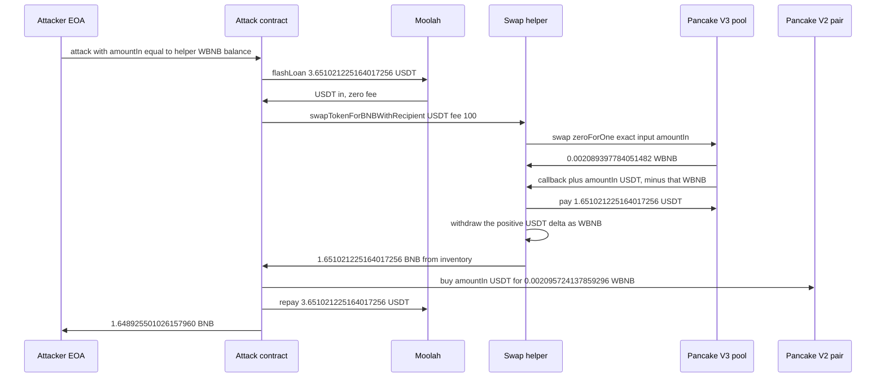

# Pancake V3 Swap Helper — Signed Swap Delta Misread as the WBNB Payout

> **Vulnerability classes:** vuln/logic/missing-validation · vuln/logic/incorrect-state-transition · vuln/logic/price-calculation

> **Reproduction:** the PoC compiles and the recorded online run passes in an isolated Foundry project at
> [this project folder](.). Full verbose trace: [output.txt](output.txt).
> The helper at `0x222C…c52D` is **unverified** (Etherscan V2 `getsourcecode` returned no source).
> Verified surrounding code is the 0.01% USDT/WBNB pool
> ([sources/PancakeV3Pool_172fcD](sources/PancakeV3Pool_172fcD)),
> the Pancake V3 factory ([sources/PancakeV3Factory_0BFbCF](sources/PancakeV3Factory_0BFbCF)),
> and Moolah's ERC1967 proxy ([sources/ERC1967Proxy_8F73b6](sources/ERC1967Proxy_8F73b6)).
> The helper's payout logic below is **RECONSTRUCTED** from the trace and labelled as such.

---

## Key info

| | |
|---|---|
| **Loss** | **1.648868884526157960 BNB** after the live tx fee (1,132,330 gas × 0.05 gwei = 0.0000566165 BNB). The PoC logs the pre-gas profit **1.648925501026157960 BNB** ([output.txt:8](output.txt)). Alert figure ~1.6488688845 BNB (~$1.30K) |
| **Vulnerable contract** | Unverified token-to-BNB helper — [`0x222C8580eaA32f6f5a728bda0129CFA485eCc52D`](https://bscscan.com/address/0x222c8580eAa32f6F5A728bDA0129Cfa485eCc52D#code). Entry used on-chain: `swapTokenForBNBWithRecipient` selector `0x6c26c88a` |
| **Pancake V3 pool** | USDT/WBNB fee `100` (0.01%) — [`0x172fcD41E0913e95784454622d1c3724f546f849`](https://bscscan.com/address/0x172fcD41E0913e95784454622d1c3724f546f849). `token0` = USDT, `token1` = WBNB |
| **Flash lender** | Moolah (ERC1967 proxy) — [`0x8F73b65B4caAf64FBA2aF91cC5D4a2A1318E5D8C`](https://bscscan.com/address/0x8F73b65B4caAf64FBA2aF91cC5D4a2A1318E5D8C), delegatecall implementation `0x9321587EA0DC8247f8F03E8696C047b2713bB79A`. Zero fee on this loan. Not the drained party |
| **Attacker EOA** | [`0x804D75DB19Ef595FD7F540262FAFa2FdA3E7d101`](https://bscscan.com/address/0x804D75DB19Ef595FD7F540262FAFa2FdA3E7d101) |
| **Attack contract** | Live deployment (the tx `to` is null; the exploit runs in the constructor) — [`0x43492c467986eaE378A1f8F8afC0B6f2417C3A2f`](https://bscscan.com/address/0x43492c467986eaE378A1f8F8afC0B6f2417C3A2f). PoC repro contract `PancakeV3SwapHelperAttack` at `0x5615dEB798BB3E4dFa0139dFa1b3D433Cc23b72f` ([output.txt:15](output.txt)) |
| **Attack tx** | [`0x70bc4ff8439f74d26d454a53e9a135ac3659a958aa3462218d0db7ed55cf5104`](https://bscscan.com/tx/0x70bc4ff8439f74d26d454a53e9a135ac3659a958aa3462218d0db7ed55cf5104) |
| **Chain / block / date** | BSC (chainId 56) / block **123,534,292** / **2026-09-23 08:37:28 UTC** (block timestamp `1790152648`, also the deadline word in the trace) |
| **Compiler** | Helper source unpublished, so its compiler is unknown (runtime code size 4,224 bytes). The pool it calls is Solidity **v0.7.6+commit.7338295f**, optimizer **on**, **400 runs**. Moolah's proxy is Solidity **v0.8.28+commit.7893614a**, optimizer **on**, **200 runs** |
| **Bug class** | `swapTokenForBNBWithRecipient` treats Pancake V3's **positive USDT input delta** as a WBNB quantity, unwraps that much of the helper's pre-existing WBNB, and sends the BNB to the caller. The pool only delivered **0.002089397784051482 WBNB** |

---

## TL;DR

`0x222C8580eaA32f6f5a728bda0129CFA485eCc52D` is an unverified helper that pulls an ERC-20, swaps it for WBNB on Pancake V3, unwraps WBNB, and forwards BNB to a caller-chosen recipient. Pancake V3's `swap` reports **signed** deltas: a positive delta is what the pool must be paid, a negative delta is what the pool has already sent. On the USDT → WBNB 0.01% pool, USDT is `token0` and WBNB is `token1`, so an exact-input swap returns `(+usdtIn, -wbnbOut)`.

The helper unwraps `uint256(amount0)` — the USDT input — instead of `uint256(-amount1)`. Both tokens use 18 decimals, and this fill traded at **790.189995 USDT per WBNB** (`1651021225164017256 / 2089397784051482`). Passing **1.651021225164017256 USDT** therefore made the helper unwrap **1.651021225164017256 WBNB**, almost the entire balance that was already sitting on the contract. The pool's real output, **0.002089397784051482 WBNB**, is what the helper still holds at the end ([output.txt:191](output.txt)).

The caller does not need capital beyond a flash loan. Moolah lent **3.651021225164017256 USDT** at zero fee ([output.txt:42](output.txt)). **1.651021225164017256 USDT** went into the helper. The BNB that came back bought that USDT back on Pancake V2 for **0.002095724137859296 WBNB** ([output.txt:128](output.txt)). Repaying the loan left **1.648925501026157960 BNB** ([output.txt:8](output.txt), [output.txt:179](output.txt)). The live transaction's gas (1,132,330 × 50,000,000 wei) cuts that to **1.648868884526157960 BNB**.

---

## Background — what the helper and the pool do

The helper is not a PancakeSwap contract. Pancake's own V3 factory (`0x0BFbCF9fa4f9C56B0F40a671Ad40E0805A091865`) only resolves the pool. The trace's external entry, decoded from selector `0x6c26c88a`, is:

`swapTokenForBNBWithRecipient(address token, uint24 fee, uint256 amountIn, uint256 /* fourth word = 1 */, uint256 deadline, address recipient)`

([output.txt:55](output.txt)). Foundry shows that call name. The fourth word is `1` in both the live argument layout and [test/PancakeV3SwapHelper_exp.sol](test/PancakeV3SwapHelper_exp.sol). It is not the sqrt-price limit: the pool is called with `4295128740`, which is `TickMath.MIN_SQRT_RATIO + 1` (`4295128739 + 1` in [sources/PancakeV3Pool_172fcD/contracts_libraries_TickMath.sol](sources/PancakeV3Pool_172fcD/contracts_libraries_TickMath.sol)). The fourth word does not stop a payout of `amountIn` WBNB.

The pool is the canonical 0.01% USDT/WBNB pool. `getPool(USDT, WBNB, 100)` returns `0x172fcD41…f849` ([output.txt:56](output.txt)–[output.txt:58](output.txt)). USDT (`0x55d3…7955`) sorts below WBNB (`0xbb4C…095c`), so USDT is `token0`. BSC-USD here has **18 decimals**, same as WBNB, which is why a USDT amount and a WBNB amount are interchangeable integers if a caller forgets which delta is which.

Pancake's verified pool documents the sign convention and implements it. The callback interface says a positive delta must be paid to the pool, and a negative delta is the amount the pool has already sent:

```solidity
/// @param amount0Delta The amount of token0 that was sent (negative) or must be received (positive) by the pool by
/// the end of the swap. If positive, the callback must send that amount of token0 to the pool.
/// @param amount1Delta The amount of token1 that was sent (negative) or must be received (positive) by the pool by
/// the end of the swap. If positive, the callback must send that amount of token1 to the pool.
function pancakeV3SwapCallback(
    int256 amount0Delta,
    int256 amount1Delta,
    bytes calldata data
) external;
```

([sources/PancakeV3Pool_172fcD/contracts_interfaces_callback_IPancakeV3SwapCallback.sol](sources/PancakeV3Pool_172fcD/contracts_interfaces_callback_IPancakeV3SwapCallback.sol)). For `zeroForOne == true` the pool transfers `token1` out **before** the callback, then requires the caller to bring `token0` in:

```solidity
(amount0, amount1) = zeroForOne == exactInput
    ? (amountSpecified - state.amountSpecifiedRemaining, state.amountCalculated)
    : (state.amountCalculated, amountSpecified - state.amountSpecifiedRemaining);

if (zeroForOne) {
    if (amount1 < 0) TransferHelper.safeTransfer(token1, recipient, uint256(-amount1));

    uint256 balance0Before = balance0();
    IPancakeV3SwapCallback(msg.sender).pancakeV3SwapCallback(amount0, amount1, data);
    require(balance0Before.add(uint256(amount0)) <= balance0(), 'IIA');
}
```

([sources/PancakeV3Pool_172fcD/contracts_PancakeV3Pool.sol](sources/PancakeV3Pool_172fcD/contracts_PancakeV3Pool.sol)). `amountCalculated` is updated with `0 - amountOut`, so the output delta is negative. That is the number a router must turn into an unsigned WBNB amount. The helper's callback does pay the positive USDT delta to the pool ([output.txt:83](output.txt)–[output.txt:90](output.txt)). The bug is the **outer** function using that same positive integer as the WBNB withdraw amount.

At the fork, immediately before the attack transaction, the helper's WBNB balance is **1.651021225164017256** ([output.txt:36](output.txt)). That inventory is the whole loss. The 0.01% pool is priced near the deep Pancake V2 USDT/WBNB pair, so swapping the inventory's *numeric value* of USDT cannot buy the inventory back.

| Venue | Figure at the fork | Trace |
|---|---|---|
| Helper WBNB | 1.651021225164017256 | [output.txt:36](output.txt) |
| V3 fee tier | 100 (0.01%), `zeroForOne` exact input | [output.txt:55](output.txt), [output.txt:72](output.txt) |
| V3 sqrt-price limit | 4,295,128,740 = `MIN_SQRT_RATIO + 1` | [output.txt:72](output.txt) |
| V3 fill | 1.651021225164017256 USDT in, 0.002089397784051482 WBNB out | [output.txt:94](output.txt), [output.txt:99](output.txt) |
| V3 state after the swap | `sqrtPriceX96` 2,818,613,529,656,947,153,662,211,905; liquidity 3,243,284,634,095,309,034,116,534; tick **−66,726**; protocol fee token0 54,483,700,430,412 | [output.txt:94](output.txt) |
| V2 pair `0x16b9…0daE` reserves before | USDT 42,609,966.095485659637415743; WBNB 53,951.749871200146842466 | [output.txt:126](output.txt) |
| V2 reserves after | USDT 42,609,964.444464434473398487; WBNB 53,951.751966924284701762 | [output.txt:144](output.txt) |

Moolah is only the funding source. `flashLoan` on the proxy delegatecalls `0x9321587E…b79A` ([output.txt:41](output.txt)), emits `FlashLoan`, and later pulls back the exact principal ([output.txt:168](output.txt)). No Moolah balance moves net.

---

## The vulnerable code

> **RECONSTRUCTED — matches the observed call pattern, not verified source.** `fetch_sources.sh` for `0x222C8580eaA32f6f5a728bda0129CFA485eCc52D` on chainId 56 returned `UNVERIFIED`. The shape below is fixed by the `-vvvvv` trace: selector, argument order, pool call, callback payment, `WBNB.withdraw` amount, and the BNB transfer to the recipient. It is not a decompilation.

### 1. The pool call is a normal exact-input USDT → WBNB swap

The helper resolves the pool, pulls USDT, approves the pool, and swaps with the helper itself as recipient. `amountSpecified` is the positive `amountIn` (exact input). Direction is `zeroForOne` (USDT to WBNB):

```solidity
// RECONSTRUCTED from output.txt:55-L72 and output.txt:83-L90.
function swapTokenForBNBWithRecipient(
    address token,
    uint24 fee,
    uint256 amountIn,
    uint256 /* fourth word, 1 on this call */,
    uint256 deadline,
    address recipient
) external returns (uint256) {
    address pool = factory.getPool(token, WBNB, fee);          // 0x172fcD41…f849
    IERC20(token).transferFrom(msg.sender, address(this), amountIn);
    IERC20(token).approve(pool, amountIn);
    (int256 amount0, int256 amount1) = IPancakeV3Pool(pool).swap(
        address(this),
        true,                              // zeroForOne
        int256(amountIn),                  // exact input
        4295128740,                        // MIN_SQRT_RATIO + 1
        abi.encode(token)
    );
    // amount0 == +1651021225164017256, amount1 == -2089397784051482
```

The callback, still reconstructed, pays whichever positive delta the pool asked for. On this path that is USDT, and the amount equals `amountIn`. The trace's `CallbackPaid` logs that payment ([output.txt:90](output.txt)). In the Foundry run the first topic is the test's `tx.origin` (`DefaultSender`, `0x1804c8AB…1f38`), which is an artifact of `forge test`, not the live attacker.

```solidity
    // RECONSTRUCTED from output.txt:83-L90.
    function pancakeV3SwapCallback(int256 amount0Delta, int256 amount1Delta, bytes calldata data) external {
        address token = abi.decode(data, (address));
        uint256 owed = uint256(amount0Delta);       // positive USDT delta
        IERC20(token).transfer(msg.sender, owed);   // pool receives amountIn USDT
    }
```

That half is consistent with the verified pool: `WBNB.transfer(helper, 2089397784051482)` happens first ([output.txt:76](output.txt)), then `pancakeV3SwapCallback(1651021225164017256, -2089397784051482, …)` ([output.txt:83](output.txt)), then `USDT.transfer(pool, 1651021225164017256)` ([output.txt:85](output.txt)). `swap` returns the same pair ([output.txt:99](output.txt)).

### 2. The payout uses the positive input delta

After the swap the helper does **not** unwrap `uint256(-amount1)`. It unwraps `1651021225164017256`, the positive `amount0`, and forwards that BNB to `recipient`:

```solidity
    // RECONSTRUCTED from output.txt:100-L113.
    // Bug: amount0 is USDT owed to the pool, not WBNB received.
    uint256 payout = uint256(amount0);             // == amountIn on this exact-input fill
    WBNB.withdraw(payout);                         // output.txt:100, Withdrawal at :104
    (bool ok,) = recipient.call{value: payout}(""); // output.txt:108
    emit SwapSuccess(pool, amount0, amount1);      // output.txt:110 logs BOTH real deltas
    return payout;                                 // output.txt:113 returns amountIn
}
```

`SwapSuccess` shows the helper **observed** the true pair `(+1651021225164017256, -2089397784051482)` and still paid the first number. The return word is `0x16e99b0e8a880e68`, which is `1651021225164017256`, not the WBNB the pool sent. One storage word (`0xb063e192…9122`) flips from `0` to `1` on the way out ([output.txt:112](output.txt)); the drain does not depend on that write. The helper's `fallback` logs `BNBReceived` for the same `1651021225164017256` when WBNB unwraps ([output.txt:102](output.txt)).

What remains on the helper is exactly the pool output. Pre-swap inventory `1.651021225164017256` plus pool output `0.002089397784051482` minus the withdraw `1.651021225164017256` equals `0.002089397784051482` ([output.txt:191](output.txt)).

---

## Root cause — why it was possible

1. **The sign convention was not applied to the payout.** Verified `PancakeV3Pool.swap` sends the output token only when its delta is negative, and the absolute value of that negative delta is the amount transferred (`uint256(-amount1)` for `zeroForOne`). The helper stored or reused the positive delta instead. `SwapSuccess` proves both numbers were in hand ([output.txt:110](output.txt)).
2. **The positive delta on this path equals `amountIn`, in USDT units.** For an exact-input swap that consumes the full input, `amount0 = amountSpecified - amountSpecifiedRemaining` is `1.651021225164017256`. Using it as a WBNB amount requests **1.651021225164017256 WBNB** for a trade that produced **0.002089397784051482 WBNB**.
3. **The copied integer is worth far more as WBNB than as USDT.** The attacker sets `amountIn` to the helper's WBNB balance, so the positive delta is the integer `1651021225164017256` in both tokens. BSC-USD and WBNB both use 18 decimals, so that integer is 1.651021225164017256 of each token. The V3 fill is `1651021225164017256 / 2089397784051482` = **790.189995 USDT per WBNB**. The withdraw is that many times the WBNB the pool sent, and `1651021225164017256 / 2095724137859296` = **787.804652** times the WBNB spent buying the USDT back.
4. **The contract already held the WBNB it was about to mis-account.** `WBNB.withdraw` burns the helper's own WBNB. It does not care that those tokens were not the swap proceeds. `amountIn` was `WBNB.balanceOf(helper)` read before the call ([output.txt:36](output.txt), [test/PancakeV3SwapHelper_exp.sol](test/PancakeV3SwapHelper_exp.sol)), so the withdraw matches the pre-existing balance and succeeds. The pool output arrives before the withdraw and is left behind, because the withdraw amount was fixed to the pre-swap balance.
5. **Nothing checks the payout against WBNB actually received.** There is no `balanceAfter - balanceBefore` measurement, and the fourth argument (`1`) does not reject a 1.651 WBNB transfer when the pool returned 0.002089 WBNB. The callback correctly pays the pool, so the swap itself succeeds the pool's `IIA` balance check. The loss is entirely the helper's extra transfer.

---

## Preconditions

- The helper's swap entry is permissionless. The trace shows no owner check before `transferFrom` / `swap` / `withdraw`. The live transaction is a contract-creation from the attacker EOA; the constructor is the whole attack. The PoC uses the same calls from `attack` / `onMoolahFlashLoan` rather than a constructor.
- The helper must already hold WBNB. Here that balance is **1.651021225164017256**. `withdraw` of a larger `amountIn` would revert. Any later WBNB balance on the helper can be passed as `amountIn` the same way. The alert notes the balance was afterwards reduced to dust.
- The caller must deliver `amountIn` of a `token0` that has a WBNB pool at the chosen fee. This path uses USDT and fee `100`. The USDT is recovered afterwards; it is not the profit.
- A flash loan is sufficient and, on this tx, free. Moolah transferred **3.651021225164017256 USDT** out and pulled the same amount back ([output.txt:44](output.txt), [output.txt:168](output.txt)). The extra **2 USDT** (`FLASHLOAN_BUFFER` in the PoC) is never spent; the V2 buy buys exactly `amountIn` USDT, and the buffer is repaid with the principal. An attacker who already held 1.651021225164017256 USDT would not need Moolah.
- The V2 USDT/WBNB pair must be able to sell `amountIn` USDT for a small WBNB amount. It could: reserves were ~42.61 million USDT and ~53,951.75 WBNB ([output.txt:126](output.txt)). The buyback cost **0.002095724137859296 WBNB**, which is **6,326,353,807,814 wei** (0.000006326353807814 WBNB) more than the V3 output. That gap is the round-trip cost. Profit is inventory minus that cost.
- No oracle, governance vote, or privileged role is involved. The deadline word is `block.timestamp` (`1790152648`), so it does not constrain a same-block call.

---

## Attack walkthrough (with on-chain numbers from the trace)

The PoC forks the attack transaction `0x70bc4f…5104` ([output.txt:13](output.txt)), reads the helper's WBNB, and runs one flash-loan callback. `balanceLog` deals the attacker EOA to 0 first, so the ending BNB balance is the profit ([output.txt:32](output.txt)–[output.txt:34](output.txt)).

| Step | Call | Amount | Trace |
|---|---|---|---|
| 0 | `WBNB.balanceOf(helper)` | 1.651021225164017256 | [output.txt:36](output.txt) |
| 1 | `Moolah.flashLoan(USDT, amountIn + 2 USDT)` | 3.651021225164017256 USDT | [output.txt:40](output.txt), [output.txt:44](output.txt) |
| 2 | `USDT.approve(helper, amountIn)` then `swapTokenForBNBWithRecipient(USDT, 100, amountIn, 1, 1790152648, attack)` | input 1.651021225164017256 USDT | [output.txt:50](output.txt), [output.txt:55](output.txt), [output.txt:60](output.txt) |
| 3 | Pool `swap(helper, true, amountIn, 4295128740, data)` | pool sends 0.002089397784051482 WBNB, callback pulls 1.651021225164017256 USDT | [output.txt:72](output.txt), [output.txt:76](output.txt), [output.txt:83](output.txt), [output.txt:85](output.txt) |
| 4 | `WBNB.withdraw(amountIn)` and BNB to the attack contract | **1.651021225164017256 BNB** from inventory | [output.txt:100](output.txt), [output.txt:104](output.txt), [output.txt:108](output.txt) |
| 5 | Helper returns | return word = `amountIn`; `SwapSuccess` logs the real negative WBNB delta | [output.txt:110](output.txt), [output.txt:113](output.txt) |
| 6 | `WBNB.deposit{value: 0.05 ether}` | seed 0.050000000000000000 WBNB | [output.txt:114](output.txt) |
| 7 | V2 `swapTokensForExactTokens` via router `0x10ED…024E`, pair `0x16b9…0daE` | spend **0.002095724137859296 WBNB**, receive **1.651021225164017256 USDT** | [output.txt:124](output.txt), [output.txt:128](output.txt), [output.txt:135](output.txt), [output.txt:145](output.txt), [output.txt:149](output.txt) |
| 8 | Unwrap leftover WBNB | 0.050 − 0.002095724137859296 = **0.047904275862140704** | [output.txt:151](output.txt), [output.txt:155](output.txt) |
| 9 | `USDT.approve(Moolah, loan)` and Moolah `transferFrom` | repay 3.651021225164017256 USDT (the 2 USDT buffer plus the bought-back `amountIn`) | [output.txt:160](output.txt), [output.txt:168](output.txt) |
| 10 | BNB to attacker EOA `0x804D…d101` | **1.648925501026157960 BNB** | [output.txt:164](output.txt), [output.txt:179](output.txt) |

Profit identity, all from the trace:

- BNB taken from the helper: `1.651021225164017256`
- WBNB spent buying the USDT back: `0.002095724137859296`
- Pre-gas profit: `1.651021225164017256 − 0.002095724137859296 = 1.648925501026157960`

The 0.05 BNB wrap is only a V2 input buffer. It comes back except for the `0.002095724137859296` that the pair keeps: leftover unwrapped is `0.047904275862140704`, and `1.651021225164017256 − 0.05 + 0.047904275862140704` is the same `1.648925501026157960`.

Post-state checks in the test:

- Attacker BNB is `1648925501026157960` ([output.txt:180](output.txt), [output.txt:194](output.txt)). Before the call it was 0 ([output.txt:34](output.txt)).
- Attack contract USDT is 0 and its WBNB is 0 ([output.txt:182](output.txt)–[output.txt:188](output.txt)).
- Helper WBNB is `2089397784051482`, the V3 output only ([output.txt:191](output.txt)).

Live transaction fee, from the receipt (not charged inside the Foundry balance log): `gasUsed` **1,132,330**, `effectiveGasPrice` **50,000,000** wei (0.05 gwei), fee **56,616,500,000,000** wei = **0.0000566165 BNB**. Net of gas: `1.648925501026157960 − 0.0000566165 = 1.648868884526157960 BNB`. The PoC's own `testExploit` gas is 378,161 ([output.txt:4](output.txt)); that figure is the Foundry test, not the live constructor.

---

## Diagrams



---

## Remediation

1. **Unwrap the output delta, not the input delta.** After `swap`, the WBNB amount is `uint256(-amount1)` when `zeroForOne` is true and `uint256(-amount0)` otherwise. Take that absolute value only after checking the sign is negative. Forward that BNB, and return that amount. The verified pool already computes this as `uint256(-amount1)` before `safeTransfer` in [sources/PancakeV3Pool_172fcD/contracts_PancakeV3Pool.sol](sources/PancakeV3Pool_172fcD/contracts_PancakeV3Pool.sol).
2. **Measure the balance change.** `uint256 got = WBNB.balanceOf(address(this)) - wbnbBefore;` and require `got == uint256(-amountOutDelta)`. A payout larger than the increase is the inventory bug, even if some future code path mixes the deltas differently.
3. **Apply the minimum-out to WBNB.** Compare `got` with the caller-supplied minimum in WBNB wei. A fourth argument of `1` must not count as a check on a 1.651 WBNB transfer. Revert if `got < amountOutMinimum`.
4. **Do not custody unrelated WBNB.** A swap helper should not hold a standing WBNB balance. Sweep residuals to a timelocked recipient. With a correct payout, this incident transfers 0.002089397784051482 BNB and the attack loses the V2 round-trip gap instead of gaining 1.648925501026157960 BNB.
5. **Authenticate the callback caller** as the pool `getPool` just returned, which the verified interface already requires. This incident's callback was in fact invoked by that pool; the check would not have stopped the bad withdraw, but a helper that pays `msg.sender` without it is separately unsafe.

---

## How to reproduce

**There is no `anvil_state.json` in this folder.** The fork-block warm did not produce a snapshot, so the offline harness never reaches `forge`. From the registry root:

```bash
_shared/run_poc.sh 2026-09-PancakeV3SwapHelper_exp -vvvvv
# no anvil_state.json in 2026-09-PancakeV3SwapHelper_exp
# exit 2, before forge
```

[test/PancakeV3SwapHelper_exp.sol](test/PancakeV3SwapHelper_exp.sol) forks `http://127.0.0.1:8546` at the attack tx, which is the localhost port the warm step writes. That port has nothing to serve without `anvil_state.json`. [output.txt](output.txt) is the **online** `-vvvvv` run (its `setUp` trace still shows `createSelectFork("bsc", 0x70bc4ff8…5104)`). That run passes. Fork block is BSC **123,534,292** (2026-09-23 08:37:28 UTC), the block of the live transaction, with earlier transactions in the block replayed so state is pre-attack.

Expected tail ([output.txt:4](output.txt), [output.txt:7](output.txt)–[output.txt:9](output.txt), [output.txt:197](output.txt)):

```
[PASS] testExploit() (gas: 378161)
Attacker Before exploit BNB Balance: 0.000000000000000000
Victim WBNB inventory drained: 1.651021225164017256
Attacker BNB profit before gas: 1.648925501026157960
Attacker After exploit BNB Balance: 1.648925501026157960
Suite result: ok. 1 passed; 0 failed; 0 skipped
```

The logged profit is the pre-gas figure, **1.648925501026157960 BNB** (the trace's `1.648e18`). Live gas reduces it to **1.648868884526157960 BNB**.

*Reference: https://x.com/exvulsec/status/2102687289730310458*

---
