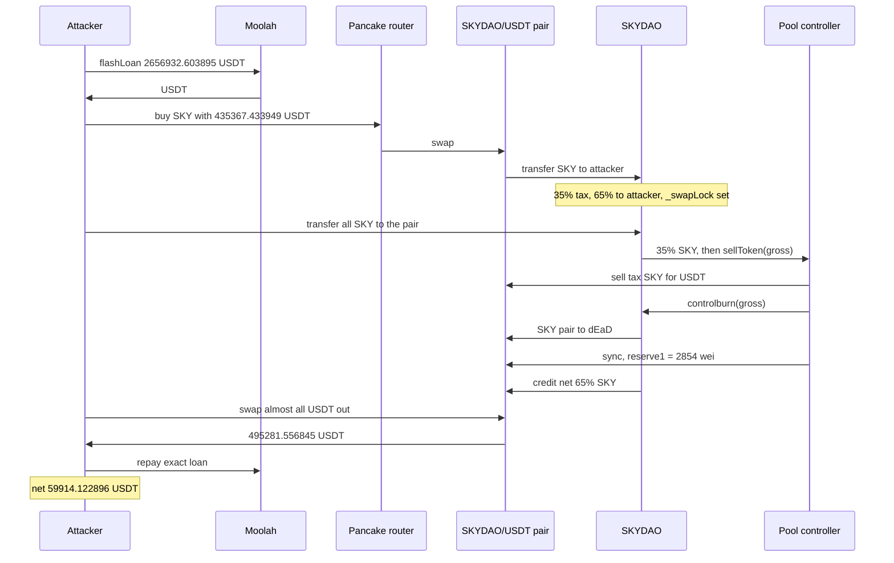

# SKYDAO sell path — `controlburn` + `sync()` before the net credit desyncs the pair reserve

> **Vulnerability classes:** vuln/logic/incorrect-order-of-operations · vuln/logic/state-update · vuln/defi/price-manipulation
> **Reproduction:** the PoC compiles and runs in an isolated Foundry project at [this project folder](.). Full verbose trace: [output.txt](output.txt). **Online pass. There is no `anvil_state.json` in this folder**, so `_shared/run_poc.sh` cannot replay it offline. The committed trace forks a live BSC RPC (`createSelectFork("<rpc url>", 124921241)` at [output.txt:13](output.txt)) and passes.

---

## Key info

| | |
|---|---|
| **Loss** | **183,482.883991401873856911 USDT** leaves the SKYDAO/USDT pair [output.txt:256](output.txt). One wei of USDT remains [output.txt:254](output.txt). Attacker net **59,914.122896306033123040 USDT** [output.txt:255](output.txt) |
| **Vulnerable contract** | SKYDAO [`0x7eBa33c7a0e555D115277BA4Af04DFbB4F4Fa70c`](https://bscscan.com/address/0x7eBa33c7a0e555D115277BA4Af04DFbB4F4Fa70c) — verified, [sources/SKYDAO_7eBa33/SKYDAO.sol](sources/SKYDAO_7eBa33/SKYDAO.sol) |
| **Unverified accomplice** | Pool controller [`0xEe5fDff6364dDe0A3C66dD38A4303cDd3D10730c`](https://bscscan.com/address/0xEe5fDff6364dDe0A3C66dD38A4303cDd3D10730c). `getsourcecode` returned **UNVERIFIED**. `sellToken` behaviour below is from the trace |
| **Pair** | PancakeSwap V2 SKYDAO/USDT [`0x096e08ddA1E18625fFdfBae4BB65a414Aa7eC2c8`](https://bscscan.com/address/0x096e08ddA1E18625fFdfBae4BB65a414Aa7eC2c8) (token0 = USDT) |
| **Attacker EOA (historical)** | [`0x5C9214d91eA1d2D6A46F80457c25a6e7e4D56EBc`](https://bscscan.com/address/0x5C9214d91eA1d2D6A46F80457c25a6e7e4D56EBc) |
| **Attack tx** | [`0x8e3016674ea8e5d2ad3af422ae5328f5a1f448e6b5a93d5d773e358bd2e440eb`](https://bscscan.com/tx/0x8e3016674ea8e5d2ad3af422ae5328f5a1f448e6b5a93d5d773e358bd2e440eb) (block 124,921,242, contract-creation; constructor ran the attack) |
| **This PoC's attacker** | `SKYDAOAttack` deployed in `setUp` at `0x5615dEB798BB3E4dFa0139dFa1b3D433Cc23b72f` [output.txt:15](output.txt). Not the historical EOA |
| **Chain / block / date** | BNB Chain / fork parent **124,921,241** [output.txt:13](output.txt) / fork `block.timestamp` **1,790,777,005** = 2026-09-30 14:03:25 UTC (router deadline [output.txt:61](output.txt)) |
| **Compiler** | `v0.8.20+commit.a1b79de6`, optimizer off ([sources/SKYDAO_7eBa33/_meta.json](sources/SKYDAO_7eBa33/_meta.json)) |
| **Bug class** | On a sell, `_transfer` hands the pool controller the **gross** SKY amount and lets it `controlburn` the pair and `sync()` **before** the seller's net 65% is credited. Stored `reserve1` latches at 2,854 wei. A direct `pair.swap` then pays out essentially all USDT. |

## TL;DR

SKYDAO is a fee-on-transfer token (35% tax) paired with USDT on PancakeSwap V2. A sell (`to == pair`) does not just take a tax. It calls the unverified pool controller's `sellToken(gross, _swapLock)` while the gross amount is still intact, and only afterwards credits `amount - tax` to the pair ([SKYDAO.sol](sources/SKYDAO_7eBa33/SKYDAO.sol) lines 258–271).

In the trace that callback sells the 35% tax for USDT, calls `SKYDAO.controlburn(gross)`, which moves the pair's whole SKY balance to `0x…dEaD`, then `pair.sync()`. `sync` reads a SKY balance of **2,854 wei** and stores that as `reserve1` [output.txt:175](output.txt). The outer `_transfer` then credits the net **2,535,948,812.272412882885892348 SKY** [output.txt:210](output.txt). Real SKY balance is now ~2.536e9; stored reserve is 2,854 wei [output.txt:217](output.txt).

`pair.swap(reserve0 - 1, 0, attacker, "")` passes the constant-product check against that stale reserve and sends **495,281.556845443667402613 USDT** to the attacker [output.txt:218](output.txt). The pair's USDT side ends at 1 wei. Net of the USDT spent to buy the SKY, profit is **59,914.122896306033123040 USDT** [output.txt:7](output.txt). `[PASS] testExploit` at [output.txt:4](output.txt).

## Background

The token stores balances in `_tOwned` and moves them in `_basicTransfer` with no Uniswap callback of its own. The pair address is cached in `_uniswapV2Pair`. Config (pair, controller, tax recipients) is an external `getAllConfig()` array; `results[8]` is the pool controller `0xEe5f…730c`, `results[12]` is USDT.

A transfer whose sender is the pair is a buy. A transfer whose recipient is the pair is a sell (`sort = 2`). `getTax` returns 35 for every address that is not the controller or `results[6]`, and 0 for those two. The buy path reverts `"Transaction Closed"` unless the recipient is one of those addresses **or** `_swapLock` is already true. `_swapLock` flips to true, inside `_transfer`, once `totalHolder >= 200000` (lines 228–230). Nothing on the sell path checks an owner, a signer, or `_swapLock`.

`controlburn` is externally gated to `results[6]` or `results[8]`. The gate does not protect the pair: the public sell path is what causes the controller to call it, and the amount it burns is the seller's gross, not the tax.

The PoC is [test/SKYDAO_exp.sol](test/SKYDAO_exp.sol). It borrows USDT from Moolah (`0x8F73b65B…5D8C`), which in this trace held exactly the borrowed amount and charged no fee. Pancake router `0x10ED43C7…024E`. USDT is BSC `0x55d39832…7955` (18 decimals).

## The vulnerable code

Verified source, [sources/SKYDAO_7eBa33/SKYDAO.sol](sources/SKYDAO_7eBa33/SKYDAO.sol):

```solidity
function _transfer(address from, address to, uint256 amount) private {
    // ...
    if (_swapLock == false && totalHolder >= 200000) {
        _swapLock = true;
    }
    // ...
    if (from == _uniswapV2Pair) {
        require(to == results[8] || to == results[6] || _swapLock, "Transaction Closed");
        tax = getTax(to, results);
    } else if (to == _uniswapV2Pair) {          // sell
        tax = getTax(from, results);            // 35
        sort = 2;
    }
    if (tax > 0) {
        uint256 taxAmount = (amount * tax) / 100;
        if (sort == 1) {
            _basicTransfer(from, results[25], taxAmount);
        } else {
            _basicTransfer(from, results[8], taxAmount);          // 35% to the controller
            IPancakeFactory(results[8]).sellToken(amount, _swapLock); // GROSS, before the net credit
        }
        amount -= taxAmount;
    }
    _basicTransfer(from, to, amount);           // net 65% credited only now
}

function controlburn(uint256 amount) external {
    address[] memory results = REFER(config).getAllConfig();
    require(msg.sender == results[6] || msg.sender == results[8], "Mast Mark Control");
    _basicTransfer(_uniswapV2Pair, 0x000000000000000000000000000000000000dEaD, amount);
}
```

What the sell trace does with that order:

1. Tax transfer of **1,365,510,898.915914629246249725 SKY** from the attacker to the controller [output.txt:109](output.txt). That is 35% of the **3,901,459,711.188327512132142073 SKY** just bought.
2. `PoolController.sellToken(3901459711188327512132142073, true)` — the gross wei amount, not the tax [output.txt:110](output.txt).
3. Inside `sellToken`: the controller sells that tax SKY into the pair and receives **216,245.331916417721284273 USDT** [output.txt:137](output.txt), then pushes **92,676.570821321880550402 USDT** back into the pair [output.txt:156](output.txt).
4. `SKYDAO.controlburn(gross)` moves **3,901,459,711.188327512132142073 SKY** from the pair to `0x…dEaD` [output.txt:162](output.txt), [output.txt:165](output.txt). Pair SKY balance is then **2,854 wei**.
5. `pair.sync()` stores `reserve0 = 495,281.556845443667402614` USDT and `reserve1 = 2854` [output.txt:175](output.txt).
6. Only then does `_basicTransfer` credit the net **2,535,948,812.272412882885892348 SKY** to the pair [output.txt:210](output.txt). `getReserves` still returns `(495281.556845443667402614, 2854, …)` [output.txt:217](output.txt). Real SKY balance is **2,535,948,812.272412882885895202** [output.txt:228](output.txt) = the net credit plus the 2,854 wei dust.

The controller's `sellToken` body is not verified. The calls above are what the fork executed. `controlburn` and `sync` are not in the SKYDAO source as a pair; `sync` is the controller. SKYDAO's bug is calling out with the gross amount before the balance update that the pair's reserve is supposed to reflect.

## Root cause

1. **External call in the middle of a balance update.** `sellToken(amount, …)` runs before `amount -= taxAmount` and before `_basicTransfer(from, pair, amount)`. The controller is handed a number that still includes tokens the pair has not been credited.
2. **`controlburn` burns the pair, not the tax.** The argument is the gross sell. Combined with `sync()`, the stored SKY reserve is the post-burn dust (2,854 wei), not the post-sell balance.
3. **`sync` is the wrong moment.** A Uniswap V2 pair sets reserves from `balanceOf` at the end of `swap`, or when `sync` is called. Calling `sync` while a transfer into the pair is half-finished freezes a reserve the next `swap` will trust.
4. **The K check then uses the lie.** After the net credit, SKY balance ≫ `reserve1`. `swap(reserve0 - 1, 0, …)` only has to satisfy `balance0 * balance1 >= reserve0 * reserve1` with `reserve1 = 2854`. The USDT output can be the entire reserve minus 1 wei.
5. **The `controlburn` modifier is not an authorization of the economic action.** Only the controller may call it, and the public sell path calls the controller. No attacker-held role is required.
6. **The buy gate opened inside the same transfer.** `totalHolder` went 199,999 → 200,000 and slot 14 (`_swapLock`) went 0 → 1 during the buy [output.txt:84](output.txt), before the `"Transaction Closed"` check. The attacker's buy both crossed the threshold and was allowed by it.

## Preconditions

- **Permissionless.** The PoC contract has no role. It calls Moolah `flashLoan`, the Pancake router, `SKY.transfer`, and `pair.swap`.
- **Fee-free flash of a fixed size.** Moolah lent **2,656,932.603895226812594665 USDT**, its entire USDT balance in this trace [output.txt:46](output.txt), [output.txt:49](output.txt). Repay is `transferFrom` of that same amount [output.txt:240](output.txt). Moolah uses transient storage, so the test needs Cancun.
- **`_swapLock` must be true for an ordinary buy.** Here the buy itself flipped it, because `totalHolder` hit 200,000. A fork where the lock is already true works the same; a fork where the lock cannot flip would revert the buy.
- **The pair must hold the USDT.** Starting pair USDT is **183,482.883991401873856912** [output.txt:44](output.txt). The attack pulls the post-buy, post-tax-sell balance, which is larger than the starting reserve because the buy added USDT.
- **No SKY and no USDT principal.** Attacker USDT starts at 0 [output.txt:6](output.txt).

## Attack walkthrough (with on-chain numbers from the trace)

| # | Action | Amount | Trace |
|---|--------|--------|-------|
| 0 | Attacker USDT before | 0 | [output.txt:6](output.txt) |
| 1 | Pair USDT before | 183,482.883991401873856912 | [output.txt:44](output.txt) |
| 2 | `Moolah.flashLoan(USDT, 2,656,932.603895226812594665)` | +2,656,932.603895226812594665 USDT | [output.txt:46](output.txt), [output.txt:50](output.txt) |
| 3 | Router buy, exact USDT in. Pair sends 6,002,245,709.520503864818680111 SKY gross; 35% (2,100,785,998.332176352686538038) goes to `0xA210…796d`, 65% to the attacker. This transfer also sets `_swapLock` | 435,367.433949137634279573 USDT in; attacker receives 3,901,459,711.188327512132142073 SKY | [output.txt:61](output.txt), [output.txt:80](output.txt), [output.txt:81](output.txt), [output.txt:84](output.txt) |
| 4 | `SKY.transfer(pair, full balance)`. Tax to controller, then `sellToken(gross)` | tax 1,365,510,898.915914629246249725 SKY | [output.txt:106](output.txt), [output.txt:109](output.txt), [output.txt:110](output.txt) |
| 5 | Controller sells the tax SKY for USDT, then returns part of that USDT to the pair | USDT out of pair 216,245.331916417721284273; USDT back 92,676.570821321880550402 | [output.txt:137](output.txt), [output.txt:156](output.txt) |
| 6 | `controlburn(gross)` pair → `dEaD`, then `sync`. Stored SKY reserve = 2,854 wei. USDT reserve = 495,281.556845443667402614 | burn 3,901,459,711.188327512132142073 SKY | [output.txt:162](output.txt), [output.txt:165](output.txt), [output.txt:175](output.txt) |
| 7 | Outer transfer credits the net 65% **after** `sync` | +2,535,948,812.272412882885892348 SKY to the pair | [output.txt:210](output.txt) |
| 8 | `getReserves` still `(495,281.556845443667402614, 2854)`. `swap(reserve0 - 1, 0, attacker)` | **495,281.556845443667402613 USDT** to the attacker. Pair USDT left = 1 wei | [output.txt:217](output.txt), [output.txt:218](output.txt), [output.txt:226](output.txt) |
| 9 | Repay Moolah the exact loan | −2,656,932.603895226812594665 USDT | [output.txt:240](output.txt) |
| 10 | Logged profit and pair loss | **59,914.122896306033123040** profit; **183,482.883991401873856911** pair loss | [output.txt:251](output.txt), [output.txt:255](output.txt), [output.txt:256](output.txt) |

**Profit identity (USDT, 18 dp)**

| Component | USDT |
|-----------|------|
| Drain `swap` | +495,281.556845443667402613 |
| Buy | −435,367.433949137634279573 |
| Flash principal in and out | 0 |
| **Net** | **59,914.122896306033123040** |

495,281.556845443667402613 − 435,367.433949137634279573 = 59,914.122896306033123040. The logged pair loss is starting balance minus 1 wei.

Pair USDT in during the attack: 435,367.433949137634279573 (buy) + 92,676.570821321880550402 (controller refill) = 528,044.004770459514829975. Pair USDT out: 216,245.331916417721284273 (tax sell) + 495,281.556845443667402613 (drain) = 711,526.888761861388686886. Out − in = 183,482.883991401873856911, the logged loss [output.txt:256](output.txt).

`assertApproxEqRel` uses 1% tolerance against the test's expected 59,914.122886306033123041 and 183,482.883991401873856912 [output.txt:257](output.txt), [output.txt:259](output.txt). The trace's own figures are the ones in the table. Suite: `1 passed` [output.txt:270](output.txt).

## Diagrams



## Remediation

1. **Finish the pair credit before any external call.** Move `_basicTransfer(from, pair, net)` and the tax transfer above `sellToken`. Do not pass `amount` (the gross) into a contract that can touch the pair.
2. **Do not `sync` from inside a transfer that is still crediting the pair.** If a burn of pair tokens is required, do it in a separate transaction after reserves match balances, or have the pair's own `swap` be the only reserve update.
3. **`controlburn` must not be reachable from a permissionless sell**, and its amount must be the tax actually received, never the seller's gross and never `balanceOf(pair)`.
4. **Measure the K input from balance delta the pair observed**, which is what Uniswap V2 already does when nobody calls `sync` mid-transfer. A hook that rewrites reserves in the middle defeats that.
5. **Cap `swap` output with a reserve check that uses the post-transfer balance**, or revert in `_transfer` if `balanceOf(pair)` and `getReserves` diverge at the end of the call.

## How to reproduce

**No `anvil_state.json`.** `_shared/run_poc.sh 2026-09-SKYDAO_exp -vvvvv` exits before Forge: the harness requires that file. The passing artifact is the **online** trace [output.txt](output.txt).

```bash
# from the registry root — this folder has no anvil state, so the offline harness will not run it
# _shared/run_poc.sh 2026-09-SKYDAO_exp -vvvvv

# online, matching the committed trace (Cancun: Moolah transient storage)
cd 2026-09-SKYDAO_exp
forge test --match-contract SKYDAO_exp --evm-version cancun -vvvvv
```

- **Chain / fork:** BNB Chain, block **124,921,241**, RPC in the test: `https://bsc-mainnet.public.blastapi.io`.
- **Expected result** (this is what [output.txt](output.txt) already records, `finished in 568.78ms`):

```
[PASS] testExploit()
Attacker Before exploit USDT Balance: 0.000000000000000000
attacker net USDT profit: 59914.122896306033123040
pair USDT loss          : 183482.883991401873856911
Attacker After exploit USDT Balance: 59914.122896306033123040
Suite result: ok. 1 passed; 0 failed; 0 skipped
```

*Reference: attack tx and fork RPC in the header of [test/SKYDAO_exp.sol](test/SKYDAO_exp.sol) — [`0x8e3016674ea8e5d2ad3af422ae5328f5a1f448e6b5a93d5d773e358bd2e440eb`](https://bscscan.com/tx/0x8e3016674ea8e5d2ad3af422ae5328f5a1f448e6b5a93d5d773e358bd2e440eb), RPC `https://bsc-mainnet.public.blastapi.io`.*
