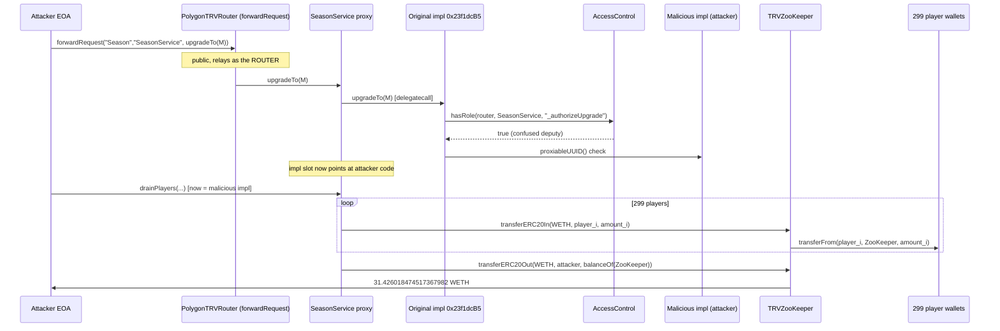

# The Red Village — a public request forwarder is a confused deputy that upgrades a UUPS proxy to attacker code

> **Vulnerability classes:** vuln/access-control/confused-deputy · vuln/access-control/missing-authorization · vuln/proxy/unauthorized-upgrade
> **Reproduction:** the PoC compiles and runs in an isolated Foundry project at [this project folder](.). Full verbose trace: [output.txt](output.txt). **Online fork pass** against real Polygon state at block 94,200,340 [output.txt:15](output.txt); `[PASS] testExploit` [output.txt:4](output.txt). Both phases (the malicious upgrade and the drain) are replayed in one test against the real deployed bytecode.

---

## Key info

| | |
|---|---|
| **Profit** | **31.426018474517367982 WETH** swept to the attacker EOA [output.txt:10](output.txt), [output.txt:11](output.txt). Matches the on-chain post-drain balance exactly (block 94,200,868). ≈ $80.7K |
| **Breakdown** | **31.350379502001367982 WETH** pulled from **299** player wallets that had approved TRVZooKeeper + **0.075638972516 WETH** that ZooKeeper already held [output.txt:7](output.txt). The whole ZooKeeper WETH balance was swept |
| **Vulnerable contracts** | PolygonTRVRouter (public `forwardRequest`) [`0xc97dCb0492412bFBBf47332F1B1b49e177e8f15C`](https://polygonscan.com/address/0xc97dCb0492412bFBBf47332F1B1b49e177e8f15C) + SeasonService UUPS proxy [`0xb172E15974FEAAe221EbC0860B578Dd7B6B06b77`](https://polygonscan.com/address/0xb172E15974FEAAe221EbC0860B578Dd7B6B06b77) (`_authorizeUpgrade` trusts the router). Both **UNVERIFIED** |
| **Sink** | TRVZooKeeper [`0x426d27190A2DdB87f1C6235F710e159a0A3774D4`](https://polygonscan.com/address/0x426d27190A2DdB87f1C6235F710e159a0A3774D4). `transferERC20In` / `transferERC20Out`, each `onlyRoler(...)`. Source in [sources/ZooKeeper.sol](sources/ZooKeeper.sol) |
| **AccessControl provider** | [`0x3f0B50B7A270de536D5De35C11C2613284C4304e`](https://polygonscan.com/address/0x3f0B50B7A270de536D5De35C11C2613284C4304e) — `hasRole(caller, target, method)` [output.txt:49](output.txt) |
| **SeasonService original impl** | [`0x23f1dcB561A0D17E9A48fD379400759777B8fCAa`](https://polygonscan.com/address/0x23f1dcB561A0D17E9A48fD379400759777B8fCAa) (performs the UUPS `upgradeTo`) |
| **Real malicious impl (historical)** | [`0xA3822CdF2Bb59CeFC7E70Fa5d693B7E9fBc50aFa`](https://polygonscan.com/address/0xA3822CdF2Bb59CeFC7E70Fa5d693B7E9fBc50aFa) — **UNVERIFIED**, reconstructed in this PoC |
| **This PoC's malicious impl** | `MaliciousSeasonService` at `0x5615dEB798BB3E4dFa0139dFa1b3D433Cc23b72f` [output.txt:43](output.txt) |
| **WETH (Polygon)** | [`0x7ceB23fD6bC0adD59E62ac25578270cFf1b9f619`](https://polygonscan.com/address/0x7ceB23fD6bC0adD59E62ac25578270cFf1b9f619) |
| **Attacker EOA** | [`0xa566592CB94475BaF5B46Ce373A260dfC9d0dF3F`](https://polygonscan.com/address/0xa566592CB94475BaF5B46Ce373A260dfC9d0dF3F) |
| **Setup / upgrade tx** | [`0xac0666c534dcad575cdb1fbcbe5b74e8bba418e35f4273933f62167d5143d55d`](https://polygonscan.com/tx/0xac0666c534dcad575cdb1fbcbe5b74e8bba418e35f4273933f62167d5143d55d) (block 94,200,341) |
| **Drain tx** | [`0x3730141adea0cd5a64824c0a541c4405256b4054ac54d8c1de65fe6ba210dd35`](https://polygonscan.com/tx/0x3730141adea0cd5a64824c0a541c4405256b4054ac54d8c1de65fe6ba210dd35) (block 94,200,868) |
| **Chain / block / date** | Polygon (chainId 137) / fork **94,200,340** (parent of the setup tx) / drain block 94,200,868 timestamp **1,790,006,389** = 2026-09-21 15:59:49 UTC |
| **Compiler** | Router, SeasonService, and the malicious impl are UNVERIFIED. The ZooKeeper sink is `0.8.13` ([sources/ZooKeeper.sol](sources/ZooKeeper.sol)) |
| **Bug class** | `forwardRequest(string,string,bytes)` is public and relays arbitrary calldata to a resolved service **with the router as `msg.sender`**. The router holds the `_authorizeUpgrade` role on SeasonService, so an attacker makes the router upgrade SeasonService to attacker code. That code, running in the proxy's context, inherits the proxy's ZooKeeper transfer roles and drains every player who approved ZooKeeper. |

## TL;DR

The Red Village's Polygon back end routes requests through `PolygonTRVRouter.forwardRequest(zone, service, data)`. The function is public and forwards `data` verbatim to the service it resolves — with the **router** as the `msg.sender` of the forwarded call. The router is a privileged actor: it holds the `_authorizeUpgrade` role on the `SeasonService` UUPS proxy.

So the attacker calls `forwardRequest("Season", "SeasonService", upgradeTo(maliciousImpl))` [output.txt:37](output.txt). The router dutifully calls `SeasonService.upgradeTo(maliciousImpl)` [output.txt:43](output.txt); `_authorizeUpgrade` checks `hasRole(msg.sender = router, …, "_authorizeUpgrade")`, which is **true** [output.txt:49-50](output.txt), and the proxy's implementation slot is overwritten with the attacker's contract [output.txt:55](output.txt). This is a textbook **confused deputy**: the attacker supplies the intent, a trusted party supplies the authority.

The upgraded `SeasonService`, executing in the proxy's storage/identity, holds the proxy's `transferERC20In` / `transferERC20Out` roles on `TRVZooKeeper`. It loops `transferERC20In(WETH, player_i, amount_i)` over **299** wallets that had approved ZooKeeper [output.txt:73](output.txt), then `transferERC20Out(WETH, attacker, zooKeeper.balanceOf(WETH))` [output.txt:4855](output.txt) — sweeping **31.426018474517367982 WETH** to the attacker [output.txt:10](output.txt).

## Background

TRVZooKeeper is the protocol's ERC-20 / ERC-721 / ERC-1155 custody hub. Players approve ZooKeeper, and protocol services move those tokens through role-gated functions. The gate is `onlyRoler("<method>")`, which passes when `msg.sender == owner()` **or** the AccessControl provider says `hasRole(msg.sender, zooKeeper, "<method>")`. The `SeasonService` proxy legitimately holds `transferERC20In` and `transferERC20Out` so seasons/tournaments can collect and pay out WETH.

`SeasonService` is a UUPS proxy. In UUPS the upgrade logic lives in the implementation (`upgradeTo`), gated by `_authorizeUpgrade`. Here `_authorizeUpgrade` does not require `onlyOwner`; it asks the AccessControl provider whether the **caller** holds `_authorizeUpgrade` on SeasonService — and the router does.

`PolygonTRVRouter` is a request relay. `forwardRequest(zone, service, data)` resolves the `(zone, service)` pair to an address and `call`s it with `data`. The router, SeasonService, and the historical malicious implementation are all **UNVERIFIED** on Polygonscan, so the control flow below is taken from the on-chain call tree in [output.txt](output.txt), not from decompiled source pasted as source. The one piece quoted from verified source is the ZooKeeper sink ([sources/ZooKeeper.sol](sources/ZooKeeper.sol)).

Because the PoC forks at **94,200,340** (the parent of the real setup tx), the real approvals, roles, and routing configuration are all live, and both phases — the malicious upgrade (the real setup tx) and the drain (the real drain tx) — are reproduced in a single `testExploit` against the real deployed bytecode.

## The vulnerable code

The **sink** is verified. ZooKeeper trusts whatever role-holder calls it, and `transferERC20In` pulls from an arbitrary `_from` that has approved the hub ([sources/ZooKeeper.sol:12-26](sources/ZooKeeper.sol)):

```solidity
// sources/ZooKeeper.sol:12
function transferERC20In(
  address _currency,
  address _from,
  uint256 _amount
) external override onlyRoler("transferERC20In") {
  IERC20(_currency).transferFrom(_from, address(this), _amount);   // pulls from any approver
}

// sources/ZooKeeper.sol:20
function transferERC20Out(
  address _currency,
  address _to,
  uint256 _amount
) external override onlyRoler("transferERC20Out") {
  IERC20(_currency).transfer(_to, _amount);                        // sends anywhere
}
```

`onlyRoler("X")` passes when `msg.sender == owner()` or `AccessControl.hasRole(msg.sender, this, "X")`. The `SeasonService` proxy holds both roles, so **any code behind that proxy** can pull from every approver and sweep out. ZooKeeper is not the bug — it correctly trusts its role-holders. The bug is that an attacker can *become* a role-holder's code.

The **confused-deputy entry point** is unverified; this is its behaviour reconstructed from the trace:

```solidity
// PolygonTRVRouter 0xc97dCb04…  — RECONSTRUCTED from output.txt:37-60
function forwardRequest(string calldata zone, string calldata service, bytes calldata data) external {
    address target = _resolve(zone, service);     // -> SeasonService 0xb172…  [output.txt:41-42]
    (bool ok, ) = target.call(data);              // msg.sender of this call == the ROUTER
    require(ok);
    emit Forwarded(zone, service, data);          // [output.txt:57]
}

// SeasonService impl 0x23f1dcB5…  — RECONSTRUCTED from output.txt:43-55
function _authorizeUpgrade(address) internal view {
    // trusts the CALLER, which forwardRequest has made the router (a role holder)
    require(AccessControl.hasRole(msg.sender, address(this), "_authorizeUpgrade"));  // [output.txt:49]
}
```

`forwardRequest` is public, performs no authorization of its own, and preserves no information about the *original* caller — it simply relays with the router as `msg.sender`. Combined with an `_authorizeUpgrade` that trusts the immediate caller, the two together let an unprivileged EOA perform a privileged upgrade.

## Root cause

The protocol has two trusted relationships that, composed, let anyone upgrade a core proxy to arbitrary code:

1. **`forwardRequest` is an open, identity-laundering relay.** It is public, authorizes nothing, and forwards arbitrary calldata to a resolvable service **as the router**. Any `(zone, service)` the router can reach — including privileged administrative selectors like `upgradeTo` — is callable by anyone through it. The original caller's identity is discarded; downstream contracts only ever see the router.

2. **`SeasonService._authorizeUpgrade` trusts its immediate caller, and that caller is the router.** The UUPS upgrade guard checks `hasRole(msg.sender, SeasonService, "_authorizeUpgrade")` rather than `onlyOwner` or a check against the *initiating* account. Because the router holds that role, a call that arrives *through* the router passes. The guard confuses "the router is authorized" with "the request is authorized."

Together these are a **confused deputy**: the attacker provides the malicious intent (`upgradeTo(maliciousImpl)`), and the router — a deputy with standing authority — executes it. The trace shows the guard returning `true` for the router [output.txt:49-50](output.txt) and the implementation slot being overwritten [output.txt:55](output.txt). Once the proxy points at attacker code, the proxy's standing `transferERC20In`/`transferERC20Out` roles on ZooKeeper become the attacker's roles, and every wallet that approved ZooKeeper is drainable in a single transaction. The loss is bounded only by the approvals outstanding and ZooKeeper's balance — here 299 players plus the hub's own balance, **31.426 WETH**.

The defensive lesson: a generic forwarder must never be allowed to reach privileged selectors, and an upgrade guard must authorize the *originator* of the request, not whatever contract happens to be relaying it.

## Preconditions

- **Public relay reaching a privileged selector.** `forwardRequest` is unprivileged and can resolve/forward to `SeasonService.upgradeTo`. No allowlist of forwardable selectors, no check that the initiator is privileged.
- **Upgrade guard trusts the router.** `AccessControl.hasRole(router, SeasonService, "_authorizeUpgrade") == true` [output.txt:49-50](output.txt).
- **SeasonService holds ZooKeeper transfer roles.** `hasRole(SeasonService, ZooKeeper, "transferERC20In"/"transferERC20Out") == true` — the proxy's standing authority becomes the attacker's after the upgrade.
- **Outstanding approvals.** 299 player wallets had approved ZooKeeper for WETH; those are the funds pulled. The PoC skips any wallet whose live allowance/balance no longer covers its historical amount, so it tracks real reproducible state at the fork block (at 94,200,340 all 299 cover it and the sweep matches to the wei).
- **UUPS acceptance.** The new implementation must expose `proxiableUUID()` returning the ERC-1967 implementation slot so the original impl's `upgradeTo` rollback check passes [output.txt:51-52](output.txt).

## Attack walkthrough (with on-chain numbers from the trace)

| # | Action | Amount | Trace |
|---|--------|--------|-------|
| 0 | Fork state: ZooKeeper holds 0.075638972516 WETH, attacker holds 0 | — | [output.txt:7](output.txt), [output.txt:8](output.txt) |
| 1 | `forwardRequest("Season","SeasonService", upgradeTo(maliciousImpl))` — public call by the attacker EOA | relays to SeasonService as the router | [output.txt:37](output.txt), [output.txt:38](output.txt) |
| 2 | Router → `SeasonService.upgradeTo(maliciousImpl)` → original impl `upgradeTo` (delegatecall) | — | [output.txt:43](output.txt), [output.txt:44](output.txt) |
| 3 | `_authorizeUpgrade` → `AccessControl.hasRole(router, SeasonService, "_authorizeUpgrade")` returns **true** | confused deputy | [output.txt:49](output.txt), [output.txt:50](output.txt) |
| 4 | UUPS rollback check calls `maliciousImpl.proxiableUUID()` → correct slot; impl slot overwritten | `0x23f1dcB5…` → `0x5615dEB7…` | [output.txt:51](output.txt), [output.txt:55](output.txt) |
| 5 | Drain: 299 × `ZooKeeper.transferERC20In(WETH, player_i, amount_i)` (each `hasRole(SeasonService, …)` checked) | **31.350379502001367982 WETH** pulled | [output.txt:73](output.txt) |
| 6 | Sweep: `ZooKeeper.transferERC20Out(WETH, attacker, zooKeeper.balanceOf(WETH))` | **31.426018474517367982 WETH** | [output.txt:4855](output.txt) |
| 7 | Logged profit | **31.426018474517367982 WETH** | [output.txt:10](output.txt), [output.txt:11](output.txt) |

**WETH identity**

| Component | WETH |
|-----------|------|
| Pulled from 299 approvers (`transferERC20In` sum) | 31.350379502001367982 |
| ZooKeeper's pre-existing balance | 0.075638972516000000 |
| Swept to attacker (`transferERC20Out`) | 31.426018474517367982 |

31.350379502001367982 + 0.075638972516 = 31.426018474517367982, exactly the attacker's post-drain balance at block 94,200,868 and the asserted figure. `[PASS] testExploit` [output.txt:4](output.txt).

## Diagrams



## Remediation

1. **Never let a generic forwarder reach privileged selectors.** `forwardRequest` must maintain an allowlist of forwardable `(service, selector)` pairs and refuse administrative selectors such as `upgradeTo` / `upgradeToAndCall`. A relay should forward business calls, not governance calls.
2. **Authorize the originator, not the relay.** `_authorizeUpgrade` must check the account that *initiated* the request (and should be `onlyOwner` / timelock-gated), not `msg.sender`. If relaying is required, propagate and verify the original caller (e.g. ERC-2771 trusted-forwarder semantics with an explicit allowlist), never trust the forwarder's own standing role.
3. **Scope the router's authority.** The router should not hold `_authorizeUpgrade` on core proxies at all. Separating "can route user requests" from "can upgrade implementations" removes the confused-deputy link entirely.
4. **Gate upgrades behind a timelock + multisig.** A privileged, delayed, observable upgrade path would have surfaced an unexpected `upgradeTo` before the drain block.
5. **Minimize standing approvals / custody roles.** ZooKeeper correctly trusts its role-holders, but the blast radius was every outstanding WETH approval plus the hub balance. Pull funds just-in-time, cap per-call transfer amounts, or require per-season escrow rather than open approvals to a long-lived hub.

## How to reproduce

Online fork against real Polygon state (no committed `anvil_state.json`).

```bash
# from this project folder
cd 2026-09-TheRedVillage_exp
forge test --evm-version cancun -vvv
```

- **Chain / fork:** Polygon (chainId 137), block **94,200,340** (parent of the setup tx 94,200,341), RPC `https://polygon.drpc.org` (fallbacks: `https://polygon-bor-rpc.publicnode.com`, `https://polygon-rpc.com`, `https://polygon-mainnet.public.blastapi.io`).
- **Both phases in one test:** the confused-deputy upgrade (real setup tx) and the 299-wallet drain + sweep (real drain tx) are replayed against the real deployed bytecode.
- **Committed result** in [output.txt](output.txt):

```
[PASS] testExploit()
  ZooKeeper WETH before: 0.075638972516000000
  Attacker WETH before: 0.000000000000000000
  Attacker WETH after: 31.426018474517367982
  Attacker WETH profit: 31.426018474517367982
Suite result: ok. 1 passed; 0 failed; 0 skipped
```

**Reconstruction note.** The historical malicious implementation `0xA3822CdF2Bb59CeFC7E70Fa5d693B7E9fBc50aFa` is UNVERIFIED. This PoC synthesizes a minimal faithful equivalent (`MaliciousSeasonService` in [test/TheRedVillage_exp.sol](test/TheRedVillage_exp.sol)): it exposes a UUPS-compatible `proxiableUUID()` so the real original impl's `upgradeTo` accepts it, and a backdoor that performs exactly the observed drain (299 `transferERC20In` pulls + one `transferERC20Out` sweep), gated on `tx.origin == attacker` to mirror the real impl's restriction. Everything else — the router, `forwardRequest`, the original SeasonService impl, `_authorizeUpgrade`, AccessControl, ZooKeeper, WETH, the roles, and the player approvals — is the **real deployed bytecode and state** at the fork block. The 299 victim rows are the exact on-chain pulls from the drain tx (see [test/VictimsData.sol](test/VictimsData.sol)).

## References

- Alert: https://x.com/DefimonAlerts/status/2107824971867119886 (@DefimonAlerts)
