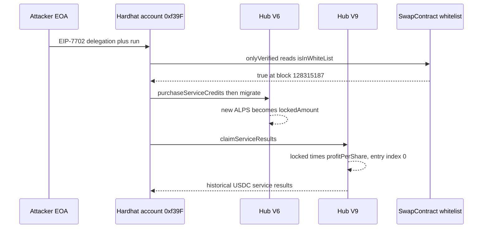

# AlpsCon AI Trade Hub — a public Hardhat address is whitelisted, and a zero entry index pays the historical USDC index

> **Vulnerability classes:** vuln/logic/reward-calculation · vuln/access-control/broken-logic · vuln/logic/missing-check
> **Reproduction:** online only. This folder has **no `anvil_state.json`**. The committed trace [output.txt](output.txt) is the whitelist check, not `testExploit()`. Folder: [(.)](.). Verified source: [sources/AiTradeHubContract_9B210D](sources/AiTradeHubContract_9B210D) (V9), [sources/AiTradeHubContract_74F091](sources/AiTradeHubContract_74F091) (V6), [sources/SwapContract_9be357](sources/SwapContract_9be357) (whitelist).
---
## Key info
| | |
|---|---|
| **Loss** | On-chain net **152,295.3625 USDC** to the attacker EOA (header of [test/AlpsCon_exp.sol](test/AlpsCon_exp.sol)). The standalone reconstruction asserts **129,775.607409916739393535 USDC**. The difference, about **22,519.75 USDC**, is the V7/V8 balance the real `claimServiceResults` pushed straight to the EOA and that a standalone claim does not replay. **That profit is not in [output.txt](output.txt)** — the saved trace ran only the whitelist test |
| **Vulnerable contract** | V9 hub `AiTradeHubContract` [`0x9B210Da482217afC24074e57f6F8337fe07F0124`](https://bscscan.com/address/0x9B210Da482217afC24074e57f6F8337fe07F0124). Deposit hub V6 [`0x74F091a719FdD47A95f378C7fb5C3D18a4582405`](https://bscscan.com/address/0x74F091a719FdD47A95f378C7fb5C3D18a4582405). Whitelist `SwapContract` [`0x9be357BD175ba6b40Ac20177B237Ec6641e98851`](https://bscscan.com/address/0x9be357BD175ba6b40Ac20177B237Ec6641e98851) |
| **Attacker EOA** | [`0x3d9DF7D20D8296286383ffe475aA7b9e548946b2`](https://bscscan.com/address/0x3d9DF7D20D8296286383ffe475aA7b9e548946b2) |
| **Delegated account** | Hardhat/Anvil account #0 [`0xf39Fd6e51aad88F6F4ce6aB8827279cffFb92266`](https://bscscan.com/address/0xf39Fd6e51aad88F6F4ce6aB8827279cffFb92266). On-chain exploit implementation [`0xbe5d79b429308f6be75898dd31c5f3c0bd4ed13d`](https://bscscan.com/address/0xbe5d79b429308f6be75898dd31c5f3c0bd4ed13d) |
| **Attack tx** | [`0x824b83f94bdc2e69b81f1cb2dfdf9d4aeed066114e3de29e3af59bd2d9355fc2`](https://bscscan.com/tx/0x824b83f94bdc2e69b81f1cb2dfdf9d4aeed066114e3de29e3af59bd2d9355fc2) |
| **Chain / block / date** | BNB Chain (chain id 56) / fork block **128,315,187**, one block before the attack / 18 October 2026 |
| **Compiler** | V9 `v0.8.20+commit.a1b79de6`, optimizer on, 185 runs ([_meta.json](sources/AiTradeHubContract_9B210D/_meta.json)). V6 and the whitelist `v0.8.19+commit.7dd6d404`, 200 runs |
| **Bug class** | `onlyVerified` still accepts the published Hardhat account, and V9's share-earnings formula applies the full stored `profitPerShare` to a prior-hub balance whose `entryProfitPerShare` is still zero |

## TL;DR
AlpsCon's AI Trade Hub sells ALPS "service credits" and later pays USDC "service results" from a per-share index. Reward entrypoints are gated by `onlyVerified`, which is `SwapContract.isInWhiteList`. At the fork block that list still contains `0xf39Fd6e51aad88F6F4ce6aB8827279cffFb92266`, Hardhat's default account #0. Its private key is the one Hardhat publishes. The attacker does not steal a user key. They sign an EIP-7702 authorization for that address, point it at their own code, and every hub call from it passes the whitelist.

The second bug is the index. V9 `_getUserLockedAmount` adds the previous hub's locked balance while `contributors[user].migrated` is false, and `_calculateUserEarningByShares` multiplies that balance by `stats.profitPerShare` and subtracts `entryProfitPerShare`. A brand-new record has `entryProfitPerShare == 0`, so the account is paid the whole accumulated index, not the index growth since its own deposit.

The PoC flash-borrows **1,027,990 USDC** (18-decimal BSC USDC) from Aave V3, buys ALPS, deposits on the still-open V6 hub, calls `V6.migrate()` so the new credits become locked, then `V9.claimServiceResults()`. It withdraws the stake, sells the ALPS, and repays the loan. The test asserts a reconstructed net of **129,775.607409916739393535 USDC**. The header's on-chain net is **152,295.3625 USDC**. [output.txt](output.txt) does not contain this leg. It only proves the whitelist: `isInWhiteList` returns true for the Hardhat account and false for `0x…dEaD` [output.txt:20](output.txt)–[output.txt:26](output.txt).

## Background — what the hubs do
Each hub version holds ALPS as service credits (`payableERC20`) and pays USDC (`paymentERC20`). `purchaseServiceCredits` pulls ALPS, takes `contributionFee / 1000`, and credits the rest as `pendingAmount`. A later conversion moves pending into `lockedAmount`. Distributions do not pay users directly. `_distributeServiceResults` adds `amount * 1e10 / totalLocked` to `stats.profitPerShare`. A user's unpaid result is locked credits times the index gap since `entryProfitPerShare`.

The versions are chained. V6 `migrate()` pulls V4/V5 credit and USDC balances into V6 and then converts pending credits to locked. V9 `migrate()` pulls the V8 record across. Until that flag is set, V9's views still read V8 via `getV8Stats`, and V8's own `getStats` is what surfaces the stake sitting on the earlier hub. `claimServiceResults` is the cash-out: it checkpoints the index, then transfers USDC minus `withdrawalFee`.

ALPS and USDC on this deployment are both 18-decimal BEP-20s. USDC is `0x8AC76a51cc950d9822D68b83fE1Ad97B32Cd580d`. ALPS is `0x5870357Dfa6A11d3Fe45D775C21eD9ae60Ac4BeF`. The project router is `0x7227D229BE754fA49F416d48e8EAa121184b1721`. Aave V3 pool is `0x6807dc923806fE8Fd134338EABCA509979a7e0cB`.

## The vulnerable code
Verified V9 source, not a reconstruction. `onlyVerified` is the only gate on deposit, migrate, and claim.

```solidity
modifier onlyVerified() {
    if (!_isVerified(msg.sender)) revert AITradeHubNotVerifyError();
    _;
}

function _isVerified(address wallet) internal view override returns (bool) {
    return config.swapContract.isInWhiteList(wallet);
}
```

`SwapContract.isInWhiteList` is a plain mapping read ([contracts_SwapContract.sol](sources/SwapContract_9be357/contracts_SwapContract.sol)). Nothing binds the entry to a signature, a deposit age, or "not a publicly known key". At block 128,315,187 the Hardhat account is in the mapping and a fresh address is not [output.txt:20](output.txt)–[output.txt:26](output.txt).

### The index pays a balance that never earned it
`_getUserLockedAmount` adds the previous hub's locked credits whenever this hub's own `migrated` flag is still false. `_calculateUserEarningByShares` then treats `entryProfitPerShare == 0` as "never paid":

```solidity
function _calculateUserEarningByShares(address wallet) internal view returns (int256) {
    Contributor storage user = contributors[wallet];
    uint256 userLockedAmount = _getUserLockedAmount(wallet);
    int256 gross = (int256(userLockedAmount) * stats.profitPerShare) / int256(INTEREST_DECIMAL_PRECISION);
    int256 claimed = (int256(userLockedAmount) * user.entryProfitPerShare) / int256(INTEREST_DECIMAL_PRECISION);
    return gross - claimed;
}

function _getUserLockedAmount(address user) internal view returns (uint256) {
    Contributor memory contributor = contributors[user];
    uint256 user_locked_amount;
    if (!contributor.migrated)
        (,,,, user_locked_amount,,,,,) = getV8Stats(user);
    return contributor.lockedAmount + user_locked_amount;
}
```

`INTEREST_DECIMAL_PRECISION` is `1e10`. `getV8Stats` is `config.aiTradeHubContractV8.getStats(wallet)`. `_claimServiceResults` checkpoints that product into `earningAmount` and sends `claimAmount` minus the withdrawal fee in `paymentERC20`. It never checks that `entryProfitPerShare` was stored at the moment the included balance was created.

V6 `purchaseServiceCredits` only requires `onlyVerified`. Its `migrate()` ends in `_convertPendingToLocked`, so a deposit made in the same call sequence becomes `lockedAmount` on V6 before V9's claim reads back through the version chain. V6 `migrate()` is also `onlyVerified` and otherwise unrestricted ([contracts_AITradeHubContract.sol](sources/AiTradeHubContract_74F091/contracts_AITradeHubContract.sol) `_migrate`).

## Root cause — why it was possible
1. **The whitelist credential is public.** `0xf39F…2266` is Hardhat account #0. Anyone can sign for it. EIP-7702 lets the attacker install their contract as that account's code and then call the hubs as the whitelisted address. A fresh address fails the same check [output.txt:24](output.txt).
2. **Unmigrated prior-hub balances are added to the earnings base.** V9 counts `getV8Stats(user).user_locked_amount` until `contributor.migrated` is set. A same-transaction deposit that lands in that view is indistinguishable from a balance that was locked when `profitPerShare` was accrued.
3. **`entryProfitPerShare` defaults to zero and is not set when the foreign balance is first observed.** Gross earnings are `locked * profitPerShare / 1e10`. The subtraction term is zero, so the claim is the full historical index, not the delta since deposit.
4. **Claim, deposit, and migrate are the same privilege.** Passing `onlyVerified` once is enough to buy credits, lock them, and cash the index. No keeper, age, or manager step sits between them.

## Preconditions
- The Hardhat account is still in `SwapContract`'s whitelist. True at block 128,315,187 [output.txt:20](output.txt). False for an arbitrary address [output.txt:24](output.txt).
- V6 still accepts `purchaseServiceCredits`. Later hubs are the ones that hold the accumulated `profitPerShare`.
- The caller can sign an EIP-7702 authorization for the Hardhat account. That key is the published Hardhat default, not a user secret. The raw key is in [test/AlpsCon_exp.sol](test/AlpsCon_exp.sol); it is not repeated here.
- Working capital is a flash loan. Aave V3 `flashLoanSimple` of **1,027,990 USDC**, repaid with premium inside the callback. No privilege on Aave, the router, or the hubs beyond the whitelist.
- The V7/V8 USDC that the real transaction also sent to the EOA is extra. The reconstruction does not depend on it.

## Attack walkthrough (with numbers from the trace)
The committed [output.txt](output.txt) is one test. `forge` reports `Ran 1 test` and `[PASS] testWhitelistStillTrustsHardhatAccount()` at gas 14,684 [output.txt:4](output.txt). `setUp` forks `"bsc"` at block **128,315,187** [output.txt:9](output.txt). There is no `claimServiceResults` call, no USDC transfer, and no "Attacker USDC gain" log in this file. The steps below are the body of `testExploit()` in [test/AlpsCon_exp.sol](test/AlpsCon_exp.sol). Amounts in this list are that file's constants and header, not trace lines.

| Step | What happens | Figure |
|---|---|---|
| 1 | Fork one block before the attack tx | block 128,315,187 [output.txt:9](output.txt) |
| 2 | `isInWhiteList(0xf39F…2266)` | `true` [output.txt:20](output.txt)–[output.txt:22](output.txt) |
| 3 | `isInWhiteList(0x…dEaD)` | `false` [output.txt:24](output.txt)–[output.txt:26](output.txt) |
| 4 | Sign EIP-7702 delegation of the Hardhat account to `AlpsConExploit`, `prank` the attacker EOA, call `run` | not in [output.txt](output.txt) |
| 5 | Aave V3 `flashLoanSimple` of USDC | **1,027,990 USDC**. Header repayment **1,028,503.995 USDC** (principal plus **513.995** premium) |
| 6 | Router `swap` USDC to ALPS, `V6.purchaseServiceCredits` | Header: about **9,970,024 ALPS** bought, **8%** fee, **9,172,422.1045410368 ALPS** left staked (`STAKED_ALPS`) |
| 7 | `V6.migrate()` then `V9.claimServiceResults()` | Header: about **312,915 USDC** paid to the delegated account on the reconstructed leg |
| 8 | `V6.withdrawFunds(STAKED_ALPS)`, sell ALPS back | Header: about **845,364 USDC** |
| 9 | Repay Aave, sweep surplus to the attacker EOA | Asserted net **129,775.607409916739393535 USDC** |

Header arithmetic for the reconstructed leg, rounded to the figures the test itself uses: claim plus ALPS sale, minus the **1,028,503.995 USDC** repayment, is the asserted net. The same header says the real transaction netted **152,295.3625 USDC**, of which **1,966.07 + 20,553.69 = 22,519.75 USDC** left the V7 and V8 hubs directly to the EOA inside the real `claimServiceResults`. Subtracting the asserted reconstruction from the on-chain net leaves **22,519.755090083260606465 USDC**, the same cascade. The test's `assertApproxEqAbs` tolerance is **1 USDC**. None of steps 4–9 appear in [output.txt](output.txt).

Suite tail of the file that was actually saved [output.txt:30](output.txt): `1 passed; 0 failed; 0 skipped`.

## Diagrams


## Remediation
1. **Delete the Hardhat address from the whitelist and stop treating that mapping as an allowlist of EOAs that can be delegated.** `isInWhiteList(0xf39F…2266)` must be false. Any other address whose key is published (default Anvil accounts, documentation keys) has the same hole. EIP-7702 means possession of the key is possession of the code that runs as that account.
2. **Do not include another hub's balance in `_getUserLockedAmount` until `entryProfitPerShare` is set to the current `profitPerShare`.** The checkpoint in `_addLockedAmount` already does this for locally added credits. The `getV8Stats` addend skips it. On first observation of a foreign balance, set the entry index, or ignore that balance in `_calculateUserEarningByShares` until `migrate()` copies it and checkpoints.
3. **`migrate()` should checkpoint before it adds locked credits, and it should not leave `migrated == false` on a later hub that is already reading this balance.** V9 pays while its own `migrated` flag is still false. Either claim must require a migrate that sets the entry index first, or the view must not sum unmigrated foreign credits into gross earnings.
4. **Pay only index growth accrued while the credits were locked on this contract.** Store `(amount, profitPerShare)` at credit creation. `gross - claimed` against a zero entry index is a full-history payout.
5. **Separate the USDC custody from the claim math.** The real transaction also moved V7 and V8 USDC to the EOA from inside the V9 claim. A claim should transfer only this contract's computed net, from this contract's balance, and never pull sibling-hub balances to `msg.sender`.

## How to reproduce
**There is no `anvil_state.json` in this folder.** The offline harness refuses to start:

```bash
_shared/run_poc.sh 2026-10-AlpsCon_exp -vvvvv
# no anvil_state.json in 2026-10-AlpsCon_exp
# exit 2, before forge
```

The test forks a live BSC archive node. `setUp` calls `vm.createSelectFork(vm.envOr("BSC_RPC_URL", string("bsc")), 128_315_187)`. [foundry.toml](foundry.toml) has no `[rpc_endpoints]`, so `BSC_RPC_URL` must be set. `evm_version` is `cancun` (EIP-7702). From this folder, with network access:

```bash
BSC_RPC_URL=<bsc-archive> forge test --match-path test/AlpsCon_exp.sol -vvvvv
```

[output.txt](output.txt) is an online run of **only** `testWhitelistStillTrustsHardhatAccount`. It does not include `testExploit()`, so it has no USDC profit line. Expected tail of this file:

```
[PASS] testWhitelistStillTrustsHardhatAccount() (gas: 14684)
Suite result: ok. 1 passed; 0 failed; 0 skipped
```

A full online run of the same file is what executes the flash-loan leg. The test then logs `Attacker USDC gain` and asserts it within 1 USDC of **129,775.607409916739393535e18**. That line is not in the committed trace. The on-chain net remains **152,295.3625 USDC**.

*Reference: [decompiled exploit contract](https://decompiler.exvul.com/bsc/0xbe5d79b429308f6be75898dd31c5f3c0bd4ed13d) (URL in [test/AlpsCon_exp.sol](test/AlpsCon_exp.sol)). Attack tx [`0x824b83f9…5fc2`](https://bscscan.com/tx/0x824b83f94bdc2e69b81f1cb2dfdf9d4aeed066114e3de29e3af59bd2d9355fc2).*


## References

- https://x.com/DefimonAlerts/status/2112102178026308045 (@DefimonAlerts secondary analysis)

- https://x.com/exvulsec/status/2112118384464892127 (@exvulsec secondary analysis)
