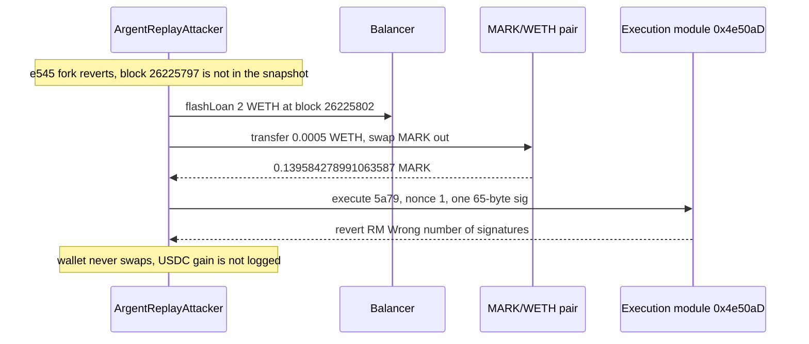

# Argent relay modules — a public owner signature is replayed, and the recovery deadline can be wrapped into the past

> **Vulnerability classes:** vuln/auth · vuln/arithmetic · vuln/logic
> **Reproduction:** the PoC compiles and runs in an isolated Foundry project at [this project folder](.). Full verbose trace: [output.txt](output.txt). **The committed trace is not a pass.** `anvil_state.json` is present and is pinned at block **26,225,802**. `[PASS] test_relay_payloads_match_onchain` only. `[FAIL] test_5a79_leg` (`RM: Wrong number of signatures`). `[FAIL] test_e545_leg` (`BlockOutOfRangeError`, anvil height 26,225,802, requested 26,225,797). Suite: `1 passed; 2 failed` in **3.09s** [output.txt:471](output.txt).

---

## Key info

| | |
|---|---|
| **Loss the test is built to match** | **50,655.918487 USDC** = 48,778.499253 (e545) + 1,877.419234 (5a79). Those are `assertApproxEqAbs` targets (±0.1 USDC) in [test/Argent_exp.sol](test/Argent_exp.sol). **Neither gain is logged.** The header also says SlowMist reported ~59.8K against ~50,655.92 USDC measured on the two txs. This folder does not show that measurement in [output.txt](output.txt) |
| **Vulnerable contracts** | Recovery module proxy [`0xF490557d67D934440677a4f16793d5EF319B8ef5`](https://etherscan.io/address/0xF490557d67D934440677a4f16793d5EF319B8ef5) (impl `0x9996396280fbf9271ba2dd66bea8326207df50a0`). Execution module proxy [`0x4e50aDFc953551286BBD7Fee2b2b846D1D227394`](https://etherscan.io/address/0x4e50aDFc953551286BBD7Fee2b2b846D1D227394) (impl `0x7CD62b0258cC51ca988cafC6Ff0597516c844b03`). `sources/` is empty |
| **Victim wallets** | e545 [`0xe545B9a69bfF1Bf0ed2E922551DDA4AFc8EE8f66`](https://etherscan.io/address/0xe545B9a69bfF1Bf0ed2E922551DDA4AFc8EE8f66). 5a79 [`0x5a79E5772493cF4329682D202aA2D28f85A85440`](https://etherscan.io/address/0x5a79E5772493cF4329682D202aA2D28f85A85440) |
| **Attacker EOA (historical)** | [`0xc10609ce5c032db92e562e463b1234aab0872b02`](https://etherscan.io/address/0xc10609ce5c032db92e562e463b1234aab0872b02) |
| **This PoC's attacker** | `ArgentReplayAttacker` at `0x5615dEB798BB3E4dFa0139dFa1b3D433Cc23b72f` [output.txt:404](output.txt). Deployed inside the test, not the historical contract |
| **Attack txs** | e545 [`0xbfed8d33561ed5f9cbd0f4e62a5bbd20187a64f3e22180148dcb58ed6ebaa795`](https://etherscan.io/tx/0xbfed8d33561ed5f9cbd0f4e62a5bbd20187a64f3e22180148dcb58ed6ebaa795) block 26,225,798. 5a79 [`0xa0ee8f914205a948c79eca039b7d8265537eb220472c9be1455d3321f1bd571b`](https://etherscan.io/tx/0xa0ee8f914205a948c79eca039b7d8265537eb220472c9be1455d3321f1bd571b) block 26,225,803 |
| **Signatures the test replays** | Recovery sig first seen in [`0xac549a6057816c740734a03b7c0bf1996da14102618146c21d5a1be9b5acb28d`](https://etherscan.io/tx/0xac549a6057816c740734a03b7c0bf1996da14102618146c21d5a1be9b5acb28d) block 11,266,059 (2020-11-16). e545 swap sig first seen in [`0xb6e27d6a6589b6a5e5b38d52e56b4dc9d753a519304a51a892dd42806f79b5f9`](https://etherscan.io/tx/0xb6e27d6a6589b6a5e5b38d52e56b4dc9d753a519304a51a892dd42806f79b5f9) block 11,948,627 (2021-02-28) |
| **Chain / block / date** | Ethereum / **2026-10-19** per the test header. e545 fork parent **26,225,797** is rejected. 5a79 fork parent **26,225,802** is the anvil tip [output.txt:353](output.txt), [output.txt:356](output.txt) |
| **Compiler** | PoC `pragma ^0.8.10`, trace compiled with **solc 0.8.36** [output.txt:1](output.txt). Module sources are not in this folder |
| **Bug class** | `execute(address,bytes,uint256,bytes,uint256,uint256)` selector `0xaacaaf88` recovers an owner or guardian signature and does not consume the nonce or the signed hash. The signed deadline is not enforced. On the recovery module, setter `0x254a2e49` takes an attacker-supplied period that wraps the recovery deadline into the past, so `finalizeRecovery` can run in the same transaction |

## TL;DR

Two Argent-style wallets are drained, in the test's account of the incident, by relaying signatures that have been public since 2020 and 2021. The execution module's `execute` checks the ECDSA signature and then runs the wallet's DEX swap anyway, as many times as the caller wants, because nothing marks the signature used. A second bug on the recovery module lets a crafted period overflow the recovery deadline, so a years-old guardian signature can `executeRecovery` and `finalizeRecovery` in one transaction on wallet e545.

The PoC encodes that plan: e545 overflows the deadline, flips the owner to `0x56F17DD1…`, flash-borrows 0.5 WETH, and loops 19 times against the thin MARK/WETH pair `0x6f23D2FE…` (~0.001 WETH of depth). 5a79 skips the owner change, flash-borrows 2 WETH, and loops 9 times, each replay spending 1,000 USDC of the wallet on MARK. Targets are **48,778.499253 USDC** and **1,877.419234 USDC**.

The committed trace does not finish either drain. The 5a79 leg forks, pulls **2 WETH** from Balancer [output.txt:375](output.txt), pushes **0.0005 WETH** into the pair for **0.139584278991063587 MARK** [output.txt:404](output.txt), and reverts inside the first `execute` with **`RM: Wrong number of signatures`** after `guardianCount` returns **0** [output.txt:412](output.txt), [output.txt:414](output.txt). The e545 leg never starts: anvil's height is 26,225,802 and the test asks for 26,225,797 [output.txt:449](output.txt). The only passing test is a pure ABI check that the three relay payloads match the bytes hardcoded from the attack transactions [output.txt:460](output.txt).

## Background

The wallets are old Argent smart wallets. Relayers call a module, not the wallet, and pass `(wallet, calldata, nonce, signatures, gasPrice, gasLimit)`. The module is supposed to recover the signer, check that the nonce is fresh, and check that the signature has not expired.

The test names two independent failures, both reachable through that relay:

- No replay protection. The nonce argument is not consumed and the signed-message hash is not stored. The same 65-byte signature is therefore a valid authorization on every call. The historical e545 transaction replayed one owner signature 19 times; 5a79 replayed one 9 times.
- The deadline in the signed payload is not checked, and it overflows. Separately, recovery-deadline setter `0x254a2e49` is called with `RECOVERY_OVERFLOW_CONFIG = 0x0000c22e450672894ab6cd8efb11d33f5617839a5bc7dea00c22e450672843a3` and a zero second argument. The test says that period wraps e545's recovery deadline into the past, so `finalizeRecovery` does not wait.

The MARK/WETH Uniswap V2 pair is the price the wallet's own swap trades against. At the 5a79 fork the pair's WETH reserve, after the attacker's 0.0005 WETH is added, is **0.001497683446595066** [output.txt:403](output.txt). The test's comment of ~0.001 WETH of depth matches that order of magnitude. Pushing WETH in, forcing the wallet to buy MARK at the new price, and selling the MARK back is how each loop is supposed to extract the wallet's USDC (5a79) or ETH (e545).

`sources/` is empty. The module behavior below is the test header plus the one `execute` the trace actually entered. It is not a verified listing.

## The vulnerable code

**RECONSTRUCTED** from the header of [test/Argent_exp.sol](test/Argent_exp.sol). Not from verified source.

```solidity
// recovery module 0xF490557d and execution module 0x4e50aD
function execute(
    address wallet,
    bytes calldata data,
    uint256 nonce,       // accepted, not consumed
    bytes calldata signatures,
    uint256 gasPrice,
    uint256 gasLimit
) external returns (bool) {
    // recover owner or guardian from `signatures` over the signed payload
    // do not store keccak(payload), do not mark `nonce` used
    // do not enforce the payload deadline
    _callWallet(wallet, data);
}

// recovery module, selector 0x254a2e49
function setRecoveryDeadline(bytes32 config, uint256) external {
    // attacker-chosen period wraps the stored deadline into the past
}
```

The 5a79 call that reverted is exactly the payload the test built. `execute` on `0x4e50aDFc…` delegatecalls impl `0x7CD62b…` with wallet `0x5a79E577…`, nonce **1**, gas price **129 gwei**, gas limit **810,000**, and the 65-byte `SIG_SWAP_5A79` [output.txt:410](output.txt). Inner sequence:

- `guardianCount(0x5a79…)` returns **0** [output.txt:412](output.txt).
- The impl reverts **`RM: Wrong number of signatures`** [output.txt:414](output.txt).

So this trace does not show a signature being accepted a second time. It shows the module rejecting the first replay the PoC attempted. The byte payload itself is what the attack transaction carried: `test_relay_payloads_match_onchain` compares it to the hardcoded hex and passes [output.txt:467](output.txt). The swap arguments inside that payload are 1,000 USDC in (`0x3b9aca00`), min return `674939427291`, MARK as the output token, and extra field `45039706`.

The e545 payloads that pass the same test, and that the drain test never submits, are:

- `executeRecovery(e545, 0x56F17DD1c69Ee819901006E462B76e7a2ea75EF8)` selector `0xb0ba4da0` [output.txt:463](output.txt).
- Wallet swap selector `0xe92bdbf8`: ETH sentinel `0xEeee…`, amount in **1.061908909163406246 ETH** (`1061908909163406246`), min return `1014580053171`, MARK, extra field `25621353654900691` [output.txt:465](output.txt).

## Root cause

1. **A signature is a bearer token with no consumption.** `execute` takes a nonce and does not write it. Replaying the same bytes is a second authorization. The test's loops (19 and 9) exist only because of that. This trace never reaches iteration 2, because iteration 1 already reverts, so the missing nonce update is not what [output.txt](output.txt) demonstrates. It is what the test says the module does, and what the historical transactions required.
2. **Expiry does not bind the signature to the time it was produced.** A signature from block 11,266,059 (2020-11-16) or 11,948,627 (2021-02-28) is still the credential in 2026. Combined with a deadline setter that accepts a period large enough to wrap `uint256` time math, `finalizeRecovery` becomes immediate. The e545 leg, which is the only place the PoC calls `0x254a2e49`, did not run.
3. **The wallet will trade at whatever the pool's spot is.** There is no TWAP and no caller check on the relayed swap. The pair is thin enough that 0.0005 WETH moves it: reserves after that push are **0.279359928895268972 MARK** and **0.001497683446595066 WETH** [output.txt:403](output.txt). That price impact is real in the trace. The wallet never joined the trade.
4. **Why the committed replay reverted.** `guardianCount` is 0 and the module then rejects the single 65-byte signature. The PoC treats that blob as a lone owner signature (`relaySwapSig = SIG_SWAP_5A79`). The live impl disagreed about how many signatures the relay must carry. Until that matches, the 5a79 drain does not reproduce, and the e545 drain cannot even fork on this snapshot.

## Preconditions

- The signatures have to already be public. The test copies three 65-byte blobs from old transactions. No key is used. The payload test confirms the blobs encode the intended calls. It does not confirm the module will accept them.
- Wallet e545 still has a recovery pending that `finalizeRecovery` can close once the deadline is in the past. Not observed in this trace.
- Wallet 5a79 still holds at least 9 × 1,000 USDC, and e545 still holds 19 × ~1.0619 ETH, at the parent blocks. Not observed. The 5a79 test reverts before any USDC leaves the wallet.
- The MARK/WETH pair stays thin. The trace shows it is thin at block 26,225,802.
- One anvil snapshot cannot serve both parents. e545 needs 26,225,797. The loaded state is 26,225,802 [output.txt:353](output.txt). A passing offline run needs a state that contains 26,225,797, or the e545 test has to be pointed at a snapshot taken at that block. This file does not do that.
- Balancer flash liquidity: 2 WETH was delivered [output.txt:375](output.txt). The e545 plan asks for 0.5 WETH. Fee on this Balancer flash is not logged because the callback reverts before repay.

## Attack walkthrough (with on-chain numbers from the trace)

What [output.txt](output.txt) actually did:

| # | Action | Amount | Trace |
|---|--------|--------|-------|
| 0 | Anvil rejects the e545 fork | height 26,225,802, request 26,225,797 | [output.txt:353](output.txt), [output.txt:449](output.txt), [output.txt:452](output.txt) |
| 1 | 5a79 fork succeeds | block 26,225,802 | [output.txt:356](output.txt) |
| 2 | Deployer USDC before | 0 | [output.txt:367](output.txt) |
| 3 | Balancer `flashLoan` of WETH | **2 WETH** (`2000000000000000000`) to `ArgentReplayAttacker` | [output.txt:375](output.txt) |
| 4 | Push WETH into MARK/WETH and `swap` | **0.0005 WETH** in, **0.139584278991063587 MARK** out. Reserves become 0.279359928895268972 MARK and 0.001497683446595066 WETH | [output.txt:386](output.txt), [output.txt:403](output.txt), [output.txt:404](output.txt) |
| 5 | First relayed `execute` of the owner swap signature | nonce 1, gas price 129e9, gas limit 810,000. `guardianCount` = 0. Revert `RM: Wrong number of signatures` | [output.txt:410](output.txt), [output.txt:412](output.txt), [output.txt:414](output.txt), [output.txt:477](output.txt) |
| 6 | Payload bytes vs the attack-tx hex | three `assertEq` pass, including both swap payloads and `executeRecovery` | [output.txt:460](output.txt), [output.txt:463](output.txt), [output.txt:465](output.txt), [output.txt:467](output.txt) |

The loops the test describes and this trace does not reach:

| Leg | Plan in the test | Target USDC | In the trace |
|---|---|---|---|
| e545 | `0x254a2e49` overflow, guardian sig, `finalizeRecovery`, 0.5 WETH flash, 19 × 0.06 WETH pushes, each forcing the wallet to buy ~1.061908909163406246 ETH of MARK | 48,778.499253 ± 0.1 | not executed |
| 5a79 | 2 WETH flash, 9 × 0.0005 WETH pushes, each forcing the wallet to spend 1,000 USDC on MARK | 1,877.419234 ± 0.1 | flash and the first push happen; the wallet call reverts |
| Sum | | **50,655.918487** | not logged |

`[FAIL] test_5a79_leg` at [output.txt:356](output.txt). `[FAIL] test_e545_leg` at [output.txt:449](output.txt). `[PASS] test_relay_payloads_match_onchain` at [output.txt:460](output.txt).

## Diagrams



## Remediation

1. **Consume the nonce and store the signed hash before the wallet call.** A second `execute` with the same signature must revert. The check has to happen even when the outer caller is a relayer the wallet does not know.
2. **Enforce the deadline in the signed payload against `block.timestamp`, and reject a wrapped value.** A signature from 2020 is not a 2026 authorization. The recovery-period setter must revert on overflow instead of writing a deadline in the past.
3. **`finalizeRecovery` needs a real delay after a deadline that the attacker cannot set.** Same-transaction `executeRecovery` plus `finalizeRecovery` is the e545 owner flip. The delay has to be measured from a timestamp the module writes, not from an attacker-supplied period.
4. **Do not treat this trace as a completed fix test.** The 5a79 revert is a signature-count mismatch (`guardianCount` returned 0), and the e545 block is missing from `anvil_state.json`. Replay protection is not shown failing or holding here. A fix is validated only when a second identical `execute` reverts on a fork where the first one succeeded.

## How to reproduce

Offline, from the committed state. `_shared/run_poc.sh` loads `anvil_state.json`, starts anvil, and rewrites the test's `http://127.0.0.1:8545` URL. The snapshot's tip is block 26,225,802, so `test_e545_leg` cannot fork 26,225,797.

```bash
# from the registry root
_shared/run_poc.sh 2026-10-Argent_exp -vvvvv
```

- **Chain / fork:** Ethereum. 5a79 parent **26,225,802**. e545 parent **26,225,797** is out of range on this state.
- **Committed result** in [output.txt](output.txt) (`finished in 3.09s`):

```
[FAIL: RM: Wrong number of signatures] test_5a79_leg()
[FAIL: BlockOutOfRangeError: block height is 26225802 but requested was 26225797] test_e545_leg()
[PASS] test_relay_payloads_match_onchain()
Suite result: FAILED. 1 passed; 2 failed; 0 skipped
```

*Reference: the two attack transactions named in the test header — [`0xbfed8d33…`](https://etherscan.io/tx/0xbfed8d33561ed5f9cbd0f4e62a5bbd20187a64f3e22180148dcb58ed6ebaa795) and [`0xa0ee8f91…`](https://etherscan.io/tx/0xa0ee8f914205a948c79eca039b7d8265537eb220472c9be1455d3321f1bd571b). The test file has no separate write-up URL.*
