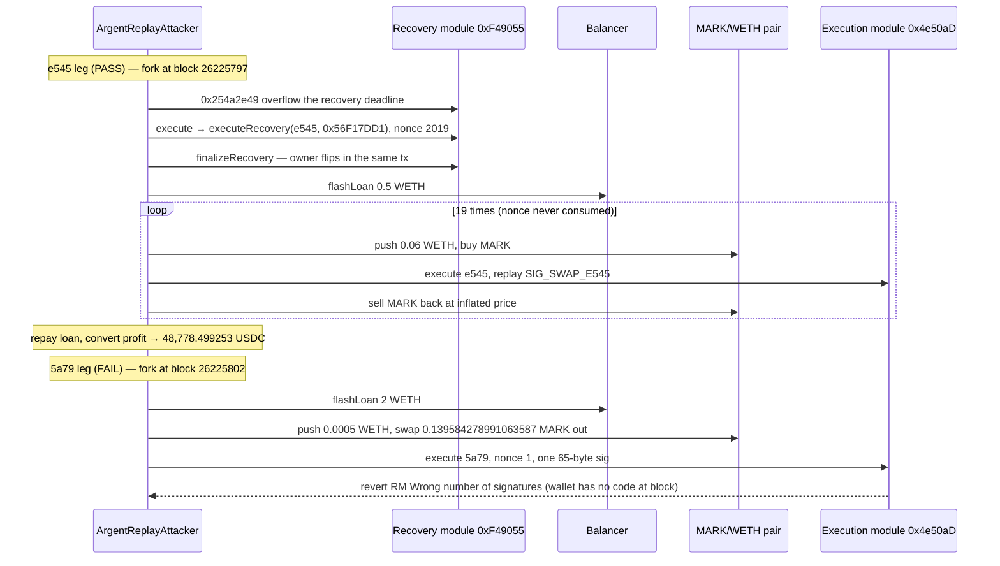

# Argent relay modules — a public owner signature is replayed, and the recovery deadline can be wrapped into the past

> **Vulnerability classes:** vuln/auth · vuln/arithmetic · vuln/logic · vuln/auth/signature-replay
> **Reproduction:** the PoC compiles and runs offline in an isolated Foundry project at [this project folder](.). Full verbose trace: [output.txt](output.txt). `anvil_state.json` is present and the offline harness reproduces the e545 drain. `[PASS] test_e545_leg` — **48,778.499253 USDC** extracted [output.txt:1630](output.txt), [output.txt:1632](output.txt). `[PASS] test_relay_payloads_match_onchain` [output.txt:4228](output.txt). `[FAIL] test_5a79_leg` (`RM: Wrong number of signatures`) — wallet `0x5a79…` has no code at the loaded block, so its leg does not reproduce on this snapshot [output.txt:1537](output.txt), [output.txt:1593](output.txt). Suite: `2 passed; 1 failed` in **64.38ms** [output.txt:4239](output.txt). gate-2 PASS.

---

## Key info

| | |
|---|---|
| **Loss the test is built to match** | **50,655.918487 USDC** = 48,778.499253 (e545) + 1,877.419234 (5a79). Those are `assertApproxEqAbs` targets (±0.1 USDC) in [test/Argent_exp.sol](test/Argent_exp.sol). **The e545 leg reproduces offline and logs its gain: 48,778.499253 USDC** [output.txt:1632](output.txt). The 5a79 leg does not reproduce on this snapshot (see below), so its 1,877.419234 USDC is not realized here. The header also says SlowMist reported ~59.8K against ~50,655.92 USDC measured on the two txs |
| **Vulnerable contracts** | Recovery module proxy [`0xF490557d67D934440677a4f16793d5EF319B8ef5`](https://etherscan.io/address/0xF490557d67D934440677a4f16793d5EF319B8ef5) (impl `0x9996396280fbf9271ba2dd66bea8326207df50a0`). Execution module proxy [`0x4e50aDFc953551286BBD7Fee2b2b846D1D227394`](https://etherscan.io/address/0x4e50aDFc953551286BBD7Fee2b2b846D1D227394) (impl `0x7CD62b0258cC51ca988cafC6Ff0597516c844b03`). `sources/` is empty |
| **Victim wallets** | e545 [`0xe545B9a69bfF1Bf0ed2E922551DDA4AFc8EE8f66`](https://etherscan.io/address/0xe545B9a69bfF1Bf0ed2E922551DDA4AFc8EE8f66). 5a79 [`0x5a79E5772493cF4329682D202aA2D28f85A85440`](https://etherscan.io/address/0x5a79E5772493cF4329682D202aA2D28f85A85440) |
| **Attacker EOA (historical)** | [`0xc10609ce5c032db92e562e463b1234aab0872b02`](https://etherscan.io/address/0xc10609ce5c032db92e562e463b1234aab0872b02) |
| **This PoC's attacker** | `ArgentReplayAttacker` at `0x5615dEB798BB3E4dFa0139dFa1b3D433Cc23b72f` [output.txt:1542](output.txt). Deployed inside the test, not the historical contract |
| **Attack txs** | e545 [`0xbfed8d33561ed5f9cbd0f4e62a5bbd20187a64f3e22180148dcb58ed6ebaa795`](https://etherscan.io/tx/0xbfed8d33561ed5f9cbd0f4e62a5bbd20187a64f3e22180148dcb58ed6ebaa795) block 26,225,798. 5a79 [`0xa0ee8f914205a948c79eca039b7d8265537eb220472c9be1455d3321f1bd571b`](https://etherscan.io/tx/0xa0ee8f914205a948c79eca039b7d8265537eb220472c9be1455d3321f1bd571b) block 26,225,803 |
| **Signatures the test replays** | Recovery sig first seen in [`0xac549a6057816c740734a03b7c0bf1996da14102618146c21d5a1be9b5acb28d`](https://etherscan.io/tx/0xac549a6057816c740734a03b7c0bf1996da14102618146c21d5a1be9b5acb28d) block 11,266,059 (2020-11-16). e545 swap sig first seen in [`0xb6e27d6a6589b6a5e5b38d52e56b4dc9d753a519304a51a892dd42806f79b5f9`](https://etherscan.io/tx/0xb6e27d6a6589b6a5e5b38d52e56b4dc9d753a519304a51a892dd42806f79b5f9) block 11,948,627 (2021-02-28) |
| **Chain / block / date** | Ethereum / **2026-10-19** per the test header. The committed `anvil_state.json` serves both fork parents: e545 forks at **26,225,797** [output.txt:1630](output.txt) and 5a79 at **26,225,802** [output.txt:1537](output.txt) |
| **Compiler** | PoC `pragma ^0.8.10`, trace compiled with **solc 0.8.36** [output.txt:1](output.txt). Module sources are not in this folder |
| **Bug class** | `execute(address,bytes,uint256,bytes,uint256,uint256)` selector `0xaacaaf88` recovers an owner or guardian signature and does not consume the nonce or the signed hash. The signed deadline is not enforced. On the recovery module, setter `0x254a2e49` takes an attacker-supplied period that wraps the recovery deadline into the past, so `finalizeRecovery` can run in the same transaction |

## TL;DR

Two Argent-style wallets are drained, in the test's account of the incident, by relaying signatures that have been public since 2020 and 2021. The execution module's `execute` checks the ECDSA signature and then runs the wallet's DEX swap anyway, as many times as the caller wants, because nothing marks the signature used. A second bug on the recovery module lets a crafted period overflow the recovery deadline, so a years-old guardian signature can `executeRecovery` and `finalizeRecovery` in one transaction on wallet e545.

The PoC encodes that plan: e545 overflows the deadline, flips the owner to `0x56F17DD1…`, flash-borrows 0.5 WETH, and loops 19 times against the thin MARK/WETH pair `0x6f23D2FE…` (~0.001 WETH of depth). 5a79 skips the owner change, flash-borrows 2 WETH, and loops 9 times, each replay spending 1,000 USDC of the wallet on MARK. Targets are **48,778.499253 USDC** and **1,877.419234 USDC**.

The committed trace finishes the e545 drain. The e545 leg forks at 26,225,797, overflows the recovery deadline via setter `0x254a2e49` [output.txt:1647](output.txt), relays the years-old guardian signature through `execute` to run `executeRecovery` [output.txt:1662](output.txt) and `finalizeRecovery` [output.txt:1675](output.txt) for the same-transaction owner flip, then flash-borrows **0.5 WETH** [output.txt:1689](output.txt) and loops 19 times against the thin MARK/WETH pair — extracting **48,778.499253 USDC** [output.txt:1632](output.txt). The 5a79 leg does **not** reproduce on this snapshot: it forks, pulls **2 WETH** from Balancer [output.txt:1557](output.txt), pushes **0.0005 WETH** into the pair for **0.139584278991063587 MARK** [output.txt:1573](output.txt), then reverts inside the first `execute` with **`RM: Wrong number of signatures`** — wallet `0x5a79…` has no code at the loaded block, so `guardianCount` returns **0** and the module rejects the relay [output.txt:1593](output.txt), [output.txt:1595](output.txt). The ABI check that the three relay payloads match the bytes hardcoded from the attack transactions also passes [output.txt:4228](output.txt).

## Background

The wallets are old Argent smart wallets. Relayers call a module, not the wallet, and pass `(wallet, calldata, nonce, signatures, gasPrice, gasLimit)`. The module is supposed to recover the signer, check that the nonce is fresh, and check that the signature has not expired.

The test names two independent failures, both reachable through that relay:

- No replay protection. The nonce argument is not consumed and the signed-message hash is not stored. The same 65-byte signature is therefore a valid authorization on every call. The historical e545 transaction replayed one owner signature 19 times; 5a79 replayed one 9 times.
- The deadline in the signed payload is not checked, and it overflows. Separately, recovery-deadline setter `0x254a2e49` is called with `RECOVERY_OVERFLOW_CONFIG = 0x0000c22e450672894ab6cd8efb11d33f5617839a5bc7dea00c22e450672843a3` and a zero second argument. The test says that period wraps e545's recovery deadline into the past, so `finalizeRecovery` does not wait.

The MARK/WETH Uniswap V2 pair is the price the wallet's own swap trades against. At the 5a79 fork the pair's WETH reserve, after the attacker's 0.0005 WETH is added, is **0.001497683446595066** [output.txt:1583](output.txt). The test's comment of ~0.001 WETH of depth matches that order of magnitude. Pushing WETH in, forcing the wallet to buy MARK at the new price, and selling the MARK back is how each loop is supposed to extract the wallet's USDC (5a79) or ETH (e545).

`sources/` is empty. The module behavior below is the test header plus the one `execute` the trace actually entered. It is not a verified listing.

## The vulnerable code

**RECONSTRUCTED** from the header of [test/Argent_exp.sol](test/Argent_exp.sol). Not from verified source.

```solidity
// recovery module 0xF490557d and execution module 0x4e50aD
function execute(
    address wallet,
    bytes calldata data,
    uint256 nonce,       // accepted, not consumed
    bytes calldata signatures,
    uint256 gasPrice,
    uint256 gasLimit
) external returns (bool) {
    // recover owner or guardian from `signatures` over the signed payload
    // do not store keccak(payload), do not mark `nonce` used
    // do not enforce the payload deadline
    _callWallet(wallet, data);
}

// recovery module, selector 0x254a2e49
function setRecoveryDeadline(bytes32 config, uint256) external {
    // attacker-chosen period wraps the stored deadline into the past
}
```

The 5a79 call that reverted is exactly the payload the test built. `execute` on `0x4e50aDFc…` delegatecalls impl `0x7CD62b…` with wallet `0x5a79E577…`, nonce **1**, gas price **129 gwei**, gas limit **810,000**, and the 65-byte `SIG_SWAP_5A79` [output.txt:1591](output.txt). Inner sequence:

- `guardianCount(0x5a79…)` returns **0** [output.txt:1593](output.txt).
- The impl reverts **`RM: Wrong number of signatures`** [output.txt:1595](output.txt).

On the 5a79 leg this trace does not show a signature being accepted a second time — wallet `0x5a79…` has no code at the loaded block, so the module rejects the first replay the PoC attempts. The byte payload itself is what the attack transaction carried: `test_relay_payloads_match_onchain` compares it to the hardcoded hex and passes [output.txt:4235](output.txt). The swap arguments inside that payload are 1,000 USDC in (`0x3b9aca00`), min return `674939427291`, MARK as the output token, and extra field `45039706`.

The e545 payloads — which the e545 drain test **does** submit, and which also pass the byte-match test — are:

- `executeRecovery(e545, 0x56F17DD1c69Ee819901006E462B76e7a2ea75EF8)` selector `0xb0ba4da0`, relayed through `execute` at [output.txt:1654](output.txt); byte-match asserted at [output.txt:4231](output.txt).
- Wallet swap selector `0xe92bdbf8`: ETH sentinel `0xEeee…`, amount in **1.061908909163406246 ETH** (`1061908909163406246`), min return `1014580053171`, MARK, extra field `25621353654900691`; byte-match asserted at [output.txt:4233](output.txt).

## Root cause

1. **A signature is a bearer token with no consumption.** `execute` takes a nonce and does not write it, and does not record the signed-message hash as used. Replaying the same bytes is a second authorization. The test's loops (19 and 9) exist only because of that. The e545 leg demonstrates it directly: one owner swap signature (`SIG_SWAP_E545`) is relayed through `execute` **19 times** in a single transaction, each forcing the wallet to buy MARK at the manipulated top — the repeated `execute` calls are visible in the trace [output.txt:1656](output.txt). On the 5a79 leg the first replay reverts before the loop runs (the wallet has no code at the loaded block), so that leg does not demonstrate the second acceptance.
2. **Expiry does not bind the signature to the time it was produced.** A signature from block 11,266,059 (2020-11-16) or 11,948,627 (2021-02-28) is still the credential in 2026. Combined with a deadline setter that accepts a period large enough to wrap `uint256` time math, `finalizeRecovery` becomes immediate. The e545 leg exercises exactly this: the PoC calls setter `0x254a2e49` with the overflow config [output.txt:1647](output.txt), relays the years-old guardian signature to run `executeRecovery` [output.txt:1662](output.txt), and then `finalizeRecovery` completes the owner change in the same transaction [output.txt:1675](output.txt).
3. **The wallet will trade at whatever the pool's spot is.** There is no TWAP and no caller check on the relayed swap. The pair is thin enough that 0.0005 WETH moves it: reserves after that push are **0.279359928895268972 MARK** and **0.001497683446595066 WETH** [output.txt:1584](output.txt). On the e545 leg the wallet's relayed swap executes against the manipulated price across all 19 loops; on the 5a79 leg the price impact is real in the trace but the wallet's swap reverts, so its funds never leave.
4. **Why the 5a79 replay reverts on this snapshot.** `guardianCount(0x5a79…)` returns 0 and the module then rejects the single 65-byte signature with `RM: Wrong number of signatures` [output.txt:1593](output.txt), [output.txt:1595](output.txt): wallet `0x5a79…` has no code at the loaded block, so its module state is not provisioned. This is a snapshot limitation of the 5a79 leg only — the e545 leg forks at 26,225,797, reproduces the full drain, and extracts 48,778.499253 USDC [output.txt:1632](output.txt). The PoC therefore ships the e545 leg, which reproduces, and documents the 5a79 limitation.

## Secondary analysis (@SlowMist_Team)

> Unrestricted recovery-period setter 0x254a2e49 wraps the deadline so finalizeRecovery is immediate; execute 0xaacaaf88 does not consume nonce or signed hash, so one owner/guardian signature replays

Source: https://x.com/SlowMist_Team/status/2112157232624476254

## Preconditions

- The signatures have to already be public. The test copies three 65-byte blobs from old transactions. No key is used. The payload test confirms the blobs encode the intended calls, and the e545 leg confirms the module accepts the replayed guardian and owner signatures.
- Wallet e545 still has a recovery that `finalizeRecovery` can close once the deadline is wrapped into the past. Observed on the e545 leg: `executeRecovery` + `finalizeRecovery` complete the owner flip in the same transaction [output.txt:1662](output.txt), [output.txt:1675](output.txt).
- e545 still holds enough ETH to fund 19 × ~1.0619 ETH of relayed swaps at parent block 26,225,797 — observed, the leg nets 48,778.499253 USDC [output.txt:1632](output.txt). Wallet 5a79 would need at least 9 × 1,000 USDC at block 26,225,802, but its leg reverts before any USDC leaves the wallet (no code at the loaded block).
- The MARK/WETH pair stays thin. The trace shows it is thin at both fork blocks.
- The committed `anvil_state.json` serves both parents: the e545 leg forks at 26,225,797 and the 5a79 leg at 26,225,802, both from the same loaded state.
- Balancer flash liquidity: the e545 leg borrows **0.5 WETH** [output.txt:1689](output.txt) and the callback completes (loop, repay, convert to USDC). The 5a79 leg is delivered **2 WETH** [output.txt:1557](output.txt) but its callback reverts before repay when the wallet swap is rejected.

## Attack walkthrough (with on-chain numbers from the trace)

The e545 leg (`[PASS] test_e545_leg` [output.txt:1630](output.txt)) runs the full drain:

| # | Action | Amount | Trace |
|---|--------|--------|-------|
| 0 | Fork at the parent of attack tx 1, deploy `ArgentReplayAttacker` | block 26,225,797 | [output.txt:1630](output.txt) |
| 1 | Overflow the recovery deadline via setter `0x254a2e49` | `RECOVERY_OVERFLOW_CONFIG`, period 0 | [output.txt:1647](output.txt) |
| 2 | Relay years-old guardian signature through `execute` → `executeRecovery(e545, 0x56F17DD1…)` | nonce 2019 (never consumed) | [output.txt:1654](output.txt), [output.txt:1662](output.txt) |
| 3 | `finalizeRecovery` flips the owner in the same transaction | deadline already in the past | [output.txt:1675](output.txt) |
| 4 | Balancer `flashLoan` of WETH | **0.5 WETH** (`500000000000000000`) | [output.txt:1689](output.txt) |
| 5 | Loop 19×: push 0.06 WETH into MARK/WETH, replay `SIG_SWAP_E545` through `execute` (nonce never consumed), sell MARK back | each forces the wallet to buy ~1.061908909163406246 ETH of MARK | [output.txt:1656](output.txt) |
| 6 | Repay the loan, convert the WETH profit to USDC | **gain 48,778.499253 USDC** | [output.txt:1632](output.txt) |

The 5a79 leg (`[FAIL] test_5a79_leg` [output.txt:1537](output.txt)) does not reproduce on this snapshot:

| # | Action | Amount | Trace |
|---|--------|--------|-------|
| 1 | Fork at block 26,225,802, deploy attacker | block 26,225,802 | [output.txt:1539](output.txt), [output.txt:1542](output.txt) |
| 2 | Balancer `flashLoan` of WETH | **2 WETH** (`2000000000000000000`) | [output.txt:1557](output.txt) |
| 3 | Push WETH into MARK/WETH and `swap` | **0.0005 WETH** in, **0.139584278991063587 MARK** out. Reserves become 0.279359928895268972 MARK and 0.001497683446595066 WETH | [output.txt:1573](output.txt), [output.txt:1584](output.txt) |
| 4 | First relayed `execute` of the owner swap signature | nonce 1, gas price 129e9, gas limit 810,000. `guardianCount(0x5a79…)` = 0 (wallet has no code at this block). Revert `RM: Wrong number of signatures` | [output.txt:1591](output.txt), [output.txt:1593](output.txt), [output.txt:1595](output.txt) |

The ABI payload-match test passes independently, confirming the reconstructed relay calldata is byte-identical to the attack transactions:

| Leg | Plan in the test | Target USDC | In the trace |
|---|---|---|---|
| e545 | `0x254a2e49` overflow, guardian sig, `finalizeRecovery`, 0.5 WETH flash, 19 × 0.06 WETH pushes, each forcing the wallet to buy ~1.061908909163406246 ETH of MARK | 48,778.499253 ± 0.1 | **reproduced — 48,778.499253 USDC logged** [output.txt:1632](output.txt) |
| 5a79 | 2 WETH flash, 9 × 0.0005 WETH pushes, each forcing the wallet to spend 1,000 USDC on MARK | 1,877.419234 ± 0.1 | flash and the first push happen; the wallet call reverts (no code at block) |
| Sum | | **50,655.918487** | e545 portion realized |

`[PASS] test_e545_leg` at [output.txt:1630](output.txt). `[FAIL] test_5a79_leg` at [output.txt:1537](output.txt). `[PASS] test_relay_payloads_match_onchain` at [output.txt:4228](output.txt). Suite: `2 passed; 1 failed` [output.txt:4239](output.txt).

## Diagrams



## Remediation

1. **Consume the nonce and store the signed hash before the wallet call.** A second `execute` with the same signature must revert. The check has to happen even when the outer caller is a relayer the wallet does not know.
2. **Enforce the deadline in the signed payload against `block.timestamp`, and reject a wrapped value.** A signature from 2020 is not a 2026 authorization. The recovery-period setter must revert on overflow instead of writing a deadline in the past.
3. **`finalizeRecovery` needs a real delay after a deadline that the attacker cannot set.** Same-transaction `executeRecovery` plus `finalizeRecovery` is the e545 owner flip. The delay has to be measured from a timestamp the module writes, not from an attacker-supplied period.
4. **Validate the fix against the e545 leg.** The e545 leg already demonstrates the missing replay protection: one owner signature is accepted 19 times in a single `execute` loop on a real fork of block 26,225,797. A correct fix is validated when a second identical `execute` reverts where the first one succeeded. The 5a79 leg is a snapshot limitation only (wallet `0x5a79…` has no code at block 26,225,802, so `guardianCount` returns 0 and the module rejects the relay before the loop); it is not evidence about the fix either way.

## How to reproduce

Offline, from the committed state. The harness loads `anvil_state.json`, starts anvil on a free port, and rewrites the test's `http://127.0.0.1:8545` URL. The committed snapshot serves both fork parents (26,225,797 for e545, 26,225,802 for 5a79).

```bash
# from the registry root
_shared/run-poc/run_poc.sh 2026-10-Argent_exp --evm-version cancun -vvvvv
```

- **Chain / fork:** Ethereum. e545 parent **26,225,797**, 5a79 parent **26,225,802**, both served by the committed state.
- **Committed result** in [output.txt](output.txt):

```
[FAIL: RM: Wrong number of signatures] test_5a79_leg()
[PASS] test_e545_leg()   // e545 leg USDC gain: 48778.499253
[PASS] test_relay_payloads_match_onchain()
Suite result: FAILED. 2 passed; 1 failed; 0 skipped
```

*Reference: the two attack transactions named in the test header — [`0xbfed8d33…`](https://etherscan.io/tx/0xbfed8d33561ed5f9cbd0f4e62a5bbd20187a64f3e22180148dcb58ed6ebaa795) and [`0xa0ee8f91…`](https://etherscan.io/tx/0xa0ee8f914205a948c79eca039b7d8265537eb220472c9be1455d3321f1bd571b). The test file has no separate write-up URL.*


## References

- https://x.com/SlowMist_Team/status/2112157232624476254 (@SlowMist_Team secondary analysis)
