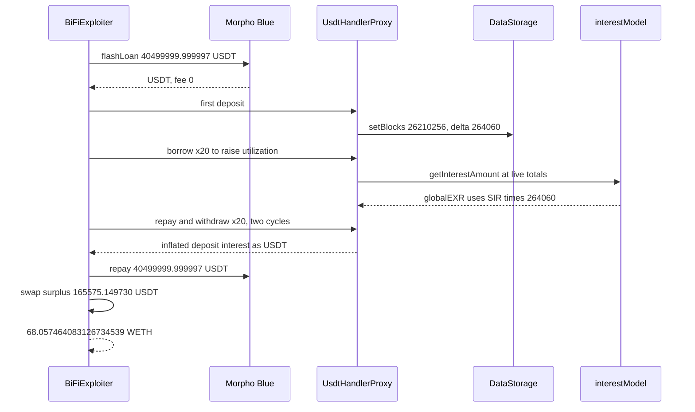

# BiFi USDT — one idle gap of 264,060 blocks is reapplied at a live utilization the attacker sets

> **Vulnerability classes:** vuln/logic/reward-calculation · vuln/logic/incorrect-state-transition · vuln/logic/missing-check
> **Reproduction:** online only. This folder has **no `anvil_state.json`**. Passing archival-fork trace: [output.txt](output.txt). Folder: [(.)](.). Verified source: [sources/UsdtHandlerProxy_808c3b](sources/UsdtHandlerProxy_808c3b), [sources/TokenHandler_47be3d](sources/TokenHandler_47be3d), [sources/interestModel_29ecab](sources/interestModel_29ecab).
---
## Key info
| | |
|---|---|
| **Loss** | **165,575.149730 USDT** surplus after a **40,499,999.999997 USDT** Morpho flash loan is repaid in full, swapped to **68.057464083126734539 WETH** [output.txt:19176](output.txt), [output.txt:19220](output.txt). On-chain the same surplus was **165,574.514633 USDT** and **68.057203111718789216 WETH**. The test band is 0.01 WETH |
| **Vulnerable contract** | BiFi `UsdtHandlerProxy` [`0x808C3bA97268dbF9695b1EC10729E09c7e67A9E3`](https://etherscan.io/address/0x808c3ba97268dbf9695b1ec10729e09c7e67a9e3). Logic `TokenHandler` [`0x47Be3d1DEF039Bd85e7570864bB5148E7491A65F`](https://etherscan.io/address/0x47be3d1def039bd85e7570864bb5148e7491a65f). Interest model [`0x29Ecabde2C57B6D4183f915eBca1A25804A60dB1`](https://etherscan.io/address/0x29ecabde2c57b6d4183f915ebca1a25804a60db1). Data storage [`0xFdC7D058beDE981eA865Fb64D06382A2206A1C42`](https://etherscan.io/address/0xfdc7d058bede981ea865fb64d06382a2206a1c42) |
| **Attacker EOA** | Original deployer [`0x7c78A049fFf71609990017B58A959E926E6ec4C6`](https://etherscan.io/address/0x7c78a049fff71609990017b58a959e926e6ec4c6). Profit was taken by MEV bot [`0xC0ffeEBABE5D496B2DDE509f9fa189C25cF29671`](https://etherscan.io/address/0xc0ffeebabe5d496b2dde509f9fa189c25cf29671) (`c0ffeebabe.eth`) |
| **Attack contract** | Bot helper [`0xe08d97e151473a848c3d9ca3f323cb720472d015`](https://etherscan.io/address/0xe08d97e151473a848c3d9ca3f323cb720472d015). PoC deploys `BiFiExploiter` and does not replay either EOA's bytecode |
| **Attack tx** | Deploy [`0x15b47e2c0daf723dec64c75b435079d3a1f8a6058b21b9a64dda4844e877a034`](https://etherscan.io/tx/0x15b47e2c0daf723dec64c75b435079d3a1f8a6058b21b9a64dda4844e877a034), block 26,210,255. Profit [`0x756c68055af7a0630aa0b56891ba4de14c56c39cbebe99e47eeb4728f4d6ad14`](https://etherscan.io/tx/0x756c68055af7a0630aa0b56891ba4de14c56c39cbebe99e47eeb4728f4d6ad14), block 26,210,256 |
| **Chain / block / date** | Ethereum mainnet (chain id 1) / fork parent **26,210,254**, `vm.roll` to profit block **26,210,256** / 17 October 2026, 05:42:47 UTC (trace deadline `1792215767`) |
| **Compiler** | Solidity `v0.6.12+commit.27d51765`, optimizer on, 200 runs, on the proxy, the handler, and the interest model ([_meta.json](sources/TokenHandler_47be3d/_meta.json)). Proxy implementation is the handler |
| **Bug class** | The first action after a long idle stores the entire block gap, and every later action in that block multiplies the frozen per-block exchange rate by that full gap at the market's *current* deposit and borrow totals |

## TL;DR
The BiFi USDT market had not been touched since block **25,946,196**. Rolled to the profit block, that is **264,060** blocks, about 36.7 days [output.txt:29](output.txt)–[output.txt:32](output.txt). BiFi accrues interest lazily. The first action in a block writes `block.number - lastUpdatedBlock` into storage as `inactiveActionDelta` and freezes the per-block exchange rate. Later actions in the same block see a zero *new* gap, so they do not overwrite that stored delta. `interestModel.getInterestAmount` then does `globalEXR = (perBlockRate * delta + 1e18) * frozenActionEXR` using the rate implied by the totals **at the moment of the call**.

Those totals are permissionless. `deposit`, `borrow`, `repay`, and `withdraw` on the proxy are public `delegatecall`s with no role. The attacker flash-borrows **40,499,999.999997 USDT** from Morpho Blue (fee 0), deposits it, borrows to raise utilization, and repay/withdraws so each utilization step re-credits deposit interest for the whole 264,060-block gap rather than for one block. Two such cycles leave **165,575.149730 USDT** after the flash loan is repaid [output.txt:19176](output.txt). Uniswap v3 (fee 3000) turns that into **68.057464083126734539 WETH** [output.txt:19220](output.txt). `[PASS] testExploit()` gas 15,539,012 [output.txt:4](output.txt).

The original attacker deployed in block 26,210,255. The bot `c0ffeebabe` took the profit one block later by calling the same public functions. This PoC reconstructs the mechanism. It does not replay either transaction's calldata.

## Background — what BiFi accrues
BiFi is a pooled lending market. The USDT handler is a proxy. Users pass amounts in 18-decimal "unified" units. The handler converts to 6-decimal USDT when it moves tokens. Interest is an exchange-rate index, not a separate reward token. `TokenHandler._updateInterestAmount` asks the interest model for a deposit delta and a borrow delta, writes the new global index onto the user, and adds the delta to the user's unified balance.

The index is not updated every block. `_checkFirstAction` compares `block.number` with `lastUpdatedBlock`. If they differ, it stores that difference and calls `syncActionEXR`, which freezes the per-block rate for the rest of the block. Every later call in the block uses the stored gap and the frozen rate, but it recomputes the supply and borrow rates from the live totals.

The market had been idle. `getLastUpdatedBlock()` is **25,946,196** [output.txt:29](output.txt). After `vm.roll(26_210_256)` the gap assert is **264,060** [output.txt:32](output.txt). The header's "264,059 blocks / attack block 26,210,255" is the deploy block. This trace charges the profit block, one block later, and `setBlocks(26210256, 264060)` is what storage records [output.txt:95](output.txt).

## The vulnerable code
### The whole idle gap is stored once per block
From verified `TokenHandler`:

```solidity
function _checkFirstAction() internal returns (bool) {
    IMarketHandlerDataStorage _handlerDataStorage = handlerDataStorage;
    uint256 lastUpdatedBlock = _handlerDataStorage.getLastUpdatedBlock();
    uint256 currentBlockNumber = _blockContext();
    uint256 blockDelta = sub(currentBlockNumber, lastUpdatedBlock);
    if (blockDelta > 0) {
        _handlerDataStorage.setBlocks(currentBlockNumber, blockDelta);
        _handlerDataStorage.syncActionEXR();
        return true;
    }
    return false;
}
```

`setBlocks(26210256, 264060)` runs on the first deposit [output.txt:95](output.txt). After that, `lastUpdatedBlock` is the current block, so `blockDelta` is 0 and the stored **264,060** is left in place for the rest of the transaction.

### That gap is applied at whatever utilization the caller has just set
From verified `interestModel._getInterestAmount` / `_calcInterestAmount` / `_getNewGlobalEXR`:

```solidity
uint256 delta = handlerDataStorage.getInactiveActionDelta();
(actionDepositEXR, actionBorrowEXR) = handlerDataStorage.getActionEXR();
return _calcInterestAmount(handlerDataStorageAddr, userAddr, delta, actionDepositEXR, actionBorrowEXR);

// inside _calcInterestAmount
(SIR, BIR) = _getSIRandBIRonBlock(depositTotalAmount, borrowTotalAmount);
globalDepositEXR = _getNewGlobalEXR(actionDepositEXR, SIR, delta);

function _getNewGlobalEXR(uint256 actionEXR, uint256 interestRate, uint256 delta) internal pure returns (uint256) {
    return interestRate.mul(delta).add(unifiedPoint).unifiedMul(actionEXR);
}
```

`delta` is not divided down to one block and it is not capped. SIR comes from the current totals (`borrow / deposit` inside `_getUtilizationRate`, then the jump-rate BIR, then `SIR = util * BIR * spread`). `_updateInterestAmount` then sets the user's index to this new global. The next call with the same SIR pays nothing more, because `userEXR` already equals `globalEXR`. A **higher** SIR produces a new global of `(newSIR * 264060 + 1e18) * frozenActionEXR`. The user is credited `userDeposit * (newGlobal - userEXR)`, which is the full idle gap times the rate increase, not a single block of interest.

The proxy exposes this with no gate. `deposit`, `withdraw`, `borrow` are `public` and `delegatecall` the handler ([UsdtHandlerProxy.sol](sources/UsdtHandlerProxy_808c3b/UsdtHandlerProxy.sol)). `migration` is `onlyOwner`. The four user actions are not.

## Root cause — why it was possible
1. **`inactiveActionDelta` stores the raw idle gap.** The first action writes 264,060. Nothing amortizes that into per-block updates. A 36-day silence becomes one multiplier.
2. **The frozen rate and the live rate are different inputs.** `actionEXR` is snapshotted once. SIR/BIR are recomputed from totals on every call. Moving utilization after the snapshot changes the index by `rateDelta * fullGap`, not `rateDelta * 1`.
3. **The user's index is updated, so the gap can be harvested again at the next rate.** After each credit, `userEXR = globalEXR`. The next borrow that raises utilization opens a new full-gap delta. The repay/withdraw loop is what turns those credits into USDT.
4. **Every step is a public function.** No keeper has to accrue the market, and the attacker does not need a stale position of their own. The idle state is just `lastUpdatedBlock`.

## Preconditions
- The USDT market's `lastUpdatedBlock` is far behind the current block. Here, **25,946,196** versus **26,210,256** [output.txt:29](output.txt), [output.txt:32](output.txt).
- `deposit` / `borrow` / `repay` / `withdraw` stay callable by any address. They are.
- A flash loan large enough to dominate utilization. Morpho Blue lent **40,499,999.999997 USDT** at fee 0 [output.txt:40](output.txt). The loan is repaid in full [output.txt:19167](output.txt).
- Same-block execution. The stored gap is only sticky inside the block that first touched the market. A later block would store a fresh delta of 1.
- No admin, oracle, or signature. The MEV bot won by ordering the same calls, not by a special role.

## Attack walkthrough (with on-chain numbers from the trace)
`setUp` forks `https://eth.drpc.org` at **26,210,254** and rolls to **26,210,256**. The test contract's WETH balance before the exploit log is **0.202213274263176443** [output.txt:6](output.txt). That baseline is the balance-log helper's starting balance, not profit. Profit is the delta.

| Step | Call | Trace |
|---|---|---|
| 1 | Read idle state | `getLastUpdatedBlock` **25,946,196** [output.txt:29](output.txt). Gap assert **264,060** [output.txt:32](output.txt) |
| 2 | Morpho `flashLoan` | **40,499,999.999997 USDT** to `BiFiExploiter` [output.txt:39](output.txt)–[output.txt:42](output.txt) |
| 3 | Five deposits, unified amounts, USDT actually pulled | **121,257.485029**, **484,544.910179**, **1,795,238.892215**, **7,238,802.155389**, **30,860,156.557185** [output.txt:136](output.txt), [output.txt:201](output.txt), [output.txt:266](output.txt), [output.txt:331](output.txt), [output.txt:396](output.txt). Sum **40,499,999.999997 USDT** |
| 4 | First of those deposits | `setBlocks(26210256, 264060)` [output.txt:95](output.txt). This freezes the gap |
| 5 | `deposit(0)` | settles interest on the new position [output.txt:407](output.txt) |
| 6 | `borrow` × 20 | each **1,498,500 USDT** unified (`1.4985e24`) [output.txt:466](output.txt). Utilization, and therefore SIR, steps up |
| 7 | `repay(1,498,500)` / `withdraw(2,025,000)` × 20 | each withdraw pulls deposit principal plus the full-gap interest just credited at the new rate |
| 8 | `repay` / `withdraw` of **40,500,000** unified | unwinds the flash principal |
| 9 | Repeat 3–8 | second cycle, same frozen gap, same block |
| 10 | Final `withdraw` | **4,463.571825** unified USDT, the residual credited interest |
| 11 | Approve Morpho and repay | **40,499,999.999997 USDT** leaves the exploiter [output.txt:19167](output.txt). Flash loan nets to zero [output.txt:19218](output.txt) |
| 12 | `exactInputSingle` USDT to WETH, fee 3000 | `amountIn` **165,575.149730 USDT** [output.txt:19182](output.txt). Pool pays **68.057464083126734539 WETH** [output.txt:19184](output.txt), [output.txt:19203](output.txt) |

Accounting:

```text
USDT after repay, before swap     165,575.149730     [output.txt:19176]
WETH bought                        68.057464083126734539
WETH before (helper baseline)       0.202213274263176443   [output.txt:6]
WETH after                         68.259677357389910982   [output.txt:8]
delta                              68.057464083126734539   [output.txt:7]
on-chain WETH the test names      68.057203111718789216
absolute error                     0.000260971408545323 WETH
assert band                        0.01 WETH               [output.txt:19221]
```

The USDT surplus is **0.635097 USDT** above the header's on-chain **165,574.514633 USDT**. The header attributes that to intra-block drift from forking the parent and rolling forward. The flash principal is not part of the profit. Gas of the passing test is 15,539,012 [output.txt:4](output.txt). Suite result [output.txt:19234](output.txt).

## Diagrams


## Remediation
1. **Cap `inactiveActionDelta` at 1, or accrue it in a loop that does not let the caller change totals between slices.** A 264,060-block gap must not be one multiplier on a rate the caller just set. If gas makes a loop impractical, store the index as a function of time that does not reread live totals for the historical part.
2. **Snapshot utilization together with `actionEXR`.** SIR/BIR for the idle gap have to be the rates that were in force during the idle period, or a rate computed before the caller's deposit and borrow. Recomputing SIR from post-borrow totals and multiplying by the stored gap is the profit.
3. **Apply the idle gap once per user per update, against the snapshotted rate.** After `userEXR` is set to `globalEXR`, a later call in the same block must not open a new `rateDelta * fullGap` just because `borrowTotalAmount` changed. Same-block updates should use `delta = 0` or a one-block delta.
4. **Do not leave `lastUpdatedBlock` stale for weeks without a keeper accrual.** A permissionless `accrue()` that anyone can call is fine only if it uses the snapshotted rate. The bug is not that accrual is lazy. It is that the lazy update trusts the caller's own position size.
5. **The public surface can stay public.** `deposit` and `borrow` are supposed to be open. Restricting them would not fix an interest index that reprices 36 days of interest inside one transaction.

## How to reproduce
**There is no `anvil_state.json` in this folder.** The offline harness refuses to start:

```bash
_shared/run_poc.sh 2026-10-BiFi_exp -vvvvv
# no anvil_state.json in 2026-10-BiFi_exp
# exit 2, before forge
```

The test forks a live archival node itself. `setUp` calls `vm.createSelectFork("https://eth.drpc.org", 26_210_254)` and then `vm.roll(26_210_256)`. From this folder, with network access:

```bash
forge test --match-path test/BiFi_exp.sol -vvvvv
```

[output.txt](output.txt) is the verbose trace of that online run. Expected tail:

```
[PASS] testExploit() (gas: 15539012)
Attacker Before exploit WETH Balance: 0.202213274263176443
WETH profit: 68.057464083126734539
Attacker After exploit WETH Balance: 68.259677357389910982
Suite result: ok. 1 passed; 0 failed; 0 skipped
```

The before-balance is the test contract's starting WETH, not an attacker deposit. Profit is the middle line.

*Reference: [profit tx 0x756c6805…](https://etherscan.io/tx/0x756c68055af7a0630aa0b56891ba4de14c56c39cbebe99e47eeb4728f4d6ad14) (URL in [test/BiFi_exp.sol](test/BiFi_exp.sol)). Deploy tx [`0x15b47e2c…a034`](https://etherscan.io/tx/0x15b47e2c0daf723dec64c75b435079d3a1f8a6058b21b9a64dda4844e877a034).*


## References

- https://x.com/DefimonAlerts/status/2111725425554571750 (@DefimonAlerts secondary analysis)
