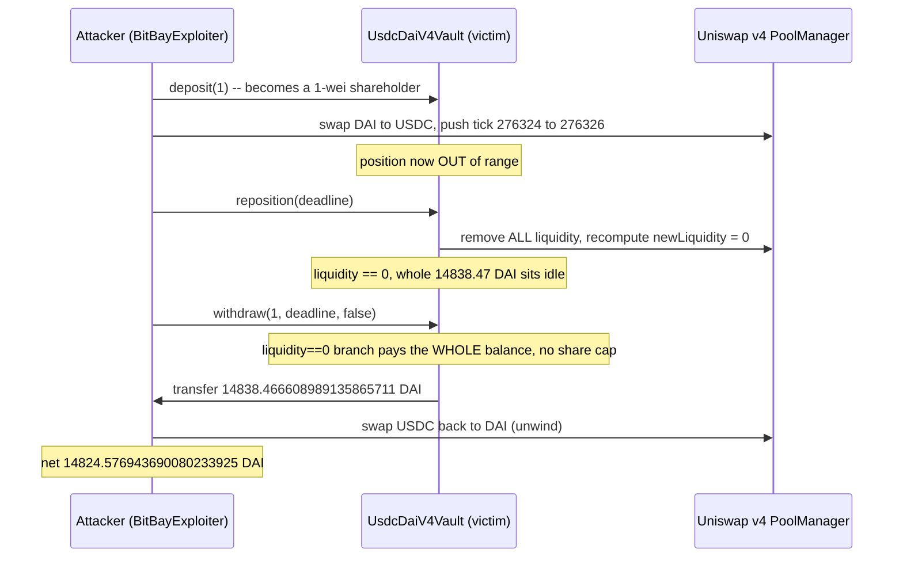

# BitBay StableVault — `withdraw` on an empty position pays the caller the **whole** vault, uncapped by shares

> **Vulnerability classes:** vuln/logic/missing-check · vuln/defi/share-accounting · vuln/defi/price-manipulation
> **Reproduction:** the PoC compiles and runs in an isolated Foundry project at [this project folder](.). Full verbose trace: [output.txt](output.txt). The test forks Polygon at block **95,204,941** (parent of the attack block) over a live RPC and `[PASS] testExploit` finishes in **617ms** [output.txt:1537](output.txt), [output.txt:2259](output.txt).

---

## Key info

| | |
|---|---|
| **Profit** | **14,824.576943690080233925 DAI** net on the exploit contract (final DAI − working capital) [output.txt:1550](output.txt), [output.txt:2228](output.txt). On-chain the attacker kept **14,813.548248 USDC** after repaying both flash loans; the vault's **gross** loss is below. |
| **Loss (victim)** | **14,838.466608989135865711 DAI** — the vault's entire idle balance, sent to the attacker by `withdraw(1)` through the `liquidity == 0` fast-path [output.txt:1548](output.txt), [output.txt:2143](output.txt). Matches the on-chain `Withdrawn` transfer exactly. Reported figure ~14,838.47 DAI. |
| **Vulnerable contract** | `UsdcDaiV4Vault` [`0x048E88311ca84876aeA086125825492e2AF2e5A0`](https://polygonscan.com/address/0x048E88311ca84876aeA086125825492e2AF2e5A0). **VERIFIED** (`StableVault.sol`, solc 0.8.30). Source copied to [sources/UsdcDaiV4Vault_048E88/](sources/UsdcDaiV4Vault_048E88/StableVault.sol). A Uniswap v4 DAI/USDC concentrated-liquidity vault. |
| **Attacker EOA** | [`0x59Ae3c8dd50063429D86BdaEBbC350fB64e9884B`](https://polygonscan.com/address/0x59Ae3c8dd50063429D86BdaEBbC350fB64e9884B) |
| **Historical attack contract** | [`0xc2C6F4F7E1425bE1DCB996175Cf7852bF53c23E2`](https://polygonscan.com/address/0xc2C6F4F7E1425bE1DCB996175Cf7852bF53c23E2) (unverified). Reconstructed here as `BitBayExploiter`. |
| **Attack tx** | [`0x5b795dc5c5e1665b712c7ccf478c1d8c59a162d698f4e0bfb40bd303e04a7ff2`](https://polygonscan.com/tx/0x5b795dc5c5e1665b712c7ccf478c1d8c59a162d698f4e0bfb40bd303e04a7ff2) (block 95,204,942) |
| **Chain / block / date** | Polygon (chainId 137) / fork parent **95,204,941**, attack block 95,204,942 / `block.timestamp` **1,791,512,622** = **2026-10-08 23:43:42 UTC** |
| **Pool / infra** | Uniswap v4 PoolManager `0x6736678280587006…53e5cD6`; StateView `0x5eA1bD79…9b3BA5a`. `poolKey = {currency0: USDC 0x3c49…3359 (native, 6 dec), currency1: DAI 0x8f3C…A063 (18 dec), fee: 50, tickSpacing: 1, hooks: 0}`. Vault position at fork: `tickLower 276323`, `tickUpper 276326`, current tick `276324` (in range) [output.txt:1543](output.txt). |
| **Compiler** | Vault verified `solc 0.8.30`. |
| **Bug class** | `_withdraw`'s `liquidity == 0` branch transfers the vault's **entire** DAI+USDC balance to the caller with **no `shareAmount / totalShares` cap**. `reposition()` can be driven to leave `liquidity == 0` (recomputed `newLiquidity` rounds to 0) with the whole position sitting idle, so a holder of a single 1-wei share drains everything. |

## TL;DR

`UsdcDaiV4Vault` keeps its funds as a single Uniswap v4 DAI/USDC position. `withdraw(shareAmount, deadline, addDust)` is supposed to burn `shareAmount` and return the caller their pro-rata slice. But its internal `_withdraw` begins with a fast-path for the case where the vault holds no live position — `if (liquidity == 0)` — and in that branch it sends **the whole** DAI and USDC balance to `recipient`, never multiplying by `shareAmount / totalShares`.

The attacker turns that branch on. They deposit **1 wei** to become a shareholder [output.txt:1644](output.txt), then push the pool tick from 276324 up to 276326 with a large DAI→USDC swap [output.txt:1545](output.txt), moving the vault position **out of range**. That lets a non-minter call `reposition()`, which removes **all** liquidity, recomputes a fresh range, and — because the recomputed `newLiquidity` rounds to **0** — re-adds nothing and sets `liquidity = 0` (`Repositioned(276324, 276327, 0)` [output.txt:2069](output.txt)). The whole position, **14,838.466608989135865711 DAI**, now sits idle in the vault [output.txt:2093](output.txt). Finally `withdraw(1, …, false)` hits the empty-position branch and transfers all of it to the 1-wei shareholder [output.txt:2143](output.txt), [output.txt:1548](output.txt). Net DAI profit after swapping the manipulation USDC back: **14,824.576943690080233925 DAI** [output.txt:1550](output.txt).

## Background

The vault holds a concentrated-liquidity position in the Uniswap v4 pool `{USDC, DAI, fee 50, tickSpacing 1}`. `USDC` is the **native** Polygon USDC `0x3c499c542cEF5E3811e1192ce70d8cC03d5c3359` (6 decimals, `poolKey.currency0`), hardcoded in the vault constructor ([StableVault.sol:356](sources/UsdcDaiV4Vault_048E88/StableVault.sol)); `DAI` `0x8f3Cf7ad…A063` is `poolKey.currency1` (18 decimals). Because `USDC < DAI` by address, `_daiIsToken0()` is `false`.

Shares are 1:1 with deposited DAI. `deposit(amount, deadline)` pulls `amount` DAI and credits `shares[msg.sender] += amount` ([StableVault.sol:541](sources/UsdcDaiV4Vault_048E88/StableVault.sol)). `withdraw(shareAmount, deadline, addDust)` burns shares and routes into `_withdraw` via the PoolManager unlock callback ([StableVault.sol:555](sources/UsdcDaiV4Vault_048E88/StableVault.sol)). The position is rebalanced through `reposition(deadline)` → `_reposition()`.

On-chain the attacker funded the working capital with a 106,411.49 DAI flash from a Uniswap-v3-style USDC/DAI pool (`0x5645dCB6…`) plus a 1,453.57 DAI Balancer flash, repaying both at the end [output.txt (historical trace)]. Those flash loans are only a funding wrapper and are **not** part of the vulnerability; the PoC replaces them with `vm.deal` of DAI to the exploit contract and measures net DAI gain against that capital. Everything that touches the vulnerable vault — the vault itself, the real Uniswap v4 PoolManager and the real DAI/USDC pool — is the live forked contract, not a mock.

The PoC is [test/BitBayStableVault_exp.sol](test/BitBayStableVault_exp.sol). The only reconstructed piece is the attacker contract `BitBayExploiter` (the on-chain one is unverified); it reproduces the attacker's externally-observable call sequence (`deposit` / v4 swap / `reposition` / `withdraw` / unwind) exactly.

## The vulnerable code

Verified source, `_withdraw` ([sources/UsdcDaiV4Vault_048E88/StableVault.sol:693-722](sources/UsdcDaiV4Vault_048E88/StableVault.sol)):

```solidity
function _withdraw(uint256 shareAmount, address recipient, bool addDust) internal {
    if (liquidity == 0) {
        uint256 daiBal = DAI.balanceOf(address(this));
        uint256 usdcBal = USDC.balanceOf(address(this));
        if (daiBal > 0) DAI.transfer(recipient, daiBal);     // <-- WHOLE balance, no share cap
        if (usdcBal > 0) USDC.transfer(recipient, usdcBal);
        emit Withdrawn(recipient, shareAmount, daiBal, usdcBal);
        return;
    }
    // ... normal path below DOES cap by shares:
    uint256 currentTotalShares = totalShares + shareAmount;
    uint128 toRemove = uint128((uint256(liquidity) * shareAmount) / currentTotalShares);
    // ...
}
```

The normal path (the `else` below the branch) correctly scales the removed liquidity by `shareAmount / currentTotalShares`. The `liquidity == 0` fast-path does **not**: it pays out `DAI.balanceOf(this)` and `USDC.balanceOf(this)` in full to whoever called `withdraw`, regardless of how many shares they burn. `shareAmount` is used only in the event, not in the amount transferred.

How `liquidity` is driven to 0, `reposition()` ([StableVault.sol:579-592](sources/UsdcDaiV4Vault_048E88/StableVault.sol)):

```solidity
function reposition(uint256 deadline) external nonReentrant {
    if(mintThis) { require(msg.sender == minter, OnlyMinter()); }
    if (msg.sender != minter) {
        int24 ct = _getCurrentTick();
        if (ct >= tickLower && ct < tickUpper) revert PositionInRange();   // must be OUT of range
    }
    if (block.timestamp > deadline) revert Expired();
    require(block.timestamp > lastReposition + POSITION_TIMELOCK, Expired());
    lastReposition = block.timestamp;
    if (liquidity == 0) revert NoPosition();
    poolManager.unlock(abi.encode(ACTION_REPOSITION, uint256(0), address(0)));
}
```

and `_reposition()`'s tail ([StableVault.sol:843-855](sources/UsdcDaiV4Vault_048E88/StableVault.sol)):

```solidity
uint128 newLiquidity;
if (required1 <= amount1) { newLiquidity = liq0; }
else { newLiquidity = LiquidityAmounts.getLiquidityForAmount1(s.sqrtPriceLower, s.sqrtPriceX96, amount1); }
if (newLiquidity > 0) {
    _modifyLiquidity(s.newTickLower, s.newTickUpper, int128(newLiquidity));  // skipped when 0
}
tickLower = s.newTickLower;
tickUpper = s.newTickUpper;
liquidity = newLiquidity;                 // <-- set to 0; all withdrawn funds now sit idle
emit Repositioned(s.newTickLower, s.newTickUpper, newLiquidity);
```

## Root cause

The vault's `_withdraw` has two completely different accounting rules and the attacker gets to pick which one runs.

1. **The `liquidity == 0` branch pays the whole vault, uncapped by shares.** When the vault holds no live position, `_withdraw` transfers `DAI.balanceOf(this)` and `USDC.balanceOf(this)` in full to `recipient` ([StableVault.sol:694-700](sources/UsdcDaiV4Vault_048E88/StableVault.sol)). `shareAmount` never enters the transferred amount — it is used only in the emitted event. The normal path just below it *does* scale by `shareAmount / currentTotalShares` ([StableVault.sol:709-710](sources/UsdcDaiV4Vault_048E88/StableVault.sol)), so the empty-position branch is a share-accounting hole: a 1-wei shareholder is paid identically to the entire shareholder base.

2. **`reposition()` can be driven to leave the whole position idle with `liquidity == 0`.** `_reposition()` removes **all** liquidity first, then re-adds `newLiquidity` and sets `liquidity = newLiquidity` ([StableVault.sol:854](sources/UsdcDaiV4Vault_048E88/StableVault.sol)). When the recomputed `newLiquidity` rounds to 0 the re-add is skipped ([StableVault.sol:849](sources/UsdcDaiV4Vault_048E88/StableVault.sol)) and `liquidity` stays 0, while the ~14.8k DAI just pulled out of the pool remains in the vault as idle balance. The trace shows exactly this: `Repositioned(276324, 276327, 0)` [output.txt:2069](output.txt) and vault idle DAI jumping to 14,838.47 [output.txt:2093](output.txt).

3. **The out-of-range gate is attacker-controllable.** A non-minter may call `reposition()` only when the position is out of range (`ct < tickLower || ct >= tickUpper`), the 3-day timelock has elapsed, and `liquidity != 0` ([StableVault.sol:583-590](sources/UsdcDaiV4Vault_048E88/StableVault.sol)). The attacker manufactures "out of range" themselves with a single large DAI→USDC swap that moves the tick from 276324 to 276326 (= `tickUpper`, so `ct >= tickUpper`) [output.txt:1545](output.txt) — still inside the vault's own `[0.995, 1.005]` price bounds, so the `checkPriceBounds` inside `_reposition` passes. No keeper, owner, or minter action is needed.

Chained: deposit 1 wei → push the tick out of range → `reposition()` zeroes `liquidity` and idles the whole position → `withdraw(1)` takes the empty-position branch and pays out the full balance. A correct `_withdraw` would scale the empty-position payout by `shareAmount / totalShares` exactly as the normal path does, and `reposition` should not be able to strand the entire position as idle balance.

## Attack walkthrough (on-chain numbers from the trace)

| # | Action | Amount | Trace |
|---|--------|--------|-------|
| 0 | (reconstruction) fund working capital DAI — on-chain a 106,411.49 DAI UniV3 flash + 1,453.57 DAI Balancer flash | 110,000 DAI dealt | test setUp |
| 1 | `deposit(1, deadline)` → 1 wei of shares | 1 wei DAI | [output.txt:1644](output.txt) |
| 2 | v4 swap DAI → USDC (oneForZero) to push the tick out of range | tick 276324 → **276326** (≥ tickUpper) | [output.txt:1543](output.txt), [output.txt:1545](output.txt) |
| 3 | `reposition(deadline)` — removes all liquidity, recomputed `newLiquidity` = 0 | `Repositioned(276324, 276327, 0)`; vault idle DAI → **14,838.466608989135865711** | [output.txt:2069](output.txt), [output.txt:2093](output.txt) |
| 4 | `withdraw(1, deadline, false)` — `liquidity==0` fast-path drains the vault | **14,838.466608989135865711 DAI** to the attacker; vault DAI → 0 | [output.txt:2143](output.txt), [output.txt:1548](output.txt), [output.txt:1549](output.txt) |
| 5 | v4 swap the manipulation USDC back to DAI (unwind) | — | [output.txt:2228](output.txt) |
| 6 | Net DAI profit (final DAI − working capital) | **14,824.576943690080233925 DAI** | [output.txt:1550](output.txt) |

Invariants asserted by the test: the vault had live liquidity before; the push swap moved the tick to ≥ `tickUpper`; `reposition` left `liquidity == 0`; `withdraw` drained the vault DAI to 0; `withdraw(1)` drained > 14,000 DAI; and the net profit matches the exact observed figure.

## Diagram



## Remediation

1. **Cap the empty-position payout by shares.** In the `liquidity == 0` branch, transfer `daiBal * shareAmount / totalShares` and `usdcBal * shareAmount / totalShares`, not the full balances. The empty-position path must obey the same pro-rata rule as the normal path.
2. **Do not let `reposition` strand the whole position.** If the recomputed `newLiquidity` is 0, revert (or clamp the new range so the funds are re-deployed) instead of silently leaving the entire position as idle balance with `liquidity == 0`.
3. **Harden the non-minter `reposition` gate.** Being out of range by a single tick is cheaply attacker-induced in a deep stable pool; require a minimum out-of-range distance, a TWAP/price-staleness check, or restrict `reposition` to the minter/keeper.
4. **Separate "no position yet" from "position just emptied."** The empty-position fast-path appears designed for the pre-first-deposit state; it should not be reachable immediately after a `reposition` that just pulled real funds out of the pool.

## How to reproduce

Live-RPC fork (no committed anvil state).

```bash
# from this folder
cd 2026-10-BitBayStableVault_exp
forge test --evm-version cancun --match-test testExploit -vvv
# full trace:
forge test --evm-version cancun --match-test testExploit -vvvvv > output.txt 2>&1
```

- **Chain / fork:** Polygon, block **95,204,941** (parent of attack block 95,204,942). `setUp` calls `vm.createSelectFork("https://polygon.drpc.org", 95204941)` and `vm.warp(1791512622)` to the attack-block timestamp (satisfies the 3-day reposition timelock and the deadline params).
- **RPC fallbacks** if drpc is slow/unavailable: `https://polygon-rpc.com`, `https://polygon-bor-rpc.publicnode.com`, `https://polygon-mainnet.public.blastapi.io`.
- **Committed result** ([output.txt](output.txt)):

```
[PASS] testExploit()
BitBay StableVault - liquidity==0 withdraw drains the whole vault to a 1-wei shareholder
vault tickLower: 276323 / tickUpper: 276326 / pool tick before: 276324
pool tick after push swap: 276326
vault liquidity after reposition: 0
vault DAI idle after reposition (now drainable): 14838.466608989135865711
DAI drained by withdraw(1): 14838.466608989135865711
Net DAI profit (final DAI - working capital): 14824.576943690080233925
Suite result: ok. 1 passed; 0 failed; 0 skipped
```

## References

- SlowMist alert: https://x.com/SlowMist_Team/status/2108399198035202138
- Verified vault source: [sources/UsdcDaiV4Vault_048E88/StableVault.sol](sources/UsdcDaiV4Vault_048E88/StableVault.sol)
