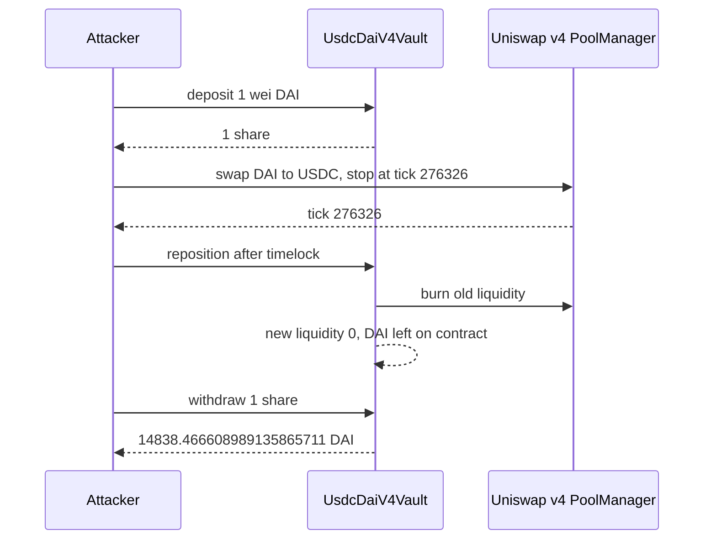

# BitBay UsdcDaiV4Vault — `liquidity == 0` pays the whole DAI balance to a 1-wei share

> **Vulnerability classes:** vuln/logic/missing-check · vuln/logic/wrong-condition · vuln/logic/incorrect-state-transition
> **Reproduction:** online only. This folder has **no `anvil_state.json`**. Passing archival-fork trace: [output.txt](output.txt). Folder: [(.)](.). Verified source: [sources/UsdcDaiV4Vault_048E88](sources/UsdcDaiV4Vault_048E88).
---
## Key info
| | |
|---|---|
| **Loss** | **14,838.466608989135865711 DAI** swept by `withdraw(1)` [output.txt:13](output.txt), [output.txt:596](output.txt). USDC swept is **0** [output.txt:14](output.txt). The header's later unwind to about **14,813 USDC** is not what this trace measures |
| **Vulnerable contract** | `UsdcDaiV4Vault` [`0x048E88311ca84876aeA086125825492e2AF2e5A0`](https://polygonscan.com/address/0x048E88311ca84876aeA086125825492e2AF2e5A0) |
| **Attacker EOA** | [`0x59Ae3c8dd50063429D86BdaEBbC350fB64e9884B`](https://polygonscan.com/address/0x59Ae3c8dd50063429D86BdaEBbC350fB64e9884B) |
| **Attack contract** | On-chain [`0xc2C6F4F7E1425bE1DCB996175Cf7852bF53c23E2`](https://polygonscan.com/address/0xc2C6F4F7E1425bE1DCB996175Cf7852bF53c23E2). PoC runs as the forge test contract `0x7FA9385bE102ac3EAc297483Dd6233D62b3e1496` |
| **Attack tx** | [`0x5b795dc5c5e1665b712c7ccf478c1d8c59a162d698f4e0bfb40bd303e04a7ff2`](https://polygonscan.com/tx/0x5b795dc5c5e1665b712c7ccf478c1d8c59a162d698f4e0bfb40bd303e04a7ff2), block 95,204,942 |
| **Chain / block / date** | Polygon (chain id 137) / fork block **95,204,941** / 9 October 2026, 02:23:41 UTC (trace timestamp `1791512621`) |
| **Compiler** | Solidity `v0.8.30+commit.73712a01`, optimizer on, 200 runs ([_meta.json](sources/UsdcDaiV4Vault_048E88/_meta.json)) |
| **Bug class** | When `liquidity == 0`, `_withdraw` transfers the vault's entire DAI and USDC balances and uses `shareAmount` only in the event. `reposition()` is callable by a non-minter once the tick is outside the range, and it can store `liquidity = 0` while the old position's tokens sit on the contract |

## TL;DR
`UsdcDaiV4Vault` is a Uniswap v4 LP vault for native USDC/DAI on Polygon. Users deposit DAI. The vault mints `shares[msg.sender] += amount` one-for-one and places a 3-tick range (fee 50, tick spacing 1) around the peg. A normal withdraw burns liquidity in proportion to shares. The other branch does not.

If `liquidity == 0`, `_withdraw` sends `DAI.balanceOf(address(this))` and `USDC.balanceOf(address(this))` to the recipient and returns. A holder of one wei of shares gets the whole balance. `reposition()` is how the attacker creates that state. `mintThis` is false, so the minter-only guard is off [output.txt](output.txt) assert in `testExploit`. A non-minter may reposition when the current tick is outside `[tickLower, tickUpper)`. The attacker swaps the public v4 pool until the tick is **276326**, the old upper bound, waits out `POSITION_TIMELOCK` with `vm.warp`, and calls `reposition`. The old liquidity is removed. The new liquidity math returns 0, and the function stores `liquidity = 0` anyway. The unwound position is then raw DAI: **14,838.466608989135865711** [output.txt:12](output.txt). `withdraw(1)` transfers that exact amount [output.txt:575](output.txt).

Before the attack the vault's idle DAI was only **8.390192804782497678** [output.txt:8](output.txt) and its liquidity was **98,869,777,365,041,977,456** [output.txt:7](output.txt). The swept DAI is the LP position, not the idle dust. `[PASS] testExploit()` gas 1,058,657 [output.txt:4](output.txt).

## Background — what the vault does
The pool key is USDC (`0x3c499c542cEF5E3811e1192ce70d8cC03d5c3359`) / DAI (`0x8f3Cf7ad23Cd3CaDbD9735AFf958023239c6A063`), fee 50, tick spacing 1, no hook. PoolManager is `0x67366782805870060151383F4BbFF9daB53e5cD6`. Shares are not an ERC-20. `deposit` adds the DAI amount directly to `shares` and `totalShares`, then unlocks the pool manager to mint or add liquidity around the current tick. `RANGE` defaults to 1, so a live position is a few ticks wide. The fork tick is **276324** [output.txt:6](output.txt), inside the range the test describes as `[276323, 276326)`.

`reposition` exists so a keeper can slide that range back onto the peg after the price moves. The source default `POSITION_TIMELOCK` is 3 days, and it is settable. This trace only needs a warp of 2 days: deposit timestamp **1791512621**, warp to **1791685421** [output.txt:85](output.txt), [output.txt:409](output.txt), and `reposition` then succeeds. So whatever `lastReposition + POSITION_TIMELOCK` was at the fork, two days cleared it. `mintThis` false means a non-minter is allowed as long as the tick is out of range.

Capital for the manipulation swap is `deal`'d DAI, **2,000,000 DAI**. On-chain the attacker used nested DAI flash loans. The drain does not depend on the source of that DAI. The price limit is `sqrtPrice` at tick 276326 (`79239942287305395081048711596759672`), so the swap stops on the upper tick instead of walking the price out of the vault's peg bound. Actual DAI consumed is **107,865.061456658704649884**, and the pool pays **107,843.364597 USDC** [output.txt:378](output.txt), [output.txt:392](output.txt).

## The vulnerable code
Verified `StableVault.sol` (the contract name on Polygonscan is `UsdcDaiV4Vault`).

### `reposition` is external, and a non-minter only has to be out of range
```solidity
function reposition(uint256 deadline) external nonReentrant {
    if (mintThis) {
        require(msg.sender == minter, OnlyMinter());
    }
    if (msg.sender != minter) {
        int24 ct = _getCurrentTick();
        if (ct >= tickLower && ct < tickUpper) revert PositionInRange();
    }
    if (block.timestamp > deadline) revert Expired();
    require(block.timestamp > lastReposition + POSITION_TIMELOCK, Expired());
    lastReposition = block.timestamp;
    if (liquidity == 0) revert NoPosition();
    poolManager.unlock(abi.encode(ACTION_REPOSITION, uint256(0), address(0)));
}
```

`_reposition` collects fees, burns the whole position with `_modifyLiquidity(tickLower, tickUpper, -int128(liquidity))`, builds a new range, and computes `newLiquidity`. If that value is 0 it skips the mint. It still writes:

```solidity
tickLower = s.newTickLower;
tickUpper = s.newTickUpper;
liquidity = newLiquidity;
```

Zero is a legal stored value. The tokens that came out of the burned position remain `DAI.balanceOf` / `USDC.balanceOf` of the vault. The trace's post-state is liquidity **0** and DAI **14,838.466608989135865711** [output.txt:11](output.txt)–[output.txt:12](output.txt).

### The zero-liquidity withdraw ignores shares
```solidity
function _withdraw(uint256 shareAmount, address recipient, bool addDust) internal {
    if (liquidity == 0) {
        uint256 daiBal = DAI.balanceOf(address(this));
        uint256 usdcBal = USDC.balanceOf(address(this));
        if (daiBal > 0) DAI.transfer(recipient, daiBal);
        if (usdcBal > 0) USDC.transfer(recipient, usdcBal);
        emit Withdrawn(recipient, shareAmount, daiBal, usdcBal);
        return;
    }
    uint256 currentTotalShares = totalShares + shareAmount;
    uint128 toRemove = uint128((uint256(liquidity) * shareAmount) / currentTotalShares);
    // ... proportional path only when liquidity > 0
}
```

`shareAmount` is not in the transfer amounts. `withdraw` has already done `shares[msg.sender] -= shareAmount` and `totalShares -= shareAmount` before the callback, so the 1-wei share is burned and the branch still pays the full balance. The event matches the transfer: `Withdrawn(..., 1, 14838466608989135865711, 0)` [output.txt:581](output.txt).

## Root cause — why it was possible
1. **The `liquidity == 0` branch is an unbounded payout.** It was written as a dust sweep. It uses the raw token balances and never divides by `totalShares`. One share and the entire supply take the same amount.
2. **`reposition` can enter that branch on purpose.** Burning the old position and then storing `newLiquidity == 0` leaves the assets on the contract with `liquidity == 0`. The next public `withdraw` hits the sweep. The proportional formula a few lines later is skipped by the early `return`.
3. **Out-of-range is permissionless.** With `mintThis == false`, any address can move the tick with a pool swap and then call `reposition`, subject only to the timelock. The swap is a normal v4 swap. No vault role is required.
4. **Shares are 1:1 with the deposited wei, and deposit is open.** `deposit(1)` mints one share [output.txt:347](output.txt), [output.txt:354](output.txt). The attacker does not need a donation or an inflation of total supply. They need one unit of shares outstanding in their name when the sweep runs.

## Preconditions
- `mintThis` is false, so `reposition` is not minter-only. The test asserts this before any call.
- The current tick can be moved to or past `tickUpper` by a public swap, and the vault's price bound still accepts `reposition` at that tick. Here the tick goes from **276324** to **276326** [output.txt:6](output.txt), [output.txt:10](output.txt).
- `POSITION_TIMELOCK` has elapsed, or the caller can wait. The PoC warps two days and the call succeeds [output.txt:409](output.txt).
- The vault holds a real position. Pre-state liquidity **98,869,777,365,041,977,456** [output.txt:7](output.txt). Idle DAI is only **8.390192804782497678** [output.txt:8](output.txt). The drain is the unwound LP.
- No owner, keeper, or signature. The 2,000,000 DAI swap budget is flash-loan principal in the real tx and `deal` in this one.

## Attack walkthrough (with on-chain numbers from the trace)
| Step | Call | Result in the trace |
|---|---|---|
| 1 | Fork `https://polygon.drpc.org` at 95,204,941 | tick **276324**, liquidity **98,869,777,365,041,977,456**, idle DAI **8.390192804782497678** [output.txt:6](output.txt)–[output.txt:8](output.txt) |
| 2 | `deposit(1, 1791512621)` | `Deposited(attacker, 1, 1)` [output.txt:347](output.txt). `shares` returns **1** [output.txt:354](output.txt) |
| 3 | PoolManager `unlock` / `swap`, DAI to USDC, `amountSpecified` minus **2,000,000 DAI**, price limit at tick 276326 | Pays **107,865.061456658704649884 DAI** [output.txt:378](output.txt). Takes **107,843.364597 USDC** [output.txt:392](output.txt) |
| 4 | `getSlot0` | tick **276326**, sqrtPrice **79239942287305395081048711596759672** [output.txt:407](output.txt)–[output.txt:408](output.txt) |
| 5 | `vm.warp(1791685421)` then `reposition` | [output.txt:409](output.txt), [output.txt:411](output.txt). Liquidity reads **0** [output.txt:519](output.txt). Vault DAI **14,838.466608989135865711** [output.txt:524](output.txt) |
| 6 | `withdraw(1, deadline, false)` | DAI `transfer` of **14,838.466608989135865711** to the test contract [output.txt:575](output.txt). `Withdrawn` share amount **1**, USDC **0** [output.txt:581](output.txt) |
| 7 | Asserts | swept DAI equals **14838466608989135865711** wei [output.txt:600](output.txt). USDC swept **0** [output.txt:598](output.txt). Liquidity stays **0** [output.txt:604](output.txt) |

The 1-wei share is **1 / (totalShares + 1)** of the vault economically, and it received 100% of the DAI balance. The header says the on-chain attacker then swapped the swept DAI plus the flash-loan inventory down to about **14,813 USDC** of profit. This trace stops at the vault transfer. It does not model that unwind, and it does not repay the `deal`'d DAI. The figure the assert locks to the wei is the DAI sweep, which matches the on-chain `Withdrawn` amount the header cites.

`[PASS]` gas 1,058,657 [output.txt:4](output.txt). Suite finished with 1 passed [output.txt:612](output.txt).

## Diagrams


## Remediation
1. **Delete the full-balance branch, or pro-rate it.** If `liquidity == 0`, pay `balance * shareAmount / (totalShares + shareAmount)` and leave the rest. `shareAmount` must be an input to the transfer, not only to the event. The proportional path a few lines below is the one that should run for every share burn.
2. **Do not store `liquidity = 0` while the contract still holds the burned position.** If `newLiquidity == 0`, revert `reposition` and keep the old position, or mint the position before returning. A zero write turns the next withdraw into a sweep.
3. **Keep `reposition` on a keeper, or require the new liquidity to be non-zero and in range before the old position is burned.** `mintThis == false` plus a public swap is enough to satisfy the current out-of-range check. Burn-then-mint is not atomic with respect to a zero result.
4. **A zero-share or one-wei deposit should not be able to sit across a reposition.** That is secondary. The bug still pays the full balance to whatever share amount is passed, including a large one. Fix the payout first.
5. **The timelock is not a control.** It delayed this call by days. It did not bind the payout to the caller's share of `totalShares`.

## How to reproduce
**There is no `anvil_state.json` in this folder.** The offline harness refuses to start:

```bash
_shared/run_poc.sh 2026-10-BitBay_exp -vvvvv
# no anvil_state.json in 2026-10-BitBay_exp
# exit 2, before forge
```

The test forks a live archival node itself. `setUp` calls `vm.createSelectFork("https://polygon.drpc.org", 95204941)`. `evm_version` is `cancun`. From this folder, with network access:

```bash
forge test --match-path test/BitBay_exp.sol -vvvvv
```

[output.txt](output.txt) is the verbose trace of that online run. Expected tail:

```
[PASS] testExploit() (gas: 1058657)
tick (pre): 276324
vault liquidity (pre): 98869777365041977456
vault DAI (pre): 8.390192804782497678
tick (after push): 276326
vault liquidity (after reposition): 0
vault DAI (after reposition): 14838.466608989135865711
DAI swept by 1-share withdraw: 14838.466608989135865711
USDC swept by 1-share withdraw: 0.000000
Suite result: ok. 1 passed; 0 failed; 0 skipped
```

*Reference: [attack tx 0x5b795dc5…](https://polygonscan.com/tx/0x5b795dc5c5e1665b712c7ccf478c1d8c59a162d698f4e0bfb40bd303e04a7ff2) (hash in [test/BitBay_exp.sol](test/BitBay_exp.sol)).*
