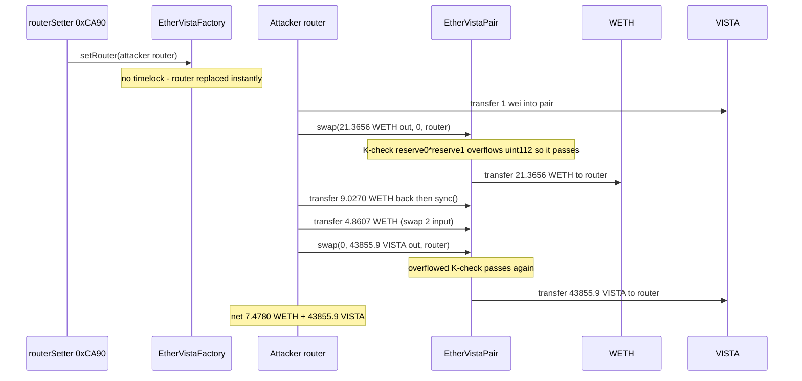

# EtherVista — `swap`'s constant-product (K) check multiplies two `uint112` reserves, so the invariant overflows and the pool drains

> **Vulnerability classes:** vuln/arithmetic/integer-overflow · vuln/defi/invariant-bypass · vuln/access-control/privileged-role-takeover
> **Reproduction:** the PoC compiles and runs in an isolated Foundry project at [this project folder](.). Full verbose trace: [output.txt](output.txt). The trace forks Ethereum mainnet at block 26,152,258 (parent of the drain block) and `[PASS] testExploit` finishes in **601.67ms** [output.txt:4](output.txt), [output.txt:177](output.txt).

---

## Key info

| | |
|---|---|
| **Profit** | **7.477952467865157795 WETH** net to the attacker-controlled router, plus **43,855.902196275763910452 VISTA** (the project token) [output.txt:11](output.txt), [output.txt:12](output.txt). The WETH leg is the ~**$18.6K** dollar loss reported by SlowMist. Both figures match the on-chain `assertApproxEqRel` targets exactly [output.txt:148](output.txt), [output.txt:150](output.txt) |
| **Pool before / after** | Reserves before: **21.365578509624935898 WETH** + **125,302.577879645672649896 VISTA** [output.txt:7](output.txt), [output.txt:8](output.txt). After the drain the pool held ~13.89 WETH + ~81,446 VISTA — i.e. 7.478 WETH and 43,856 VISTA extracted |
| **Vulnerable contract** | EtherVistaPair [`0xfdd05552F1377aA488AFed744c8024358AF02041`](https://etherscan.io/address/0xfdd05552F1377aA488AFed744c8024358AF02041). **VERIFIED**, solc `0.5.16`. Bug in `swap(uint256,uint256,address,bytes)` at [ethervista_pair_source.sol:633](ethervista_pair_source.sol) |
| **Factory** | EtherVistaFactory [`0x9a27cb5ae0B2cEe0bb71f9A85C0D60f3920757B4`](https://etherscan.io/address/0x9a27cb5ae0B2cEe0bb71f9A85C0D60f3920757B4). **VERIFIED**, solc `0.5.16`. `setRouter(address)` guarded only by `routerSetter`, no timelock |
| **WETH (token0)** | [`0xC02aaA39b223FE8D0A0e5C4F27eAD9083C756Cc2`](https://etherscan.io/address/0xC02aaA39b223FE8D0A0e5C4F27eAD9083C756Cc2) |
| **VISTA (token1, project token)** | [`0xC9bCa88B04581699fAb5aa276CCafF7Df957cbbf`](https://etherscan.io/address/0xC9bCa88B04581699fAb5aa276CCafF7Df957cbbf) |
| **Attacker EOA** | [`0xBBf8f3fe8e4FdF6b594E6107144D78293D2018Fa`](https://etherscan.io/address/0xBBf8f3fe8e4FdF6b594E6107144D78293D2018Fa) |
| **Attacker router (historical)** | [`0x469424b628a9d2036e41496e814Db500D683b120`](https://etherscan.io/address/0x469424b628a9d2036e41496e814Db500D683b120). **UNVERIFIED** — reconstructed as `EtherVistaAttackRouter` in the PoC |
| **Privileged routerSetter** | [`0xCA90D843288E35beeADfCe14E5F906e3F1AFc7cB`](https://etherscan.io/address/0xCA90D843288E35beeADfCe14E5F906e3F1AFc7cB) — held/compromised by the attacker; installed the malicious router |
| **Legit router (pre-takeover)** | [`0x9bD63C5D44fF28390df1EaaFD4eB4BD73E94A72a`](https://etherscan.io/address/0x9bD63C5D44fF28390df1EaaFD4eB4BD73E94A72a) |
| **Drain tx** | [`0xb2c7332d9e1be6a86d9d37083aa4cc0d94b60eb95cc9b29494555a3c09764930`](https://etherscan.io/tx/0xb2c7332d9e1be6a86d9d37083aa4cc0d94b60eb95cc9b29494555a3c09764930) (block 26,152,259) |
| **Router-takeover tx** | [`0xc97ad886a4cbd022edc33deaa44656d66814fe3df1142d03802c96ce7632cc7a`](https://etherscan.io/tx/0xc97ad886a4cbd022edc33deaa44656d66814fe3df1142d03802c96ce7632cc7a) (block 26,152,250): `routerSetter` → `setRouter(attackerRouter)` |
| **Chain / block / date** | Ethereum mainnet (chainId 1) / fork parent **26,152,258** / drain block timestamp **1,791,517,679** = 2026-10-09 03:47:59 UTC |
| **Compiler** | EtherVistaPair & Factory: `0.5.16+commit.9c3226ce` (verified via Sourcify) |
| **Bug class** | `require(balance0 * balance1 >= reserve0 * reserve1, "K")` — `balance*` are `uint256` locals but `reserve0`/`reserve1` are `uint112` storage, so `reserve0 * reserve1` wraps mod 2^112 and the invariant is checked against garbage, letting a swap remove almost the entire reserve |

## TL;DR

EtherVista is a Uniswap-V2-style AMM (token0 = WETH, token1 = VISTA). Its `swap` ends with the stock-looking constant-product check `require(balance0 * balance1 >= reserve0 * reserve1, "K")`. In Uniswap V2 the reserves are widened to `uint256` first (`uint(_reserve0) * _reserve1`). EtherVista dropped the widening: `reserve0` and `reserve1` are the pair's `uint112 private` storage fields, and under solc 0.5.16 (no overflow checks) `reserve0 * reserve1` is computed at `uint112` width and **wraps mod 2^112** (~5.19e33). For this pool the true product is ~2.68e42 [output.txt:37](output.txt) but the value `swap` actually compares against is the wrapped ~3.76e33 [output.txt:38](output.txt). So the invariant is trivially satisfiable while the pool is being emptied.

`swap` is callable only by `factory.router()`. The attacker already controlled the factory's `routerSetter`, so one block earlier (block 26,152,250) they called `factory.setRouter(attackerRouter)` — no timelock protects it — swapping the legitimate router for their own contract. Then, in the drain tx, the malicious router made two `swap` calls that the overflowed K-check waved through, taking **7.478 WETH** and **43,856 VISTA** for 1 wei of VISTA plus self-recycled WETH.

## Background

EtherVistaPair is a standalone V2-style pair; `swap(amount0Out, amount1Out, to, data)` optimistically transfers outputs, then (lacking a flash-swap callback here) checks the input and the K invariant on the final balances. The only privileged gate on `swap` is `require(msg.sender == IEtherVistaFactory(factory).router())`.

The factory keeps a single mutable `router` address and a `routerSetter` that can rewrite it:

```solidity
// EtherVistaFactory
function setRouter(address _router) external {
    require(msg.sender == routerSetter, 'EtherVista: FORBIDDEN');
    router = _router;
}
```

On-chain, `router()` was the legitimate `0x9bD63C…A72a` up to block 26,152,248, and `routerSetter()` was `0xCA90…7cB` throughout. At block 26,152,250 the takeover tx (`0xc97ad886…`, from `0xCA90…7cB`, input `0xc0d78655` = `setRouter(address)` with arg `0x469424…`) replaced it with the attacker's contract. From that point the attacker's contract satisfies the `msg.sender == router()` gate on `swap`.

The verified pair source is committed at [ethervista_pair_source.sol](ethervista_pair_source.sol) and the factory at [ethervista_factory_source.sol](ethervista_factory_source.sol); both were fetched from Sourcify. The PoC runs against the **real deployed bytecode** of the pair and factory on a mainnet fork — nothing about the vulnerable contracts is mocked. Only the attacker's router (unverified) is reconstructed, clearly labelled, from the drain-tx call tree.

## The vulnerable code

Verified source, `EtherVistaPair.swap`, [ethervista_pair_source.sol:611](ethervista_pair_source.sol)–[ethervista_pair_source.sol:639](ethervista_pair_source.sol):

```solidity
// this low-level function should be called from a contract which performs important safety checks
function swap(uint amount0Out, uint amount1Out, address to, bytes calldata data) external lock {
    require(msg.sender == IEtherVistaFactory(factory).router(), 'EtherVistaPair: FORBIDDEN');
    require(amount0Out > 0 || amount1Out > 0, 'EtherVistaPair: INSUFFICIENT_OUTPUT_AMOUNT');
    (uint112 _reserve0, uint112 _reserve1,) = getReserves(); // gas savings
    require(amount0Out < _reserve0 && amount1Out < _reserve1, 'EtherVista: INSUFFICIENT_LIQUIDITY');

    uint balance0;
    uint balance1;
    { // scope for _token{0,1}, avoids stack too deep errors
    address _token0 = token0;
    address _token1 = token1;
    require(to != _token0 && to != _token1, 'EtherVistaPair: INVALID_TO');
    if (amount0Out > 0) _safeTransfer(_token0, to, amount0Out); // optimistically transfer tokens
    if (amount1Out > 0) _safeTransfer(_token1, to, amount1Out); // optimistically transfer tokens
    if (data.length > 0) IUniswapV2Callee(to).uniswapV2Call(msg.sender, amount0Out, amount1Out, data);
    balance0 = IERC20(_token0).balanceOf(address(this));
    balance1 = IERC20(_token1).balanceOf(address(this));
    }
    uint amount0In = balance0 > _reserve0 - amount0Out ? balance0 - (_reserve0 - amount0Out) : 0;
    uint amount1In = balance1 > _reserve1 - amount1Out ? balance1 - (_reserve1 - amount1Out) : 0;
    require(amount0In > 0 || amount1In > 0, 'EtherVista: INSUFFICIENT_INPUT_AMOUNT');
    {
    require(balance0 * balance1 >= reserve0 * reserve1, "K");   // <-- BUG, line 633
    }

    _update(balance0, balance1, _reserve0, _reserve1);
    emit Swap(msg.sender, amount0In, amount1In, amount0Out, amount1Out, to);
}
```

and the reserve declarations, [ethervista_pair_source.sol:340](ethervista_pair_source.sol)–[ethervista_pair_source.sol:341](ethervista_pair_source.sol):

```solidity
uint112 private reserve0;           // uses single storage slot, accessible via getReserves
uint112 private reserve1;           // uses single storage slot, accessible via getReserves
```

## Root cause

The K-check `require(balance0 * balance1 >= reserve0 * reserve1, "K")` is evaluated with mismatched integer widths:

- `balance0` / `balance1` are **local `uint` (uint256)** variables; `balance0 * balance1` is a full 256-bit product.
- `reserve0` / `reserve1` are the pair's **`uint112 private` storage** fields. In Solidity, a binary operation takes the type of its operands, so `reserve0 * reserve1` is computed at **`uint112`** width. Under solc `0.5.16` (pre-0.8, which has **no automatic overflow reverts**, and this line deliberately does **not** use the `SafeMath` library the contract imports), the product **wraps modulo 2^112** (≈ 5.19e33).

For any realistically-sized 18-decimal pool, `reserve0 * reserve1` greatly exceeds 2^112, so the right-hand side collapses to a small wrapped number. The PoC prints both values straight off the live reserves:

- real `reserve0 * reserve1` = **2,677,162,065,145,962,451,132,398,363,044,340,796,366,608** (~2.68e42) [output.txt:37](output.txt)
- `uint112`-wrapped value that `swap` actually compares against = **3,760,355,340,290,237,821,639,216,231,751,440** (~3.76e33) [output.txt:38](output.txt)

Because the genuine invariant is never enforced, the attacker can set `balance0 * balance1` to almost anything ≥ 3.76e33 — i.e. remove nearly the entire reserve — and the check still passes. Uniswap V2's reference implementation avoids this exactly by widening first: `require(balance0Adjusted.mul(balance1Adjusted) >= uint(_reserve0).mul(_reserve1).mul(1000**2))`, where `uint(_reserve0)` promotes to 256-bit before the multiply. EtherVista re-introduced the classic `uint112 * uint112` overflow by comparing against the raw storage fields.

A second, compounding issue is access control: `swap` trusts `factory.router()` entirely, and `factory.setRouter` has only a single-address `routerSetter` guard with **no timelock**. Whoever holds `routerSetter` can instantly install an arbitrary "router" that is allowed to call the privileged `swap`/`mint`/`burn`/`transfer` surface. The attacker exploited this to make their own contract the router, which is what let them reach the overflowing `swap` at all.

## Preconditions

- **Attacker must be `factory.router()`.** Achieved here by controlling `routerSetter` (`0xCA90…7cB`) and calling `setRouter(attackerRouter)` one block before the drain. No timelock or multi-sig gates this. The PoC reproduces it with `vm.prank(ROUTER_SETTER); FACTORY.setRouter(attackerRouter)`.
- **Pool product must exceed 2^112.** True for any ordinary 18-decimal pair with non-trivial depth; here ~2.68e42 ≫ 5.19e33. The PoC asserts `real > 2^112` and `wrapped < real` before exploiting [output.txt:37](output.txt), [output.txt:38](output.txt).
- **1 wei of VISTA** transferred into the pair before swap #1 so `amount1In > 0` satisfies the `INSUFFICIENT_INPUT_AMOUNT` guard. The WETH used as swap #2 input is recycled from swap #1's output; the drain is self-funded apart from that 1 wei.
- **No depeg, flash loan, or oracle condition is needed.** The overflow is unconditional at these reserves.

## Attack walkthrough (with on-chain numbers from the trace)

All amounts are taken verbatim from the drain-tx trace and reproduced by the PoC.

| # | Action | Amount | Source |
|---|--------|--------|--------|
| 0 | `routerSetter` → `factory.setRouter(attackerRouter)` (prior block 26,152,250) | installs malicious router | takeover tx `0xc97ad886…` |
| 1 | Attacker router transfers 1 wei VISTA into the pair | 1 wei VISTA | drain-tx trace |
| 2 | `pair.swap(21.365578479614736555 WETH out, 0, router, "")` — K passes only on the overflowed invariant | router receives **21.365578479614736555 WETH** | drain-tx trace |
| 3 | Router transfers **9.026956903960976779 WETH** back to the pair and calls `sync()` to restore reserve0 depth | reserve0 reseeded | drain-tx trace |
| 4 | Router transfers **4.860669107788601981 WETH** into the pair (input for swap #2) | — | drain-tx trace |
| 5 | `pair.swap(0, 43,855.902196275763910452 VISTA out, router, "")` — K passes on the overflowed invariant | router receives **43,855.902196275763910452 VISTA** | drain-tx trace |
| 6 | Net held by the attacker | **7.477952467865157795 WETH** + **43,855.902196275763910452 VISTA** | [output.txt:11](output.txt), [output.txt:12](output.txt) |

**WETH identity**

| Component | WETH |
|-----------|------|
| Drained in swap #1 | 21.365578479614736555 |
| Returned (reseed) | − 9.026956903960976779 |
| Supplied (swap #2 input) | − 4.860669107788601981 |
| **Net profit** | **7.477952467865157795** |

21.365578479614736555 − 9.026956903960976779 − 4.860669107788601981 = 7.477952467865157795, matching the asserted figure [output.txt:148](output.txt). In the real tx the final VISTA was forwarded to the attacker EOA `0xBBf8…`; the PoC keeps it in the router so one address holds all proceeds for a clean assertion.

## Diagrams



## Remediation

1. **Widen the reserves before multiplying.** Use `uint(reserve0) * uint(reserve1)` (or `SafeMath`'s `mul` on the promoted values), exactly as Uniswap V2 does, so the invariant is computed in 256-bit arithmetic and cannot wrap. This single change neutralizes the drain.
2. **Upgrade the compiler / use checked math.** Compile with solc ≥ 0.8 (checked arithmetic) or apply the already-imported `SafeMath` to every reserve/balance multiplication, so any width mismatch reverts instead of silently wrapping.
3. **Harden router management.** `setRouter`/`setRouterSetter` change a globally trusted role that gates every pair's privileged surface. Guard them behind a timelock and/or multisig, and emit events; an instantaneous single-key rewrite of `router` is a protocol-wide takeover primitive.
4. **Scope router trust per pair.** Consider binding each pair to an immutable router at initialization rather than reading a mutable global `factory.router()` on every privileged call.

## How to reproduce

Live-fork reproduction (no committed anvil state):

```bash
# from this project folder
cd 2026-10-EtherVista_exp
forge test --evm-version cancun --match-test testExploit -vvv
```

- **Chain / fork:** Ethereum mainnet, block **26,152,258** (parent of drain block 26,152,259). RPC: `https://eth.drpc.org` (fallbacks: `https://ethereum-rpc.publicnode.com`, `https://eth-mainnet.public.blastapi.io`).
- **Committed result** in [output.txt](output.txt) (`finished in 601.67ms`):

```
[PASS] testExploit()
reserve0 (WETH): 21365578509624935898
reserve1 (VISTA): 125302577879645672649896
real reserve0*reserve1: 2677162065145962451132398363044340796366608
uint112-wrapped reserve0*reserve1 (what swap() actually checks): 3760355340290237821639216231751440
WETH profit: 7.477952467865157795
VISTA profit: 43855.902196275763910452
Suite result: ok. 1 passed; 0 failed; 0 skipped
```

*Reference: drain tx [`0xb2c7332d9e1be6a86d9d37083aa4cc0d94b60eb95cc9b29494555a3c09764930`](https://etherscan.io/tx/0xb2c7332d9e1be6a86d9d37083aa4cc0d94b60eb95cc9b29494555a3c09764930); router-takeover tx [`0xc97ad886a4cbd022edc33deaa44656d66814fe3df1142d03802c96ce7632cc7a`](https://etherscan.io/tx/0xc97ad886a4cbd022edc33deaa44656d66814fe3df1142d03802c96ce7632cc7a).*

## References

- SlowMist alert: https://x.com/SlowMist_Team/status/2108427455572918626
