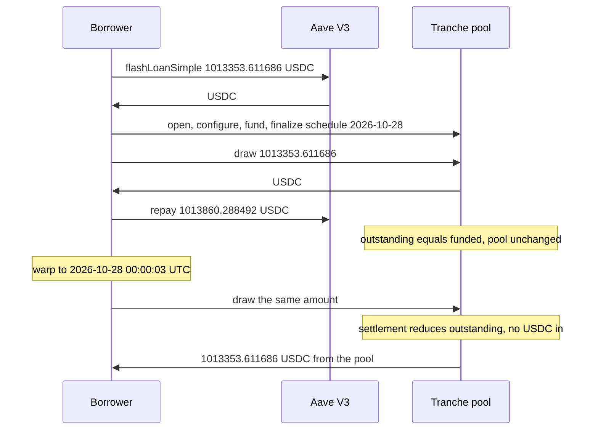

# Fence tranche pool — the UTC rollover credits a scheduled principal payment that was never paid, and `draw` pays it again

> **Vulnerability classes:** vuln/logic · vuln/defi · vuln/input-validation
> **Reproduction:** the PoC compiles and runs in an isolated Foundry project at [this project folder](.). Full verbose trace: [output.txt](output.txt). **Offline pass.** `anvil_state.json` is present. The trace forks `<rpc url>` at block 98,731,442 [output.txt:362](output.txt). `[PASS] testExploit` and `[PASS] testSecondDrawRevertsWithoutRollover`. Suite: `2 passed` in **23.94ms** [output.txt:755](output.txt).

---

## Key info

| | |
|---|---|
| **Loss** | **1,013,353.611686 USDC** (`1013353611686`), the pool's entire balance, on the second `draw` [output.txt:357](output.txt), [output.txt:546](output.txt). Pool balance after is **0** [output.txt:358](output.txt) |
| **Attacker's own cash** | Aave V3 premium **506.676806 USDC** (`506676806`). `FLASHLOAN_PREMIUM_TOTAL` is **5** [output.txt:384](output.txt). The premium is transferred in from aUSDC holder `0x625E7708…`, not minted [output.txt:387](output.txt). It is consumed repaying the flash. Borrower USDC after cycle 1 is **0** [output.txt:531](output.txt) |
| **Vulnerable contract** | Tranche pool [`0xE25CB545Bdd47a8Ec2d08001cb5661B00D47621a`](https://snowtrace.io/address/0xe25cb545bdd47a8ec2d08001cb5661b00d47621a). **UNVERIFIED.** Draw selector `0x8e27c105`. `sources/` is empty |
| **Facility / strategy** | [`0x0e710A20376ae1e18316B0A270889d665a6918b2`](https://snowtrace.io/address/0x0e710a20376ae1e18316b0a270889d665a6918b2). Read during the second draw via `0xe44d0797` [output.txt:539](output.txt) |
| **Attacker EOA (historical)** | [`0x6ff1c3ffa622e1062168f3497a275be9cc2b1246`](https://snowtrace.io/address/0x6ff1c3ffa622e1062168f3497a275be9cc2b1246) |
| **Historical helper** | [`0xf09dcf4ede2a88bd316ff355dfc333a281a57805`](https://snowtrace.io/address/0xf09dcf4ede2a88bd316ff355dfc333a281a57805) |
| **This PoC** | Attacker `0x9dF0C6b0066D5317aA5b38B36850548DaCCa6B4e` [output.txt:374](output.txt). Fresh `Borrower` `0x959951c51b3e4B4eaa55a13D1d761e14Ad0A1d6a` [output.txt:379](output.txt) |
| **Attack txs** | First draw [`0x19ab145e7f771549ca2f1da4b1768d7f728834015b2480ddb5be19c9769899fd`](https://snowtrace.io/tx/0x19ab145e7f771549ca2f1da4b1768d7f728834015b2480ddb5be19c9769899fd) (2026-10-27 23:56:41 UTC). Second draw [`0x3f6b23292a2e9c2956c7ac56d0b1f79b0271b49edec2156d2675ddf1de058c77`](https://snowtrace.io/tx/0x3f6b23292a2e9c2956c7ac56d0b1f79b0271b49edec2156d2675ddf1de058c77) (2026-10-28 00:00:03 UTC) |
| **Chain / block / date** | Avalanche / fork block **98,731,442** = 2026-10-27 23:56:40 UTC, day index 20,753 [output.txt:362](output.txt). Warp to **1,793,145,603** = 2026-10-28 00:00:03 UTC, day index 20,754 [output.txt:533](output.txt) |
| **Compiler** | Pool unverified. PoC `pragma ^0.8.13`, trace compiled with **solc 0.8.36** [output.txt:1](output.txt). Selectors are not in the public 4byte databases, per the test |
| **Bug class** | At the UTC day boundary the pool subtracts the scheduled principal from outstanding principal without pulling USDC. `draw` allows `requested <= funded - outstanding`, so the phantom reduction restores a draw that was already taken |

## TL;DR

A Valinor Digital / Fence Finance tranche pool on Avalanche lets anyone open a facility, name themselves borrower, fund principal, and draw it back. Cycle 1 is a wash: Aave V3 flash-lends **1,013,353.611686 USDC**, the new facility is funded with it, `draw` returns it, and the flash is repaid with a **506.676806 USDC** premium the attacker supplied. Pool balance is unchanged [output.txt:525](output.txt). Outstanding principal now equals funded principal, so a second draw of the same size must fail. It does fail if time does not move [output.txt:744](output.txt).

`vm.warp` to the next UTC midnight makes the same `draw` (`0x8e27c105`, identical arguments) transfer **1,013,353.611686 USDC** from the pool to the borrower [output.txt:548](output.txt). No second flash, no repayment, no role. A storage word on the pool changes its low 32 bits from `0x6adfe980` (2026-10-27 00:00:00 UTC) to `0x6ae13b00` (2026-10-28 00:00:00 UTC), which is the `SCHEDULE_DAY` the finalize call set [output.txt:558](output.txt). The pool treated that boundary as "principal was paid".

## Background

The pool is unverified on Snowtrace. The PoC does not guess function names. It sends the selectors captured from the two historical transactions and ABI-encodes typed arguments so the calldata matches those transactions. The test says the typed encoding is byte-for-byte the on-chain calldata. Human-readable names are unknown.

Selectors, from [test/FenceTranchePool_exp.sol](test/FenceTranchePool_exp.sol):

| Step | Selector | Role in the test |
|---|---|---|
| Open facility | `0xb1f70fbc` | names the attacker contract as borrower |
| Configure | `0x200634ba` | passes the draw amount |
| Fund principal | `0xcec66073` | `transferFrom` borrower to pool |
| Finalize | `0x2d02d600` | sets schedule day `0x6ae13b00` |
| Draw | `0x8e27c105` | same arguments both times |

The facility struct is the same on every call: strategy `0x0e710A20…`, borrower and recipient = the new contract, asset = USDC `0xB97EF9Ef8734C71904D8002F8b6Bc66Dd9c48a6E`, decimals 6, two scale fields of 1e18. The pool calls back into the borrower (`0x717505a9` is visible on the second draw [output.txt:544](output.txt)). The borrower `fallback` returns `1`. The test says the historical helper did the same for `0xe9e6e950`, `0x85b40b16`, and `0x717505a9`.

Aave V3 pool is `0x794a61358D6845594F94dc1DB02A252b5b4814aD`. Premium 5 / 10,000. The test computes `(amount * 5 + 5000) / 10000` = **506,676,806** wei of USDC, and the trace transfers that exact figure [output.txt:387](output.txt). Repay is amount plus premium = **1,013,860.288492 USDC** (`1013860288492`) [output.txt:502](output.txt). 1,013,353.611686 + 506.676806 = 1,013,860.288492.

## The vulnerable code

**RECONSTRUCTED** from the `@Summary` in [test/FenceTranchePool_exp.sol](test/FenceTranchePool_exp.sol) and the trace. The pool source is not in `sources/`.

```solidity
// unverified pool 0xE25CB545…  draw selector 0x8e27c105
function draw(uint256 amount, Facility[] facilities, address asset, ...) external {
    // on a new UTC day, settlement runs first:
    // outstanding -= scheduledPrincipal;   // no USDC is pulled
    // the schedule timestamp advances by 86400
    uint256 capacity = fundedPrincipal - outstandingPrincipal;
    require(amount <= capacity);
    IERC20(asset).transfer(recipient, amount);
    outstandingPrincipal += amount;
}
```

Evidence that is actually in the trace, not a decompile:

- Before the warp, a second `0x8e27c105` reverts with data **15** [output.txt:744](output.txt). Pool balance stays **1,013,353.611686** [output.txt:751](output.txt). So draw capacity is not unlimited. The first cycle really did consume it.
- After `warp(1793145603)` the same calldata succeeds [output.txt:533](output.txt), [output.txt:538](output.txt).
- USDC moves pool → borrower for the full **1,013,353.611686** [output.txt:548](output.txt). The borrower did not `transfer` USDC in on this call.
- The packed word at storage slot `0xada50131…9e7e` keeps amount `0xebf09501a6` (which is 1,013,353,611,686) and changes the timestamp from `0x6adfe980` to `0x6ae13b00` [output.txt:558](output.txt). Difference is **86,400** seconds. That is the settlement day rolling forward inside the draining draw.

## Root cause

1. **Settlement credits a payment the borrower did not make.** The schedule says principal is due at 2026-10-28 00:00:00 UTC (`SCHEDULE_DAY = 0x6ae13b00`). Crossing that timestamp reduces outstanding principal. Nothing in the second draw's trace is a USDC `transferFrom` of the borrower. The only USDC transfer is the pool paying the borrower.
2. **`draw` trusts `funded - outstanding`.** After cycle 1 those are equal, so capacity is zero and the negative control reverts. After the phantom reduction, outstanding is low again and the same amount fits. The pool then pays with its idle USDC, which was 1,013,353.611686 before and after cycle 1 [output.txt:370](output.txt), [output.txt:525](output.txt) and 0 after cycle 2 [output.txt:571](output.txt).
3. **The borrower path is permissionless.** A fresh EOA deploys a fresh contract, passes its own address as `borrower` and `recipient`, and the pool accepts `0xb1f70fbc` / `0x200634ba` / `0xcec66073` / `0x2d02d600`. No admin transaction appears in the trace. The only input that is not the flash principal is the 506.676806 USDC premium.
4. **The callback that returns `1` is enough.** The pool asks the borrower to approve the step (`0x717505a9` on the draining draw). It does not ask an oracle, a whitelist, or a repayment token.

## Preconditions

- The pool holds **1,013,353.611686 USDC** at fork block 98,731,442 [output.txt:370](output.txt). The draw amount is that balance. A smaller idle balance would cap the theft at whatever is idle. The bug still restores draw capacity.
- Aave V3 will flash-lend that amount of USDC, and the attacker can pay 5 bps. Premium **506.676806 USDC** [output.txt:511](output.txt).
- The attacker can set the facility's schedule to the next UTC midnight (`0x6ae13b00`) and can warp, or wait, across it. Without the warp the second draw reverts [output.txt:744](output.txt).
- Opening a facility does not require a role. The PoC uses `makeAddr("attacker")` and `new Borrower()`.
- The borrower must answer the pool's callbacks with `true`. The fallback does.

## Attack walkthrough (with on-chain numbers from the trace)

| # | Action | Amount | Trace |
|---|--------|--------|-------|
| 0 | Fork one block before the historical first draw | 98,731,442. Pool USDC = 1,013,353.611686 | [output.txt:362](output.txt), [output.txt:370](output.txt) |
| 1 | Deploy `Borrower` from a fresh EOA | attacker `0x9dF0C6…`, borrower `0x959951…` | [output.txt:374](output.txt), [output.txt:379](output.txt) |
| 2 | Read Aave premium and fund it from aUSDC | premium parameter 5; transfer **506.676806 USDC** | [output.txt:381](output.txt), [output.txt:384](output.txt), [output.txt:387](output.txt) |
| 3 | `flashLoanSimple` of the draw amount | **1,013,353.611686 USDC** to the borrower | [output.txt:398](output.txt), [output.txt:411](output.txt) |
| 4 | Inside the callback: open, configure, fund, finalize, draw. Then approve amount + premium back to Aave | repay **1,013,860.288492 USDC** (principal 1,013,353.611686 + premium 506.676806) | [output.txt:502](output.txt), [output.txt:511](output.txt) |
| 5 | Pool and borrower after cycle 1 | pool still 1,013,353.611686; borrower 0 | [output.txt:525](output.txt), [output.txt:531](output.txt) |
| 6 | Warp across UTC midnight | `1,793,145,603` = 2026-10-28 00:00:03 UTC | [output.txt:533](output.txt) |
| 7 | `drawAgain` → `0x8e27c105` | pool transfers **1,013,353.611686 USDC** to the borrower. Schedule word moves `0x6adfe980` → `0x6ae13b00` | [output.txt:537](output.txt), [output.txt:548](output.txt), [output.txt:558](output.txt) |
| 8 | Logs and asserts | drained 1013353611686; pool 0 | [output.txt:357](output.txt), [output.txt:565](output.txt), [output.txt:571](output.txt) |
| 9 | Negative control, no warp | `0x8e27c105` reverts with **15**. Pool still 1,013,353.611686 | [output.txt:744](output.txt), [output.txt:751](output.txt) |

**USDC identity**

| Piece | USDC |
|---|---|
| Idle in the pool before and after cycle 1 | 1,013,353.611686 |
| Flash principal | 1,013,353.611686 |
| Premium, attacker capital | 506.676806 |
| Repaid to Aave | 1,013,860.288492 |
| Taken on the second draw | 1,013,353.611686 |
| Left in the pool | 0 |

1,013,353.611686 + 506.676806 = 1,013,860.288492. The premium is spent. The 1,013,353.611686 that ends on the borrower is the pool's cash, not the flash. `[PASS] testExploit` at [output.txt:355](output.txt). `[PASS] testSecondDrawRevertsWithoutRollover` at [output.txt:583](output.txt).

## Diagrams



## Remediation

1. **Do not reduce outstanding principal until USDC is in the pool.** Settlement should `transferFrom` the borrower for the scheduled amount, measure the received delta, and reduce outstanding by that delta only. A timestamp crossing midnight is not a payment.
2. **`draw` capacity must use cash that was funded and not yet drawn, minus what was actually repaid.** Recomputing `funded - outstanding` after a book entry that no token transfer supports will pay the idle balance to the borrower. The negative control is the specification: the second draw reverts until a real repayment lands.
3. **Do not let the borrower pick the schedule timestamp that triggers the credit.** `0x2d02d600` accepted `0x6ae13b00` from the attacker. A due date that restores draw capacity has to be set by the lender, and it has to arm a pull, not a forgiveness.
4. **Verify the pool.** The selectors are not in public databases and `sources/` is empty. The functions that move 1,013,353.611686 USDC are the ones that were not verified.

## How to reproduce

Offline, from the committed state. `_shared/run_poc.sh` loads `anvil_state.json`, starts anvil, and rewrites the test's `http://127.0.0.1:8551` URL.

```bash
# from the registry root
_shared/run_poc.sh 2026-10-FenceTranchePool_exp -vvvvv
```

- **Chain / fork:** Avalanche, block **98,731,442**. Warp to timestamp **1,793,145,603**.
- **Committed result** in [output.txt](output.txt) (`finished in 23.94ms`):

```
[PASS] testExploit()
  USDC drained from pool : 1013353611686
  Pool USDC balance after : 0
[PASS] testSecondDrawRevertsWithoutRollover()
Suite result: ok. 2 passed; 0 failed; 0 skipped
```

*Reference: the two draw transactions in the test header — [`0x19ab145e…`](https://snowtrace.io/tx/0x19ab145e7f771549ca2f1da4b1768d7f728834015b2480ddb5be19c9769899fd) and [`0x3f6b2329…`](https://snowtrace.io/tx/0x3f6b23292a2e9c2956c7ac56d0b1f79b0271b49edec2156d2675ddf1de058c77).*


## References

- https://x.com/blockaid_/status/2115249066787340562 (@blockaid_ secondary analysis)

- https://x.com/blockaid_/status/2115249529029034120 (@blockaid_ secondary analysis)

- https://x.com/SlowMist_Team/status/2115281126516490514 (@SlowMist_Team secondary analysis)

- https://x.com/DefimonAlerts/status/2115281514309026089 (@DefimonAlerts secondary analysis)

- https://x.com/CertiKAlert/status/2115289650025923015 (@CertiKAlert secondary analysis)

- https://x.com/DefimonAlerts/status/2115328732181242351 (@DefimonAlerts secondary analysis)

- https://x.com/Phalcon_xyz/status/2115371832593563761 (@Phalcon_xyz secondary analysis)
