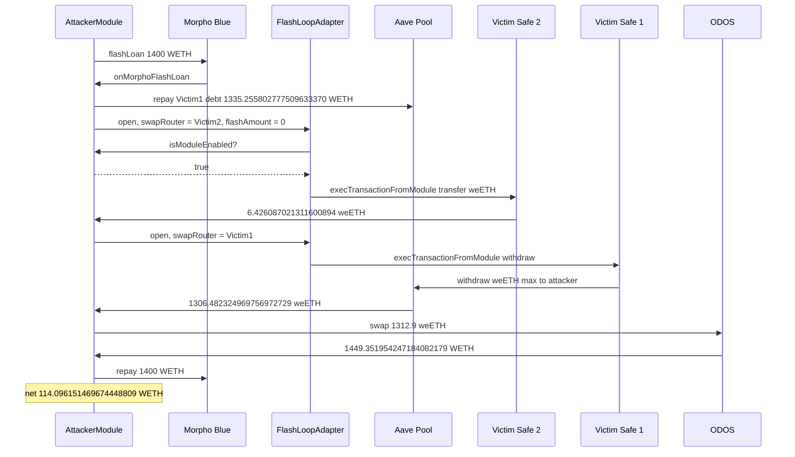

# FlashLoopAdapter — caller self-attests as the Safe, then `swapRouter.call` runs the victim

> **Vulnerability classes:** vuln/access-control/missing-auth · vuln/dependency/unsafe-external-call · vuln/input-validation/missing · vuln/logic/missing-check
> **Reproduction:** the PoC compiles and runs in an isolated Foundry project at [this project folder](.). Full verbose trace: [output.txt](output.txt). **Online pass. There is no `anvil_state.json` in this folder**, so `_shared/run_poc.sh` cannot replay it offline. The committed trace forks a live Ethereum RPC (`createSelectFork("<rpc url>", 26098263)` at [output.txt:12](output.txt)) and passes.

---

## Key info

| | |
|---|---|
| **Loss** | **114.096151469674448809 WETH** left on the attacker after repaying a 1,400 WETH Morpho flash [output.txt:7](output.txt), [output.txt:839](output.txt). Pre-gas. The test's `assertApproxEqRel` target is 114.092 WETH (1% tolerance) [output.txt:840](output.txt) |
| **Vulnerable contract** | FlashLoopAdapter [`0x16bb8B912da187870C23eC6756bB3FAd061283d8`](https://etherscan.io/address/0x16bb8B912da187870C23eC6756bB3FAd061283d8) — verified, [sources/FlashLoopAdapter_16bb8B/src_FlashLoopAdapter.sol](sources/FlashLoopAdapter_16bb8B/src_FlashLoopAdapter.sol) |
| **Victim Safe #1** | [`0xCFeDF95a3653a128dFC2E4288758A1a1850D169f`](https://etherscan.io/address/0xCFeDF95a3653a128dFC2E4288758A1a1850D169f) — Aave variable WETH debt **1,335.255802777509633370**, weETH collateral withdrawn **1,306.482324969756972729** |
| **Victim Safe #2** | [`0xE3b23E47dF7cD85876aC6cB05BDb9d7cd5b28520`](https://etherscan.io/address/0xE3b23E47dF7cD85876aC6cB05BDb9d7cd5b28520) — plain weETH **6.426087021311600894** |
| **Attacker EOA (historical)** | [`0x42c2633438609881c8fBAb82414eb9A0c45F9353`](https://etherscan.io/address/0x42c2633438609881c8fBAb82414eb9A0c45F9353) |
| **Historical attack contract** | [`0xF09168963ac7b31917A02Aa82fA9Cd667F4B67ff`](https://etherscan.io/address/0xF09168963ac7b31917A02Aa82fA9Cd667F4B67ff) |
| **This PoC's attacker** | `AttackerModule` at `0x5615dEB798BB3E4dFa0139dFa1b3D433Cc23b72f` [output.txt:18](output.txt) |
| **Attack tx** | [`0x75328f916b1a0878724d364da5eb12b255160b894cb36c63ed5d718efc616fc4`](https://etherscan.io/tx/0x75328f916b1a0878724d364da5eb12b255160b894cb36c63ed5d718efc616fc4) (block 26,098,264) |
| **Chain / block / date** | Ethereum / fork parent **26,098,263**, `vm.roll` **26,098,264**, `vm.warp` **1,790,867,327** = 2026-10-01 15:08:47 UTC [output.txt:12](output.txt), [output.txt:14](output.txt), [output.txt:16](output.txt) |
| **Compiler** | `v0.8.28+commit.7893614a`, optimizer on, 200 runs ([sources/FlashLoopAdapter_16bb8B/_meta.json](sources/FlashLoopAdapter_16bb8B/_meta.json)). Transient `_pending` / `_safe` need Cancun |
| **Bug class** | `open()` treats `msg.sender` as the Safe because it asks `msg.sender` whether the adapter is an enabled module. `_swap` then `call`s a caller-supplied `swapRouter` with caller-supplied calldata. Pointing that call at a real Safe that enabled the adapter makes the Safe execute as itself. |

## TL;DR

FlashLoopAdapter is a Zodiac-style module for looping an Aave position through a flash loan and an aggregator. `open` / `close` both enter `_start`, which authenticates with:

```solidity
if (!ISafe(msg.sender).isModuleEnabled(address(this))) revert ModuleNotEnabled();
_safe = msg.sender;
```

That is self-attestation. `AttackerModule.isModuleEnabled` returns `true` [output.txt:103](output.txt). The adapter then sets `_safe` to the attacker and, with `providerAddr` and `pool` also set to the attacker and `flashAmount = 0`, every other leg is a no-op against the attacker contract.

The one real effect is `_swap`. It `approve`s `tokenIn` to `swapRouter` and does `router.call(data)` with both arguments taken from `Params`. The attacker sets `swapRouter` to a victim Safe and `data` to `execTransactionFromModule(target, 0, inner, 0)`. Both victims had enabled this adapter, so the Safe singleton `0x41675C09…7461a` accepts the call and runs the inner call as the Safe: Victim #2 `weETH.transfer` of **6.426087021311600894** [output.txt:128](output.txt), Victim #1 `Pool.withdraw(weETH, type(uint256).max, attacker)` of **1,306.482324969756972729** [output.txt:219](output.txt).

Victim #1's collateral was locked by **1,335.255802777509633370** variable WETH debt. Repaying that debt is permissionless and is done with a real Morpho Blue flash of 1,400 WETH before either `open` [output.txt:53](output.txt). ODOS then swaps **1,312.9 weETH** for **1,449.351954247184082179 WETH** [output.txt:283](output.txt), [output.txt:707](output.txt). After repaying 1,400 WETH the attacker holds **114.096151469674448809 WETH** [output.txt:838](output.txt). No victim owner signed anything. `[PASS] testExploit` at [output.txt:4](output.txt).

## Background

The adapter's intended caller is a Safe that has enabled it. `open` flashes debt, swaps debt to collateral, supplies collateral on behalf of the Safe, and `execTransactionFromModule`s a borrow plus a transfer back so the flash can be repaid. `close` does the reverse. `swapRouter` and `swapCalldata` exist so the Safe can pass an off-chain aggregator quote. `minOut` is checked against the adapter's **tokenOut balance after the call**, not against a decoded amount.

Both victims delegatecall the same Safe singleton `0x41675C099F32341bf84BFc5382aF534df5C7461a` [output.txt:113](output.txt), [output.txt:180](output.txt). Module calls do not need owner signatures when the caller is an enabled module. The adapter really was that module; the missing check is which Safe it is willing to drive, and which address it is willing to `call`.

Aave v3 Pool is `0x87870Bca3F3fD6335C3F4ce8392D69350B4fA4E2`. Variable debt WETH is `0xeA51d7853EEFb32b6ee06b1C12E6dcCA88Be0fFE`. WETH `0xC02aaA39…6Cc2`. weETH `0xCd5fE23C…b7ee`. Morpho Blue `0xBBBBBbbB…FFCb` (fee-free). ODOS router `0x6A000F20…1068`. The PoC is [test/FlashLoopAdapter_exp.sol](test/FlashLoopAdapter_exp.sol). The weETH→WETH route is the historical calldata, replayed; its recipient is `msg.sender`, so the WETH arrives on this test's attacker.

## The vulnerable code

Verified source, [sources/FlashLoopAdapter_16bb8B/src_FlashLoopAdapter.sol](sources/FlashLoopAdapter_16bb8B/src_FlashLoopAdapter.sol):

```solidity
/// @notice msg.sender MUST be the Safe (which has this adapter enabled as module).
function open(Params calldata p) external { _start(p); }

function _start(Params calldata p) internal {
    if (!ISafe(msg.sender).isModuleEnabled(address(this))) revert ModuleNotEnabled();
    _safe = msg.sender;
    _pending = keccak256(abi.encode(msg.sender, p));
    // flash from p.providerAddr — attacker sets this to itself
    if (p.provider == Provider.MORPHO) {
        IMorpho(p.providerAddr).flashLoan(p.debt, p.flashAmount, data);
    }
    // ...
}

function _swap(address tokenIn, address tokenOut, address router, bytes memory data, uint256 minOut)
    internal returns (uint256 got)
{
    IERC20(tokenIn).approve(router, type(uint256).max);
    (bool ok, bytes memory ret) = router.call(data);   // router and data are caller-supplied
    if (!ok) {
        assembly { revert(add(ret, 0x20), mload(ret)) }
    }
    IERC20(tokenIn).approve(router, 0);
    got = IERC20(tokenOut).balanceOf(address(this));
    if (got < minOut) revert SwapMinOut(got, minOut);
}
```

`_validate` checks `msg.sender == p.providerAddr` and that the callback params match `_pending`. That only binds the flash callback to the address `_start` just called. It does not constrain `swapRouter`. With `providerAddr = attacker` and `flashAmount = 0`, the callback is the attacker's `flashLoan` re-entering `onMorphoFlashLoan(0, data)` [output.txt:105](output.txt). `minOut = 0`, so the balance check cannot fail. The unlimited `approve` is to the victim Safe; the Safe ignores it and executes the module call instead.

`_run` on `Op.OPEN` also `supply`s to `p.pool` and `_moduleExec`s borrow / repay against `_safe`. Those hit `AttackerModule.supply` and `AttackerModule.execTransactionFromModule`, both no-ops that return success [output.txt:153](output.txt), [output.txt:155](output.txt). The comment in source says the caller must be the Safe. The code never checks a registry of Safes that enabled this module.

## Root cause


## Secondary analysis (@DefimonAlerts)

> FlashLoopAdapter.open authenticates by asking msg.sender whether the adapter is an enabled module, then _swap calls a caller-supplied router with caller-supplied calldata, so an attacker can make any Safe that enabled the module execute as itself.

Source: https://x.com/DefimonAlerts/status/2105765575766990932


## Secondary analysis (@SlowMist_Team)

> Spoofable Safe-module auth: open()/close() trust ISafe(msg.sender).isModuleEnabled(address(this)); _swap() then performs an attacker-controlled router.call that invokes execTransactionFromModule on victim Safes that enabled the adapter.

Source: https://x.com/SlowMist_Team/status/2105855276536725599


1. **Authentication is delegated to the caller.** `ISafe(msg.sender).isModuleEnabled(address(this))` is true for any contract that implements the function to return true. A real Safe would answer honestly; an attacker answers yes. `_safe = msg.sender` then stores the lie for the rest of the operation.
2. **`swapRouter` is an arbitrary call target.** No allowlist, no selector filter, no `msg.sender == router` relationship. `router.call(data)` is an open dispatch from a contract that real Safes trust as a module.
3. **The victims opted into that module.** `execTransactionFromModule` from `0x16bb8B91…` succeeds on both Safes (`ExecutionFromModuleSuccess` at [output.txt:134](output.txt)). The drain is the module permission plus the two bugs, not a stolen owner key.
4. **The rest of `Params` is attacker-controlled and is used as the Aave pool and the flash source.** Setting both to the attacker and `flashAmount` to 0 strips the function down to the single `call`. `flashAmount = 0` still enters `_swap` on the OPEN path (step 1 of `_run` runs before the borrow).
5. **Collateral unlock is a separate, permissionless Aave action.** Repaying `onBehalfOf = victim` does not need the adapter. It is what makes Victim #1's `withdraw` succeed. The adapter bug is what makes the Safe be the one calling `withdraw`.

## Preconditions

- **The target Safe must have enabled this adapter** (`0x16bb8B91…d8`). A Safe that never enabled it would reject `execTransactionFromModule`. The PoC does not enable the module; it was already enabled at the fork block.
- **No owner signature, no `vm.prank` of a victim, no private key.** The only `isModuleEnabled` answer in the trace is the attacker's `true` [output.txt:104](output.txt).
- **Victim #1 must have a repayable WETH debt and weETH collateral.** Debt read and repaid: **1,335.255802777509633370** [output.txt:53](output.txt). weETH sent to the attacker on withdraw: **1,306.482324969756972729** [output.txt:219](output.txt). aWeETH burned in the same withdraw: **1,306.482262583889567736** [output.txt:203](output.txt) (rebasing index, not a second transfer).
- **A WETH flash large enough to repay that debt.** Morpho lent **1,400 WETH** with no fee [output.txt:34](output.txt). 1,400 − 1,335.255802777509633370 = **64.744197222490366630** WETH of the flash stayed with the attacker until the final repay.
- **Fork timestamp.** `vm.warp(1790867327)` matches the attack block so the rebasing aWeETH balance matches the ODOS quote. The test says this explicitly.

## Attack walkthrough (with on-chain numbers from the trace)

| # | Action | Amount | Trace |
|---|--------|--------|-------|
| 0 | Attacker WETH before | 0 | [output.txt:6](output.txt), [output.txt:26](output.txt) |
| 1 | Morpho `flashLoan(WETH, 1400 ether)` | +1,400 WETH | [output.txt:34](output.txt) |
| 2 | `Pool.repay(WETH, debt, 2, Victim#1)`. Debt is the variable-debt token balance, not `type(uint256).max` (Aave reverts `NoExplicitAmountToRepayOnBehalf`) | 1,335.255802777509633370 WETH | [output.txt:53](output.txt), [output.txt:83](output.txt) |
| 3 | Victim #2 weETH balance | 6.426087021311600894 | [output.txt:100](output.txt) |
| 4 | `adapter.open` with `swapRouter = Victim#2`, `flashAmount = 0`, `providerAddr = pool = attacker`. `isModuleEnabled` returns true. Adapter `call`s `Victim#2.execTransactionFromModule(weETH, 0, transfer(attacker, bal), 0)` | 6.426087021311600894 weETH to the attacker. Victim #2 balance slot goes to 0 | [output.txt:102](output.txt), [output.txt:103](output.txt), [output.txt:112](output.txt), [output.txt:128](output.txt), [output.txt:130](output.txt) |
| 5 | Second `open`, `swapRouter = Victim#1`. Inner call is `Pool.withdraw(weETH, type(uint256).max, attacker)` | 1,306.482324969756972729 weETH to the attacker | [output.txt:169](output.txt), [output.txt:179](output.txt), [output.txt:181](output.txt), [output.txt:219](output.txt) |
| 6 | ODOS `swapExactAmountIn`, input exactly 1,312.9 weETH (dust remains: 6.426087021311600894 + 1,306.482324969756972729 = 1,312.908411991068573623) | WETH out **1,449.351954247184082179** | [output.txt:283](output.txt), [output.txt:707](output.txt) |
| 7 | Approve and repay Morpho 1,400 WETH | −1,400 WETH | [output.txt:715](output.txt), [output.txt:721](output.txt) |
| 8 | Logged profit | **114.096151469674448809 WETH** | [output.txt:838](output.txt), [output.txt:839](output.txt) |

**WETH identity**

| Component | WETH |
|-----------|------|
| Morpho flash | +1,400 |
| Aave repay for Victim #1 | −1,335.255802777509633370 |
| ODOS proceeds | +1,449.351954247184082179 |
| Morpho repay | −1,400 |
| **Net** | **114.096151469674448809** |

Check: 1,400 − 1,335.255802777509633370 + 1,449.351954247184082179 − 1,400 = 114.096151469674448809. That is the equity of the two Safes after selling the seized weETH, not a fee-on-flash. Suite: `1 passed; 0 failed` [output.txt:851](output.txt).

## Diagrams



## Remediation

1. **Store the Safe at enable time.** `isModuleEnabled` must be called on a Safe the adapter already knows (`enabled[msg.sender]` set by the Safe in an opt-in that the adapter records), not on `msg.sender` as an oracle about itself. A view on an arbitrary contract is not authentication.
2. **Allowlist `swapRouter`.** The aggregator address should be immutable or owner-set. Reject `swapRouter` if it is a contract that can move third-party funds, in particular any Safe. Do not `approve(router, type(uint256).max)` for a caller-supplied router; approve the quoted input amount to a known router, or pull tokens only after a successful swap callback from that router.
3. **Constrain calldata.** If an aggregator quote is required, check the selector and that the token path is `(tokenIn, tokenOut)`. `execTransactionFromModule` must not be a reachable selector.
4. **`minOut` cannot be the only bound** when `tokenOut.balanceOf(adapter)` is unchanged by a malicious call and `minOut` is 0. Measure the balance delta of the intended output token and require it.
5. **Users who enabled this module should disable it.** The permission is the blast radius. Disabling the module stops this dispatch even before an upgrade. Funds already sitting in a still-enabled Safe are exposed to anyone who can call `open`.

## How to reproduce

**No `anvil_state.json`.** `_shared/run_poc.sh 2026-10-FlashLoopAdapter_exp -vvvvv` exits before Forge. The passing artifact is the **online** trace [output.txt](output.txt).

```bash
# from the registry root — offline harness refuses this folder (no anvil_state.json)
# _shared/run_poc.sh 2026-10-FlashLoopAdapter_exp -vvvvv

# online, matching the committed trace (Cancun: adapter transient storage)
cd 2026-10-FlashLoopAdapter_exp
forge test --match-contract FlashLoopAdapterExploit --evm-version cancun -vvvvv
```

- **Chain / fork:** Ethereum, block **26,098,263**, then `warp(1790867327)` and `roll(26098264)`. RPC in the test: `https://eth.drpc.org`.
- **Expected result** (this is what [output.txt](output.txt) already records, `finished in 554.77ms`):

```
[PASS] testExploit()
Attacker Before exploit WETH Balance: 0.000000000000000000
Attacker profit (WETH): 114.096151469674448809
Attacker After exploit WETH Balance: 114.096151469674448809
Suite result: ok. 1 passed; 0 failed; 0 skipped
```

*Reference: attack tx and fork RPC in the header of [test/FlashLoopAdapter_exp.sol](test/FlashLoopAdapter_exp.sol) — [`0x75328f916b1a0878724d364da5eb12b255160b894cb36c63ed5d718efc616fc4`](https://etherscan.io/tx/0x75328f916b1a0878724d364da5eb12b255160b894cb36c63ed5d718efc616fc4), RPC `https://eth.drpc.org`.*


## References

- https://x.com/DefimonAlerts/status/2105695635647144370 (@DefimonAlerts secondary analysis)

- https://x.com/exvulsec/status/2105701761554190847 (@exvulsec secondary analysis)

- https://x.com/DefimonAlerts/status/2105765575766990932 (@DefimonAlerts secondary analysis)

- https://x.com/SlowMist_Team/status/2105855276536725599 (@SlowMist_Team secondary analysis)

- https://x.com/exvulsec/status/2105898901589184712 (@exvulsec secondary analysis)
