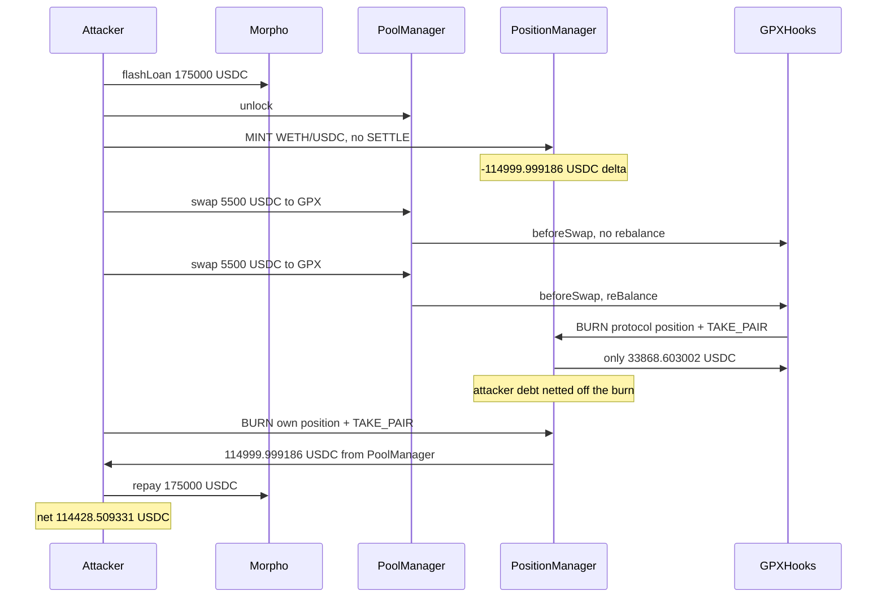

# GoldPesa GPXHooks — `TAKE_PAIR` settles the shared unlock, so another position's debt cancels the burn credit

> **Vulnerability classes:** vuln/logic/missing-check · vuln/logic/state-update · vuln/defi/flash-loan-attack
> **Reproduction:** the PoC compiles and runs in an isolated Foundry project at [this project folder](.). Full verbose trace: [output.txt](output.txt). **`anvil_state.json` is present.** The committed [output.txt](output.txt) is still an **online pass**, not an anvil replay: `createSelectFork("base", 52078501)` at [output.txt:12](output.txt), `[PASS] testExploit` at [output.txt:4](output.txt), suite ok in **24.27s** (22.89s CPU) at [output.txt:634](output.txt). The test source now forks `http://127.0.0.1:8548`. This note reports the trace that is actually in `output.txt`.

---

## Key info

| | |
|---|---|
| **Stolen (asserted)** | **114,999.999186 USDC** taken from the V4 PoolManager when the attacker burns their own unsettled WETH/USDC position [output.txt:7](output.txt), [output.txt:481](output.txt), [output.txt:622](output.txt) |
| **Net after flash repay** | **114,428.509331 USDC** [output.txt:8](output.txt), [output.txt:627](output.txt). Round-trip cost of the GPX swaps: 114,999.999186 − 114,428.509331 = **571.489855 USDC** |
| **Hook's TAKE_PAIR** | **33,868.603002 USDC** PoolManager → GPXHooks [output.txt:230](output.txt). The two takes sum to **148,868.602188**. The hook's pre-simulation event is **148,868.602189** (1 microunit higher) [output.txt:197](output.txt) |
| **Vulnerable contract** | GPXHooks [`0x4519e2b040ff1B64fa03aBe2AeF0BC99D7CcEaA8`](https://basescan.org/address/0x4519e2b040ff1B64fa03aBe2AeF0BC99D7CcEaA8) — verified, [sources/GPXHooks_4519e2/src_gpx_GPXHooks.sol](sources/GPXHooks_4519e2/src_gpx_GPXHooks.sol) |
| **PoolManager** | [`0x498581fF718922c3f8e6A244956aF099B2652b2b`](https://basescan.org/address/0x498581fF718922c3f8e6A244956aF099B2652b2b) |
| **PositionManager** | [`0x7C5f5A4bBd8fD63184577525326123B519429bDc`](https://basescan.org/address/0x7C5f5A4bBd8fD63184577525326123B519429bDc) |
| **Attacker EOA (historical)** | [`0x4a5FD2e9357cC87DF4cD6A1808174DBc8646899F`](https://basescan.org/address/0x4a5FD2e9357cC87DF4cD6A1808174DBc8646899F) |
| **Historical attack contract** | [`0x3d69591a3868FE77B531187486862c459Cce4e86`](https://basescan.org/address/0x3d69591a3868FE77B531187486862c459Cce4e86) |
| **This PoC's attacker** | `GoldPesaExploiter` at `0x5615dEB798BB3E4dFa0139dFa1b3D433Cc23b72f` [output.txt:16](output.txt) |
| **Attack tx** | [`0x5c1febd5047c2a15c37988b6abd5c8b984236dddf6fd24eed96b0f43951ad2c9`](https://basescan.org/tx/0x5c1febd5047c2a15c37988b6abd5c8b984236dddf6fd24eed96b0f43951ad2c9) (block 52,078,502) |
| **Chain / block / date** | Base / fork parent **52,078,501** [output.txt:12](output.txt) / `vm.warp` **1,790,946,351** = 2026-10-02 13:05:51 UTC [output.txt:14](output.txt) |
| **Compiler** | `v0.8.30+commit.73712a01`, optimizer on, 200 runs ([sources/GPXHooks_4519e2/_meta.json](sources/GPXHooks_4519e2/_meta.json)) |
| **Bug class** | `reBalance` burns protocol liquidity with `PositionManager.modifyLiquiditiesWithoutUnlock(BURN_POSITION, TAKE_PAIR)` inside whatever PoolManager unlock is already open. `TAKE_PAIR` pays the PositionManager's **net** positive delta, so an attacker's unsettled USDC debt is subtracted from the hook's burn credit and later withdrawn by the attacker. |

## TL;DR

GPXHooks owns the GPX/USDC Uniswap V4 liquidity. Any swap whose `beforeSwap` sees `block.timestamp - lastRebalance >= 1 hours` calls `reBalanceRoutine()` → `checkRebalance` → `reBalance` ([GPXHooks.sol](sources/GPXHooks_4519e2/src_gpx_GPXHooks.sol) lines 576–577 and 694–710). The burn uses `modifyLiquiditiesWithoutUnlock`, which does not open its own unlock. `TAKE_PAIR` then pulls only the PositionManager's net credit for that currency across the whole unlock.

The attacker opens one unlock, flash-borrowing **175,000 USDC** from Morpho first [output.txt:23](output.txt). Inside it they mint a WETH/USDC position at ticks **[−210000, −209990]**, liquidity **8,346,512,432,733,306,153**, token id **3,106,205**, and they do not settle [output.txt:36](output.txt), [output.txt:461](output.txt). The range is entirely below spot, so the PositionManager's delta is pure USDC debt: the later burn returns amount0 = 0 and amount1 = **114,999.999186** [output.txt:476](output.txt).

Two GPX buys of **5,500 USDC** follow. The first `beforeSwap` does not rebalance [output.txt:62](output.txt). The second does [output.txt:178](output.txt): it burns protocol position **3,078,078** and `take`s only **33,868.603002 USDC** back to the hook [output.txt:202](output.txt), [output.txt:230](output.txt). The missing **114,999.999186** was netted against the attacker's open debt. The attacker then burns token 3,106,205 and `take`s that **114,999.999186 USDC** out of the PoolManager [output.txt:481](output.txt). A last GPX→USDC swap unwinds inventory; Morpho is repaid in full (Morpho Blue fee is 0). Net profit **114,428.509331 USDC** [output.txt:627](output.txt).

## Background

Uniswap V4 accounts for a swap or a liquidity change as a `BalanceDelta` on the caller while an `unlock` is open. Currency actually moves only on `sync`/`settle` (payer pays the PoolManager) and `take` (PoolManager pays the recipient). The PositionManager is one caller. Every `modifyLiquidities` that runs inside the same unlock shares that contract's delta. `TAKE_PAIR` transfers `max(netDelta, 0)` of each currency to a recipient and clears it. A negative delta is not paid out; it waits for a later positive delta or a settle.

`modifyLiquiditiesWithoutUnlock` is the entry point for a caller that is **already** inside `unlockCallback`. The hook is in that position because `beforeSwap` runs under the PoolManager's lock, which the attacker's `unlock` is holding. The hook never reads the PositionManager's GPX or USDC delta before the burn, and it never requires that delta to be zero.

GPX/USDC pool key: currency0 GPX `0x454F8c3f…3133`, currency1 USDC `0x833589fC…2913` (6 decimals), fee 0, tickSpacing 1, hooks = GPXHooks. Pool id `0xe33d2ac4…dcac`. WETH/USDC pool: WETH `0x4200…0006`, fee 500, tickSpacing 10, hooks = 0. Pool id `0x90333bb0…43a0`. The attacker's burn emits that id [output.txt:464](output.txt). Morpho on Base is `0xBBBBBbbB…FFCb`. The PoC is [test/GoldPesa_exp.sol](test/GoldPesa_exp.sol).

## The vulnerable code

Verified source, [sources/GPXHooks_4519e2/src_gpx_GPXHooks.sol](sources/GPXHooks_4519e2/src_gpx_GPXHooks.sol):

```solidity
function beforeSwap(...) external override onlyPoolManager returns (...) {
    checkForDonations();
    if (block.timestamp - lastRebalance >= 1 hours) {
        reBalanceRoutine();   // permissionless: any swap, once an hour
    }
    // ...
}

function reBalance(...) internal {
    bytes memory burnActions = abi.encodePacked(
        uint8(Actions.BURN_POSITION),  // 0x03
        uint8(Actions.TAKE_PAIR)       // 0x11
    );
    burnParams[0] = abi.encode(positionId, minGPXExpected, minUSDCExpected, ZERO_BYTES);
    burnParams[1] = abi.encode(key.currency0, key.currency1, address(this));
    isRebalancing = true;
    positionManager.modifyLiquiditiesWithoutUnlock(burnActions, burnParams);
    isRebalancing = false;
    // USDC left on the hook is treated as the liquidity just burned
    uint256 usdcInsideHook = IERC20(Currency.unwrap(usdc)).balanceOf(address(this));
    // ...
}
```

`onlyPoolManager` stops a random account from calling `beforeSwap` directly. It does not stop a random account from swapping, and the swap is what calls `beforeSwap`. There is no "PositionManager delta is zero" check around line 907.

The trace's second `beforeSwap` is the one that matters:

- `CurrentStateBeforeSimulation(148868602189, …)` [output.txt:197](output.txt). That first word is 148,868.602189 USDC.
- `modifyLiquiditiesWithoutUnlock(0x0311, …)` burns position **3,078,078** [output.txt:199](output.txt), [output.txt:202](output.txt).
- `take(GPX, hook, 40780334982392197810812)` and `take(USDC, hook, 33868603002)` [output.txt:220](output.txt), [output.txt:230](output.txt).

33,868.603002 + 114,999.999186 = 148,868.602188. The event is 1 microunit above that sum (148,868.602189). The USDC that left the PoolManager toward the hook is the smaller number. The hook then computes the next position from `balanceOf(hook)`, which is the **net** take, so it also rebuilds liquidity from the already-reduced USDC (the `0x020d` mint later in the same `beforeSwap` [output.txt:271](output.txt)). The theft itself is the attacker's subsequent take, not that rebuild.

The attacker's own burn, still inside the same unlock, is `modifyLiquiditiesWithoutUnlock` on token **3,106,205**, ticks −210000 / −209990, liquidity delta −8,346,512,432,733,306,153 [output.txt:458](output.txt), [output.txt:462](output.txt). The returned delta's high word is 0 (no WETH) and the low word is `0x1ac688bad2` = 114,999,999,186 [output.txt:476](output.txt). `exttload` of the USDC delta is the same value [output.txt:480](output.txt), and `take` sends it to the attacker [output.txt:481](output.txt), [output.txt:484](output.txt).

## Root cause

1. **`TAKE_PAIR` is a net settlement, and the hook assumes it is a gross one.** The burn credit and every other unsettled PositionManager delta in this unlock are one number. An unpaid mint of 114,999.999186 USDC reduces the hook's withdrawal by that amount. The hook does not compare `usdcInsideHook` to `usdcInsideUniswap` except to skim a donation when the balance is **larger**. A shortfall is accepted and used as the new liquidity budget.
2. **`modifyLiquiditiesWithoutUnlock` inherits the caller's unlock.** The function is correct for a hook that is the only liquidity actor in the callback. It is not safe when the callback was entered by an arbitrary swapper who already mutated the PositionManager in that same unlock. The hook cannot see that history because it never looks.
3. **The hourly rebalance is on the public swap path.** `checkRebalance` can still return false (the first 5,500 USDC buy did not burn). The second buy, after the tick was pushed, returned true and burned. No keeper, owner, or signer is required. `isRebalancing` only stops re-entry of the hook's own path.
4. **The attacker's debt is a normal permissionless mint.** Minting below spot on WETH/USDC creates a pure currency1 debt. Leaving out `SETTLE_PAIR` is allowed; V4 collects later. The bug is the hook paying that debt with protocol liquidity.
5. **The attacker is made whole by burning the same position.** Once the rebalance has cancelled the debt, `BURN_POSITION` + `TAKE_PAIR` to `address(this)` pays the attacker the USDC the position was owed, out of PoolManager balances that the protocol position just released.

## Preconditions

- **An open PoolManager unlock the attacker controls.** `PM.unlock` from the exploiter [output.txt:34](output.txt). The hook's `beforeSwap` then runs nested inside it.
- **At least one hour since `lastRebalance`, and `checkRebalance` true.** The first buy's `beforeSwap` did not burn. The second did. The test warps to 1,790,946,351 so the timestamp matches the attack block; the price math does not depend on the warp, the hour-gate does.
- **Working capital.** Morpho flash of **175,000 USDC** [output.txt:24](output.txt), repaid in full [output.txt:609](output.txt). Two buys of 5,500 USDC are settled inside the unlock [output.txt:176](output.txt) (second buy's `settle` returns 5,500 USDC). No WETH is transferred; the trace has no WETH `transfer`.
- **Protocol liquidity large enough.** The burn credit has to exceed the attacker's manufactured debt. Here the USDC side of the burn was about 148,868.60 before netting.
- **No admin.** The attacker is not the hook owner. `onlyPoolManager` is satisfied because the PoolManager is the one calling `beforeSwap`.

## Attack walkthrough (with on-chain numbers from the trace)

| # | Action | Amount (USDC, 6 dp) | Trace |
|---|--------|---------------------|-------|
| 0 | Morpho `flashLoan(USDC, 175000e6)` | +175,000.000000 | [output.txt:23](output.txt), [output.txt:27](output.txt) |
| 1 | `PM.unlock`. Inside, `MINT_POSITION` only (action `0x02`) on WETH/USDC, ticks −210000/−209990, liquidity 8346512432733306153, no settle. Position id 3,106,205 | open debt, later measured as 114,999.999186 | [output.txt:34](output.txt), [output.txt:36](output.txt), [output.txt:461](output.txt) |
| 2 | First GPX buy, exact input 5,500 USDC (`zeroForOne = false`). `beforeSwap` does not rebalance. `settle` pulls 5,500 | −5,500.000000 | [output.txt:62](output.txt), [output.txt:176](output.txt) |
| 3 | Second GPX buy, another 5,500. `beforeSwap` runs `checkRebalance` and burns position 3,078,078 | simulation word 148,868.602189 | [output.txt:177](output.txt), [output.txt:178](output.txt), [output.txt:197](output.txt), [output.txt:202](output.txt) |
| 4 | Hook `TAKE_PAIR`: GPX 40,780.334982392197810812 (18 dp) and USDC **33,868.603002** to the hook. The other 114,999.999186 of USDC credit was consumed by the open debt | hook receives 33,868.603002 | [output.txt:220](output.txt), [output.txt:230](output.txt), [output.txt:233](output.txt) |
| 5 | Attacker `BURN_POSITION` + `TAKE_PAIR` on token 3,106,205. Delta amount0 = 0, amount1 = 114,999.999186. `take` to the attacker | **+114,999.999186** | [output.txt:458](output.txt), [output.txt:476](output.txt), [output.txt:481](output.txt), [output.txt:484](output.txt) |
| 6 | GPX balance sold back (`zeroForOne = true`) and USDC settled/taken, then Morpho `transferFrom` of 175,000 | repay 175,000.000000 | [output.txt:503](output.txt), [output.txt:609](output.txt) |
| 7 | `stolenUSDC` and net balance | stolen **114,999.999186**; net **114,428.509331** | [output.txt:621](output.txt), [output.txt:622](output.txt), [output.txt:625](output.txt), [output.txt:627](output.txt) |

`assertApproxEqRel(stolen, 114999999186, 1e14)` passes exactly [output.txt:628](output.txt). `assertGt(net, 100_000e6)` passes [output.txt:630](output.txt). Suite: `1 passed` [output.txt:634](output.txt).

The 571.489855 USDC gap between stolen and net is the GPX round trip (two 5,500 buys, the unwind, and hook fees taken during those swaps). It is not a Morpho fee. 175,000 in and 175,000 out.

## Diagrams



## Remediation

1. **Do not `TAKE_PAIR` inside a user-opened unlock.** Burn and take in a hook-owned `poolManager.unlock` so the PositionManager delta starts at zero, or use `modifyLiquidities` (the version that unlocks itself) when the caller cannot have pre-seeded a delta.
2. **Require the PositionManager's currency deltas to be zero** immediately before the burn, via `exttload` on the delta slots. Revert the rebalance if they are not. A failed rebalance must not be worse than skipping it.
3. **Compare gross burn credit to `usdcInsideHook`.** If `balanceOf(hook)` after `TAKE_PAIR` is less than the USDC the burn reported, revert. The donation check only handles the greater-than case (lines 917–928). The less-than case is the exploit.
4. **Keep the hourly trigger, but not on an arbitrary swapper's lock.** A keeper call that enters through the hook's own callback cannot smuggle a foreign mint into the same unlock.
5. **Re-mint only from tokens the hook measured as the burn output**, stored before any other PositionManager action, not from `balanceOf` after a shared `TAKE_PAIR`.

## How to reproduce

`anvil_state.json` is in this folder, so the offline harness can start:

```bash
# from the registry root
_shared/run_poc.sh 2026-10-GoldPesa_exp -vvvvv
```

That command loads `anvil_state.json` and rewrites `http://127.0.0.1:8548` in a temp copy of the test. **It is not what produced the committed trace.** [output.txt](output.txt) records:

- `createSelectFork("base", 52078501)` [output.txt:12](output.txt) — the named Base endpoint, not a redacted `http://` URL
- `[PASS] testExploit()` [output.txt:4](output.txt)
- `USDC pulled out via own-position burn: 114999.999186` [output.txt:7](output.txt)
- `Net USDC profit after flash-loan repay: 114428.509331` [output.txt:8](output.txt)
- `Suite result: ok. 1 passed; 0 failed; 0 skipped; finished in 24.27s (22.89s CPU time)` [output.txt:634](output.txt)

The current test file forks `http://127.0.0.1:8548` at block 52,078,501 and warps to 1,790,946,351. Cancun is required (V4 transient storage); [foundry.toml](foundry.toml) sets `evm_version = 'cancun'`.

*Reference: attack tx in the header of [test/GoldPesa_exp.sol](test/GoldPesa_exp.sol) — [`0x5c1febd5047c2a15c37988b6abd5c8b984236dddf6fd24eed96b0f43951ad2c9`](https://basescan.org/tx/0x5c1febd5047c2a15c37988b6abd5c8b984236dddf6fd24eed96b0f43951ad2c9). The test's fork URL is `http://127.0.0.1:8548`; the committed trace forked `"base"`.*
