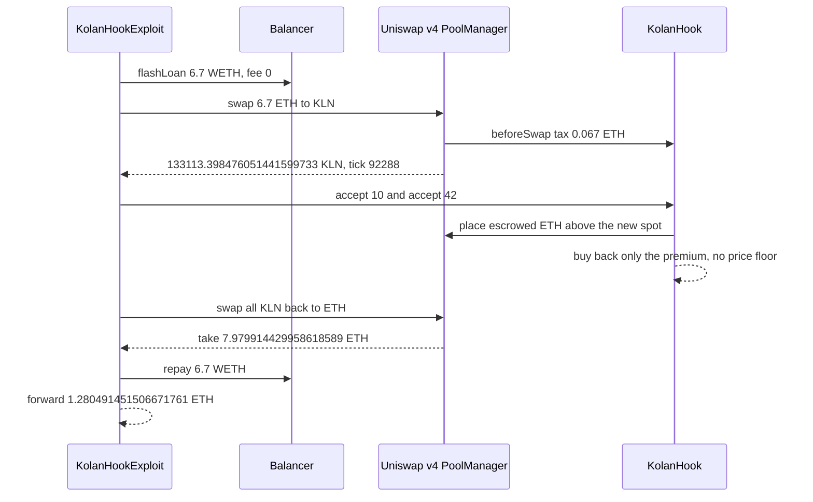

# KolanHook — expired buy windows settle on the pool's own spot, then the escrowed ETH is bought back with no price limit

> **Vulnerability classes:** vuln/oracle/spot-price · vuln/oracle/price-manipulation · vuln/defi/slippage · vuln/logic/missing-check
> **Reproduction:** offline (this folder ships an `anvil_state.json`) or online archival fork. Passing trace: [output.txt](output.txt). Folder: [(.)](.). Verified source: [sources/KolanHook_0136fe](sources/KolanHook_0136fe).
---
## Key info
| | |
|---|---|
| **Loss** | Attacker ETH after the flash loan is repaid: **1.280491451506671761** [output.txt:7](output.txt), [output.txt:342](output.txt). Before-balance was dealt to **0** [output.txt:6](output.txt), [output.txt:30](output.txt). On-chain the EOA net was **1.279453 ETH** after gas. The test band is 0.0015 ETH. The reverse swap's `take` is **7.979914429958618589 ETH** against **6.7 ETH** borrowed [output.txt:325](output.txt) |
| **Vulnerable contract** | `KolanHook` [`0x0136feCf49E0217BFd2D9551E8e7b05f174Ba8eC`](https://etherscan.io/address/0x0136fecf49e0217bfd2d9551e8e7b05f174ba8ec), the hook on the ETH/KLN Uniswap v4 pool |
| **Attacker EOA** | [`0x8df735014EaB81905E76B87Ef0c069BD8e0Ae382`](https://etherscan.io/address/0x8df735014eab81905e76b87ef0c069bd8e0ae382) |
| **Attack contract** | On-chain helper [`0x4d6a41f2B80FE75FacF27F9D0b3DC8bd0EBC835f`](https://etherscan.io/address/0x4d6a41f2B80FE75FacF27F9D0b3DC8bd0EBC835f). PoC deploys a fresh `KolanHookExploit`. Trace address `0x5615dEB798BB3E4dFa0139dFa1b3D433Cc23b72f` |
| **Attack tx** | [`0x7b131926e6f06491ae1aead3e419b208c8aa70ed7898e8c5a33d9f52e40915a9`](https://etherscan.io/tx/0x7b131926e6f06491ae1aead3e419b208c8aa70ed7898e8c5a33d9f52e40915a9), block 26,197,504 |
| **Chain / block / date** | Ethereum mainnet (chain id 1) / fork parent **26,197,503** / 15 October 2026. The test's fork timestamp **1792062359** is 11:05:59 UTC |
| **Compiler** | Solidity `v0.8.26+commit.8a97fa7a`, optimizer on, 200 runs ([_meta.json](sources/KolanHook_0136fe/_meta.json)). Not a proxy |
| **Bug class** | `accept` after expiry prices the window off `PoolManager.getSlot0` of the same pool and, when the window is not "back in place", re-injects the escrowed ETH at that spot and market-buys KLN down to `MIN_SQRT_PRICE + 1` |

## TL;DR
KolanHook escrows ETH for timed "buy windows" on a single ETH/KLN Uniswap v4 pool (fee 0, tick spacing 10, currency0 native ETH, currency1 KLN `0x2CADc4F2660Bb77a118b0e74fC9E48E935b3a1bF`). `accept(id)` settles a window. After `w.expiry`, the caller does not have to be `w.owner`. Settlement reads the live sqrt price. `accept` passes `keep = true`. If the manipulated price is above the window's lower tick, the escrowed ETH is placed as single-sided liquidity starting at that price (`_addEthAbove`), and `_buyBack` swaps ETH for KLN with `sqrtPriceLimitX96 = TickMath.MIN_SQRT_PRICE + 1`.

The attacker flash-borrows **6.7 WETH** from Balancer (fee 0), unwraps, and swaps it to KLN. The hook's before-swap tax takes **0.067 ETH**. The pool moves by **6.633 ETH** and pays **133,113.398476051441599733 KLN**. Tick goes to **92288** [output.txt:71](output.txt). `accept(10)` and `accept(42)` then run at that spot. The reverse swap sells the same KLN back and `take`s **7.979914429958618589 ETH** [output.txt:325](output.txt). Repaying **6.7 WETH** leaves **1.280491451506671761 ETH**, forwarded to the attacker EOA [output.txt:342](output.txt).

Both windows were already expired at the fork. Window 10's owner `0x4BBA7DcE455910189987380309935Ef3Bdc6De2C` receives **23,126.925448255121033021 KLN** [output.txt:169](output.txt). Window 42's owner `0x43B6bf2Ee5d85fdFa65Ce16FfCB6721B7C4A13D2` receives **984.620498563695423304 KLN** [output.txt:282](output.txt). The test header records the escrow as window 10: 2.0 ETH plus 0.05 premium, window 42: 0.2 ETH plus 0.059861111 premium, **2.309861 ETH** on the hook in total. The buy-backs in the trace are those premiums: **0.05 ETH** and **0.059861111111111108 ETH** [output.txt:125](output.txt), [output.txt:237](output.txt). The escrowed ETH itself was moved into the pool as liquidity, which is what the reverse swap extracts. `[PASS] testExploit()` gas 2,935,325 [output.txt:4](output.txt).

## Background — what a window is
A window is an order the hook executes inside `PoolManager.unlock`. Opening it carves liquidity across ticks, taxes the buyer, and stores `eth`, `tokens`, `premium`, and `expiry`. `cancel` before expiry is owner-only and passes `keep = false`. `accept` is the settle path and passes `keep = true`. The only extra check is:

```solidity
if (msg.sender != w.owner && block.timestamp < w.expiry) revert WindowStillOpen();
```

So before expiry, only the owner settles. After expiry, any address does. That is the whole access check. There is no keeper role and no max delay.

`_closeWindow` then reads `_sqrtPrice()`, which is `PoolManager.getSlot0(_poolId())` with no TWAP and no observation cardinality ([src_LiquidityBook.sol](sources/KolanHook_0136fe/src_LiquidityBook.sol)). For `keep = true`, `backInPlace` means `sqrtPrice <= sqrtPriceAtTick(lower)`. If that holds, the original cuts are restored. If it does not, `_addEthAbove(sqrtPrice, upper - lower, w.eth)` mints a new range whose lower tick is the manipulated price aligned up to the spacing. Spendable ETH for the buy-back is `premium + eth + currencyDelta(this, ETH)`. Because `_addEthAbove` already owes the pool about `w.eth`, the delta cancels the escrow and the swap size collapses to about the premium. That is why `accept(10)` swaps **0.05 ETH** and `accept(42)` swaps **0.059861111111111108 ETH**, not the full escrow. The escrow is now liquidity sitting above the depressed spot. Selling KLN back through it pays out that ETH.

The hook also taxes swaps. On the way in, `Taxed` is **0.067 ETH**, 1% of 6.7 [output.txt:67](output.txt). On the way out, `Taxed` is **0.080605196262208268 ETH** [output.txt:304](output.txt). The pool's raw `amount0` on the reverse swap is **8.060519626220826857 ETH** [output.txt:297](output.txt). Subtracting the tax leaves the **7.979914429958618589 ETH** that `take` delivers. **8.060519626220826857 − 0.080605196262208268 = 7.979914429958618589**.

## The vulnerable code
Verified `src_KolanHook.sol`.

```solidity
function accept(uint256 id) external nonReentrant {
    Window memory w = windows[id];
    if (w.owner == address(0)) revert NoWindow();
    if (msg.sender != w.owner && block.timestamp < w.expiry) revert WindowStillOpen();
    _close(id, w, true);
    if (!TOKEN.transfer(w.owner, w.tokens)) revert TransferFailed();
    _checkSolvent();
}

function _closeWindow(uint256 id, bool keep) private returns (uint256 burned, bool backInPlace) {
    uint160 sqrtPrice = _sqrtPrice();
    backInPlace = keep
        ? sqrtPrice <= TickMath.getSqrtPriceAtTick(lower)
        : sqrtPrice >= TickMath.getSqrtPriceAtTick(upper);
    if (backInPlace) {
        for (uint256 i = 0; i < cuts.length; ++i) _restore(cuts[i]);
    } else if (keep) {
        _addEthAbove(sqrtPrice, upper - lower, w.eth);
    } else {
        _addTokensBelow(sqrtPrice, upper - lower, w.tokens);
    }
    int256 spendable = int256(uint256(w.premium)) + (keep ? int256(uint256(w.eth)) : int256(0))
        + POOL_MANAGER.currencyDelta(address(this), ETH);
    if (spendable > 0) _buyBack(spendable.toUint256());
    // ...
}

function _buyBack(uint256 eth) private {
    POOL_MANAGER.swap(
        poolKey(),
        SwapParams({
            zeroForOne: true,
            amountSpecified: -eth.toInt256(),
            sqrtPriceLimitX96: TickMath.MIN_SQRT_PRICE + 1
        }),
        ""
    );
}
```

`_addEthAbove` starts at `_alignedAtOrAbove(sqrtPrice)` and extends by the old window width, capped at `HIGHEST_TICK`. The liquidity it mints is sized from `w.eth` between those two sqrt prices. There is no comparison with the price that was in force when the window was opened, and `_buyBack` will trade through every tick down to the minimum usable sqrt price.

## Root cause — why it was possible
1. **Settlement price is the spot of the pool being settled.** `getSlot0` moves when the attacker swaps. The hook is the pool's hook, so the attacker is not manipulating an external oracle. They are trading the inventory the hook will reprice against.
2. **`backInPlace` is a single comparison with no tolerance.** Pushing the spot above the window's lower tick flips `keep = true` from "restore the cuts" to "place `w.eth` as new liquidity at the new price". Window 42 takes that path. The trace shows `modifyLiquidity` starting at tick **92450** during `accept(42)` [output.txt:183](output.txt), under the attacker's spot (tick **92288** after the first swap, then **92177** after the in-accept buy-back [output.txt:237](output.txt)).
3. **The buy-back has no slippage bound that protects the hook.** `MIN_SQRT_PRICE + 1` is the Uniswap v4 minimum usable limit, not a user min-out. Whatever KLN that ETH buys is what the hook gets.
4. **`accept` is callable by the same address that just moved the spot, as soon as `expiry` has passed.** Window 10 expiry in the header is **1791494951**. Window 42 expiry is **1791670463**. Both are before the fork timestamp **1792062359**. No signature from the window owner is required. The owners are paid their KLN. The loss is the ETH that was escrowed against a different price.

## Preconditions
- At least one window is past `expiry` and still open. Both 10 and 42 are. Their KLN payouts are the transfers at [output.txt:169](output.txt) and [output.txt:282](output.txt).
- The attacker can move the ETH/KLN spot with a swap large relative to the window. **6.7 ETH** is enough. Balancer's flash loan fee on this token is **0** [output.txt:347](output.txt).
- `accept` does not restrict `msg.sender` after expiry. It does not.
- The hook's solvency check passes after the mis-placed liquidity, so `accept` does not revert. It doesn't: both accepts return and the reverse swap completes.
- No admin key. The helper contract is created inside the transaction, same as the trace's `new KolanHookExploit`.

## Attack walkthrough (with on-chain numbers from the trace)
The attacker EOA is dealt to 0 before the call [output.txt:30](output.txt). `balanceLog` prints **0** [output.txt:6](output.txt).

| Step | What the trace shows | Amount |
|---|---|---|
| 1 | Balancer `flashLoan` of WETH, fee 0 | **6.7 WETH** [output.txt:39](output.txt), [output.txt:45](output.txt), [output.txt:347](output.txt) |
| 2 | `WETH.withdraw` | **6.7 ETH** [output.txt:51](output.txt) |
| 3 | `beforeSwap` tax on the exact-in ETH to KLN swap | **0.067 ETH** [output.txt:67](output.txt) |
| 4 | Pool `Swap` | amount0 **−6.633 ETH**, amount1 **+133,113.398476051441599733 KLN**, tick **92288**, sqrtPriceX96 **7994678147986494704038746930061** [output.txt:71](output.txt) |
| 5 | `take` KLN to the helper | same **133,113.398476051441599733 KLN** [output.txt:79](output.txt) |
| 6 | `accept(10)` | in-callback swap **−0.05 ETH** for **507.825064575904251158 KLN** [output.txt:125](output.txt). That KLN is burned [output.txt:159](output.txt). Owner receives **23,126.925448255121033021 KLN** [output.txt:169](output.txt) |
| 7 | `accept(42)` | in-callback swap **−0.059861111111111108 ETH** for **604.614443131604424342 KLN**, tick **92177** [output.txt:237](output.txt). `take` is 1 wei less, **604.614443131604424341** [output.txt:247](output.txt), and that amount is burned [output.txt:272](output.txt). Owner receives **984.620498563695423304 KLN** [output.txt:282](output.txt). New liquidity is minted from tick **92450** upward [output.txt:183](output.txt) |
| 8 | Reverse swap, exact-in the full KLN balance | amount0 **+8.060519626220826857 ETH**, amount1 **−133,113.398476051441599733 KLN**, tick **102262** [output.txt:297](output.txt) |
| 9 | Out-tax and `take` ETH | tax **0.080605196262208268 ETH** [output.txt:304](output.txt). `take` **7.979914429958618589 ETH** [output.txt:325](output.txt) |
| 10 | `WETH.deposit` and repay Balancer | **6.7 WETH** [output.txt:331](output.txt), [output.txt:337](output.txt) |
| 11 | Forward the surplus | **1.280491451506671761 ETH** to the attacker EOA [output.txt:342](output.txt) |

Checks [output.txt:350](output.txt)–[output.txt:352](output.txt): the balance is at least **1.279453 ETH** and within **0.0015 ETH** of it. **1.280491451506671761 − 1.279453 = 0.001038451506671761**, inside the band. The header's on-chain surplus before gas was **7.979914429958618589 − 6.7 = 1.279914429958618589 ETH**, and the EOA's balance change was that minus about **0.00046 ETH** of gas, **1.279453 ETH**. This parent-block fork's forwarded surplus is **0.000577021548053172 ETH** higher than that pre-gas on-chain surplus. The header calls the gap intra-block drift. Forge does not charge gas, so the trace's **1.280491451506671761** is the full surplus.

`6.633 + 0.067 = 6.7` accounts for the inbound tax. The outbound tax accounts for `take` versus the raw swap `amount0`, as above. Suite result [output.txt:357](output.txt).

## Diagrams


## Remediation
1. **Do not read `getSlot0` of this pool as the settlement price.** Use a TWAP or a price recorded when the window was opened. A same-transaction swap must not be able to flip `backInPlace`.
2. **Put a real sqrt-price limit on `_buyBack` and on `_addEthAbove`.** `MIN_SQRT_PRICE + 1` means the hook will sell ETH at any price. The limit should be the worse of the open price and a fixed slippage from the window's own ticks. If the spot is outside that band, revert or restore the original cuts.
3. **If the spot is outside the window, do not relocate `w.eth`.** Restoring the cuts, or returning the ETH to the owner, does not hand the escrow to the pool at the attacker's tick. `_addEthAbove(sqrtPrice, …, w.eth)` is the line that donates the escrow to the manipulated range.
4. **`accept` after expiry can stay permissionless only if the settlement is price-bounded.** A keeper is not required for safety if the hook refuses to trade beyond the window's original range. Adding an owner check and leaving the spot read unchanged would not stop the owner from running this themselves.
5. **The 1% swap tax is not a control.** It reduced the ETH that reached the pool from 6.7 to 6.633 and skimmed **0.080605196262208268 ETH** on the way out. The surplus was still **1.280491451506671761 ETH**.

## How to reproduce
This folder now ships an **`anvil_state.json`**, so the offline harness replays the exploit with no network:

```bash
_shared/run-poc/run_poc.sh 2026-10-KolanHook_exp --evm-version cancun -vv
```

The test itself still forks a live archival node when run directly (`setUp` calls `vm.createSelectFork("https://eth.drpc.org", 26_197_503)`). From this folder, with network access:

```bash
forge test --match-path test/KolanHook_exp.sol -vvvvv
```

[output.txt](output.txt) is the verbose trace of that online run. Expected tail:

```
[PASS] testExploit() (gas: 2935325)
Attacker Before exploit ETH Balance: 0.000000000000000000
Attacker After exploit ETH Balance: 1.280491451506671761
Suite result: ok. 1 passed; 0 failed; 0 skipped
```

The before-balance is a `deal` to zero, not the EOA's real historical balance. The after-balance is the profit.

*Reference: [attack tx 0x7b131926…](https://etherscan.io/tx/0x7b131926e6f06491ae1aead3e419b208c8aa70ed7898e8c5a33d9f52e40915a9) (URL in [test/KolanHook_exp.sol](test/KolanHook_exp.sol)).*


## References

- https://x.com/exvulsec/status/2110708025753481600 (@exvulsec secondary analysis)

- https://x.com/DefimonAlerts/status/2110776621087047818 (@DefimonAlerts secondary analysis)
