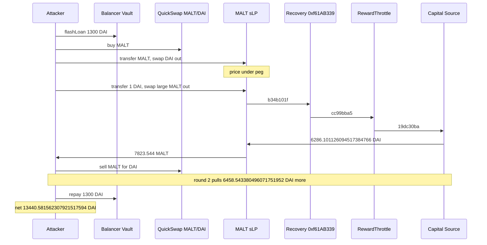

# MALT sLP — below-peg recovery deposits treasury DAI into the pair, and `swap` counts it as the caller's input

> **Vulnerability classes:** vuln/logic/missing-check · vuln/logic/incorrect-order-of-operations · vuln/defi/price-manipulation
> **Reproduction:** the PoC compiles and runs in an isolated Foundry project at [this project folder](.). Full verbose trace: [output.txt](output.txt). **Offline pass.** `anvil_state.json` is present. The trace forks `<rpc url>` at block 94,869,209 [output.txt:362](output.txt) and `[PASS] testExploit` finishes in **75.71ms** [output.txt:355](output.txt), [output.txt:1530](output.txt).

---

## Key info

| | |
|---|---|
| **Profit** | **13,440.581562307921517594 DAI** on the attacker after repaying a 1,300 DAI Balancer flash [output.txt:358](output.txt), [output.txt:1525](output.txt). Matches the asserted on-chain figure exactly [output.txt:1526](output.txt) |
| **Treasury drained** | Capital Source `0xF0d314…2AAC` sent **6,286.101126094517384766** then **6,458.543380496071751952** DAI into the sLP. Sum **12,744.644506590589136718**. Net profit is **695.937055717332380876** DAI above that sum (round-trip residual after the flash principal is repaid; Balancer fee is 0) |
| **Vulnerable contract** | MALT/DAI sLP [`0xfe6C096a2871337d4f6F7DD04Ebda733E94D7A13`](https://polygonscan.com/address/0xfe6C096a2871337d4f6F7DD04Ebda733E94D7A13). **UNVERIFIED.** `swap(uint256,uint256,address)` selector `0x6d9a640a` (three arguments, no `bytes data`) |
| **Victim treasury** | Capital Source [`0xF0d314849A3Bc9270a79110F25dBA2c8325A2AAC`](https://polygonscan.com/address/0xF0d314849A3Bc9270a79110F25dBA2c8325A2AAC). **UNVERIFIED.** Pull selector `0x19dc30ba` |
| **Recovery caller** | `0xf61AB33917fd056bB7dDd4F474a237928f63d5d6` selector `0xb34b101f`, then RewardThrottle `0x6f96483f951Db6cCA759B9B032eEAF1754c7188a` selector `0xcc99bba5` |
| **MALT token (not the swap)** | [`0x16c8cdbE2dbC271b8F05c83e9bD72ae4F38c50d4`](https://polygonscan.com/address/0x16c8cdbE2dbC271b8F05c83e9bD72ae4F38c50d4) — verified [sources/Malt_16c8cd/](sources/Malt_16c8cd/). The bug is not in this token |
| **Attacker EOA (historical)** | [`0x8F103B6A0aD705bcE6357842A5fefEB49e8D83Ef`](https://polygonscan.com/address/0x8F103B6A0aD705bcE6357842A5fefEB49e8D83Ef) |
| **Historical attack contract** | [`0x0DbF3Da828ad3B21d63a0429Ca08F93c63670393`](https://polygonscan.com/address/0x0DbF3Da828ad3B21d63a0429Ca08F93c63670393) |
| **This PoC's attacker** | `MaltExploiter` at `0x5615dEB798BB3E4dFa0139dFa1b3D433Cc23b72f` [output.txt:364](output.txt) |
| **Attack tx** | [`0x915eccb5791508aa89a0a3f1385b26346b127ebb648b046e4cb558474ce8445b`](https://polygonscan.com/tx/0x915eccb5791508aa89a0a3f1385b26346b127ebb648b046e4cb558474ce8445b) (block 94,869,210) |
| **Chain / block / date** | Polygon / fork parent **94,869,209** [output.txt:362](output.txt) / router deadline uses `block.timestamp` **1,791,008,954** = 2026-10-03 06:29:14 UTC [output.txt:1191](output.txt) |
| **Compiler** | sLP and Capital Source unverified. MALT token `v0.8.11+commit.d7f03943`, optimizer on, 200 runs ([sources/Malt_16c8cd/_meta.json](sources/Malt_16c8cd/_meta.json)) |
| **Bug class** | `swap` runs a below-peg recovery that `transfer`s DAI from the Capital Source into the pair, then checks constant product on the **final** balances. Treasury DAI is indistinguishable from DAI the caller transferred in, so 1 DAI of caller input buys thousands of MALT. |

## TL;DR

The MALT stablecoin's own market is a Uniswap V2-style pair (token0 = MALT, token1 = DAI) whose `swap` is not the stock two-step pair. Before it pays `amount0Out` / `amount1Out` it calls `0xf61AB339…b34b101f`. When MALT is under peg that path asks RewardThrottle `0x6f96483f…` to pull DAI from the Capital Source into the pair. The pair then applies the K check to balances that include that deposit, and it charges its 0.1% fee on the caller's specified output.

The attacker does not call the treasury. They sell MALT into the sLP so the price is under peg, `transfer` 1 DAI in, and `swap` out a much larger MALT amount. Round 1: treasury **6,286.101126094517384766 DAI** [output.txt:621](output.txt), MALT out **7,823.544** [output.txt:738](output.txt). Round 2: treasury **6,458.543380496071751952 DAI** [output.txt:1029](output.txt), MALT out **8,229.254** [output.txt:1182](output.txt). Each MALT stack is sold on QuickSwap for DAI. A third round does not touch the Capital Source. Flash repay is **1,300 DAI** [output.txt:1503](output.txt). Profit **13,440.581562307921517594 DAI** [output.txt:358](output.txt).

## Background

MALT is meant to trade near 1 DAI. The sLP is the protocol pool. A separate QuickSwap MALT/DAI pair `0xF864Db3e…3cE1` is the outside market the attacker buys and sells on, through router `0xa5E0829C…78ff`. Balancer V2 Vault `0xBA122222…F2C8` is the flash source. Fee on this Polygon flash is 0: the repay is exactly 1,300 DAI.

`swap` on the sLP takes `(amount0Out, amount1Out, to)` and no callback bytes. The caller must `transfer` the input token first (standard V2). The pair reads both balances, calls the recovery, sends the output, takes a 0.1% fee to `profitDistributor()` `0x5c2152a8…f369` [output.txt:747](output.txt), and `sync`s. The 0.1% is visible on the first sell: requested DAI out **2,047.278**, transferred to the attacker **2,045.230722**, fee **2.047278** [output.txt:475](output.txt), [output.txt:492](output.txt), [output.txt:502](output.txt). 2.047278 / 2,047.278 = 0.001.

The verified MALT token under [sources/Malt_16c8cd/](sources/Malt_16c8cd/) is an ERC20 with a transfer verifier. It does not implement `swap` and it does not hold the Capital Source. Fetching `0xfe6C09…` and `0xF0d314…` both returned **UNVERIFIED**. The control flow below is the call tree in [output.txt](output.txt), not a decompiled listing pasted as source.

The PoC is [test/MALT_exp.sol](test/MALT_exp.sol). Per-leg amounts are the historical ones: round 1 buy 1,300 DAI, sLP DAI out 2,047.278, exploit MALT out 7,823.544; round 2 buy 2,850 DAI, sLP DAI out 6,459.541, exploit MALT out 8,229.254; round 3 buy 2,850 DAI, sLP DAI out 6,455.961, exploit MALT out 120.748, with 50 DAI transferred in. Decimals are 18. The test writes those as `1_300e18`, `2_047_278e15`, `7_823_544e15`, and so on.

## The vulnerable code

**RECONSTRUCTED** from [output.txt](output.txt). Not verified source.

```solidity
// sLP 0xfe6C096a…  selector 0x6d9a640a
function swap(uint256 amount0Out, uint256 amount1Out, address to) external {
    // balances already include whatever the caller transferred in
    uint256 bal0 = MALT.balanceOf(address(this));
    uint256 bal1 = DAI.balanceOf(address(this));

    // below peg: recovery may transfer DAI CapitalSource -> this pair
    // trace: 0xf61AB339.b34b101f -> RewardThrottle 0x6f96483f.cc99bba5
    //        -> CapitalSource.19dc30ba(DAI, amount, sLP)
    IRecovery(0xf61AB33917fd056bB7dDd4F474a237928f63d5d6).b34b101f(...);

    // output is paid, 0.1% fee goes to profitDistributor, then K is checked
    // on the FINAL balances. Treasury DAI just received counts as input.
    if (amount0Out > 0) MALT.transfer(to, amount0Out);
    if (amount1Out > 0) DAI.transfer(to, amount1Out);
    // require(balance0 * balance1 >= reserve0 * reserve1) using balances
    // that now include the Capital Source deposit
}
```

Round 1 exploit `swap`, the call that matters, in order:

- Caller has already transferred **1 DAI** [output.txt:545](output.txt). sLP DAI balance before the recovery is **2,632.155765831136241737** [output.txt:560](output.txt).
- `0xf61AB339.b34b101f` [output.txt:564](output.txt). It checks `isPair(sLP)` [output.txt:565](output.txt), reads prices, then `RewardThrottle.cc99bba5` [output.txt:607](output.txt).
- `CapitalSource.19dc30ba(DAI, 6286101126094517384766, sLP)` transfers **6,286.101126094517384766 DAI** from `0xF0d314…` to the pair [output.txt:618](output.txt), [output.txt:621](output.txt).
- The pair then `transfer`s **7,823.544 MALT** to the attacker [output.txt:738](output.txt) and **0.001 DAI** to the fee recipient [output.txt:748](output.txt). The 1 DAI input was not the K input that made 7,823.544 MALT legal. The 6,286 DAI deposit was.

Round 2 repeats the same selectors with **6,458.543380496071751952 DAI** [output.txt:1026](output.txt), [output.txt:1029](output.txt) and **8,229.254 MALT** out (`Swap` event [output.txt:1182](output.txt)). The trace contains exactly two `19dc30ba` calls. Round 3's `swap` does not call the Capital Source.

## Root cause

1. **The invariant is applied after an exogenous deposit.** Constant product is supposed to compare reserves with balances that changed only by the swap's own input and output. DAI that the recovery pushed in raises `balance1` with no matching reduction of `amount1Out` and no matching "this DAI is not the caller's". The check passes, and the MALT output is released.
2. **The recovery is on the public `swap` path.** Selling MALT into the pool is enough to get under peg. There is no keeper window and no `msg.sender` allowlist on `swap`. The Capital Source pays because the pair (via RewardThrottle) is an authorized allocator, which the trace shows as `allocation(...)` before the pull [output.txt:612](output.txt), [output.txt:1020](output.txt). The attacker never calls `19dc30ba`.
3. **Input size is not related to output size by the caller's tokens alone.** 1 DAI in, 7,823.544 MALT out, is only possible because 6,286 DAI arrived from the treasury in the middle. A correct implementation would snapshot `balanceOf` before the recovery, or exclude tokens received from the Capital Source during this call, and would revert if `amountOut` is not backed by the caller's delta.
4. **The 0.1% fee does not fix it.** The fee is a slice of the specified output (or of the input, on the sell leg). It is not a check that the caller funded the input the curve assumed.

## Preconditions

- **Permissionless surface.** Balancer `flashLoan`, QuickSwap `swapExactTokensForTokens` (amountOutMin = 0 in the PoC), sLP `transfer` + `swap`. No owner, timelock, or keeper call in the attacker's path.
- **Capital Source must still allocate DAI to this RewardThrottle.** Round 1 pull 6,286.101126094517384766. Round 2 pull 6,458.543380496071751952. If `allocation` were 0 the recovery would not fund the K check and the large `amount0Out` would revert.
- **The sLP must be movable under peg by a sell the attacker can fund.** The PoC manufactures that with the flash and the QuickSwap inventory. It does not wait for an existing depeg.
- **1,300 DAI flash, fee 0.** Repay [output.txt:1503](output.txt) is `1300000000000000000000` and `feeAmounts` added nothing (the transfer equals the principal).
- **No MALT or DAI balance at the start.** The contract is deployed empty in `setUp` and funded only by the vault.

## Attack walkthrough (with on-chain numbers from the trace)

| # | Action | Amount | Trace |
|---|--------|--------|-------|
| 0 | Balancer flash, 1,300 DAI to the attacker | +1,300 DAI | [output.txt:371](output.txt), [output.txt:378](output.txt) |
| 1 | QuickSwap buy, 1,300 DAI → MALT | 3,333.128671099268524698 MALT | [output.txt:412](output.txt) |
| 2 | Transfer that MALT into the sLP and `swap(0, 2,047.278 DAI, attacker)`. 0.1% fee stays in the pair's flow to `0x5c21…` | attacker receives 2,045.230722 DAI; fee 2.047278 DAI | [output.txt:467](output.txt), [output.txt:475](output.txt), [output.txt:492](output.txt), [output.txt:502](output.txt) |
| 3 | Transfer 1 DAI into the sLP | 1 DAI | [output.txt:545](output.txt) |
| 4 | `swap(7,823.544 MALT, 0, attacker)`. Recovery pulls the treasury | **6,286.101126094517384766 DAI** Capital Source → sLP; **7,823.544 MALT** to the attacker; 0.001 DAI fee | [output.txt:553](output.txt), [output.txt:618](output.txt), [output.txt:621](output.txt), [output.txt:738](output.txt), [output.txt:748](output.txt) |
| 5 | Sell that MALT on QuickSwap | 2,654.043861673244229965 DAI | [output.txt:797](output.txt) |
| 6 | Round 2 buy 2,850 DAI, dump into the sLP for 6,459.541 DAI out, transfer 1 DAI, exploit `swap` | treasury **6,458.543380496071751952 DAI**; MALT out 8,229.254 | [output.txt:961](output.txt), [output.txt:1026](output.txt), [output.txt:1029](output.txt), [output.txt:1182](output.txt) |
| 7 | Sell round-2 MALT on QuickSwap | 2,836.853280425504780673 DAI | [output.txt:1204](output.txt), [output.txt:1220](output.txt) |
| 8 | Round 3 (2,850 DAI buy, 50 DAI exploit input, 120.748 MALT out). No `19dc30ba` | no further treasury transfer | only two pulls, [output.txt:618](output.txt) and [output.txt:1026](output.txt) |
| 9 | Repay Balancer 1,300 DAI | −1,300 | [output.txt:1503](output.txt) |
| 10 | Logged profit | **13,440.581562307921517594 DAI** | [output.txt:1525](output.txt), [output.txt:1526](output.txt) |

**DAI identity**

| Component | DAI |
|-----------|-----|
| Capital Source, round 1 | 6,286.101126094517384766 |
| Capital Source, round 2 | 6,458.543380496071751952 |
| Treasury total | 12,744.644506590589136718 |
| Net profit | 13,440.581562307921517594 |
| Profit minus treasury (trading residual; flash principal repaid) | 695.937055717332380876 |

6,286.101126094517384766 + 6,458.543380496071751952 = 12,744.644506590589136718. 13,440.581562307921517594 − 12,744.644506590589136718 = 695.937055717332380876. The residual is real arithmetic on the trace totals; the PoC does not log it as its own line. `[PASS] testExploit` at [output.txt:355](output.txt). Suite: `1 passed` in 75.71ms [output.txt:1530](output.txt).

## Diagrams



## Remediation

1. **Snapshot balances before the recovery and do not let recovery deposits satisfy K.** If the protocol must inject DAI, account for it as a reserve increase that is paired with an explicit MALT burn or a rebase, not as `amountIn` of the swapper who happened to be in the function.
2. **Run the invariant on the caller's delta only.** `amountIn = balanceAfterTransfer - reserve`, measured before any treasury transfer. Revert when `amountOut` is not paid for by that delta under the fee.
3. **Separate the keeper entrypoint from `swap`.** A public swap should not be able to decide that the treasury sends DAI. If a rebalance is required, a permissioned caller should move the reserves in a transaction that does not also pay a user-specified `amountOut`.
4. **Cap the pull.** `allocation` is an upper bound the throttle already reads [output.txt:612](output.txt). The pair should still refuse to treat any of it as swap input. A per-block cap does not fix the accounting; it only limits the loss.
5. **Verify the sLP and the Capital Source.** The token is verified and is not where the DAI is released. The contracts that move the treasury are the ones that were not verified.

## How to reproduce

Offline, from the committed state. `_shared/run_poc.sh` loads `anvil_state.json`, starts anvil, and rewrites the test's `http://127.0.0.1:8549` URL.

```bash
# from the registry root
_shared/run_poc.sh 2026-10-MALT_exp -vvvvv
```

- **Chain / fork:** Polygon, block **94,869,209** (parent of attack block 94,869,210). The test forks `http://127.0.0.1:8549`.
- **Committed result** in [output.txt](output.txt) (`finished in 75.71ms`):

```
[PASS] testExploit()
MALT - treasury-funded rebalance counted as the caller's swap input
Attacker DAI profit after flash-loan repay: 13440.581562307921517594
Suite result: ok. 1 passed; 0 failed; 0 skipped
```

*Reference: attack tx in the header of [test/MALT_exp.sol](test/MALT_exp.sol) — [`0x915eccb5791508aa89a0a3f1385b26346b127ebb648b046e4cb558474ce8445b`](https://polygonscan.com/tx/0x915eccb5791508aa89a0a3f1385b26346b127ebb648b046e4cb558474ce8445b). The test's fork URL is `http://127.0.0.1:8549`.*
