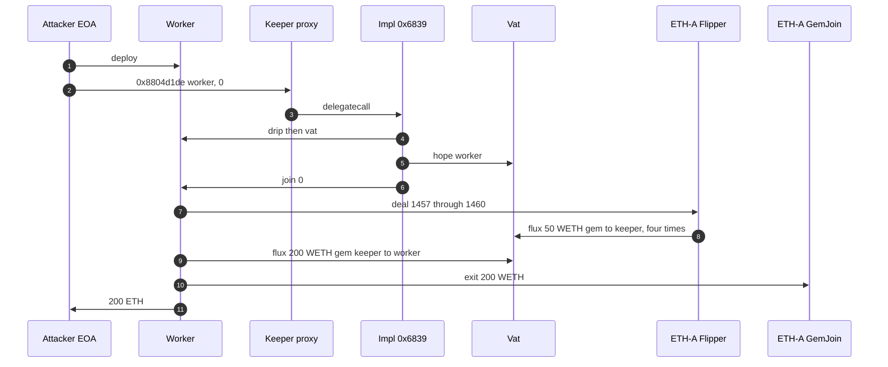
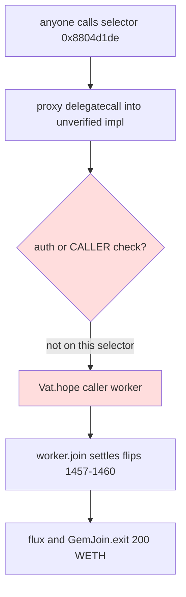

# MakerDAO flip-keeper — ungated `0x8804d1de` hopes a caller-supplied worker, then exits 200 WETH
> **Vulnerability classes:** vuln/access-control/missing-auth · vuln/dependency/unsafe-external-call · vuln/logic/incorrect-state-transition
> **Reproduction:** online only. This folder has **no `anvil_state.json`**. Passing archival-fork trace: [output.txt](output.txt). Folder: [(.)](.). Verified proxy: [sources/AdminUpgradeabilityProxy_9c05a0](sources/AdminUpgradeabilityProxy_9c05a0). The keeper implementation is unverified.
---
## Key info
| | |
|---|---|
| **Loss** | **200 ETH** exactly (200 WETH unwrapped). [output.txt:196](output.txt). Alert figure ~$538K. Not a Maker core loss |
| **Vulnerable contract** | Third-party ETH-A flip keeper, EIP-1967 `AdminUpgradeabilityProxy` [`0x9c05a05893Ada984FC20D0DA0c046De5Cc0e8273`](https://etherscan.io/address/0x9c05a05893Ada984FC20D0DA0c046De5Cc0e8273). Implementation [`0x68399ed8aa33C5b43F863EE6782de492006A5546`](https://etherscan.io/address/0x68399ed8aa33C5b43F863EE6782de492006A5546) (unverified) |
| **Attacker EOA** | [`0x01EB957E5C7DcDDD60F3C875956cCc6fb9BdA5FA`](https://etherscan.io/address/0x01EB957E5C7DcDDD60F3C875956cCc6fb9BdA5FA) (fresh nonce-2 EOA). The PoC pranks `makeAddr("attacker")` = `0x9dF0C6b0066D5317aA5b38B36850548DaCCa6B4e` instead |
| **Attack contract** | Real helper [`0xEc997d2aD033277913d6002277353368E8321dcF`](https://etherscan.io/address/0xEc997d2aD033277913d6002277353368E8321dcF), which created worker `0xF09A13072ed939B79bC25b66AA3a836eA6DcC170`. PoC worker is `FlipKeeperWorker` at `0xA9d5026A3fF2db063632bE894537ce4Fb11688bC` [output.txt:21](output.txt) |
| **Attack tx** | [`0xbb6940f7c2a1e68cafbae7bb9b94d09af9af06ec3a114f6996f2cab993f3a88c`](https://etherscan.io/tx/0xbb6940f7c2a1e68cafbae7bb9b94d09af9af06ec3a114f6996f2cab993f3a88c) |
| **Chain / block / date** | Ethereum mainnet (chain id 1) / exploit block 26,131,471, fork parent 26,131,470 / 6 October 2026, 06:13:11 UTC |
| **Compiler** | Proxy: Solidity `v0.5.3+commit.10d17f24`, optimizer off, 200 runs ([_meta.json](sources/AdminUpgradeabilityProxy_9c05a0/_meta.json)). Implementation: no verified source |
| **Bug class** | Selector `0x8804d1de` on the keeper implementation has no auth check. Via the proxy's `delegatecall` it reads `vat()` / `drip()` off a caller-supplied worker, `Vat.hope`s that worker on the keeper's own account, then calls `worker.join`. The worker settles four undealt 2020 ETH-A flips and exits 200 WETH |

## TL;DR
This is not a MakerDAO Vat, Flipper, or GemJoin bug. Those contracts did what they are supposed to do. The loss is a dormant third-party liquidation keeper.

The keeper is an OpenZeppelin `AdminUpgradeabilityProxy` whose implementation at `0x6839…5546` is unverified. Its drain selector `0x8804d1de(address,uint256)` never reads `authority` or `msg.sender`. A public alert described this as "ds-auth with authority == 0". That framing is wrong: other selectors on the same bytecode do check the caller. This one does not check at all. See the header of [test/MakerDAOFlipKeeper_exp.sol](test/MakerDAOFlipKeeper_exp.sol).

Called by a fresh EOA, the drain `hope`s the attacker's worker (`vat.can` goes from 0 to 1) and hands it control. The worker calls `Flipper.deal` on auctions 1457, 1458, 1459, and 1460. Each credits the keeper 50 WETH of ETH-A gem. `Vat.flux` moves **200 WETH** of gem to the worker, `GemJoin.exit` pays out 200 WETH, and the worker unwraps and forwards **200 ETH**. `[PASS] testExploit()` gas 765,949 [output.txt:4](output.txt).

## Background — what was sitting in the keeper
The proxy won four ETH-A flip auctions in 2020 and never called `deal`. Until `deal`, the 50 WETH lot on each auction stays in the Flipper, and `vat.gem(ETH-A, keeper)` is 0. The PoC checks that at the fork block [output.txt:15](output.txt)–[output.txt:17](output.txt). The test header records auction 1457 as `guy == keeper`, `lot == 50e18`, `end == 1584285968` (15 March 2020). The trace then shows each `deal` fluxing `50000000000000000000` (50 WETH) from the Flipper into the keeper [output.txt:51](output.txt), [output.txt:75](output.txt), [output.txt:99](output.txt), [output.txt:123](output.txt).

Maker addresses used, all behaving as designed:

| Contract | Address |
|---|---|
| Vat | [`0x35D1b3F3D7966A1DFe207aa4514C12a259A0492B`](https://etherscan.io/address/0x35D1b3F3D7966A1DFe207aa4514C12a259A0492B) |
| ETH-A Flipper | [`0xd8a04F5412223F513DC55F839574430f5EC15531`](https://etherscan.io/address/0xd8a04F5412223F513DC55F839574430f5EC15531) |
| ETH-A GemJoin (`gem == WETH`) | [`0x2F0b23f53734252Bda2277357e97e1517d6B042A`](https://etherscan.io/address/0x2F0b23f53734252Bda2277357e97e1517d6B042A) |
| WETH | [`0xC02aaA39b223FE8D0A0e5C4F27eAD9083C756Cc2`](https://etherscan.io/address/0xC02aaA39b223FE8D0A0e5C4F27eAD9083C756Cc2) |

`Flipper.deal` is permissionless once an auction has ended. `Vat.flux` only needs `vat.can(src, msg.sender) == 1` (or `msg.sender == src`). `GemJoin.exit` burns the caller's own gem and sends WETH. None of those checks was bypassed. The keeper itself called `hope` for the attacker.

## The vulnerable code
The proxy source is verified. The implementation is not, so the drain body below is **RECONSTRUCTED** from the live trace and the decompile notes in the test. It is not Etherscan source.

Verified proxy, [AdminUpgradeabilityProxy.sol](sources/AdminUpgradeabilityProxy_9c05a0/AdminUpgradeabilityProxy.sol) lines 112–148. Every non-admin call is a `delegatecall` into the implementation, so storage writes (`vat.hope` from the keeper's address) happen as the proxy:

```solidity
function _delegate(address implementation) internal {
    assembly {
        calldatacopy(0, 0, calldatasize)
        let result := delegatecall(gas, implementation, 0, calldatasize, 0, 0)
        returndatacopy(0, 0, returndatasize)
        switch result
        case 0 { revert(0, returndatasize) }
        default { return(0, returndatasize) }
    }
}

function _fallback() internal {
    _willFallback();
    _delegate(_implementation());
}
```

`_meta.json` records `implementation = 0x68399ed8aa33c5b43f863ee6782de492006a5546`. The trace enters that address as `8804d1de` under the proxy [output.txt:32](output.txt)–[output.txt:33](output.txt).

**RECONSTRUCTED** drain (selector `0x8804d1de`, args `(address worker, uint256)`). Order is the trace, not a guess: `drip`, then `vat`, then `hope`, then `join`. There is no `CALLER` comparison and no `SLOAD` of an authority slot on this path.

```solidity
// RECONSTRUCTED — unverified implementation 0x68399ed8…5546. Not source.
function drain(address worker, uint256 x) external {
    // no auth. first external call is drip() on the caller-supplied worker
    worker.drip();                 // trace returns 1e27
    address vat = worker.vat();    // trace returns the real Vat
    IVat(vat).hope(worker);        // can[keeper][worker] = 1
    worker.join(x);                // attacker moves the keeper's gem
}
```

The PoC calls that selector with its own worker and `x = 0` [test/MakerDAOFlipKeeper_exp.sol](test/MakerDAOFlipKeeper_exp.sol). `join(0)` is what the trace shows [output.txt:49](output.txt). The worker, also reconstructed in the test, then does the only economically meaningful steps: `deal` four ids, `flux` the keeper's gem to itself, `GemJoin.exit`, `WETH.withdraw`, forward ETH.

`drip()` on the worker returns `1e27` [output.txt:34](output.txt)–[output.txt:35](output.txt). The keeper does not use a Maker `Jug.drip`. It just calls whatever the attacker deployed.

## Root cause — why it was possible
1. **`0x8804d1de` is ungated.** The implementation is a ds-auth contract on other selectors. This selector's dispatcher does the non-payable `CALLVALUE` check and jumps into the body. Authority is never loaded. "Authority is the zero address" is not why the call succeeded. A brand-new EOA with `vat.can(keeper, worker) == 0` before the call [output.txt:28](output.txt) completed it.
2. **The body trusts the caller's contract.** `vat` and `drip` are getters on `worker`, an argument. The keeper then `hope`s that same address. `hope` is `Vat`'s normal "I authorize this usr" and it is correct that the keeper can authorize someone. It is not correct that any external caller can make the keeper do it.
3. **`join` is an arbitrary external call after the grant.** The worker runs with `can[keeper][worker] == 1`, so `Vat.flux(ETH-A, keeper, worker, amt)` is legal. That is the state transition that moves the collateral. After the call, `can` is still 1 [output.txt:197](output.txt)–[output.txt:199](output.txt). The authorization is not scoped to one auction or one token and it is not revoked.
4. **The collateral was already the keeper's.** `deal` on a finished flip only moves the lot from the Flipper into `vat.gem[ETH-A][guy]`. Four lots of 50 WETH is 200 WETH. No flash loan, no price move, no Maker parameter change.

## Preconditions
- The keeper proxy still points at the implementation that exposes ungated `0x8804d1de`. It did, at block 26,131,470.
- The keeper is `guy` on ended ETH-A flips that were never `deal`ed, and `vat.gem` for the keeper is still 0 so the lots have not been taken. Auctions 1457–1460, 50 WETH each.
- The caller can deploy a worker with `vat()`, `drip()`, and `join(uint256)`. No prior `hope`, no keeper-owner signature, no allowance.
- `deal` is still callable (auction `end` in the past, not already dealt). It was.

## Attack walkthrough (with numbers from the trace)
| # | Step | Effect (from [output.txt](output.txt)) |
|---|------|----------------------------------------|
| 1 | Fork parent 26,131,470. `vat.gem(ETH-A, keeper) == 0` | [output.txt:10](output.txt), [output.txt:15](output.txt)–[output.txt:17](output.txt) |
| 2 | Fresh EOA deploys `FlipKeeperWorker`. `vat.can(keeper, worker) == 0` | [output.txt:21](output.txt), [output.txt:28](output.txt)–[output.txt:30](output.txt) |
| 3 | `keeper.fallback(0x8804d1de ‖ worker ‖ 0)` delegatecalls the implementation | [output.txt:32](output.txt)–[output.txt:33](output.txt) |
| 4 | Implementation calls `worker.drip()` → `1e27`, then `worker.vat()` → Vat | [output.txt:34](output.txt)–[output.txt:37](output.txt) |
| 5 | `Vat.hope(worker)`. `can` storage slot goes `0 → 1` | [output.txt:40](output.txt)–[output.txt:48](output.txt) |
| 6 | `worker.join(0)` calls `Flipper.deal(1457)`, `deal(1458)`, `deal(1459)`, `deal(1460)`. Each `Vat.flux`es **50 WETH** of ETH-A gem from the Flipper to the keeper | [output.txt:49](output.txt), [output.txt:50](output.txt)–[output.txt:51](output.txt), [output.txt:74](output.txt)–[output.txt:75](output.txt), [output.txt:98](output.txt)–[output.txt:99](output.txt), [output.txt:122](output.txt)–[output.txt:123](output.txt) |
| 7 | `Vat.flux(ETH-A, keeper, worker, 200e18)` | [output.txt:148](output.txt) |
| 8 | `GemJoin.exit(worker, 200e18)` transfers **200 WETH** from the join adapter to the worker | [output.txt:158](output.txt), [output.txt:168](output.txt)–[output.txt:169](output.txt) |
| 9 | `WETH.withdraw(200e18)` and forward **200 ETH** to the pranked attacker | [output.txt:182](output.txt)–[output.txt:189](output.txt) |
| 10 | Logged profit **200.000000000000000000** ETH. `can` stays 1. Exact equality asserted | [output.txt:196](output.txt), [output.txt:197](output.txt)–[output.txt:203](output.txt) |

No principal is repaid because nothing was borrowed. 200 WETH in, 200 ETH out.

## Diagrams





## Remediation
1. **Put the drain behind the same auth gate as the other selectors.** `0x8804d1de` should require the ds-auth owner or a dedicated keeper role before any external call. Do not treat "authority happens to be unset" as the bug to fix. The missing modifier is the bug. A zero authority would still be wrong, but this function never reads it.
2. **Do not `hope` an address the caller picked.** If a worker is required, it must be an immutable or owner-set contract, and `hope` should be paired with `nope` before returning. A permission granted inside an unauthenticated function is a persistent `can[keeper][worker] = 1`, which the trace leaves set [output.txt:197](output.txt).
3. **Do not call `drip` / `vat` / `join` on untrusted addresses.** Those are attacker-controlled. A keeper that needs Maker's Vat should store the Vat address itself.
4. **Settle leftover auctions from 2020.** `deal` plus `GemJoin.exit` to a fixed recipient, under auth, pulls the same 200 WETH out without a public callback. Anyone can `deal` a finished flip, but only an authorized `flux` from the keeper can move the gem afterward. Clearing `guy`'s auctions into a controlled address removes the prize.
5. **Maker core needs no patch for this incident.** `deal`, `flux`, and `exit` enforced their own rules.

## How to reproduce
**There is no `anvil_state.json` in this folder.** The offline harness refuses to start:

```bash
_shared/run_poc.sh 2026-10-MakerDAOFlipKeeper_exp -vvvvv
# no anvil_state.json in 2026-10-MakerDAOFlipKeeper_exp
# exit 2, before forge
```

The test forks a live archival node itself. `setUp` calls `vm.createSelectFork("https://eth-mainnet.public.blastapi.io", 26131470)`. From this folder, with network access:

```bash
forge test --match-path test/MakerDAOFlipKeeper_exp.sol -vvvvv
```

[output.txt](output.txt) is the verbose trace of that online run. Expected tail:

```
[PASS] testExploit() (gas: 765949)
Attacker ETH profit: 200.000000000000000000
Suite result: ok. 1 passed; 0 failed; 0 skipped
```

*Reference: [exploit tx 0xbb6940f7…](https://etherscan.io/tx/0xbb6940f7c2a1e68cafbae7bb9b94d09af9af06ec3a114f6996f2cab993f3a88c) (hash in [test/MakerDAOFlipKeeper_exp.sol](test/MakerDAOFlipKeeper_exp.sol))*
