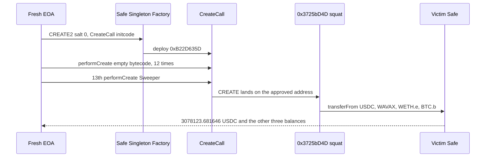

# Safe approval squat — unlimited ERC-20 allowances point at an empty CREATE address anyone can occupy

> **Vulnerability classes:** vuln/access-control · vuln/auth · vuln/logic
> **Reproduction:** the PoC compiles and runs in an isolated Foundry project at [this project folder](.). Full verbose trace: [output.txt](output.txt). **Offline pass.** `anvil_state.json` is present. The trace forks `<rpc url>` at block 98,603,854 [output.txt:364](output.txt). `[PASS] testExploit` in **16.72ms** [output.txt:565](output.txt).

---

## Key info

| | |
|---|---|
| **Loss** | The Safe's entire balance of four tokens [output.txt:357](output.txt). **3,078,123.681646 USDC** (`3078123681646`, 6 decimals). **351,374.076087103761073449 WAVAX** (`351374076087103761073449`). **183.747433456727608183 WETH.e** (`183747433456727608183`). **10.77385586 BTC.b** (`1077385586`, 8 decimals). The test's USD headline is ~7.45M. This trace does not price the basket |
| **Vulnerable state** | Victim Safe (2-of-7) [`0x631FCa4a73AEe699638634479132452ef354b9B8`](https://snowtrace.io/address/0x631fca4a73aee699638634479132452ef354b9b8). The allowances, not a Safe bug in `execTransaction`, are what pay out. Each allowance to the squat address is `type(uint256).max` [output.txt:385](output.txt) |
| **Squat address** | [`0x3725bD4D175283108156c3F15f86e1c51266155d`](https://snowtrace.io/address/0x3725bd4d175283108156c3f15f86e1c51266155d). Empty at the fork. Occupied by the 13th `CREATE` from CreateCall |
| **CreateCall** | [`0xB22D635D552eC95142E2Abe3FfB859eA7d7C0316`](https://snowtrace.io/address/0xB22D635D552eC95142E2Abe3FfB859eA7d7C0316), deployed in the test via Safe Singleton Factory [`0x914d7Fec6aaC8cd542e72Bca78B30650d45643d7`](https://snowtrace.io/address/0x914d7Fec6aaC8cd542e72Bca78B30650d45643d7) with salt 0 [output.txt:404](output.txt) |
| **Tokens** | USDC [`0xB97EF9Ef8734C71904D8002F8b6Bc66Dd9c48a6E`](https://snowtrace.io/address/0xB97EF9Ef8734C71904D8002F8b6Bc66Dd9c48a6E). WAVAX [`0xB31f66AA3C1e785363F0875A1B74E27b85FD66c7`](https://snowtrace.io/address/0xB31f66AA3C1e785363F0875A1B74E27b85FD66c7). WETH.e [`0x49D5c2BdFfac6CE2BFdB6640F4F80f226bc10bAB`](https://snowtrace.io/address/0x49D5c2BdFfac6CE2BFdB6640F4F80f226bc10bAB). BTC.b [`0x152b9d0FdC40C096757F570A51E494bd4b943E50`](https://snowtrace.io/address/0x152b9d0FdC40C096757F570A51E494bd4b943E50) |
| **Attacker EOA (historical)** | [`0x4c48b79b97516719444056d2bf0dc9564138fa0a`](https://snowtrace.io/address/0x4c48b79b97516719444056d2bf0dc9564138fa0a). MEV bot that landed the drain [`0x36b112875f921e51f5ea8ff39b374960694d21b3`](https://snowtrace.io/address/0x36b112875f921e51f5ea8ff39b374960694d21b3) |
| **This PoC's attacker** | `makeAddr("attacker")` = `0x9dF0C6b0066D5317aA5b38B36850548DaCCa6B4e` [output.txt:366](output.txt). No Safe key |
| **Txs** | Approvals, 2026-03-07 [`0x6952f80bbbcad4368b020bcda600965cf0a520a8694db431b6b1521842d3829e`](https://snowtrace.io/tx/0x6952f80bbbcad4368b020bcda600965cf0a520a8694db431b6b1521842d3829e). Original attack, reverted, front-run [`0xf1f87d370290afe269ae8eb30fe8e5e4694ad153914a2de6d980641f4a331289`](https://snowtrace.io/tx/0xf1f87d370290afe269ae8eb30fe8e5e4694ad153914a2de6d980641f4a331289). MEV drain [`0xf88a7960a07832e1bf5be64edbd12a9e615b4f63959a4b87a147f0c63c007ed5`](https://snowtrace.io/tx/0xf88a7960a07832e1bf5be64edbd12a9e615b4f63959a4b87a147f0c63c007ed5) |
| **Chain / block / date** | Avalanche / fork parent **98,603,854**, attack block **98,603,855** [output.txt:364](output.txt). Approvals set **2026-03-07**. The drain is the 2026-10 incident in the folder name. The trace has no block timestamp |
| **Compiler** | PoC `pragma ^0.8.13`, trace compiled with **solc 0.8.36** [output.txt:1](output.txt). The embedded CreateCall v1.3.0 initcode ends in metadata `solc 0.7.6` (`64736f6c63430007060033`). `sources/` is empty |
| **Bug class** | An ERC-20 approval names an address, not a deployed contract. That address is the 13th `CREATE` of a CreateCall instance that is itself `CREATE2` from the Safe Singleton Factory at salt 0. Anyone can deploy that bytecode, burn 12 nonces, and land a sweeper on the approved address |

## TL;DR

On 2026-03-07 the Safe approved `type(uint256).max` of USDC, WAVAX, WETH.e, and BTC.b to `0x3725bD4D…`. At block 98,603,854 that address still has no code, and the four allowances are still max [output.txt:385](output.txt). The address is not random. It is fixed by `(Safe Singleton Factory, salt 0, CreateCall initcode)` and then by CreateCall's nonce: the 13th `CREATE` lands there.

The PoC is a fresh EOA. It calls the factory with salt 0 and the attacker's CreateCall initcode, gets CreateCall at `0xB22D635D…` [output.txt:404](output.txt), runs `performCreate(0, 0x60006000f3)` **12** times to burn nonces [output.txt:407](output.txt) through [output.txt:462](output.txt), and on the 13th call deploys `Sweeper` at exactly `0x3725bD4D…` [output.txt:468](output.txt). `sweep()` then `transferFrom`s each of the Safe's balances to the attacker. All four Safe balances end at 0 [output.txt:541](output.txt). No Safe signature is required in the draining transaction. The approval, seven months earlier, was the authorization, and it authorized an address rather than a contract the Safe had audited.

## Background

Safe's `approve` is a normal ERC-20 approval. The token stores `(owner=Safe, spender=0x3725bD4D…, amount=2^256-1)`. Later, `transferFrom` checks that the caller is that spender. It does not check that the spender's codehash is one the Safe signed, and it does not check that code existed when the approval was set.

CreateCall v1.3.0 `performCreate(value, deploymentData)` is a public `CREATE`. The nth contract it creates is `keccak256(rlp(createCall, nonce))`. Nonces start at 1, so twelve tiny deployments (`0x60006000f3`, runtime empty) leave the nonce ready for the 13th. The CreateCall address itself is `CREATE2(factory, salt=0, keccak256(CREATECALL_INITCODE))`. Salt 0 and this initcode are public. The factory `0x914d7Fec…` is the canonical Safe Singleton Factory and is already on Avalanche. The PoC does not etch. The initcode is the hex constant in the test, and the trace shows a real `CREATE` of CreateCall at the expected address [output.txt:404](output.txt).

The historical race matters only as context. The original attack transaction reverted because a MEV bot landed the same deployment first. This test does not replay either transaction. It repeats the address math from a clean EOA and sweeps the balances that were still on the Safe one block earlier.

## The vulnerable code

The bug is not a function that forgot `onlyOwner`. It is the approval plus the rule that `CREATE` addresses are public. The sweeper the PoC lands on the approved address is the whole exploit. From [test/SafeApprovalSquat_exp.sol](test/SafeApprovalSquat_exp.sol):

```solidity
function sweep() external {
    _pull(USDC);
    _pull(WAVAX);
    _pull(WETHe);
    _pull(BTCb);
}

function _pull(address token) private {
    uint256 bal = IERC20(token).balanceOf(safe);
    require(IERC20(token).transferFrom(safe, recipient, bal), "transferFrom failed");
}
```

That works only because `address(this)` after the 13th `CREATE` is the spender. The trace:

- USDC allowance Safe → squat is `2^256-1` [output.txt:385](output.txt). The test asserts the same for WAVAX, WETH.e, and BTC.b immediately after.
- Squat code size is 0 before the deploy. The test asserts that. The 13th `performCreate` then logs `new SquatAddress@0x3725bD4D175283108156c3F15f86e1c51266155d` [output.txt:468](output.txt) and the address assert passes [output.txt:472](output.txt).
- `transferFrom(Safe, attacker, 3078123681646)` USDC [output.txt:479](output.txt).
- `transferFrom` WAVAX **351374076087103761073449** [output.txt:490](output.txt).
- `transferFrom` WETH.e **183747433456727608183** [output.txt:498](output.txt).
- `transferFrom` BTC.b **1077385586** [output.txt:508](output.txt).

WETH.e and BTC.b emit `Approval` down by the spent amount, from max uint toward a still-enormous remainder [output.txt:500](output.txt), [output.txt:510](output.txt). The Safe did not have to sign those updates. That is standard ERC-20 bookkeeping on an unlimited allowance.

## Root cause

1. **The spender is an address with no code, and the address is predictable.** ERC-20 does not bind an allowance to bytecode. The first transaction that puts code at `0x3725bD4D…` becomes the spender. Predictability comes from a public factory, salt 0, a public initcode, and a nonce. Twelve `performCreate` calls of `0x60006000f3` are in the trace at [output.txt:407](output.txt), [output.txt:412](output.txt), [output.txt:417](output.txt), [output.txt:422](output.txt), [output.txt:427](output.txt), [output.txt:432](output.txt), [output.txt:437](output.txt), [output.txt:442](output.txt), [output.txt:447](output.txt), [output.txt:452](output.txt), [output.txt:457](output.txt), and [output.txt:462](output.txt). The next one is the sweeper.
2. **The allowance is unlimited and was never revoked.** Set 2026-03-07, still `2^256-1` at block 98,603,854. A finite allowance equal to a single intended payment would have capped one token. It would not have fixed the other three, and it would not have stopped a sweeper that lands before the intended contract.
3. **No secret is required.** The PoC prank is `makeAddr("attacker")`. The factory call, the nonce burns, and `sweep()` are all from that EOA [output.txt:366](output.txt). The Safe's owners do not appear.
4. **Front-running is the same bug, not a separate one.** Two parties who both know the CREATE sequence race for the nonce. The MEV transaction won historically. The reconstruction shows either of them can empty the Safe. The loser reverts because the address is already occupied, not because the allowance checked a signature.

## Preconditions

- The four allowances to `0x3725bD4D…` are still non-zero. Here each is `2^256-1` [output.txt:385](output.txt).
- `0x3725bD4D…` has no code. The test asserts `code.length == 0` before the deploy, and the 13th `CREATE` succeeds, so it was empty.
- CreateCall is not already sitting at `0xB22D635D…` with a nonce past 13. The factory deploy in this trace creates it fresh [output.txt:404](output.txt), so on this fork the salt-0 CreateCall was not yet deployed. If someone else had deployed it and used nonces, the 13th `CREATE` would miss the address. That is a race, not an access check.
- The Safe still holds the balances. It does: the four `transferFrom` amounts match the constants, and the Safe is then at zero on each token [output.txt:541](output.txt).
- The attacker needs gas only. No WAVAX balance is funded onto the attacker before the sweep. The swept WAVAX is the profit, not the gas.

## Attack walkthrough (with on-chain numbers from the trace)

| # | Action | Amount | Trace |
|---|--------|--------|-------|
| 0 | Fork the parent of the drain | block 98,603,854 | [output.txt:364](output.txt) |
| 1 | Read allowances Safe → `0x3725bD4D…` | each `2^256-1` | [output.txt:381](output.txt), [output.txt:385](output.txt) |
| 2 | Factory `CREATE2`, salt 0, CreateCall initcode | CreateCall at `0xB22D635D552eC95142E2Abe3FfB859eA7d7C0316` | [output.txt:404](output.txt) |
| 3 | Twelve `performCreate(0, 0x60006000f3)` | nonce advanced to 12 | [output.txt:407](output.txt) through [output.txt:462](output.txt) |
| 4 | 13th `performCreate` of `Sweeper` | new contract at `0x3725bD4D175283108156c3F15f86e1c51266155d` | [output.txt:467](output.txt), [output.txt:468](output.txt), [output.txt:472](output.txt) |
| 5 | `sweep` USDC `transferFrom` | **3,078,123.681646 USDC** to `0x9dF0C6…` | [output.txt:479](output.txt) |
| 6 | WAVAX | **351,374.076087103761073449** | [output.txt:490](output.txt) |
| 7 | WETH.e | **183.747433456727608183** | [output.txt:498](output.txt) |
| 8 | BTC.b | **10.77385586** | [output.txt:508](output.txt) |
| 9 | Logs. Safe balances asserted 0 | the four raw amounts above | [output.txt:357](output.txt), [output.txt:555](output.txt), [output.txt:541](output.txt) |

`[PASS] testExploit` at [output.txt:355](output.txt). Gas **1,146,578**.

## Diagrams



## Remediation

1. **Revoke these four allowances now.** Set USDC, WAVAX, WETH.e, and BTC.b allowance of `0x3725bD4D175283108156c3F15f86e1c51266155d` to 0. Do it before any other transaction that could be ordered behind a deploy of that address. If code is already there, revoke anyway and move the tokens.
2. **Never approve an address that has no code, and never approve a counterfactual CREATE/CREATE2 address unless the deployer key is the Safe's.** If a contract must be approved before deployment, deploy it in the same transaction that approves it, and pin the codehash. An unlimited allowance to a public nonce address is a blank check.
3. **Stop using `type(uint256).max` for treasury tokens.** Approve the exact amount in the transaction that spends it, or use a permit that expires. A finite allowance would have limited one race. Combined with (2) it is the actual fix.
4. **Watch allowances, not only Safe signers.** The draining call does not look like a Safe execution. Monitoring that only alerts on `execTransaction` from the Safe misses `transferFrom(Safe, …)` by a newly deployed spender.

## How to reproduce

Offline, from the committed state. `_shared/run_poc.sh` loads `anvil_state.json`, starts anvil, and rewrites the test's `http://127.0.0.1:8551` URL.

```bash
# from the registry root
_shared/run_poc.sh 2026-10-SafeApprovalSquat_exp -vvvvv
```

- **Chain / fork:** Avalanche, block **98,603,854** (parent of attack block 98,603,855).
- **Committed result** in [output.txt](output.txt) (`finished in 16.72ms`):

```
[PASS] testExploit()
  USDC  drained: 3078123681646
  WAVAX drained: 351374076087103761073449
  WETHe drained: 183747433456727608183
  BTCb  drained: 1077385586
Suite result: ok. 1 passed; 0 failed; 0 skipped
```

*Reference: the approval transaction and the MEV drain named in the test header — [`0x6952f80b…`](https://snowtrace.io/tx/0x6952f80bbbcad4368b020bcda600965cf0a520a8694db431b6b1521842d3829e) and [`0xf88a7960…`](https://snowtrace.io/tx/0xf88a7960a07832e1bf5be64edbd12a9e615b4f63959a4b87a147f0c63c007ed5).*
