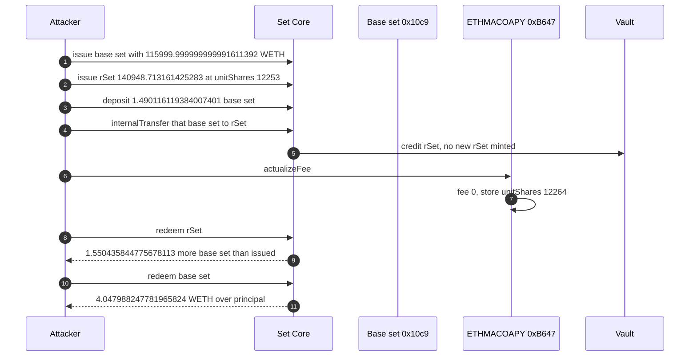
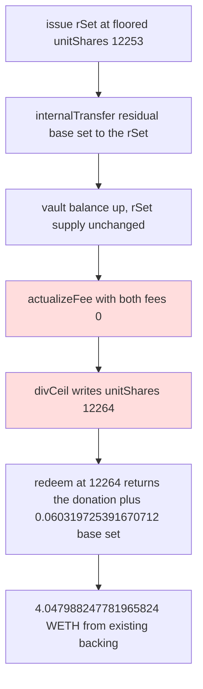

# ETHMACOAPY — a base-set donation makes zero-fee `actualizeFee` ceil `unitShares` from 12253 to 12264
> **Vulnerability classes:** vuln/arithmetic/rounding-direction · vuln/logic/fee-calculation · vuln/logic/missing-check
> **Reproduction:** online only. This folder has **no `anvil_state.json`**. Passing archival-fork trace: [output.txt](output.txt). Folder: [(.)](.). Verified source: [sources/RebalancingSetTokenV3_B647a1](sources/RebalancingSetTokenV3_B647a1), [sources/Core_f55186](sources/Core_f55186).
---
## Key info
| | |
|---|---|
| **Loss** | **4.047988247781965824 WETH** on this tx [output.txt:416](output.txt). The test header records a second tx two blocks later, from a different EOA, for a further ~4.062 WETH. This PoC asserts tx1 only. Combined alert figure ~8.11 WETH. This file does not replay tx2 |
| **Vulnerable contract** | ETHMACOAPY `RebalancingSetTokenV3` [`0xB647a1D7633c6C4d434e22eE9756b36F2b219525`](https://etherscan.io/address/0xB647a1D7633c6C4d434e22eE9756b36F2b219525) |
| **Backing** | `currentSet` [`0x10c9ACd6E7b65aBAf04118198553B375dC2B0Ad4`](https://etherscan.io/address/0x10c9ACd6E7b65aBAf04118198553B375dC2B0Ad4). Only component is WETH, `naturalUnit` 1e6, unit `67108864` [output.txt:70](output.txt)–[output.txt:73](output.txt) |
| **Attacker EOA** | Tx1 [`0x3A15Cf422307e922645d671Cb247e76e8b1eC50d`](https://etherscan.io/address/0x3A15Cf422307e922645d671Cb247e76e8b1eC50d). Tx2 [`0xfc3fAcD67138966aB0c841E905B0C4BCA1AbE92F`](https://etherscan.io/address/0xfc3fAcD67138966aB0c841E905B0C4BCA1AbE92F), not used here |
| **Attack contract** | Real tx1 caller [`0xa0F52c688345D05859a94499E0809577B28f4e6d`](https://etherscan.io/address/0xa0F52c688345D05859a94499E0809577B28f4e6d). PoC deploys `SetAttacker` at `0x5615dEB798BB3E4dFa0139dFa1b3D433Cc23b72f` [output.txt:18](output.txt) |
| **Attack tx** | Tx1 [`0xb54c77dae4c5ff8664779bacfb56d75242f39005b0b7778109d2f9033b9e8fc2`](https://etherscan.io/tx/0xb54c77dae4c5ff8664779bacfb56d75242f39005b0b7778109d2f9033b9e8fc2), block 26,132,514. Tx2 [`0x1dc6b9f18c362192397e8483088f7957622a9323fd93ed2a22073bf309c8e08a`](https://etherscan.io/tx/0x1dc6b9f18c362192397e8483088f7957622a9323fd93ed2a22073bf309c8e08a), block 26,132,516 (09:43:23 UTC) |
| **Chain / block / date** | Ethereum mainnet (chain id 1) / tx1 block 26,132,514, fork parent 26,132,513 / 6 October 2026, 09:42:59 UTC |
| **Compiler** | Solidity `v0.5.7+commit.6da8b019`, optimizer on, 200 runs ([_meta.json](sources/RebalancingSetTokenV3_B647a1/_meta.json)). Same verified source as `0x54e8371C1EC43e58fB53D4ef4eD463C17Ba8a6bE` |
| **Bug class** | Same `actualizeFee` / `divCeil` bug as the other 6 October Set. Here the attacker also `Core.deposit`s residual base set and `internalTransfer`s it onto the rebalancing set's vault balance before the ceil, so `unitShares` jumps by 11 (12253 → 12264) instead of resting on an exact floor |

## TL;DR
ETHMACOAPY is a legacy Set Protocol rebalancing set. Its verified `RebalancingSetTokenV3` source matches the contract drained earlier the same day at `0x54e8…a6bE`: same `actualizeFee`, same `divCeil`, same compiler. The shape of the attack is different. There is no Uniswap v4 flash, and the ceil is widened by a donation.

`unitShares` starts at **12253** [output.txt:126](output.txt). The attacker issues the WETH-only base set, issues **140948.713161425283** rebalancing-set tokens, and is left holding **1.490116119384007401** base set. That residual is deposited and `internalTransfer`ed to the rebalancing set. It increases `vault.getOwnerBalance(currentSet, rSet)` and mints no new rSet supply. `actualizeFee` then runs with `profitFee: 0` and `streamingFee: 0` and stores **12264** [output.txt:250](output.txt), [output.txt:256](output.txt), [output.txt:398](output.txt).

Redeeming the same rSet quantity at 12264 returns **1.550435844775678113** more base set than was paid to issue it. Subtracting the donation leaves **0.060319725391670712** base set taken from existing backing. The base set redeems at `67108864` WETH wei per `naturalUnit`. After dropping **670712** wei of base set that is not a multiple of `naturalUnit`, the WETH surplus over the **116000 WETH** principal is **4.047988247781965824** [output.txt:416](output.txt).

The PoC does not open the real Aave-fork loan. It `deal`s 116000 WETH onto the attacker and subtracts that principal. The test header says the real tx repaid exactly 116000 WETH with no premium. `[PASS] testExploit()` gas 1,616,965 [output.txt:4](output.txt).

This is not the 4927 → 4928 incident. That one is [2026-10-SetProtocol_exp](../2026-10-SetProtocol_exp/SetProtocol_exp.md), a different vault, a different tx, and a +1 bump with no donation.

## Background — same bytecode, different vault
`getComponents()` on ETHMACOAPY returns only `0x10c9…0Ad4` [output.txt:123](output.txt)–[output.txt:124](output.txt). That base set's `getComponents()` is only WETH [output.txt:71](output.txt). `naturalUnit` is **1000000** on both the rebalancing set and the base set [output.txt:51](output.txt)–[output.txt:52](output.txt), [output.txt:65](output.txt)–[output.txt:66](output.txt). Base-set `getUnits()` is **67108864** [output.txt:73](output.txt), so one base-set token (1e18 wei) is `1e12 * 67108864 = 67.108864` WETH.

Core still prices the rebalancing set as:

```text
base set required = quantity / naturalUnit * unitShares
```

At 12253, issuing `140948.713161425283e18` costs

```text
140948713161425283000000 / 1000000 * 12253 = 1727044582366943992599
```

which is the amount Core pulls [output.txt:127](output.txt)–[output.txt:129](output.txt). The attacker had issued `1728.534698486328` base set, so the residual is

```text
1728534698486328000000 − 1727044582366943992599 = 1490116119384007401
```

That is the donated **1.490116119384007401** base set [output.txt:401](output.txt). Nothing in `Core.deposit` or `Core.internalTransfer` checks that `_to` is a rebalancing set whose `unitShares` is recomputed from that vault balance.

The real tx borrowed the 116000 WETH from an Aave-v3-fork pool (`0x5aE329203E00f76891094DcfedD5Aca082a50e1b`, aWETH `0x59cD1C87501baa753d0B5B5Ab5D8416A45cD71DB`) and repaid the principal with no premium. The PoC replaces that leg with `deal`. Profit is `wethBalance − 116000 ether`, so the loan principal nets out and only the Set rounding is counted.

## The vulnerable code
Verified source, byte-for-byte the same file as the `0x54e8…` token. [RebalancingSetTokenV3.sol](sources/RebalancingSetTokenV3_B647a1/RebalancingSetTokenV3.sol).

```solidity
function divCeil(uint256 a, uint256 b) internal pure returns(uint256) {
    return a.mod(b) > 0 ? a.div(b).add(1) : a.div(b);
}

function calculateNewUnitShares() internal view returns(uint256) {
    uint256 currentSetAmount = vault.getOwnerBalance(address(currentSet), address(this));
    return currentSetAmount.mul(naturalUnit).divCeil(totalSupply());
}

function actualizeFee() public {
    IncentiveFee.validateFeeActualization();
    (uint256 feePercent, uint256 feeQuantity) = IncentiveFee.handleFees();
    uint256 newUnitShares = IncentiveFee.calculateNewUnitShares();
    validateUnitShares(newUnitShares); // only require > 0
    unitShares = newUnitShares;
}
```

`handleFees` (lines 2440–2452) mints only when `feeQuantity > 0`. Both fee fields in the trace are 0, and `IncentiveFeePaid` still reports `newUnitShares = 12264` [output.txt:256](output.txt).

The donation uses Core, [Core.sol](sources/Core_f55186/Core.sol). `deposit` (lines 910–929) pulls tokens into the vault and credits `msg.sender`. `internalTransfer` (lines 1023–1037) then moves that credit to any `_to`:

```solidity
function internalTransfer(address _token, address _to, uint256 _quantity)
    external
    nonReentrant
    whenOperational
{
    state.vaultInstance.transferBalance(_token, msg.sender, _to, _quantity);
}
```

`_to` may be the rebalancing set. `calculateNewUnitShares` reads that balance and ceils. There is no check that the transfer is a fee, a rebalance settlement, or even a multiple of `naturalUnit`.

Issuance of the caller's own rSet uses the pre-donation `getUnits()` of 12253 [output.txt:126](output.txt). Redemption uses whatever is stored after `actualizeFee`.

## Root cause — why it was possible
1. **Zero-fee `actualizeFee` still ceils `unitShares`.** Same bug as `0x54e8…`. A fee of 0 does not freeze the rate. `divCeil` stores a strictly higher integer whenever `currentSetAmount * naturalUnit` is not divisible by `totalSupply`. The stored value here moved by 11, not by 1: **12253 → 12264**.
2. **The vault balance is not an invariant of the set.** Anyone who holds the base set can `deposit` it and `internalTransfer` it to the rebalancing set. That raises `currentSetAmount` without minting rSet and without going through settlement's floored `calculateNextSetNewUnitShares`. The next `actualizeFee` treats the gift as if the set had always owned it, and ceils the new ratio into `unitShares`.
3. **The donor is paid back at the new rate, and the ceil adds extra.** Extra base set on the attacker's redeem is

```text
(12264 − 12253) * 140948713161425283000000 / 1e6 = 1550435844775678113
```

which matches `1728595018211719670712 − 1727044582366943992599` [output.txt:288](output.txt) and [output.txt:129](output.txt). Donation was `1490116119384007401`. Net base set taken from prior backing:

```text
1550435844775678113 − 1490116119384007401 = 60319725391670712
```

`0.060319725391670712` base set. The other 1.490116119384007401 is the attacker's own residual coming back through the higher rate. The profit is the ceil gap, not the donation.
4. **WETH conversion is exact, minus one natural-unit dust.** `60319725391670712 * 67108864 / 1e6 = 4047988247826976544` wei of WETH. Redeem quantity must be a multiple of 1e6, so **670712** wei of base set is left behind [output.txt:324](output.txt) vs [output.txt:325](output.txt). That dust is `670712 * 67108864 / 1e6 = 45010720` wei of WETH, and

```text
4047988247826976544 − 45010720 = 4047988247781965824
```

which is the logged profit. The 116000 WETH `deal` is not part of the gain. Issuing the base set only consumed `115999.999999999991611392` WETH [output.txt:82](output.txt). The unspent **8388608** wei stays in the contract and is inside `finalWeth`, so `finalWeth − 116000 ether` still equals the surplus above, not that dust plus something else. Final balance `116004.047988247781965824` [output.txt:412](output.txt) = `116000 + 4.047988247781965824`.

## Preconditions
- ETHMACOAPY is in Default state and is a Core `validSet`. `actualizeFee` and both `issue` calls succeeded.
- `unitShares` is the floored rate 12253, and `getUnits()` during issue returns that value [output.txt:126](output.txt).
- The caller can obtain a large multiple of the base set. This reconstruction uses 116000 WETH via `deal`. The real tx borrowed the same number, fee-free, from the Aave fork named in the test header.
- `Core.internalTransfer` of the base set onto the rebalancing set is allowed. It is: the call at [output.txt:199](output.txt) does not revert.
- The vault holds enough WETH behind the base set to pay the inflated redeem. After the attacker's withdraw of `116004.047988247773577216` WETH, the vault still holds **481.979146746909786536 WETH** [output.txt:382](output.txt). That is other depositors' WETH, which is why the redeem could pay more than this caller put in.
- Tx2 is a second independent pass at block 26,132,516. This PoC forks the parent of tx1, so tx2's ~4.062 WETH is not in [output.txt](output.txt).

## Attack walkthrough (with numbers from the trace)
| # | Step | Effect (from [output.txt](output.txt)) |
|---|------|----------------------------------------|
| 1 | Fork parent 26,132,513. `deal` **116000 WETH** to `SetAttacker` | [output.txt:13](output.txt), [output.txt:48](output.txt)–[output.txt:49](output.txt) |
| 2 | `naturalUnit` of the rSet is 1e6 | [output.txt:51](output.txt)–[output.txt:52](output.txt) |
| 3 | `Core.issue(baseSet, 1728.534698486328)`. WETH unit `67108864`. Pulls **115999.999999999991611392 WETH** | [output.txt:63](output.txt), [output.txt:73](output.txt), [output.txt:82](output.txt) |
| 4 | `getUnits()` is **12253**. `Core.issue(rSet, 140948.713161425283)` pulls **1727.044582366943992599** base set | [output.txt:116](output.txt), [output.txt:126](output.txt)–[output.txt:129](output.txt) |
| 5 | Residual base set **1.490116119384007401** is `Core.deposit`ed and `internalTransfer`ed to the rSet | [output.txt:171](output.txt), [output.txt:199](output.txt), [output.txt:401](output.txt) |
| 6 | `actualizeFee`. `FeeActualization` profitFee 0, streamingFee 0, new high watermark `0.821949366272`. `IncentiveFeePaid` fee 0, **newUnitShares 12264** | [output.txt:250](output.txt), [output.txt:256](output.txt) |
| 7 | Logged unit shares **12253** then **12264** | [output.txt:395](output.txt), [output.txt:398](output.txt) |
| 8 | Redeem rSet. Vault credits **1728.595018211719670712** base set | [output.txt:288](output.txt) |
| 9 | Net of the donation: `1.550435844775678113 − 1.490116119384007401 = 0.060319725391670712` base set from existing backing | difference of [output.txt:288](output.txt), [output.txt:129](output.txt), [output.txt:401](output.txt) |
| 10 | Redeem `1728.595018211719` base set (dust **670712** wei left). WETH out **116004.047988247773577216** | [output.txt:324](output.txt)–[output.txt:325](output.txt), [output.txt:353](output.txt) |
| 11 | Final WETH **116004.047988247781965824**, which is the withdrawn WETH plus the unspent **8388608** wei of principal. Profit **4.047988247781965824** | [output.txt:412](output.txt), [output.txt:416](output.txt) |
| 12 | Assertions: unit shares 12253 and 12264. Profit within 1% of `4047988247781965824` (this run is exact) | [output.txt:404](output.txt)–[output.txt:417](output.txt) |

`116004047988247773577216 − 115999999999999991611392 = 4047988247781965824`. The WETH that left the vault, minus the WETH that entered it, is the profit. The 116000 figure is only the `deal` size.

## Diagrams





## Remediation
1. **Same fix as the other Set token.** If `feeQuantity == 0`, `actualizeFee` must not store a new `unitShares`. `divCeil` on an unchanged economic position is a one-way bump. `validateUnitShares` rejecting only 0 does not stop 12253 becoming 12264.
2. **Ignore, or separately account, base set that arrived by `internalTransfer`.** `calculateNewUnitShares` treats `vault.getOwnerBalance(currentSet, this)` as the settlement inventory. A permissionless transfer into that account is not a settlement. Either track collateral credited only by Core issue/redeem/settlement, or revert `internalTransfer` when `_to` is a rebalancing set in Default state.
3. **Round in one direction.** Settlement floors (`_issueQuantity.div(naturalUnitsOutstanding)`). The fee path must not ceil. A new rate has to be low enough that `unitShares * totalSupply / naturalUnit` is still covered by the vault balance measured before any same-transaction donation.
4. **Do not let the caller both mint at the old rate and redeem at the new rate in one transaction.** A snapshot of `unitShares` at the start of `Core.issue`, or a delay before `actualizeFee` takes effect, removes the atomic round trip. Restricting the caller to the manager stops outsiders. It does not fix a manager who runs the same donation.
5. **Tx2 shows the vault was still solvent after tx1.** A single 4.05 WETH pass did not empty ETHMACOAPY. Pausing `actualizeFee`, or forcing a settle that rewrites `unitShares` with the floored formula, is what stops the second caller at block 26,132,516.

## How to reproduce
**There is no `anvil_state.json` in this folder.** The offline harness refuses to start:

```bash
_shared/run_poc.sh 2026-10-SetProtocolETHMACOAPY_exp -vvvvv
# no anvil_state.json in 2026-10-SetProtocolETHMACOAPY_exp
# exit 2, before forge
```

The test forks a live archival node itself. `setUp` calls `vm.createSelectFork("https://eth-mainnet.public.blastapi.io", 26132513)`. From this folder, with network access:

```bash
forge test --match-path test/SetProtocolETHMACOAPY_exp.sol -vvvvv
```

[output.txt](output.txt) is the verbose trace of that online run. It is tx1 only. Expected tail:

```
[PASS] testExploit() (gas: 1616965)
unitShares before actualizeFee: 12253
unitShares after  actualizeFee: 12264
base set donated into rSet backing: 1.490116119384007401
WETH profit (tx1): 4.047988247781965824
Suite result: ok. 1 passed; 0 failed; 0 skipped
```

*Reference: [exploit tx 0xb54c77da…](https://etherscan.io/tx/0xb54c77dae4c5ff8664779bacfb56d75242f39005b0b7778109d2f9033b9e8fc2) (hash in [test/SetProtocolETHMACOAPY_exp.sol](test/SetProtocolETHMACOAPY_exp.sol))*


## References

- https://x.com/exvulsec/status/2107426749281943634 (@exvulsec secondary analysis)
