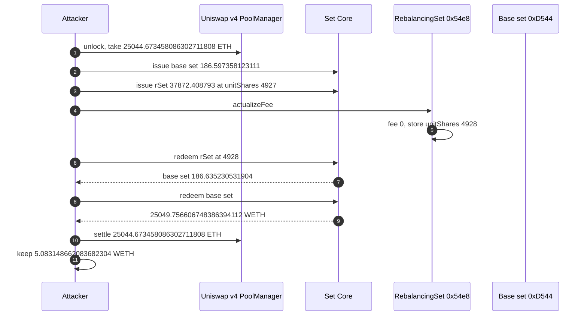
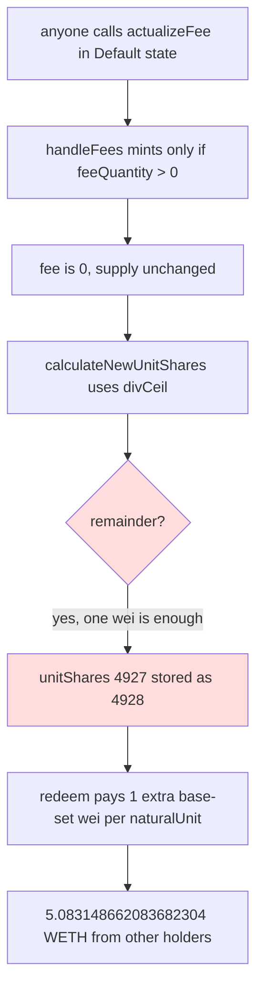

# Set Protocol — zero-fee `actualizeFee` ceils `unitShares` from 4927 to 4928 and over-redeems the base set
> **Vulnerability classes:** vuln/arithmetic/rounding-direction · vuln/logic/fee-calculation · vuln/logic/price-calculation
> **Reproduction:** online only. This folder has **no `anvil_state.json`**. Passing archival-fork trace: [output.txt](output.txt). Folder: [(.)](.). Verified source: [sources/RebalancingSetTokenV3_54e837](sources/RebalancingSetTokenV3_54e837), [sources/Core_f55186](sources/Core_f55186).
---
## Key info
| | |
|---|---|
| **Loss** | **5.083148662083682304 WETH** pulled out of the rebalancing set after repaying the flash loan [output.txt:341](output.txt). That is the protocol loss. The logged sweep is **5.083725683631735476 ETH** [output.txt:373](output.txt) because the PoC create address already held **577021548053172 wei** at the fork block and `sweep` sends the whole balance. Headline ~5.08 ETH |
| **Vulnerable contract** | `RebalancingSetTokenV3` [`0x54e8371C1EC43e58fB53D4ef4eD463C17Ba8a6bE`](https://etherscan.io/address/0x54e8371C1EC43e58fB53D4ef4eD463C17Ba8a6bE) |
| **Backing** | `currentSet` [`0xD5447466a7394A22F39cAFA56017204124Aa1Bfb`](https://etherscan.io/address/0xD5447466a7394A22F39cAFA56017204124Aa1Bfb), one component, WETH, `naturalUnit` 1e6, unit `134217728` [output.txt:45](output.txt)–[output.txt:53](output.txt) |
| **Attacker EOA** | [`0x506440728D84eB22809DC9464bC8189618A1c5B6`](https://etherscan.io/address/0x506440728D84eB22809DC9464bC8189618A1c5B6). PoC sweeps to `makeAddr("attacker")` = `0x9dF0C6b0066D5317aA5b38B36850548DaCCa6B4e` |
| **Attack contract** | Real one-shot [`0x016Feaaa25aB8325e233BC8A2C25055BEe0B2F6E`](https://etherscan.io/address/0x016Feaaa25aB8325e233BC8A2C25055BEe0B2F6E). PoC deploys `SetAttacker` at `0x5615dEB798BB3E4dFa0139dFa1b3D433Cc23b72f` [output.txt:17](output.txt) |
| **Attack tx** | [`0xaca5f83ff3a206209f3d213c33d04e6febe345f6ad52ef476bd1c0ee1505ba65`](https://etherscan.io/tx/0xaca5f83ff3a206209f3d213c33d04e6febe345f6ad52ef476bd1c0ee1505ba65) |
| **Chain / block / date** | Ethereum mainnet (chain id 1) / exploit block 26,131,887, fork parent 26,131,886 / 6 October 2026, 07:36:47 UTC |
| **Compiler** | Solidity `v0.5.7+commit.6da8b019`, optimizer on, 200 runs ([_meta.json](sources/RebalancingSetTokenV3_54e837/_meta.json)). Core is the same compiler |
| **Bug class** | `actualizeFee()` is public in Default state. With a zero fee it still rewrites `unitShares` using `divCeil`. Issuance had stored the floored value 4927. The ceil rewrite stores 4928. Redeeming the same quantity pays one extra base-set wei per `naturalUnit` |

## TL;DR
Set Protocol v1 prices a rebalancing set in units of its `currentSet`. `unitShares` is how many base-set wei back one `naturalUnit` (here `1e6`) of rebalancing-set supply. Issuance and redemption both read the live value:

```text
component required = quantity / naturalUnit * unitShares
```

On this token that stored value was **4927**. `actualizeFee()` is documented as "anyone can call". It asks the fee calculator for a fee, mints fee tokens only when the fee is non-zero, then **unconditionally** sets

```text
unitShares = ceil(vaultBalance(currentSet, this) * naturalUnit / totalSupply)
```

The trace shows `FeeActualization(..., profitFee: 0, streamingFee: 0)` and `IncentiveFeePaid(..., 0, 0, 4928)` [output.txt:191](output.txt), [output.txt:199](output.txt). No fee tokens were minted. `unitShares` still moved **4927 → 4928** [output.txt:361](output.txt), [output.txt:364](output.txt).

The attacker issues `37872.408793` rebalancing-set tokens at 4927, calls `actualizeFee`, and redeems the same quantity at 4928. Extra base set is exactly `37872408793000000000000 / 1e6 = 37872408793000000` wei (`0.037872408793` base set). The base set's only component is WETH at `134217728` wei per `naturalUnit`, so the extra base set unwraps to **5.083148662083682304 WETH** [output.txt:341](output.txt). Working capital is a Uniswap v4 `take` / `settle` of **25044.673458086302711808 ETH**, repaid in full [output.txt:24](output.txt), [output.txt:338](output.txt). No pool swap. `[PASS] testExploit()` gas 1,714,507 [output.txt:4](output.txt).

The logged "ETH profit" of **5.083725683631735476** is the WETH surplus plus **577021548053172 wei** that already sat on create address `0x5615…b72f` at block 26,131,886. `sweep` forwards `address(this).balance`. The assertion allows 1% relative error against `5.083148662083682304` and passes [output.txt:374](output.txt). The set lost the smaller number.

## Background — what `unitShares` is
`RebalancingSetTokenV3.getComponents()` returns a one-element array, `currentSet`. `getUnits()` returns `unitShares`. Core issuance treats that pair like any other Set: [Core.sol](sources/Core_f55186/Core.sol) `calculateRequiredComponentQuantities` (lines 2352–2373) does

```solidity
tokenValues[i] = _quantity.div(_naturalUnit).mul(_componentUnits[i]);
```

which is floor division only because `_quantity` is required to be a multiple of `naturalUnit`. The rate itself is whatever `getUnits()` returns at that moment. There is no snapshot.

`naturalUnit` on this rebalancing set is **1000000** [output.txt:100](output.txt)–[output.txt:104](output.txt). `getUnits()` during the issue returns **4927** (`0x133f`) [output.txt:107](output.txt)–[output.txt:108](output.txt). Core then asks for **186.597358123111** base set [output.txt:111](output.txt):

```text
37872408793000000000000 / 1000000 * 4927 = 186597358123111000000
```

The base set `0xD544…a1Bfb` is itself a SetToken whose only component is WETH, `naturalUnit` 1e6, unit `134217728` [output.txt:53](output.txt). Issuing `186.597358123111` of it pulls exactly the flash amount of WETH, **25044.673458086302711808** [output.txt:24](output.txt).

Settlement of a rebalance writes `unitShares` with floor division, [RebalancingSetTokenV3.sol](sources/RebalancingSetTokenV3_54e837/RebalancingSetTokenV3.sol) lines 2836–2847:

```solidity
uint256 naturalUnitsOutstanding = totalSupply().div(naturalUnit);
return _issueQuantity.div(naturalUnitsOutstanding);
```

`actualizeFee` later writes the same economic ratio with `divCeil`. Those two roundings do not meet.

## The vulnerable code
Verified source, identical on the ETHMACOAPY deployment (same sha256). [RebalancingSetTokenV3.sol](sources/RebalancingSetTokenV3_54e837/RebalancingSetTokenV3.sol).

`divCeil` rounds up whenever there is a remainder (lines 394–399):

```solidity
function divCeil(uint256 a, uint256 b) internal pure returns(uint256) {
    return a.mod(b) > 0 ? a.div(b).add(1) : a.div(b);
}
```

Fee mint, only if non-zero (lines 2440–2452):

```solidity
function handleFees() internal returns (uint256, uint256) {
    uint256 feePercent = rebalanceFeeCalculator.updateAndGetFee();
    uint256 feeQuantity = calculateIncentiveFeeInflation(feePercent);
    if (feeQuantity > 0) {
        ERC20._mint(feeRecipient, feeQuantity);
    }
    return (feePercent, feeQuantity);
}
```

The rewrite does not depend on `feeQuantity` (lines 2492–2503 and 4324–4355):

```solidity
function calculateNewUnitShares() internal view returns(uint256) {
    uint256 currentSetAmount = vault.getOwnerBalance(address(currentSet), address(this));
    return currentSetAmount.mul(naturalUnit).divCeil(totalSupply());
}

function actualizeFee() public {
    IncentiveFee.validateFeeActualization(); // Default state only
    (uint256 feePercent, uint256 feeQuantity) = IncentiveFee.handleFees();
    uint256 newUnitShares = IncentiveFee.calculateNewUnitShares();
    validateUnitShares(newUnitShares);       // require(_newUnitShares > 0)
    unitShares = newUnitShares;
    emit IncentiveFeePaid(feeRecipient, feeQuantity, feePercent, newUnitShares);
}
```

The comment above `actualizeFee` says "Anyone can call this function." `validateUnitShares` only rejects 0. It does not reject `newUnitShares > unitShares` when `feeQuantity == 0`.

`Core.issue` / `Core.redeem` are permissionless for any `validSets` entry. They call `getUnits()` live, so the redeem after `actualizeFee` uses 4928 and the issue used 4927.

## Root cause — why it was possible
1. **Floor on the way in, ceil on the way out.** The stored 4927 is the floored settlement ratio. `calculateNewUnitShares` ceils the same vault balance over the same supply. A remainder of one wei is enough to store `4928`. The fee does not have to be non-zero for that store to happen. The event is explicit: fee quantity 0, new unit shares 4928 [output.txt:199](output.txt).
2. **The bump is paid by other holders' collateral.** Redeeming `Q` at `unitShares + 1` withdraws `Q / naturalUnit` extra base-set wei that the caller did not deposit. Here `Q / 1e6 = 37872408793000000` wei of base set. At 134.217728 WETH per base-set token that is **5.083148662083682304 WETH**, and the vault had it because other holders' base set is still in the vault. After the attacker's WETH withdraw the vault still holds **491.785525107305101480 WETH** [output.txt:325](output.txt). That remainder is other positions, not a refund to this set's holders.
3. **`actualizeFee` is the price update.** `getUnits()` is the issuance price. Writing `unitShares` changes what every future `issue` and `redeem` pays, with no fee mint and no collateral deposit.
4. **Size is chosen so the 1-wei gap is worth ETH.** One `naturalUnit` of rebalancing set gains 1 wei of base set, which is `134217728 / 1e6` WETH. Times `37872408793` natural units that is exactly the 5.083148662083682304 WETH surplus. The 25044.673458086302711808 ETH is only inventory, borrowed with v4 flash accounting (`unlock` → `take(address(0))` → `settle`) and repaid in full. There is no swap and no fee on that debt.

## Preconditions
- The rebalancing set is in Default state, so `validateFeeActualization` does not revert. It was. `Core` considers the set valid, because `issue` succeeded.
- `unitShares` is strictly below `ceil(vaultBalance * naturalUnit / totalSupply)`. It was: 4927 stored, 4928 after one call, with both fees 0.
- The caller can mint and redeem a multiple of `naturalUnit` (1e6). Both the rebalancing set and the base set use 1e6.
- Enough of the base set's WETH sits in the vault to pay the inflated redeem. It did.
- A source of ~25044.67 ETH for one transaction. The PoC uses Uniswap v4 PoolManager `0x000000000004444c5dc75cB358380D2e3dE08A90`. `foundry.toml` sets `evm_version = cancun` because v4 uses transient storage.

## Attack walkthrough (with numbers from the trace)
| # | Step | Effect (from [output.txt](output.txt)) |
|---|------|----------------------------------------|
| 1 | Fork parent 26,131,886 | [output.txt:12](output.txt) |
| 2 | `PoolManager.take(ETH, 25044.673458086302711808)` then `WETH.deposit` of the same amount | [output.txt:24](output.txt)–[output.txt:28](output.txt) |
| 3 | `Core.issue(baseSet, 186.597358123111)`. Component unit `134217728`, `naturalUnit` 1e6. Pulls the 25044.673458086302711808 WETH | [output.txt:43](output.txt)–[output.txt:53](output.txt) |
| 4 | `unitShares()` is **4927**. `Core.issue(rSet, 37872.408793)` requires **186.597358123111** base set (`37872.408793e18 / 1e6 * 4927`) | [output.txt:96](output.txt)–[output.txt:98](output.txt), [output.txt:109](output.txt)–[output.txt:111](output.txt) |
| 5 | `actualizeFee`. `FeeActualization` profitFee 0, streamingFee 0. `IncentiveFeePaid` fee quantity 0, **newUnitShares 4928**. Fee recipient `0xF8523c551763FE4261A28313015267F163de7541` receives nothing | [output.txt:191](output.txt), [output.txt:199](output.txt) |
| 6 | `Core.redeem(rSet, 37872.408793)` then withdraw base set. Attacker receives **186.635230531904** base set | [output.txt:231](output.txt), [output.txt:252](output.txt), [output.txt:266](output.txt) |
| 7 | Difference in base set: `186635230531904000000 − 186597358123111000000 = 37872408793000000`, which is exactly `37872.408793e18 / 1e6` | arithmetic of [output.txt:111](output.txt) and [output.txt:231](output.txt) |
| 8 | `Core.redeem` of that base set credits **25049.756606748386394112 WETH** (`25049756606748386394112`) | [output.txt:268](output.txt), [output.txt:289](output.txt), [output.txt:296](output.txt) |
| 9 | Surplus over the flash: `25049756606748386394112 − 25044673458086302711808 = 5083148662083682304` = **5.083148662083682304 WETH** | [output.txt:341](output.txt) |
| 10 | `WETH.withdraw(flash)` and `PoolManager.settle{value: flash}`. Then unwrap the surplus | [output.txt:331](output.txt)–[output.txt:345](output.txt) |
| 11 | `sweep` sends **5.083725683631735476 ETH** | [output.txt:356](output.txt), [output.txt:373](output.txt). Delta `577021548053172` wei is the pre-existing balance of `0x5615…b72f` at block 26,131,886, not WETH from the set |
| 12 | Assert stored unit shares 4927 then 4928. `assertApproxEqRel` of the swept ETH against `5.083148662083682304` with 1% tolerance | [output.txt:361](output.txt)–[output.txt:374](output.txt) |

`5.083148662083682304 = 37872408793000000 * 134217728 / 1e6`. The base-set unit and the +1 `unitShares` fully explain the WETH. They do not explain the extra 0.000577021548053172 ETH in the log line.

## Diagrams





## Remediation
1. **Do not rewrite `unitShares` when the fee mint is zero.** If `feeQuantity == 0`, return. The stored floored value is the rate holders already issued at. `divCeil` on an unchanged vault balance and an unchanged supply can only stay equal or go up, and the up case is a redeem premium.
2. **If a rewrite is required after a real mint, round the same way issuance does.** Settlement uses `.div`, which floors ([lines 2836–2847](sources/RebalancingSetTokenV3_54e837/RebalancingSetTokenV3.sol)). `actualizeFee` should not be the only path that ceils. A new rate must be `<=` the rate implied by collateral actually in the vault, so a redeem cannot withdraw more base set than the set owns.
3. **`validateUnitShares` must bound the move.** `> 0` does not stop 4927 becoming 4928. Reject a change that is not explained by `feeQuantity` just minted, or require `newUnitShares <= unitShares` when supply was not increased.
4. **Restrict the caller.** The function comment says anyone can call it, and the fee recipient is a separate `onlyManager` concern (`adjustFee` is `onlyManager` and itself calls `actualizeFee`). The price update should be manager-or-keeper only. That does not fix the rounding, but it stops an atomic issue-bump-redeem.
5. **Cap the quantity issued in one transaction relative to existing supply,** or snapshot `unitShares` for the duration of a Core `issue`/`redeem` pair. The 1-wei gap is worthless until it is multiplied by `37872408793` natural units.

## How to reproduce
**There is no `anvil_state.json` in this folder.** The offline harness refuses to start:

```bash
_shared/run_poc.sh 2026-10-SetProtocol_exp -vvvvv
# no anvil_state.json in 2026-10-SetProtocol_exp
# exit 2, before forge
```

The test forks a live archival node itself. `setUp` calls `vm.createSelectFork("https://eth-mainnet.public.blastapi.io", 26131886)`. `evm_version` is `cancun` in [foundry.toml](foundry.toml) because the v4 flash accounting uses transient storage. From this folder, with network access:

```bash
forge test --match-path test/SetProtocol_exp.sol -vvvvv
```

[output.txt](output.txt) is the verbose trace of that online run. Expected tail:

```
[PASS] testExploit() (gas: 1714507)
unitShares before actualizeFee: 4927
unitShares after  actualizeFee: 4928
ETH profit: 5.083725683631735476
Suite result: ok. 1 passed; 0 failed; 0 skipped
```

Read the logged ETH profit together with [output.txt:341](output.txt). The WETH left after `settle` is **5.083148662083682304**. The extra **0.000577021548053172 ETH** in the log is the create address's pre-fork balance, swept with the profit.

*Reference: [exploit tx 0xaca5f83f…](https://etherscan.io/tx/0xaca5f83ff3a206209f3d213c33d04e6febe345f6ad52ef476bd1c0ee1505ba65) (hash in [test/SetProtocol_exp.sol](test/SetProtocol_exp.sol))*


## References

- https://x.com/SlowMist_Team/status/2107382337654951943 (@SlowMist_Team secondary analysis)
