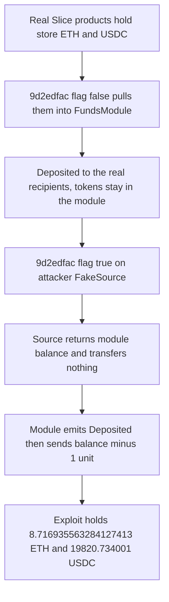

# Slice FundsModule — Unbacked Release From a Caller-Chosen Source

> **Vulnerability classes:** vuln/access-control/missing-auth · vuln/logic/missing-validation · vuln/dependency/unsafe-external-call

> **Reproduction:** [output.txt](output.txt) is the **online** Base trace, not the offline anvil replay. The offline run against `anvil_state.json` **completes but fails the USDC balance assertion** (the offline snapshot's USDC reserves drift by ~$24; the ETH leg matches exactly). The online trace **passes**: `Suite result: ok. 1 passed` ([output.txt:2790](output.txt)). Fork alias `base` at block **52,866,121** ([output.txt:11](output.txt)). The attack-block implementation is **unverified**; the release logic below is **RECONSTRUCTED** from that trace. Proxy scaffolding only: [sources/ERC1967Proxy_61bCd1](sources/ERC1967Proxy_61bCd1). Test: [test/SliceFundsModule_exp.sol](test/SliceFundsModule_exp.sol).

---

## Key info

| | |
|---|---|
| **Loss** | **8.716935563284127413 ETH** and **19,820.734001 USDC** to the exploit contract ([output.txt:6](output.txt)–[output.txt:7](output.txt)). On-chain key info is **8.716935563284127414 ETH** and **19,820.734002 USDC**. The trace is **1 wei** and **1 USDC-unit** under those figures, inside the test’s tolerances (1e9 wei and 10 units). Reported value about **$41K–$42K**. |
| **Vulnerable contract** | FundsModule proxy [`0x61bCd1ED11fC03C958A847A6687b1875f5eAcaaf`](https://basescan.org/address/0x61bCd1ED11fC03C958A847A6687b1875f5eAcaaf). At the attack block the delegatecall target is [`0x8db3B6f51b594Dc87B87a3A3b844DE9c0d8D60b5`](https://basescan.org/address/0x8db3b6f51b594dc87b87a3a3b844de9c0d8d60b5) ([output.txt:25](output.txt)). Etherscan’s current implementation is `0x1f08a189be9b14abcf2ad18b7d46af2562e6e7a5` (post-incident). Neither implementation is verified. |
| **Attacker EOA** | [`0xc34572ebb26b9a4c54854aae8d2347108e8c892f`](https://basescan.org/address/0xc34572ebb26b9a4c54854aae8d2347108e8c892f) |
| **Attack contract** | Live [`0x8eBC7878287415f1FADCF4Ace8817094E4C86f90`](https://basescan.org/address/0x8eBC7878287415f1FADCF4Ace8817094E4C86f90). PoC uses `SliceFundsModuleExploit` plus two `FakeSource` contracts |
| **Attack tx** | [`0x02b039a6345348d984e4a0b70dd233127772206e61ce82c390c4709c0b8d790a`](https://basescan.org/tx/0x02b039a6345348d984e4a0b70dd233127772206e61ce82c390c4709c0b8d790a) |
| **Chain / block / date** | Base (chainId 8453) / attack block **52,866,122**, fork **52,866,121** / **20 Oct 2026**, about **18:39 UTC** |
| **Compiler** | Proxy verified as Solidity **v0.8.2+commit.661d1103**, optimizer **on**, **200 runs**. Implementation compiler unknown (unverified). |
| **Bug class** | Selector `0x9d2edfac` calls a caller-supplied source’s `_releaseFromFundsModule` and credits the returned amount with no check that the module’s ETH or USDC balance increased, and no check that the source is a real Slice product. With the withdraw flag set, it pays that credit out of the pooled reserve |

---

## TL;DR

Slice’s FundsModule is the settlement contract for Slice stores. One permissionless entry point takes a list of source contracts, a recipient, a token (`address(0)` means ETH), and a boolean. For each source it calls `source._releaseFromFundsModule(recipient, token)` and **trusts the amount returned**. It emits `Deposited` for that amount. If the boolean is true it then sends that amount, minus a 1-unit floor, to the recipient and emits `Withdrawn`.

The source address is not looked up in an allowlist. An attacker can pass their own contract, which returns the module’s live balance and transfers nothing. Before that, the same entry point with the flag clear is pointed at real Slice products so their unswept ETH and USDC are pulled into the module. The module held about **2 wei** and **1 USDC unit** before the attack. The drained money is other stores’ revenue.

[output.txt](output.txt) result, online: **`[PASS] testExploit()` gas 7,033,656**. Logged drain **8,716,935,563,284,127,413 wei** and **19,820,734,001 USDC units** ([output.txt:4](output.txt)–[output.txt:7](output.txt)). Assertions accept a 1-wei / 1-unit gap versus the historical totals ([output.txt:2781](output.txt)–[output.txt:2783](output.txt)). **Suite result: ok. 1 passed; 0 failed** ([output.txt:2790](output.txt)). The offline anvil replay completes but fails the USDC balance assertion (offline USDC drift ~$24; the ETH leg matches exactly); this file is the canonical online PASS.

---

## Background

Slice is an on-chain commerce protocol. A product (slicer) holds sales proceeds until someone releases them through the FundsModule into a recipient’s claim, or straight out to that recipient. The module at `0x61bCd1…caaf` is an ERC1967 proxy. Every `0x9d2edfac` call in the trace delegatecalls `0x8db3B6f5…60b5`.

The historical transaction does this in one shot: release about seventy real stores into the module (flag false, so the stores’ owners are credited but the tokens sit in the module), then call the same function with a fake source and flag true. This PoC does not replay attacker bytecode. It deploys two `FakeSource` contracts and walks the real `(source, recipient)` pairs taken from the attack calldata. Eight ETH legs and sixty-six USDC legs are attempted. Pooling is best-effort: a leg that reverts is ignored. The test comment records that all 8 ETH legs reconstruct and 55 of 66 USDC legs do. The 11 that revert are releases whose recipient is itself a slicer; they do not add to the balance the drain reads. A nested `slicerId()` revert inside a successful ETH release is caught and ignored ([output.txt:89](output.txt)). Whole `9d2edfac` calls that revert show up later, for example [output.txt:2740](output.txt)–[output.txt:2746](output.txt).

`FakeSource._releaseFromFundsModule` is a view. It returns `module.balance` or `USDC.balanceOf(module)`, and a second zero word, and it transfers nothing.

---

## The vulnerable code

> **RECONSTRUCTED.** `getsourcecode` for `0x8db3B6f5…60b5` returns unverified. The proxy bundle is OpenZeppelin ERC1967 only. The shape below matches the calls, return data, and events in [output.txt](output.txt).

```solidity
// RECONSTRUCTED — selector 0x9d2edfac
// args: (address[] sources, address recipient, address token, bool withdraw)
function release(address[] calldata sources, address recipient, address token, bool withdraw) external {
    for (uint256 i; i < sources.length; ++i) {
        // no allowlist, no code-hash check, no balance-delta check
        (uint256 amount, uint256 extra) =
            ISource(sources[i])._releaseFromFundsModule(recipient, token);
        // amount is credited even if this contract's balance did not increase
        emit Deposited(recipient, token, amount, extra);
        if (withdraw && amount > 1) {
            uint256 payout = amount - 1; // 1-unit floor, observed on both assets
            if (token == address(0)) payable(recipient).transfer(payout);
            else IERC20(token).transfer(recipient, payout);
            emit Withdrawn(recipient, token, payout, extra);
        }
    }
}
```

Evidence for the unbacked credit, ETH drain leg ([output.txt:254](output.txt)–[output.txt:261](output.txt)):

- `FakeSource._releaseFromFundsModule` returns **8,716,935,563,284,127,414** and **0**. No ETH is transferred into the module in that call.
- `Deposited(exploit, address(0), 8716935563284127414, 0)`.
- The module then calls `exploit.receive{value: 8716935563284127413}`.
- `Withdrawn(exploit, address(0), 8716935563284127413, 0)`.

The same pattern on USDC ([output.txt:2751](output.txt)–[output.txt:2768](output.txt)): the fake source returns **19,820,734,002**, `Deposited` records that amount, `USDC.transfer` sends **19,820,734,001**, `Withdrawn` records the transfer. The 1-unit gap is the payout floor, not a failed assertion.

The eight real ETH pulls that filled the module, each a `Deposited` to the genuine recipient with the flag clear, sum to **8,716,935,563,284,127,412 wei**. Plus the **2 wei** already in the module, that is exactly the **8,716,935,563,284,127,414** the fake source read back:

| Leg | Source | Recipient | Wei |
|---|---|---|---:|
| 0 | `0xad1E8F10…bA4a5` | `0x750EcE33…9AAc6` | 3,438,948,563,284,127,412 |
| 1 | `0x0c401453…1f2D5` | `0xAe009d53…5c0FF` | 2,898,076,500,000,000,000 |
| 2 | `0x949EabB5…51c09` | `0x7774235C…e0Baf` | 696,168,000,000,000,000 |
| 3 | `0x250fBbf2…1CA1F` | `0x8177b346…07a66` | 66,859,650,000,000,000 |
| 4 | same | `0xf32dd1Bd…f79c7` | 601,736,850,000,000,000 |
| 5 | `0xAC8f3E2D…1Fed10` | `0xDe300404…f97aD` | 585,783,000,000,000,000 |
| 6 | `0xd8E4303E…48C74` | `0xAe009d53…5c0FF` | 285,219,000,000,000,000 |
| 7 | `0x7e96a089…AE9F2` | `0x92f55166…22d17` | 144,144,000,000,000,000 |

Those `Deposited` events are [output.txt:46](output.txt), [output.txt:73](output.txt), [output.txt:102](output.txt), [output.txt:139](output.txt), [output.txt:168](output.txt), [output.txt:195](output.txt), [output.txt:222](output.txt), and [output.txt:249](output.txt).

---

## Root cause

1. **The release amount is an untrusted return value.** The module treats `sources[i]._releaseFromFundsModule` as if it were an accounting callback from a product it deployed. The only proof that funds arrived would be `address(this).balance` or `token.balanceOf(address(this))` increasing by `amount` across the external call. That delta is never taken.

2. **The source list is caller-controlled.** There is no registry of product addresses on this path. The same function that honestly pulls a real store (the products do send ETH/USDC, which is why the pool fills) will also call an attacker contract.

3. **Credit and cash-out are the same call.** The boolean pays the credited amount immediately. A fake credit does not sit as an internal claim the protocol could later unwind. It is ETH and USDC in the caller’s balance before the transaction ends.

4. **The reserve being paid was other users’ unswept revenue.** The module itself was almost empty. Step 1 is required because the money lived in the product contracts. The bug is what lets a stranger both pool it and withdraw it.

---

## Preconditions

- Products still hold ETH or USDC that `0x9d2edfac` with flag false will release into the module. If every store has already withdrawn, the fake source reads a near-zero balance.
- The caller can deploy a contract with `_releaseFromFundsModule(address,address) returns (uint256,uint256)`.
- No allowlist and no `msg.sender` role on `0x9d2edfac`.
- The withdraw flag is honored for the caller’s own recipient. The PoC sets the recipient to the exploit contract.
- The 11 USDC legs that revert are not required. The drain reads whatever balance the successful legs actually transferred.

No flash loan and no privileged key.

---

## Attack walkthrough

Online fork of Base at **52,866,121** ([output.txt:11](output.txt)). Gas **7,033,656**.

1. Deploy two `FakeSource` contracts, one bound to ETH and one to USDC `0x833589fCD6eDb6E08f4c7C32D4f71b54bdA02913` ([output.txt:20](output.txt)–[output.txt:23](output.txt)).

2. **Pool ETH.** Eight calls to `FundsModule.9d2edfac` with flag false, the real product as the only source, and the real investor as recipient. The first delegatecalls `0x8db3B6f5` and the product’s `_releaseFromFundsModule`, then `Deposited` **3.438948563284127412 ETH** to `0x750EcE33…` ([output.txt:24](output.txt), [output.txt:46](output.txt)). The other seven deposits are the table above. No `Withdrawn` on these calls. The ETH now sits in the module, credited to the real recipients.

3. **Drain ETH.** `9d2edfac` with the ETH `FakeSource`, recipient = exploit, token = `address(0)`, flag = true ([output.txt:254](output.txt)). The source returns the full balance and moves no value ([output.txt:256](output.txt)–[output.txt:257](output.txt)). The module credits **8.716935563284127414 ETH** and sends **8.716935563284127413 ETH** ([output.txt:258](output.txt)–[output.txt:261](output.txt)).

4. **Pool USDC.** Sixty-six attempted releases, flag false. The test ignores a leg whose call returns failure. One such revert, just before the drain, is [output.txt:2740](output.txt)–[output.txt:2746](output.txt). Successful legs transfer USDC into the module. After the loop, `USDC.balanceOf(module)` is **19,820,734,002** ([output.txt:2754](output.txt)–[output.txt:2757](output.txt)), which is the pooled revenue plus the **1 unit** that was already there.

5. **Drain USDC.** `FakeSource` returns **19,820,734,002** ([output.txt:2753](output.txt)–[output.txt:2758](output.txt)). `Deposited` records that credit ([output.txt:2759](output.txt)). `USDC.transfer` of **19,820,734,001** to the exploit emits `Transfer` and `Withdrawn` ([output.txt:2760](output.txt)–[output.txt:2768](output.txt)).

6. **Checks.** `console.log` prints `8716935563284127413` and `19820734001` ([output.txt:2777](output.txt)–[output.txt:2779](output.txt)). `assertApproxEqAbs` against `8716935563284127414` (tolerance 1e9) and `19820734002` (tolerance 10) both return success ([output.txt:2781](output.txt)–[output.txt:2783](output.txt)).

**output.txt result:** online pass. `[PASS] testExploit()` at [output.txt:4](output.txt). Suite **ok, 1 passed, 0 failed**, finished in **156.54s** ([output.txt:2790](output.txt)–[output.txt:2792](output.txt)). This is not an offline PASS. The anvil snapshot in this folder reproduces the ETH drain exactly but fails the USDC balance assertion (its USDC reserves drift by ~$24), so the offline run completes without passing; the numbers above are from the archive RPC run that forked alias `base`.

---

## Diagrams



---

## Remediation

- Allowlist sources. `0x9d2edfac` should accept only registered product contracts, not an arbitrary address with the right selector.
- Measure the balance before and after `_releaseFromFundsModule`. Credit `min(returnedAmount, balanceAfter - balanceBefore)`, and credit nothing if the source did not transfer the token.
- Split the permissionless “pull a real product” path from the “pay a recipient” path. Paying out should spend an internal claim that was increased only by a measured transfer, and only the claim owner should withdraw.
- A one-unit floor does not fix a forged amount. It only leaves dust, which is why this trace is 1 wei and 1 USDC unit short of the credited figures.
- The implementation was unverified at the time of the attack. Publish the source, and treat an upgradeable settlement contract as needing an emergency pause on this selector. Slice did upgrade and pause after the fact. The pause does not recover the transfer already sent.

---

## How to reproduce

`anvil_state.json` is present, but the **offline** `_shared/run_poc.sh` replay **completes and then fails the USDC balance assertion** (offline USDC drift ~$24; the ETH leg matches exactly). The canonical [output.txt](output.txt) is the **online** PASS:

- `createSelectFork("base", 52866121)` ([output.txt:11](output.txt))
- `[PASS] testExploit()` gas **7,033,656** ([output.txt:4](output.txt))
- ETH drained **8,716,935,563,284,127,413** wei, USDC drained **19,820,734,001** ([output.txt:6](output.txt)–[output.txt:7](output.txt))
- `Suite result: ok. 1 passed; 0 failed; 0 skipped` ([output.txt:2790](output.txt))

From the registry root:

```bash
_shared/run_poc.sh 2026-10-SliceFundsModule_exp -vvvvv
```

That command is the offline runner. Expect the USDC balance assertion to fail (ETH matches exactly) when it loads `anvil_state.json`. To match this `output.txt`, fork Base archive at block 52,866,121 (alias `base` or an archive URL) and run `forge test --match-path test/SliceFundsModule_exp.sol -vvvvv`. The checked-in test currently points at `http://127.0.0.1:8548`, which is the offline rewrite and is the run that fails the USDC assertion.

*Reference: https://x.com/DefimonAlerts/status/2112804669865042308*


## References

- https://x.com/TenArmorAlert/status/2112714662064398524 (@TenArmorAlert secondary analysis)

- https://x.com/SlowMist_Team/status/2112746806585274454 (@SlowMist_Team secondary analysis)
