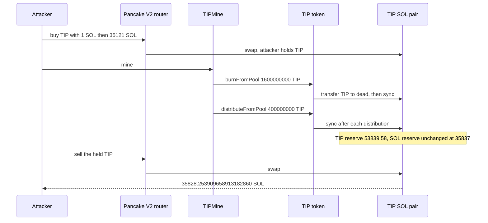

# TIPMine — permissionless `mine()` burns TIP out of the Pancake pair and `sync()` leaves the SOL reserve in place

> **Vulnerability classes:** vuln/access-control/missing-auth · vuln/logic/incorrect-state-transition · vuln/logic/missing-check
> **Reproduction:** online only. This folder has **no `anvil_state.json`**. Passing archival-fork trace: [output.txt](output.txt). Folder: [(.)](.). Verified source: [sources/TIPMine_412c7b](sources/TIPMine_412c7b), [sources/TIPToken_36D75b](sources/TIPToken_36D75b).
---
## Key info
| | |
|---|---|
| **Loss** | Reconstructed profit **706.253909658913182860 SOL** [output.txt:12](output.txt), [output.txt:395](output.txt). On-chain the EOA received **667.228863551156127021 SOL** [output.txt:13](output.txt). The gap is the flash-loan cost that `deal`'d principal does not pay. The pool's SOL reserve ends at **8.746805341801817855** [output.txt:11](output.txt), down from **715.000715000715000715** [output.txt:7](output.txt) |
| **Vulnerable contract** | `TIPMine` [`0x412c7bd213D4feA88b582A8A0E5B80e2F2d10993`](https://bscscan.com/address/0x412c7bd213D4feA88b582A8A0E5B80e2F2d10993). TIP token [`0x36D75b5A8c724B692FBA78aC2dd8cE933c0e1F4E`](https://bscscan.com/address/0x36D75b5A8c724B692FBA78aC2dd8cE933c0e1F4E) |
| **Attacker EOA** | [`0x96bB3276f74Fd736a8BC89DF5B934F5b7F3Ef6ce`](https://bscscan.com/address/0x96bB3276f74Fd736a8BC89DF5B934F5b7F3Ef6ce) |
| **Attack contract** | On-chain [`0xdaB0622E6bbbE2ac7E54f1269Fa87014f8dA5F04`](https://bscscan.com/address/0xdaB0622E6bbbE2ac7E54f1269Fa87014f8dA5F04). PoC is the test contract `0x7FA9385bE102ac3EAc297483Dd6233D62b3e1496` |
| **Attack tx** | [`0xa7b879b5d4252fa5b518db1f81be8a5cc670c5b978c7626fa287c0a1f37895a3`](https://bscscan.com/tx/0xa7b879b5d4252fa5b518db1f81be8a5cc670c5b978c7626fa287c0a1f37895a3), block 128,188,934 |
| **Chain / block / date** | BNB Chain (chain id 56) / fork block **128,188,933** / 17 October 2026, 14:47:45 UTC (trace deadline `1792248465`) |
| **Compiler** | Solidity `v0.8.34+commit.80d5c536`, optimizer on, 1 run, on both TIPMine and TIP ([_meta.json](sources/TIPMine_412c7b/_meta.json)) |
| **Bug class** | `mine()` has no caller check. It removes TIP from the live TIP/SOL pair through `burnFromPool` / `distributeFromPool`, and each of those calls `sync()`, so the SOL reserve stays put while the TIP reserve collapses |

## TL;DR
TIPMine is the public "mine" function for the TIP token. Once a day it releases 2% of the unmined supply. On the first call, `lastMineTime` is 0, so the timer is already open. Eighty percent of that release is burned and the rest is pushed to staking, nodes, a foundation, and a partner. Both the burn and the distributions take the TIP from `pool`, the Pancake V2 pair, and then `pool.call(sync())`.

`sync()` sets reserves to current balances. It does not preserve `x * y = k`. Removing TIP and syncing leaves the SOL side unchanged, so TIP becomes expensive in SOL. The attacker holds TIP across that call and sells it back.

SOL here is a BEP-20, `0x570A5D26f7765Ecb712C0924E4De545B89fD43dF`, 18 decimals, not native Solana. The pair is `0xb1E0FB4129314F3AEDAeD1a4061B22c20b3F1219` (token0 TIP, token1 SOL). The router is Pancake V2 `0x10ED43C718714eb63d5aA57B78B54704E256024E`.

The trace starts with **100,000,000,000 TIP** and **715.000715000715000715 SOL** in the pair [output.txt:6](output.txt)–[output.txt:7](output.txt). After buying TIP, dumping **35,121 SOL** in, and calling `mine()`, the TIP reserve is **53,839.578961186330694175** and the SOL reserve is **35,837.000715000715000715** [output.txt:9](output.txt)–[output.txt:10](output.txt). The sell then takes **35,828.253909658913182860 SOL** out of the pair. Net of **36,000 SOL** of `deal`'d working capital, profit is **706.253909658913182860 SOL** [output.txt:12](output.txt). The pair is left with **8.746805341801817855 SOL** [output.txt:11](output.txt). `[PASS] testExploit()` gas 1,240,603 [output.txt:4](output.txt). `nonReentrant` in `mine()` uses transient storage, so the file is compiled with `cancun`.

## Background — what `mine()` is supposed to do
The contract comment says the daily release is 2% (`DAILY_RELEASE_RATE = 200` of 10,000) and the burn rate starts at 80% (`MAX_BURN_RATE = 8000`) and decays by 0.5% per day toward 30%. Distribution of what is not burned is LP 60%, nodes 15%, D-level 14%, foundation 5%, partner 6%. `lastMineTime == 0` at the parent block, so `block.timestamp >= lastMineTime + 1 days` is true for the first caller. There is no `onlyOwner` on `mine()`.

The TIP token's `onlyMining` and `onlyMinter` both include `miningContract`. TIPMine is that contract, so `burnFromPool` and `distributeFromPool` succeed when `mine()` calls them. They would revert for the attacker calling them directly. The attacker does not need that. They call `mine()`.

TIP's own transfer path also taxes the pair. A buy burns most of the TIP that leaves the pair (`BuyBurned` in the trace). A sell into the pair burns **94%** of the TIP that arrived (`_burnFromPool = toPool * 9400 / 10000` in `_sellTax`) and the burn itself moves the reserve again. That tax makes the dump and the final sell worse for a normal trader. It does not undo `mine()`. The header of the test records a control: the same buy, dump, and sell without `mine()` loses about **31,563 SOL**. That control is not a second test in [output.txt](output.txt). The committed trace is the path that includes `mine()`.

Working capital on-chain was a Venus-fork SOL borrow plus flash loans from TIP-ecosystem pools, about **36,000 SOL**, all repaid in the attack transaction. This pair is the SOL token's market, so the PoC `deal`s **36,000 SOL** and subtracts it at the end, the same pattern the test header attributes to other same-month PoCs. Profit is already net of that principal. It is not net of the real flash fees, which is why it sits **39.025046107757055839 SOL** above the on-chain **667.228863551156127021**. The assert allows **45 SOL** for that modelled-away cost [output.txt:399](output.txt).

## The vulnerable code
### `mine()` is public
Verified `TIP_1015_TIPMine.sol`:

```solidity
function mine() external nonReentrant {
    require(initialTotalSupply > 0, "!supply");
    require(block.timestamp >= lastMineTime + 1 days, "too early");
    uint256 remaining = initialTotalSupply - totalMined;
    uint256 releaseAmount = remaining * DAILY_RELEASE_RATE / 10000;
    uint256 burnRate = _getCurrentBurnRate();
    uint256 burnAmount = releaseAmount * burnRate / 10000;
    uint256 distributeAmount = releaseAmount - burnAmount;
    // ...
    (bool s, ) = address(tipToken).call(
        abi.encodeWithSignature("burnFromPool(uint256)", burnAmount));
    require(s, "burn failed");
    // distributeFromPool to stakeCore, address(this), foundation, partner
}
```

No `msg.sender` check. The first call in the trace is from the test contract [output.txt:173](output.txt).

### The pair is the source of the TIP, and it is synced
Verified `TIPToken`:

```solidity
function burnFromPool(uint256 amount) external onlyMining {
    require(pool != address(0), "Pool not set");
    require(balanceOf(pool) >= amount, "Pool balance insufficient");
    _transfer(pool, address(0xdead), amount);
    _syncPool();
    emit BurnedFromPool(amount);
}

function distributeFromPool(address to, uint256 amount) external onlyMinter {
    require(balanceOf(pool) >= amount, "Pool balance insufficient");
    _transfer(pool, to, amount);
    _syncPool();
    emit DistributedFromPool(to, amount);
}

function _syncPool() internal {
    if (pool != address(0)) {
        (bool success, ) = pool.call(abi.encodeWithSignature("sync()"));
        success;
    }
}
```

`_transfer` plus `sync()` is not a `burn` that the pair itself performs, and it is not a swap. The pair never receives SOL and never updates `k`. Each of the six calls below syncs again, so the reserve tracks the shrinking TIP balance and the untouched SOL balance. `_syncPool` also ignores a failed `sync`. A failed sync would at least leave the pair's reserve stale until the next real swap. A successful sync is what publishes the broken price.

`_sellTax` then burns 94% of TIP sent to the pool when circulating supply is above 1% of total supply. The final sell hits that path [output.txt:345](output.txt).

## Root cause — why it was possible
1. **`mine()` is permissionless.** The only gates are `initialTotalSupply > 0` and a one-day timer. At this block the timer is already satisfied. Any address can choose the moment the pair's TIP balance is cut.
2. **The released TIP is taken from the AMM pair, not from a treasury.** `burnFromPool` and `distributeFromPool` both `_transfer` from `pool`. The economic effect is a donation of TIP reserves to `0xdead`, the mine contract, and the distribution addresses, paid by the LPs.
3. **`sync()` after each transfer resets the reserve to the new balance.** Pancake V2 `sync` does not require the balances to satisfy the previous `k`. SOL stays at **35,837.000715000715000715** across `mine()` [output.txt:170](output.txt), [output.txt:321](output.txt) while TIP falls from about **2,000,053,839.58** to **53,839.578961186330694175**.
4. **The sell tax compounds the reserve damage. It does not protect the SOL.** Ninety-four percent of the TIP that reaches the pair on the way out is burned and the price is updated again. The attacker still receives **35,828.253909658913182860 SOL** [output.txt:366](output.txt).

## Preconditions
- `mine()` is callable. It is. `lastMineTime` is far enough in the past. Here it is zero, so the first caller wins.
- `miningContract` is TIPMine, so `onlyMining` / `onlyMinter` pass. They do: `burnFromPool` and `distributeFromPool` execute inside `mine()` [output.txt:174](output.txt), [output.txt:192](output.txt).
- The TIP/SOL pair holds almost all of the releasable TIP. Before any attacker swap the TIP reserve is **100,000,000,000** [output.txt:6](output.txt). The release that actually executes is **2,000,000,000 TIP**.
- The attacker can hold TIP across the `mine()` call. They buy with **1 SOL** and then **35,121 SOL**. Both swaps are public Pancake router calls.
- The **36,000 SOL** principal is modelled with `deal`. On-chain it was borrowed and repaid. No owner key is used.

## Attack walkthrough (with on-chain numbers from the trace)
Reserves are 18-decimal. TIP figures below are whole tokens only where the trace's decimal log is exact.

| Step | Call | Reserves and amounts |
|---|---|---|
| 1 | Fork `https://bsc-mainnet.public.blastapi.io` at 128,188,933. `deal` **36,000 SOL** | TIP **100,000,000,000**. SOL **715.000715000715000715** [output.txt:6](output.txt)–[output.txt:7](output.txt) |
| 2 | Router buy, **1 SOL** in | Pair sends **139,315,989.775058851184007351 TIP** gross [output.txt:97](output.txt). Attacker receives **5,572,639.591002354047360295 TIP** after the buy burn [output.txt:101](output.txt). `BuyBurned` burns **125,384,390.797552966065606615 TIP** [output.txt:102](output.txt) |
| 3 | Router buy, **35,121 SOL** in | Pair sends **97,860,630,170.645979962485298474 TIP** gross [output.txt:144](output.txt). Attacker receives **3,914,425,206.825839198499411940 TIP** [output.txt:148](output.txt) |
| 4 | Reserves after the dump | TIP **2,000,053,839.578961186330694175**. SOL **35,837.000715000715000715** [output.txt:170](output.txt), [output.txt:8](output.txt). **715.000715000715000715 + 1 + 35,121 = 35,837.000715000715000715** |
| 5 | `mine()` | [output.txt:173](output.txt). `burnFromPool` **1,600,000,000 TIP** to `0xdead` [output.txt:174](output.txt)–[output.txt:175](output.txt), then `sync`. First sync still sees TIP balance **400,053,839.578961186330694175** [output.txt:178](output.txt) because the transfer and the sync are inside the same call. Later syncs follow each distribution |
| 6 | Distributions, in source order | **240,000,000 TIP** to stake core `0xEd6FaCe44D0352d4288Be815F077eFf6045848f4` [output.txt:192](output.txt). **60,000,000** to TIPMine itself [output.txt:215](output.txt). **56,000,000** to stake core again [output.txt:240](output.txt). **20,000,000** to `0xA0f045cde45ca1aeE2033356170B46A1fF3b7202` [output.txt:270](output.txt). **24,000,000** to `0xe164eab5efA206675Ea8bBb339E3eEb9891C1e1b` [output.txt:289](output.txt). **1,600,000,000 + 400,000,000 = 2,000,000,000** released. 80% burned, then 60/15/14/5/6 of the remaining 400,000,000 |
| 7 | Reserves after `mine()` | TIP **53,839.578961186330694175**. SOL still **35,837.000715000715000715** [output.txt:9](output.txt)–[output.txt:10](output.txt) |
| 8 | Sell **3,919,997,846.416841552546772235 TIP** | [output.txt:324](output.txt). Of that, **3,684,797,975.631831059393965901 TIP** is what reaches the pair [output.txt:339](output.txt). `SellBurned` burns **3,463,710,097.093921195830327946 TIP** from the pair, 94% of the amount that arrived [output.txt:345](output.txt) |
| 9 | Pair pays SOL | **35,828.253909658913182860 SOL** [output.txt:363](output.txt), [output.txt:366](output.txt) |
| 10 | End state | SOL reserve **8.746805341801817855** [output.txt:11](output.txt). Profit **706.253909658913182860 SOL** [output.txt:12](output.txt). Named on-chain net **667.228863551156127021 SOL** [output.txt:13](output.txt) |

```text
SOL reserve start                         715.000715000715000715
SOL added by the two buys              35,122
SOL reserve after dump and after mine 35,837.000715000715000715
SOL paid to the attacker on the sell   35,828.253909658913182860
SOL reserve end                            8.746805341801817855
deal principal                         36,000
profit = end balance - 36,000             706.253909658913182860
on-chain EOA net                          667.228863551156127021
difference                                 39.025046107757055839
assert tolerance                           45 SOL
```

**35,837.000715000715000715 − 35,828.253909658913182860 = 8.746805341801817855**, so the sell took the entire SOL reserve except that residual. The two buys had put **35,122 SOL** in. The profit is that SOL, plus the original **715.000715000715000715**, minus the **8.746805341801817855** left behind, minus the **1 SOL** and **35,121 SOL** notionally still "owed" to the `deal`, with the buy-side TIP tax already reflected in how much TIP the attacker had to sell. The logged profit is the balance delta, not a hand sum, and it is **706.253909658913182860** [output.txt:395](output.txt).

`[PASS]` gas 1,240,603 [output.txt:4](output.txt). Suite result [output.txt:406](output.txt).

## Diagrams


## Remediation
1. **Do not pull mining releases out of the AMM pair.** Mint the release, or pay it from a treasury that is not `token0` of the SOL pair. If the intent is a buyback-and-burn, do it with a swap that pays SOL in, not with `transfer` plus `sync`.
2. **`sync()` after an external transfer from the pair is the bug, even if `mine()` stays public.** A public daily call is fine if it cannot move pair balances. `burnFromPool` and `distributeFromPool` should revert when `from` is a pair, or they should go through the pair's own `burn`/`skim` path so `k` is checked.
3. **If a reserve must change, require `k` to hold or require the caller to deposit the other token.** Ignoring `sync`'s success bit makes a failed sync silent. Checking the bit would not have saved this pair. The sync succeeded and the price moved.
4. **The 94% sell tax is not a backstop.** It burned **3,463,710,097.093921195830327946 TIP** on the way out and the attacker still removed **35,828.253909658913182860 SOL**. A sell tax does not restore a reserve that `mine()` already deleted.
5. **Initialize `lastMineTime`, and do not let the first call release 2% of supply against a 100 billion TIP pool.** That is defense in depth. The reserve invariant has to hold on day 2 as well.

## How to reproduce
**There is no `anvil_state.json` in this folder.** The offline harness refuses to start:

```bash
_shared/run_poc.sh 2026-10-TIPMine_exp -vvvvv
# no anvil_state.json in 2026-10-TIPMine_exp
# exit 2, before forge
```

The test forks a live archival node itself. `setUp` calls `vm.createSelectFork("https://bsc-mainnet.public.blastapi.io", 128188933)`. `evm_version` must be `cancun` because `mine()`'s `nonReentrant` guard uses transient storage. [foundry.toml](foundry.toml) already sets that. From this folder, with network access:

```bash
forge test --match-path test/TIPMine_exp.sol -vvvvv
```

[output.txt](output.txt) is the verbose trace of that online run. Expected tail:

```
[PASS] testExploit() (gas: 1240603)
pool TIP before      : 100000000000.000000000000000000
pool SOL before      : 715.000715000715000715
pool TIP after dump  : 2000053839.578961186330694175
pool TIP after mine  : 53839.578961186330694175
pool SOL after mine  : 35837.000715000715000715
pool SOL end         : 8.746805341801817855
profit SOL           : 706.253909658913182860
on-chain net SOL     : 667.228863551156127021
Suite result: ok. 1 passed; 0 failed; 0 skipped
```

The **36,000 SOL** principal is `deal`'d. The profit line is already net of it.

*Reference: [attack tx 0xa7b879b5…](https://bscscan.com/tx/0xa7b879b5d4252fa5b518db1f81be8a5cc670c5b978c7626fa287c0a1f37895a3) (hash in [test/TIPMine_exp.sol](test/TIPMine_exp.sol)).*


## References

- https://x.com/TenArmorAlert/status/2111993166752866498 (@TenArmorAlert secondary analysis)
