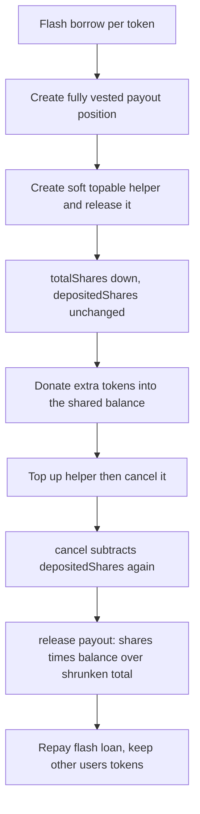

# UNCX Smart Token Vesting — Shared-Pool Share Double-Debit

> **Vulnerability classes:** vuln/logic/state-update · vuln/logic/incorrect-state-transition · vuln/logic/missing-check

> **Reproduction:** the PoC compiles and passes both as an **online** Ethereum archive fork and **offline** against the bundled **`anvil_state.json`** snapshot in this folder (`_shared/run_poc.sh` serves it on localhost — no RPC required). Canonical trace: [output.txt](output.txt) (`[PASS]`, fork block 26,191,744, RPC redacted as `<rpc url>`). Verified source: [sources/VestingManager_A98F06](sources/VestingManager_A98F06). Test: [test/UNCXSmartTokenVesting_exp.sol](test/UNCXSmartTokenVesting_exp.sol).

---

## Key info

| | |
|---|---|
| **Loss** | This transaction keeps, after every flash loan is repaid: **55,601,598.708417972560603048 EDGEN**, **9,055,847.637887682268154756 ZC**, **40,155.284285661160205717 pepecoin**, **65,372.217059159993437512 LO0P**, **113,657.766933968 $PAAL** ([output.txt:6](output.txt)–[output.txt:10](output.txt)). Contemporaneous reports put this first Ethereum drain near **$86K–$89K** gross and about **$85.6K** retained. UNCX’s later incident report puts the four-chain total near **$807,609** (Ethereum about $77.2K of that). |
| **Vulnerable contract** | `VestingManager` — [`0xA98F06312b7614523d0f5e725e15fd20fB1b99F5`](https://etherscan.io/address/0xA98F06312b7614523d0f5e725e15fd20fB1b99F5) (not a proxy) |
| **Attacker EOA** | [`0x78C9B11853E4f183a34C63fFd1924d2319a2f5B3`](https://etherscan.io/address/0x78C9B11853E4f183a34C63fFd1924d2319a2f5B3) |
| **Attack contract** | Live [`0xf6D072254Eb8A9B06e0bA21221b498332C1BC35E`](https://etherscan.io/address/0xf6D072254Eb8A9B06e0bA21221b498332C1BC35E). PoC contract `UNCXVestingExploit` at `0x5615dEB798BB3E4dFa0139dFa1b3D433Cc23b72f` |
| **Attack tx** | [`0x352065378c4a41b77e5b6a1e5b5616cd2886c3e1a2c87ed3db8e5ddddc23823d`](https://etherscan.io/tx/0x352065378c4a41b77e5b6a1e5b5616cd2886c3e1a2c87ed3db8e5ddddc23823d) |
| **Chain / block / date** | Ethereum (chainId 1) / fork parent **26,191,744**, attack block **26,191,745** / **14 Oct 2026**. `vm.warp(1791992999)` matches that block’s timestamp so the attacker’s create-tranches (ending at 1,791,992,998) are already fully vested |
| **Compiler** | Solidity **v0.8.27+commit.40a35a09**, optimizer **on**, **5 runs** (`sources/VestingManager_A98F06/_meta.json`) |
| **Bug class** | One `VestingManager` pools every position of a token and pays `release()` as `releasableShares * balance / _totalTokenShares`. `release()` subtracts those shares from the global total but not from `_depositedShares`. `cancel()` subtracts `_depositedShares` again. The denominator falls below the shares the pool still owes, and the attacker’s surviving position is paid other users’ tokens |

---

## TL;DR

UNCX Smart Token Vesting V2 keeps every vesting of a given ERC-20 in one contract balance and tracks ownership with internal shares. `release()` pays a fraction of that **whole** balance, then decrements `_totalTokenShares` without reducing the position’s `_depositedShares`. `cancel()` later computes shares to remove from `_depositedShares` and ignores `schedule.released`, so the same shares leave the global total a second time.

The create path is permissionless. A tranche that already ended is 100% releasable at `block.timestamp`. The attacker, per token, flash-borrows inventory, opens a small fully vested payout position and one or two soft top-up-able helpers, releases the helpers, donates extra tokens into the pool, tops the helpers up, cancels them, and releases the payout position against the corrupted denominator. Flash principal is repaid inside the same callback. What the exploit contract still holds is the stolen inventory: the five balances in [output.txt:6](output.txt)–[output.txt:10](output.txt). `testExploit` gas is **8,017,284**. Suite result: **ok, 1 passed** ([output.txt:4](output.txt), [output.txt:1188](output.txt)).

The same bytecode was deployed on BNB Chain, Base, and Robinhood Chain. This PoC reconstructs only the first Ethereum drain.

---

## Background

`VestingManager` sells token locks to other projects. A creator pays a **0.05 ETH** flat fee and deposits an ERC-20 against a `TimeAmount[]` schedule. Positions may be soft (cancellable by the creator), top-up-able, NFT-ized, or transferable. All positions of one token share `IERC20(token).balanceOf(VestingManager)`. The contract does not escrow each position in its own balance.

Shares convert through `_shareRatio[token]` (`_toShares` = `amount * ratio / 1e18`). `_totalTokenShares[token]` is the denominator. `_depositedShares[vestingId]` is the numerator base for that position. `schedule.released` counts shares already paid. `_updateShareRatio` rewrites the ratio from `balance / totalShares` before a release or top-up, so a donation that increases `balance` without minting shares changes the ratio for the next conversion.

Nothing in `createVesting`, `createAirdropVesting`, `topUpVesting`, `release`, or `cancel` checks an owner, role, or signature. The caller must be the beneficiary to release, and the creator of a soft schedule to cancel. Both are the attacker for the positions the attacker just created.

Working capital is borrowed and repaid inside the same call:

| Token | Source | Borrow (raw) | Repay |
|---|---|---:|---|
| EDGEN `0xAa9806c9…AE02Ca` | Uniswap V3 pool `0x4B2C930F…dD03e` | 131,769,607.356179331729743626 | principal + pool fee |
| ZC `0x4E67DB19…298722` | Uniswap V4 `PoolManager` `0x0000…08A90` | 47,059,196.744096272543282784 | exact `settle` |
| pepecoin `0xA9E8aCf0…a9489A` | Uniswap V2 `0xDDd23787…E6aff` | 531,437.174022481383511735 | `amount * 1000/997 + 1` |
| LO0P `0x00000000…c1De3F` | same PoolManager | 280,857.955066472266672982 | exact `settle` |
| $PAAL `0x14feE680…D10e16` (9 decimals) | Uniswap V2 `0x2a6c340b…9259f` | 494,701.979586570 | `amount * 1000/997 + 1` |

The V4 legs use transient storage, so the run needs the Cancun EVM. `foundry.toml` stays on Shanghai; Cancun is a command-line flag.

---

## The vulnerable code

Verified `contracts/VestingManager.sol` in [sources/VestingManager_A98F06](sources/VestingManager_A98F06). Not reconstructed.

### 1. `release()` pays from the shared balance and forgets `_depositedShares`

```solidity
function release(uint256 vestingId) external nonReentrant {
    VestingSchedule storage schedule = vestingSchedules[vestingId];
    // beneficiary (or NFT owner) check omitted
    _updateShareRatio(schedule.token);
    uint256 releasableShares = _getReleasableShares(vestingId);
    if (releasableShares == 0) revert NoTokensToRelease();

    uint256 balance = IERC20(schedule.token).balanceOf(address(this));
    uint256 amount = (releasableShares * balance) / _totalTokenShares[schedule.token];

    schedule.released += releasableShares;
    _totalTokenShares[schedule.token] -= releasableShares;
    // _depositedShares[vestingId] is not reduced
    IERC20(schedule.token).safeTransfer(msg.sender, amount);
}
```

`_getReleasableShares` vests with `calculator.calculateVestedAmount(tranches, block.timestamp)` and returns `vestedShares - schedule.released`, capped by `_depositedShares`. A schedule whose last tranche time is already in the past is fully releasable on the block it is created.

### 2. `cancel()` debits `_depositedShares` as if `release()` had not touched them

```solidity
function cancel(uint256 vestingId) external nonReentrant {
    // creator + isSoft + not-yet-cancelled checks omitted
    uint256 vestedAmount = getVestedAmount(vestingId);
    uint256 vestedShare = vestedAmount * _depositedShares[vestingId] / schedule.totalAmount;
    uint256 sharesToRemove = _depositedShares[vestingId] - vestedShare;
    if (sharesToRemove > 0) {
        _totalTokenShares[schedule.token] -= sharesToRemove;
    }
    _depositedShares[vestingId] = vestedShare;
    schedule.cancelled = true;
    // unvested token amount is transferred back to the creator
}
```

`sharesToRemove` never subtracts `schedule.released`. Shares already removed from `_totalTokenShares` inside `release()` are removed again.

### 3. Top-up still mints shares onto that stale `_depositedShares`

`_updateTopUpState` sets `schedule.totalAmount` to the new cumulative total, then does `_depositedShares[vestingId] += newShares` and `_totalTokenShares[token] += newShares`. A top-up after a full release puts new shares on a position whose old shares are still sitting in `_depositedShares`. The following `cancel()` removes both generations, including the generation `release()` already removed.

---

## Root cause

1. **Two ledgers, one decrement.** The global denominator and the per-position share record are updated by different functions. `release()` writes `schedule.released` and `_totalTokenShares`. `cancel()` reads `_depositedShares` and writes `_totalTokenShares` again. Nothing keeps those three fields in one transition.

2. **The payout is a share of the live balance, not of the position’s own deposit.** Once `_totalTokenShares` is too small, `releasableShares * balance / _totalTokenShares` pays more tokens than the position deposited. Donating tokens into the contract raises `balance` without a matching share mint, which widens the same gap. The other vestings’ deposits are the asset.

3. **Fully elapsed tranches make the sequence atomic.** With `block.timestamp` past the create point, helper and payout are releasable in the creating transaction. No waiting, no admin, no signature.

4. **The manager is one deployment of a shared design.** The Ethereum contract is not a proxy and cannot be patched in place. The same accounting shipped on the other three networks, which is why the loss did not stop at this transaction.

---

## Preconditions

- The manager holds other users’ balances of the target token. The attacker does not need those users’ keys.
- `createVesting` / `createAirdropVesting` are open, soft + top-up-able flags are caller-chosen, and `cancel` is available to the creator of a soft schedule.
- Create-tranche end times are already `<= block.timestamp` (here 1,791,992,997 and 1,791,992,998 versus warp **1,791,992,999**).
- A flash source can cover the deposit that opens the helper. The loan is repaid from the same tokens before the callback returns, so it is not profit.
- About **0.05 ETH** per `createVesting` / `createAirdropVesting`. The test deals the exploit contract **1 ETH** for those fees. That ETH is not part of the measured profit.
- Cancun EVM for the two Uniswap V4 `unlock` legs.

---

## Attack walkthrough

Fork is the parent of the attack block ([output.txt:14](output.txt)). Each leg is a real typed call, not a calldata replay. Vesting ids in the trace start at **5058**.

1. **EDGEN.** Uniswap V3 `flash` of **131,769,607.356179331729743626** EDGEN ([output.txt:26](output.txt)). `createVesting` payout id 5058 for **57,344.850920662031757537** EDGEN ([output.txt:43](output.txt)). Two soft top-up-able helpers, each **131,319,708.608316052724761594** EDGEN, ids 5059 and 5060 ([output.txt:78](output.txt), [output.txt:135](output.txt)). `release(5059)` and `release(5060)` ([output.txt:114](output.txt), [output.txt:171](output.txt)) debit `_totalTokenShares` and leave `_depositedShares` intact. A direct `transfer` donates **49,725,755.695478956273916705** EDGEN into the manager. `topUpVesting` + `cancel` on 5059 and 5060 ([output.txt:198](output.txt), [output.txt:239](output.txt), [output.txt:255](output.txt), [output.txt:296](output.txt)) apply the second debit. `release(5058)` pays the payout position from the inflated pool ([output.txt:312](output.txt)). The callback repays the V3 principal plus fee.

2. **ZC.** `PoolManager.unlock` ([output.txt:350](output.txt)), `take` of **47,059,196.744096272543282784** ZC, payout id 5061 for **73,333.333333333333333333** ZC ([output.txt:365](output.txt)), helper id 5062 for **46,860,000** ZC ([output.txt:401](output.txt)), `release(5062)` ([output.txt:437](output.txt)), donation of **18,013,033.004096272539846540** ZC, `topUp` + `cancel` ([output.txt:464](output.txt), [output.txt:505](output.txt)), `release(5061)` ([output.txt:521](output.txt)), then `sync` / `transfer` / `settle` of the exact principal.

3. **pepecoin.** V2 `swap` of **531,437.174022481383511735** ([output.txt:559](output.txt)). `createAirdropVesting` opens two soft positions at once, ids 5063 and 5064, each **127,468.440700974947074572** ([output.txt:572](output.txt)). Release helper 5064 ([output.txt:620](output.txt)), donate **212,447.401168291578457620**, top up and cancel ([output.txt:647](output.txt), [output.txt:688](output.txt)), release payout 5063 ([output.txt:704](output.txt)), repay `borrow * 1000/997 + 1`.

4. **LO0P.** Second `unlock` ([output.txt:744](output.txt)). Payout id 5065 for **438.84** LO0P ([output.txt:759](output.txt)), helper id 5066 for **280,418.76** LO0P ([output.txt:794](output.txt)), `release` ([output.txt:830](output.txt)), donation of **107,040.430125632266672982**, top up and cancel ([output.txt:857](output.txt), [output.txt:898](output.txt)), `release(5065)` ([output.txt:914](output.txt)), exact V4 repay.

5. **$PAAL.** V2 `swap` of **494,701.979586570** raw units ([output.txt:952](output.txt)). Payout id 5067 for **772.970865896** ([output.txt:965](output.txt)), helper id 5068 for **493,928.383308136** ([output.txt:1000](output.txt)), release ([output.txt:1036](output.txt)), donation of **188,540.547717140**, top up and cancel ([output.txt:1063](output.txt), [output.txt:1104](output.txt)), `release(5067)` ([output.txt:1120](output.txt)), V2 repay.

6. **What remains.** After all five callbacks the exploit contract’s balances are logged and checked within one whole token of the historical retained amounts ([output.txt:1171](output.txt)–[output.txt:1175](output.txt)):

| Token | Retained |
|---|---:|
| EDGEN (18) | 55,601,598.708417972560603048 |
| ZC (18) | 9,055,847.637887682268154756 |
| pepecoin (18) | 40,155.284285661160205717 |
| LO0P (18) | 65,372.217059159993437512 |
| $PAAL (9) | 113,657.766933968 |

The flash loans net to zero. Those five figures are the drain.

---

## Diagrams



---

## Remediation

- On `release()`, decrease `_depositedShares[vestingId]` by the same `releasableShares` subtracted from `_totalTokenShares`, or make `cancel()` compute `sharesToRemove` from `_depositedShares - schedule.released` so a share cannot be removed twice.
- Pay `release()` from the position’s own share-converted deposit, not from `balanceOf(address(this))`. Reject direct token transfers that do not mint shares (`balance` must move only inside create, top-up, release, and cancel).
- Keep one function that updates `_depositedShares`, `schedule.released`, and `_totalTokenShares` together, and assert `_totalTokenShares[token]` equals the sum of live positions’ unreleased shares.
- Do not treat a schedule whose end time is already in the past as a same-transaction release-and-cancel tool. A minimum duration, or a creator cooldown between create, release, and cancel, would have blocked this shape even before the accounting fix.
- The Ethereum manager is not upgradeable. UNCX disabled new vesting creation. The same patch has to land on every other deployment of this bytecode.

---

## How to reproduce

This folder now ships an **`anvil_state.json`** snapshot, so it reproduces **offline**: `_shared/run_poc.sh` loads that snapshot and serves it on localhost, and the test runs against it with no RPC. The checked-in [output.txt](output.txt) is the equivalent **online** pass: `createSelectFork` of an archive RPC at block **26,191,744**, `vm.warp(1791992999)`, `[PASS] testExploit()` gas **8,017,284**, suite **ok** in **4.43s** ([output.txt:4](output.txt), [output.txt:14](output.txt), [output.txt:1188](output.txt)).

The test must be run with `--evm-version cancun` because the Uniswap V4 legs use transient storage. From the registry root, the standard runner loads the bundled `anvil_state.json` and reproduces this offline:

```bash
_shared/run_poc.sh 2026-10-UNCXSmartTokenVesting_exp -vvvvv
```

That command now passes against the local snapshot (no RPC). To reproduce online instead, re-run the test against the archive URL `https://eth-mainnet.public.blastapi.io`, Cancun, `-vvvvv`, and compare the five retained balances with [output.txt:6](output.txt)–[output.txt:10](output.txt).

*Reference: https://x.com/UNCX_token/status/2111424972694368464*


## References

- https://x.com/blockaid_/status/2110406902752387455 (@blockaid_ secondary analysis)

- https://x.com/blockaid_/status/2110406987611508781 (@blockaid_ secondary analysis)

- https://x.com/exvulsec/status/2110408967822381342 (@exvulsec secondary analysis)

- https://x.com/DefimonAlerts/status/2110417910048956515 (@DefimonAlerts secondary analysis)

- https://x.com/SlowMist_Team/status/2110565552083325032 (@SlowMist_Team secondary analysis)

- https://x.com/blockaid_/status/2110616419939566029 (@blockaid_ secondary analysis)

- https://x.com/blockaid_/status/2110618211267854473 (@blockaid_ secondary analysis)

- https://x.com/DefimonAlerts/status/2110678453758329260 (@DefimonAlerts secondary analysis)

- https://x.com/DefimonAlerts/status/2110679746203767230 (@DefimonAlerts secondary analysis)

- https://x.com/Phalcon_xyz/status/2110684882443870452 (@Phalcon_xyz secondary analysis)

- https://x.com/GoPlusSecurity/status/2110719095058616680 (@GoPlusSecurity secondary analysis)
