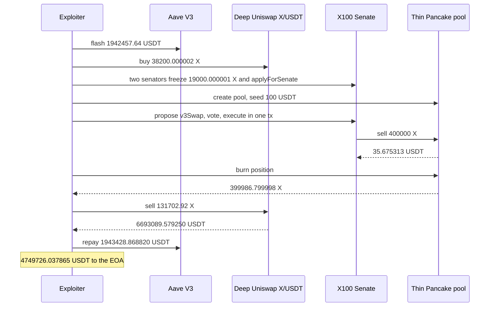

# X100 Senate — two flash-bought seats pass a same-block vote that dumps treasury X into the attacker's pool

> **Vulnerability classes:** vuln/governance · vuln/access-control · vuln/defi · vuln/logic
> **Reproduction:** the PoC compiles and runs in an isolated Foundry project at [this project folder](.). Full verbose trace: [output.txt](output.txt). **Offline pass.** `anvil_state.json` is present. The trace forks `<rpc url>` at block 26,263,021 and warps to timestamp 1,792,851,107 [output.txt:361](output.txt), [output.txt:363](output.txt). `[PASS] testExploit` in **2.76s** [output.txt:885](output.txt).

---

## Key info

| | |
|---|---|
| **USDT to the attacker EOA** | **4,749,726.037865 USDT** [output.txt:357](output.txt), [output.txt:872](output.txt). The test says the historical tx netted **4,749,726.10 USDT**. Difference **0.062135 USDT**. The assert allows 1 USDT of slack [output.txt:881](output.txt) |
| **Unsold X left on the exploiter** | Collect returns **399,986.799998 X** [output.txt:776](output.txt). The deep-pool sell uses **131,702.92 X** [output.txt:804](output.txt). **268,283.879998 X** stays on the contract. It is not in the USDT log and is not sent to the EOA |
| **What the treasury got for 400,000 X** | **35.675313 USDT** from the thin Pancake V3 pool [output.txt:698](output.txt). Treasury X immediately before the dump is **12,471,964.091540** [output.txt:687](output.txt), which includes the attacker's just-frozen stake |
| **Vulnerable contract** | X100 Senate / Freezer / DexTreasury, one contract [`0x79F35A33FE2813414851c4Ae8daeacD14d822A46`](https://etherscan.io/address/0x79f35a33fe2813414851c4ae8daeacd14d822a46). `v3Swap` delegatecalls impl [`0xcd5762AC6013fA762782ac1797Ab09152C1028e8`](https://etherscan.io/address/0xcd5762AC6013fA762782ac1797Ab09152C1028e8) [output.txt:683](output.txt). Test says Sourcify-verified. `sources/` in this folder is empty |
| **X token** | [`0x100A2C7F45Fd48e217fdcE72e658dc78Fd43A100`](https://etherscan.io/address/0x100a2c7f45fd48e217fdce72e658dc78fd43a100), 6 decimals |
| **Attacker EOA** | [`0x7ec2afdF3eC5964899894f8D58afa95cbB8FfD63`](https://etherscan.io/address/0x7ec2afdf3ec5964899894f8d58afa95cbb8ffd63). The PoC pays this address directly [output.txt:872](output.txt) |
| **This PoC's contracts** | `X100SenateExploiter` `0x5615dEB798BB3E4dFa0139dFa1b3D433Cc23b72f` [output.txt:373](output.txt). Senator A `0x104fBc016F4bb334D775a19E8A6510109AC63E00` [output.txt:442](output.txt). Senator B `0x037eDa3aDB1198021A9b2e88C22B464fD38db3f3` [output.txt:448](output.txt). Thin pool `0x9A03c41c539880b51508bEbbc2Dde7B738f6f075` [output.txt:607](output.txt) |
| **Attack tx** | [`0x38c60844f1923d53fdce7d99e9bc2a2d8c73a08e793341dfbb479f8cc74d81d0`](https://etherscan.io/tx/0x38c60844f1923d53fdce7d99e9bc2a2d8c73a08e793341dfbb479f8cc74d81d0) block 26,263,022 |
| **Chain / block / date** | Ethereum / fork parent **26,263,021** / `block.timestamp` **1,792,851,107** = 2026-10-24 14:11:47 UTC [output.txt:361](output.txt), [output.txt:363](output.txt) |
| **Compiler** | PoC `pragma ^0.8.28`, trace compiled with **solc 0.8.36** [output.txt:1](output.txt). Senate compiler is not in this folder |
| **Bug class** | `applyForSenate` is permissionless. Seats are the top `senateSize` by live frozen stake, with no snapshot. Two of three seats pass (`support * 2 > senateSize`). `propose`, `vote`, and `execute` have no delay, and `execute` calls `address(this)`, which satisfies `onlySenate` on `v3Swap`. `amountOutMinimum` is 0, so the treasury can be aimed at a pool the attacker priced |

## TL;DR

X100's treasury is governed by a three-seat Senate. A seat is "freeze X and call `applyForSenate`". There is no timelock between propose, vote, and execute, and the proposer is already a Yes. Two seats are a majority.

The attacker flash-borrows **1,942,457.64 USDT** from Aave V3 [output.txt:373](output.txt), buys **38,200.000002 X** on the deep Uniswap V3 X/USDT pool for **1,942,356.637245 USDT** [output.txt:403](output.txt), [output.txt:412](output.txt), and splits it across two contracts. Each freezes **19,000.000001 X** and pays the **100 X** candidacy fee [output.txt:461](output.txt), [output.txt:491](output.txt). Both `isSenator` checks then succeed [output.txt:567](output.txt).

They create a Pancake V3 X/USDT pool at `sqrtPriceX96 = 806000000000000000000000000` and seed it with **100 USDT** only, ticks **[-100000, -92000]** [output.txt:616](output.txt). Senator A proposes `v3Swap` of **400,000 X** into that pool with `amountOutMinimum = 0`. Senator B votes. `execute(7)` runs in the same call and the treasury receives **35.675313 USDT** for the 400,000 X [output.txt:681](output.txt), [output.txt:698](output.txt). Burning the position returns **399,986.799998 X** and **64.324680 USDT** [output.txt:776](output.txt), [output.txt:782](output.txt). Selling **131,702.92 X** on the deep pool returns **6,693,089.579250 USDT** [output.txt:807](output.txt). Flash repay is **1,943,428.868820 USDT** (principal plus **971.228820** premium) [output.txt:854](output.txt), [output.txt:860](output.txt). USDT left is **4,749,726.037865**, transferred to the historical EOA [output.txt:872](output.txt).

## Background

The Senate is also the freezer and the dex treasury. Stake weight is `frozenOf`, read live, not snapshotted at proposal time. The test states `MIN_SENATE` is 3 and `_isPassed` is `support * 2 > senateSize`, so 2 of 3 is enough. `propose` records the proposer's vote immediately. `execute` only checks `block.timestamp <= deadline`. The PoC never waits on a block.

`v3Swap(dex, tokenIn, tokenOut, fee, amountIn, amountOutMinimum)` is on the proposal whitelist (`_isProposable`). The guard on the treasury function is `onlySenate`, meaning `msg.sender == address(this)`. `execute` does `address(this).call(proposal.data)`, so the self-call passes the guard. The trace shows `execute(7)` calling `v3Swap` on `0x79F35A33…`, which delegatecalls the impl [output.txt:681](output.txt), [output.txt:683](output.txt). Dex enum value **1** is Pancake V3. The router it hits is Pancake `SmartRouter` `0x13f4EA83…` [output.txt:693](output.txt).

The deep market is Uniswap V3 X/USDT fee 100 at `0x0D85edD90c94053Fc5997551b1BAa8A77Aa02Fa0`. That pool is where the attacker both buys the votes and sells the reclaimed X. The thin pool is created in the same transaction at `0x9A03c41c…` and is empty except for the attacker's 100 USDT. `amountOutMinimum = 0` means the Senate will accept 35.675313 USDT for 400,000 X.

Aave premium is 5 bps. 1,942,457.64 × 0.0005 = **971.22882**, and the flash event's premium field is **971.228820** (`971228820`) [output.txt:860](output.txt). Repay **1,943,428.868820** = 1,942,457.64 + 971.228820.

`sources/` is empty, so the function bodies below are the test's root-cause description, confirmed against the trace's call order. They are not a paste of the Sourcify files.

## The vulnerable code

**RECONSTRUCTED** from the header of [test/X100Senate_exp.sol](test/X100Senate_exp.sol).

```solidity
function applyForSenate() external {
    _collectCandidacyFee(); // safeTransferFrom of 100 * 10**decimals X
    _register(_msgSender()); // no role, no delay
    // seat = top senateSize by frozenOf, read live
}

function propose(bytes calldata data, string calldata) external returns (uint256 id) {
    // caller must be a senator
    // _isProposable(data) allows v3Swap.selector
    votes[id][msg.sender] = For; // already one Yes
}

function vote(uint256 id, bool support) external { /* immediate */ }

function execute(uint256 id) external {
    require(block.timestamp <= deadline);
    require(support * 2 > senateSize);
    address(this).call(proposal.data); // msg.sender == address(this) inside v3Swap
}

function v3Swap(uint8 dex, address tokenIn, address tokenOut, uint24 fee, uint256 amountIn, uint256 amountOutMinimum)
    external
    onlySenate
{
    // sells treasury tokenIn for tokenOut, amountOutMinimum may be 0
    // _afterExecute: treasury X balance >= totalFrozen
}
```

Trace correspondence:

- Two `applyForSenate` calls [output.txt:489](output.txt), [output.txt:546](output.txt) after freezes of **19,000.000001 X** and fees of **100 X**.
- `propose` of the `v3Swap` calldata, then `vote(7, true)` from senator B, then `execute(7)` [output.txt:644](output.txt), [output.txt:671](output.txt), [output.txt:681](output.txt). Proposal id is **7**. No block is mined between them.
- `v3Swap(1, X, USDT, 100, 400000000000, 0)` [output.txt:682](output.txt). The pool used is the one just created: `getPool` returns `0x9A03c41c…` [output.txt:685](output.txt).
- Pancake swap pays the treasury **35.675313 USDT** and pulls **400,000 X** [output.txt:698](output.txt), [output.txt:709](output.txt).

The residual checks the test names did not stop this. `dexSellCap` and `_afterExecute` (treasury X must stay ≥ `totalFrozen`) still allowed a 400,000 X sale. The trace does not log a revert from either check.

## Root cause

1. **The electorate is for sale in the same transaction that votes.** `applyForSenate` has no whitelist. Rank is live `frozenOf`. Buying 38,200.000002 X, freezing 19,000.000001 on each of two contracts, and paying 100 X each is enough to occupy 2 of 3 seats. The extra 1 wei over 19,000 X is what the test says outranks an incumbent 19,000 X seat. The trace shows both freezes at `19000000001` [output.txt:461](output.txt), [output.txt:518](output.txt) and both `isSenator` reads succeeding [output.txt:567](output.txt).
2. **There is no voting delay and the proposer counts as a vote.** `propose` → `vote` → `execute(7)` is one call stack [output.txt:644](output.txt), [output.txt:671](output.txt), [output.txt:681](output.txt). A timelock, a snapshot at the previous block, or "the proposer does not count" would have made the thin pool useless, because the pool only exists inside this transaction.
3. **`execute` is a self-call into a treasury function whose only auth is `msg.sender == address(this)`.** That guard stops an EOA from calling `v3Swap` directly. It does not stop a majority that can pass a proposal, because the proposal is how the contract calls itself. Whitelisting `v3Swap.selector` as proposable is what puts the treasury's tokens on the ballot.
4. **The swap has no real slippage limit, and the caller picks the pool.** `amountOutMinimum` is 0. Dex 1 plus fee 100 resolves to a pool the attacker initialized in this transaction. 400,000 X out, 35.675313 USDT in, is a legal Pancake swap at the seeded price. It is not a legal treasury sale. The attacker then sells 131,702.92 of the recovered X on the deep pool for 6,693,089.579250 USDT, which is the actual exit.

## Preconditions

- Aave V3 will lend **1,942,457.64 USDT**. It did [output.txt:387](output.txt). Premium **971.228820 USDT** must be repayable from the proceeds. It was.
- The deep X/USDT pool must sell 38,200.000002 X for less than the flash, and later buy 131,702.92 X for enough USDT to cover the flash. Both happened: buy cost **1,942,356.637245 USDT** [output.txt:412](output.txt), sell proceeds **6,693,089.579250 USDT** [output.txt:807](output.txt).
- Two seats must be reachable by freezing just over 19,000 X each. If incumbents had frozen more than 19,000.000001, these two contracts would not sit. The trace shows they did sit.
- `v3Swap` must stay proposable, `amountOutMinimum` must be allowed to be 0, and 400,000 X must fit under `dexSellCap` and the `totalFrozen` residual. The execute succeeded, so those bounds held at this block.
- Pancake V3 factory must still allow `createPool` for X/USDT fee 100. It returned the thin pool [output.txt:571](output.txt), [output.txt:685](output.txt).
- No owner key, role, or signature is used. The flash, the two senators, the pool, and the vote are all from the new exploiter.

## Attack walkthrough (with on-chain numbers from the trace)

| # | Action | Amount | Trace |
|---|--------|--------|-------|
| 0 | Fork parent, warp to the attack timestamp | block 26,263,021; ts 1,792,851,107 | [output.txt:361](output.txt), [output.txt:363](output.txt) |
| 1 | Aave `flashLoanSimple` USDT | **1,942,457.64** in | [output.txt:373](output.txt), [output.txt:387](output.txt) |
| 2 | Uniswap `exactOutputSingle`, buy stake | **38,200.000002 X** for **1,942,356.637245 USDT** | [output.txt:400](output.txt), [output.txt:403](output.txt), [output.txt:412](output.txt) |
| 3 | Split to two senators | **19,100.000001 X** each | [output.txt:442](output.txt), [output.txt:448](output.txt) |
| 4 | `freeze` + `applyForSenate` on each | freeze **19,000.000001 X**, fee **100 X**, twice | [output.txt:461](output.txt), [output.txt:491](output.txt), [output.txt:518](output.txt), [output.txt:548](output.txt), [output.txt:489](output.txt) |
| 5 | Create and seed the thin pool | 100 USDT, ticks [-100000, -92000], liquidity 30,170,315,705. Pool `0x9A03c41c…` | [output.txt:571](output.txt), [output.txt:607](output.txt), [output.txt:616](output.txt) |
| 6 | propose, vote, `execute(7)` | `v3Swap` 400,000 X, min out 0 | [output.txt:644](output.txt), [output.txt:671](output.txt), [output.txt:681](output.txt), [output.txt:682](output.txt) |
| 7 | Thin-pool swap | treasury receives **35.675313 USDT**, sends **400,000 X** | [output.txt:698](output.txt), [output.txt:709](output.txt) |
| 8 | Decrease and collect | **399,986.799998 X** and **64.324680 USDT** back to the exploiter | [output.txt:752](output.txt), [output.txt:776](output.txt), [output.txt:782](output.txt) |
| 9 | Sell on the deep pool | **131,702.92 X** in, **6,693,089.579250 USDT** out | [output.txt:804](output.txt), [output.txt:807](output.txt) |
| 10 | Repay Aave | **1,943,428.868820 USDT** including premium **971.228820** | [output.txt:854](output.txt), [output.txt:860](output.txt) |
| 11 | Transfer profit to the EOA | **4,749,726.037865 USDT** | [output.txt:872](output.txt), [output.txt:880](output.txt) |

**USDT identity**

| Piece | USDT |
|---|---|
| Flash in | 1,942,457.640000 |
| Spent buying X | 1,942,356.637245 |
| Left after the buy | 101.002755 |
| Seeded into the thin pool | 100.000000 |
| Left after the seed | 1.002755 |
| Collected back from the thin pool | 64.324680 |
| Deep-pool sale | 6,693,089.579250 |
| Sum before repay | 6,693,154.906685 |
| Repay (principal + 971.228820) | 1,943,428.868820 |
| Net to the EOA | **4,749,726.037865** |

1,942,457.640000 − 1,942,356.637245 = 101.002755. 101.002755 − 100 = 1.002755. 1.002755 + 64.324680 + 6,693,089.579250 = 6,693,154.906685. 6,693,154.906685 − 1,943,428.868820 = 4,749,726.037865. The treasury's **35.675313 USDT** is not in this sum. It stayed on the Senate. The 268,283.879998 X that was not sold is extra residue on the exploiter, on top of the logged USDT.

`[PASS] testExploit` at [output.txt:355](output.txt).

## Diagrams



## Remediation

1. **Snapshot stake at a block before the proposal, and do not count a seat that applied in the proposal's block.** Live `frozenOf` plus permissionless `applyForSenate` is what lets a flash loan buy the majority. A one-block delay on seating is enough to kill this transaction. A real delay of days is better.
2. **Separate propose, vote, and execute by a timelock the proposer cannot satisfy in the same call.** `execute` should also refuse a proposal created in the same block. The proposer's automatic Yes should not exist. With three seats, one automatic Yes means a single confederate is a majority.
3. **`onlySenate` via `address(this).call` is not an authorization.** Treasury swaps need an explicit allowlist of pools and a non-zero `amountOutMinimum` checked against an oracle or a TWAP on a pool the Senate configured. A proposal must not be able to pass an arbitrary `dex`, `fee`, and `amountOutMinimum` of 0. Creating the pool in the same transaction should be irrelevant because that pool was never approved.
4. **Keep the `totalFrozen` check, but do not treat it as the safeguard.** It only stops the contract from selling X that is owed to stakers. The 400,000 X sold here was inside that line, and it was still the treasury. Cap sells in USDT terms per day, not only in X raw amount.

## How to reproduce

Offline, from the committed state. `_shared/run_poc.sh` loads `anvil_state.json`, starts anvil, and rewrites the test's `http://127.0.0.1:8545` URL.

```bash
# from the registry root
_shared/run_poc.sh 2026-10-X100Senate_exp -vvvvv
```

- **Chain / fork:** Ethereum, block **26,263,021** (parent of attack block 26,263,022). Warp to **1,792,851,107**.
- **Committed result** in [output.txt](output.txt) (`finished in 2.76s`):

```
[PASS] testExploit()
  attacker net USDT profit: 4749726.037865
Suite result: ok. 1 passed; 0 failed; 0 skipped
```

*Reference: the attack transaction named in the test header — [`0x38c60844…`](https://etherscan.io/tx/0x38c60844f1923d53fdce7d99e9bc2a2d8c73a08e793341dfbb479f8cc74d81d0).*
