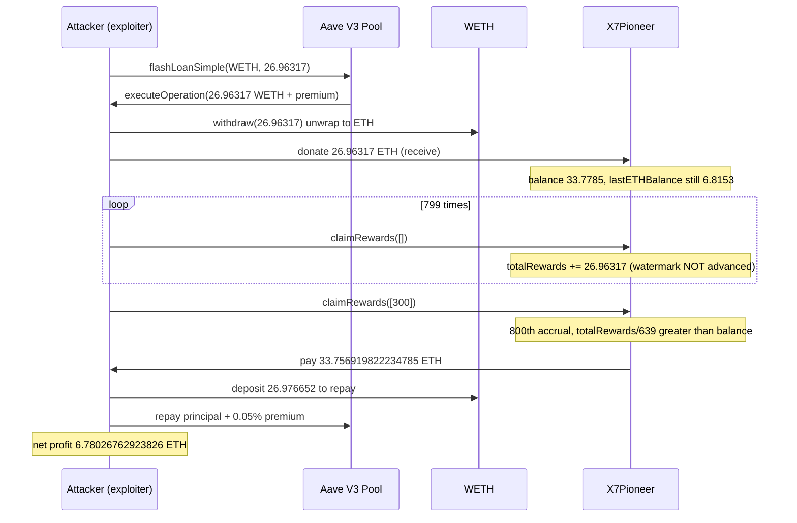

# X7 Finance (X7Pioneer) — empty-array `claimRewards([])` re-accrues the same donated ETH without advancing the watermark, inflating the per-token reward until one NFT drains the whole pool

> **Vulnerability classes:** vuln/logic/missing-state-update · vuln/logic/incorrect-order-of-operations · vuln/defi/reward-accounting
> **Reproduction:** the PoC compiles and runs in an isolated Foundry project at [this project folder](.). Full verbose trace: [output.txt](output.txt). The trace forks Ethereum mainnet at block 26,146,921 [output.txt:12](output.txt) and `[PASS] testExploit` finishes in ~0.79s [output.txt:4](output.txt), [output.txt:3309](output.txt).

---

## Key info

| | |
|---|---|
| **Profit** | **6.780267629238261652 ETH** on the attacker after repaying a 26.96317 WETH Aave V3 flash loan (+0.05% premium) [output.txt:7](output.txt), [output.txt:3303](output.txt). Matches the asserted on-chain figure within 1% [output.txt:4](output.txt) and the ~6.78 ETH reported by SlowMist |
| **Vulnerable contract** | X7Pioneer [`0x70000299ee8910ccacd97b1bb560e34f49c9e4f7`](https://etherscan.io/address/0x70000299ee8910ccacd97b1bb560e34f49c9e4f7). **VERIFIED** (`X7Pioneer.sol`, solc 0.8.15). ERC-721 with a native-ETH reward pool. Bug in `claimRewards(uint256[])` selector `0x5eac6239` |
| **Attacker EOA** | [`0xc79352119a7cf6efbfabbd7e6b013b79687bacf2`](https://etherscan.io/address/0xc79352119a7cf6efbfabbd7e6b013b79687bacf2) (nonce 2; held X7Pioneer token #300, already transfer-unlocked) |
| **Historical attack contracts** | deployer `0x021F832b9ce6685B1135F4A3B55F2b317F95f55c`, child/exploiter `0xaA0cad88Ac3F76BeB9a0F1Ba661916D7716d5F4A` (both **UNVERIFIED**; their orchestration is reconstructed, see below) |
| **Flash-loan source** | Aave V3 Pool [`0x87870Bca3F3fD6335C3F4ce8392D69350B4fA4E2`](https://etherscan.io/address/0x87870Bca3F3fD6335C3F4ce8392D69350B4fA4E2), WETH `0xC02aaA39b223FE8D0A0e5C4F27eAD9083C756Cc2`. `FLASHLOAN_PREMIUM_TOTAL` = 5 bps |
| **This PoC's attacker** | `X7FinanceExploit` at `0x7FA9385bE102ac3EAc297483Dd6233D62b3e1496` [output.txt:30](output.txt) |
| **Attack tx** | [`0xc98056d6ab55ef898189da5fa1fb08b968cb84ca99528d171f8240836b21766d`](https://etherscan.io/tx/0xc98056d6ab55ef898189da5fa1fb08b968cb84ca99528d171f8240836b21766d) (block 26,146,922) |
| **Chain / block / date** | Ethereum mainnet (chainId 1) / fork parent **26,146,921**, attack block 26,146,922, `block.timestamp` 1,791,453,359 = **2026-10-08 09:55:59 UTC** |
| **Compiler** | `v0.8.15+commit.e14f2714` |
| **Bug class** | A reward-accrual line runs on every call, but the watermark it depends on is only advanced when a non-empty claim pays out. Calling `claimRewards([])` repeatedly double-counts the same donated ETH into `totalRewards`. |

## TL;DR

X7Pioneer is an airdropped ERC-721 whose holders share any ETH sent to the contract. `claimRewards(uint256[])` first accrues `address(this).balance - lastETHBalance` into `totalRewards`, then pays each supplied token its pro-rata slice and — **only if something was actually paid** — advances `lastETHBalance` to the post-payout balance. Passing an **empty** `tokenIds` array makes `claimable == 0`, so the watermark is never advanced, yet the accrual line has already fired. Every empty call therefore re-adds the *same* balance delta to `totalRewards`.

The attacker flash-loaned 26.96317 WETH from Aave, unwrapped it, and donated the 26.96317 ETH to X7Pioneer so the delta was large. They then called `claimRewards([])` 799 times — each adding 26.96317 ETH to `totalRewards` — and finished with `claimRewards([300])` on a token they owned. By then `totalRewards / totalSupply()` (≈ 33.77 ETH per token, over 639 tokens) exceeded the whole contract balance (≈ 33.78 ETH), so the single claim drained essentially the entire pool. After repaying the flash loan + 0.05% premium the attacker netted **6.780267629238261652 ETH** [output.txt:7](output.txt).

## Background

X7Pioneer (`totalSupply()` = 639 at the fork block) accumulates ETH — from `transferUnlockFee` payments (0.07 ETH each) and direct sends via `receive()` — and lets each NFT holder withdraw its share. The accounting rests on two storage variables: `totalRewards` (lifetime ETH ever credited) and `lastETHBalance` (the balance watermark as of the last payout). Per-token entitlement is `totalRewards / totalSupply()`, and `rewardsClaimed[tokenId]` tracks what each token has already taken.

At the fork block the contract held exactly `lastETHBalance == address(this).balance == 6.815330579819881509 ETH`, with `totalRewards == 9.580356782661038694 ETH` and `rewardsClaimed[300] == 0.014781027431572824 ETH`. Because `lastETHBalance == balance`, the attacker first had to create a positive `balance - lastETHBalance` delta — that is the purpose of the donated flash-loan capital.

The attacker already owned token **#300** and had paid the 0.07 ETH `transferUnlockFee` for it (`transferUnlocked[300] == true` on-chain), which is why the token could be moved into their helper contract. The real transaction deployed a deployer + child contract and pre-approved the NFT transfer; that scaffolding is not the vulnerability, so this PoC drives the identical victim calls directly and acquires token #300 the legitimate way (a pranked transfer from its genuine, already-unlocked owner — no storage forgery).

## The vulnerable code

**VERIFIED source**, `X7Pioneer.sol:1407-1432` (saved at [sources/X7Pioneer.sol](sources/X7Pioneer.sol)):

```solidity
function claimRewards(uint256[] memory tokenIds) public nonReentrant {
    if (lastETHBalance < address(this).balance) {
        totalRewards += (address(this).balance - lastETHBalance);   // (A) runs on EVERY call
    }

    uint256 claimable;
    uint256 tokenClaimable;

    for (uint i=0; i < tokenIds.length; i++) {                        // (B) empty array => loop skipped
        require(ownerOf(tokenIds[i]) == msg.sender);
        uint256 tokenTotalRewards = totalRewards / totalSupply();
        uint256 tokenClaimedRewards = rewardsClaimed[tokenIds[i]];
        if (tokenClaimedRewards < tokenTotalRewards) {
            rewardsClaimed[tokenIds[i]] = tokenTotalRewards;
            tokenClaimable = tokenTotalRewards - tokenClaimedRewards;
            claimable += tokenClaimable;
            emit RewardsClaimed(tokenIds[i], msg.sender, tokenClaimable);
        }
    }

    if (claimable > 0) {                                             // (C) watermark advanced ONLY here
        lastETHBalance = address(this).balance - claimable;
        (bool ok, ) = msg.sender.call{value: claimable}("");
        require(ok);
    }
}
```

## Root cause

The accrual at **(A)** and the watermark update at **(C)** are not performed atomically with respect to each other. `(A)` fires on **every** invocation and credits `address(this).balance - lastETHBalance` to `totalRewards`. `lastETHBalance` — the watermark that makes `(A)` a *one-time* credit for any given ETH inflow — is updated **only inside the `claimable > 0` branch** at `(C)`.

When `tokenIds` is empty, the loop at `(B)` never executes, so `claimable` stays `0` and the `(C)` branch is skipped. The donated ETH has been credited to `totalRewards`, but `lastETHBalance` still sits below the current balance by the full donation. The next `claimRewards([])` sees the identical `balance - lastETHBalance` delta and credits it **again**. Each empty call inflates `totalRewards` by the donation amount without ever moving any ETH, and there is no cap or re-entrancy relevance — the inflation is purely arithmetic.

Correctly, `lastETHBalance` must be advanced to `address(this).balance` whenever the accrual line `(A)` runs (so each inflow is counted once), independently of whether any token was paid. Tying the watermark update to a successful payout is the defect.

A secondary amplifier: per-token entitlement is `totalRewards / totalSupply()`, so with `totalSupply() = 639` the attacker only needed `totalRewards ≈ 639 × balance`. A large donation (26.96 ETH) made `800` accrual steps sufficient; the donation size and loop count are coupled by `N·D ≈ totalSupply·(balance_before + D)`.

## Attack walkthrough

All figures are the exact on-chain values, reproduced by the PoC.

| # | Action | Effect (on-chain numbers) |
|---|--------|---------------------------|
| 1 | Own token #300 | `transferUnlocked[300] == true`; attacker is `ownerOf(300)` |
| 2 | `AAVE.flashLoanSimple(exploiter, WETH, 26.963170607692677032e18, "", 0)` | 26.96317 WETH borrowed [output.txt:30](output.txt) |
| 3 | `WETH.withdraw(26.96317e18)` → send ETH to X7Pioneer | X7Pioneer balance: 6.81533 → **33.77850118751256 ETH**; `lastETHBalance` stays 6.81533, so delta = 26.96317 |
| 4 | `claimRewards([])` × 799 | each adds 26.96317 to `totalRewards`; watermark never advances. `totalRewards`: 9.58036 → 9.58036 + 799·26.96317 |
| 5 | `claimRewards([300])` | accrual adds the delta a 800th time → `totalRewards = 9.580356782661038694 + 800·26.963170607692677032`; `tokenTotalRewards = totalRewards/639 = 33.77170084966636`; `claimable = 33.77170… − rewardsClaimed[300] (0.014781…) = ` **33.756919822234785 ETH** paid to attacker [output.txt:3257](output.txt) |
| 6 | `WETH.deposit{value: 26.976652192996523371e18}()`, approve, Aave pulls repay | repay = 26.96317 principal + 0.013481585303846338 premium |
| 7 | Residual ETH | **6.780267629238261652 ETH** profit [output.txt:7](output.txt) |

Reward paid for ONE token (33.7569 ETH) ≈ the entire contract balance (33.7785 ETH); X7Pioneer is left with ~0.0216 ETH.



## Remediation

Advance the watermark whenever the accrual runs, not only on a successful payout. For example:

```solidity
function claimRewards(uint256[] memory tokenIds) public nonReentrant {
    if (lastETHBalance < address(this).balance) {
        totalRewards += (address(this).balance - lastETHBalance);
        lastETHBalance = address(this).balance;   // count each inflow exactly once
    }
    // ... per-token payout; subtract `claimable` from lastETHBalance when ETH leaves ...
    if (claimable > 0) {
        lastETHBalance -= claimable;
        (bool ok, ) = msg.sender.call{value: claimable}("");
        require(ok);
    }
}
```

The invariant to preserve is `lastETHBalance == address(this).balance` after every state-changing `claimRewards` return, so any single ETH inflow is credited to `totalRewards` exactly once. Accrual must not depend on whether a token happened to be claimed in the same call.

## How to reproduce

```bash
cd 2026-10-X7Finance_exp
forge test --evm-version cancun -vvv
# full trace:
forge test --evm-version cancun -vvvvv > output.txt 2>&1
```

- Fork: Ethereum mainnet at block **26,146,921** (parent of the attack block 26,146,922).
- RPC used: `https://eth.drpc.org` (fallbacks: `https://eth.llamarpc.com`, `https://ethereum-rpc.publicnode.com`, `https://eth-mainnet.public.blastapi.io`).
- Expected: `[PASS] testExploit` with `Realized profit (ETH): 6.780267629238261652`.

Alert: https://x.com/SlowMist_Team/status/2108142452888776907
