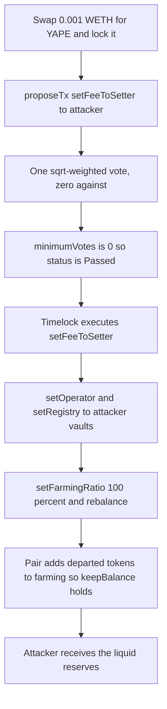

# Yapeswap — Zero-Quorum Governance Capture, Then a Fake Yearn Vault

> **Vulnerability classes:** vuln/governance/proposal-manipulation · vuln/logic/state-update · vuln/logic/missing-validation

> **Reproduction:** **offline PASS.** `_shared/run_poc.sh` loaded `anvil_state.json` (the runner kills anvil at [output.txt:1346](output.txt)). `[PASS] testExploit()` gas **5,151,095**, suite **ok** in **2.74s** ([output.txt:355](output.txt), [output.txt:1343](output.txt)). Trace: [output.txt](output.txt). Verified source: [sources/YapeFactory_46aDc1](sources/YapeFactory_46aDc1), [sources/YapePair_23c165](sources/YapePair_23c165), [sources/WorkersUnion_5D3580](sources/WorkersUnion_5D3580), [sources/VoteCounter_b32870](sources/VoteCounter_b32870). Test: [test/Yapeswap_exp.sol](test/Yapeswap_exp.sol).

---

## Key info

| | |
|---|---|
| **Loss** | Reported about **$21.9K** (SlowMist, 25 Oct 2026), including Yearn positions this PoC does not unwind. This reproduction’s liquid-reserve drain, priced in the test, is **$2,254.32393044** ([output.txt:363](output.txt)): **163.743781027207428308 DAI**, **148.578005 USDC**, **805.879296 USDT**, **0.426300217673777164 WETH**, **0.00119509 WBTC** ([output.txt:358](output.txt)–[output.txt:362](output.txt)). |
| **Vulnerable contracts** | `YapeFactory` [`0x46aDc1C052Fafd590F56C42e379d7d16622835a2`](https://etherscan.io/address/0x46adc1c052fafd590f56c42e379d7d16622835a2). `WorkersUnion` proxy [`0x5D35809b5558FbD8eFa18AE1B202db1973b95DdB`](https://etherscan.io/address/0x5d35809b5558fbd8efa18ae1b202db1973b95ddb) (impl `0x3b5161078a7218398A6e03Df994DAd8F30367A69`). Pairs drained listed below. `SquareRootVoteCounter` [`0xb32870D82BF4E2d1f046d09b599ccB30f8A47A2c`](https://etherscan.io/address/0xb32870D82BF4E2d1f046d09b599ccB30f8A47A2c). |
| **Attacker EOA** | [`0x6e523866424220b3cb2cab88ba2195cfa5636b12`](https://etherscan.io/address/0x6e523866424220b3cb2cab88ba2195cfa5636b12) |
| **Attack contract** | Live [`0x327bf6dfc38a79393f78866c705193c39b04be01`](https://etherscan.io/address/0x327bf6dfc38a79393f78866c705193c39b04be01) (became operator and feeTo). Live malicious registry [`0xC620CA5b2A63cdb792d462898010d2be4421b5A7`](https://etherscan.io/address/0xC620CA5b2A63cdb792d462898010d2be4421b5A7). PoC `Attacker` is `0x5615dEB798BB3E4dFa0139dFa1b3D433Cc23b72f`; its registry is `0x104fBc016F4bb334D775a19E8A6510109AC63E00` |
| **Attack tx** | Historical capture executed through governance on 25 Oct 2026. This PoC does not replay that tx hash. It submits its own proposal on a fork **before** the real proposal existed (block **26,202,000**) and warps the real pending, voting, and timelock windows. |
| **Chain / block / date** | Ethereum (chainId 1) / fork block **26,202,000** / incident **25 Oct 2026** |
| **Compiler** | Factory and pair: Solidity **v0.8.6+commit.11564f7e**, optimizer **on**, **999,999 runs**. WorkersUnion and vote counter: **v0.7.6+commit.7338295f**, optimizer **on**, **1,000 runs**. |
| **Bug class** | `WorkersUnion.getVotingStatus` rejects a proposal only when `totalForVotes < minimumVotes`. With the live minimum at **0**, one positive sqrt-weighted lock and no opposition is `Passed`. The passed call moves `YapeFactory.feeToSetter`. That role points `registry` and `operator` at the attacker. `YapePair._toYearn` then deposits the pair’s reserves into `registry.latestVault(token)` and adds the departed tokens to `farming[token]`, so `keepBalance` still holds. |

---

## TL;DR

Yapeswap is a Uniswap V2 fork whose pairs farm a share of reserves into a Yearn vault chosen by `YapeFactory.registry`. Who may change that registry is `feeToSetter`, and at the fork that role sits behind `TimelockedGovernance` `0x463Ee0E8…78D8B`, which WorkersUnion drives.

WorkersUnion’s passing rule is `totalForVotes > totalAgainstVotes` once `totalForVotes >= minimumVotes`. The configured minimum is zero: a proposal passes on any strictly positive for-vote if nobody votes against. Voting power is the square root of a veYAPE lock. YAPE is swappable. **0.001 WETH** buys **364,156,621.096224367726737573 YAPE** from the YAPE/WETH pair ([output.txt:415](output.txt)), and that lock is enough.

The PoC buys YAPE, locks it, proposes `setFeeToSetter(attacker)`, warps, votes, warps, schedules, warps, and executes. `factory.feeToSetter()` is then the attacker contract ([output.txt:357](output.txt)). It calls `setOperator` and `setRegistry`, installs a vault whose `deposit()` `transferFrom`s the tokens to itself, sets the farming ratio to 100%, and `rebalance`s both tokens of six pairs. `keepBalance` does not save the reserves: `_toYearn` credits `farming[token]` for tokens that now sit in the attacker’s vault.

Measured haul is **$2,254.32393044**, not the full ~$21.9K. The historical attacker first pulled capital already sitting in real Yearn vaults back into the pairs. That Yearn v3 withdraw does not replay on this pre-execution fork, so the PoC takes only the liquid reserves. It still asserts every reserve token moved and the USD figure is above $2,000 ([output.txt:1326](output.txt)–[output.txt:1336](output.txt)).

---

## Background

`YapeFactory` extends `UniswapV2Factory` with `registry` and `operator`. Both setters require `msg.sender == feeToSetter`. `setFeeToSetter` is the stock Uniswap V2 function, same check. The timelock holds `feeToSetter`, so a WorkersUnion proposal that the timelock executes can hand the role away. The proposal payload in this run is selector `0xa2e74af6`, `setFeeToSetter(address)`, targeting the factory, salt `0x9a9e` ([output.txt:521](output.txt)).

A `YapePair` keeps `farming[token]` beside its ERC-20 balance. `_balanceOf` is `token.balanceOf(this) + farming[token]`. `keepBalance` requires `_balanceOf` unchanged across a Yearn deposit or withdraw. `_toYearn` deposits `amount` through `YapeWrapper._deposit` and then **adds the deposited amount to `farming[token]`**. The invariant holds if and only if the vault actually took the tokens. It does not check that the pair received vault shares.

`YapeWrapper.bestVault` is `registry().latestVault(token)`. `registry()` on the pair is a cached copy, refreshed by `updateRegistry()`, which reads `IYapeFactory(factory).registry()`. `setFarmingRatio` is `onlyOperator`. `rebalance` is permissionless for `token0` or `token1` (`onlyReserved`), and with `force = true` it farms toward the midpoint of the min and max ratios.

`SquareRootVoteCounter.getVotes` returns `super.getVotes(veLockId, timestamp).sqrt()`. `getTotalVotes` is `totalSupply().sqrt()`. A small lock is a small root, but a zero quorum does not care.

Governance timing used here, read from the live rule by the test: pending at least **1 day**, voting at least **7 days**, timelock delay **1 day**. The PoC warps those windows. It does not `prank` the timelock and does not write `feeToSetter` by storage.

The six pairs at the fork:

| Pair | Tokens |
|---|---|
| `0x23c1653E…0483b6` | DAI / USDC |
| `0x670120d4…5B33B97` | YAPE / WETH |
| `0x8e5b9D85…A897805` | USDC / WETH |
| `0xE3b43bE5…787Ed25` | WETH / USDT |
| `0xEC5ED926…2216B6` | DAI / WETH |
| `0x0415Af9F…417c0AA` | WBTC / WETH |

At the YAPE/WETH swap the reserves are **1,101,582,046.019660539255569637 YAPE** and **0.002018947634222457 WETH** ([output.txt:408](output.txt)). The pool is thin, which is why 0.001 WETH clears most of the YAPE side.

---

## The vulnerable code

### 1. A zero minimum is a passing vote

Verified `WorkersUnion.sol` in [sources/WorkersUnion_5D3580](sources/WorkersUnion_5D3580). The zero is storage, not a literal in this function. The comparisons are what make a stored `0` fatal.

```solidity
function getVotingStatus(bytes32 txHash) public view override returns (VotingState) {
    Proposal storage proposal = _proposals[txHash];
    require(proposal.start != 0, "Not an existing proposal");
    if (block.timestamp < proposal.start) return VotingState.Pending;
    else if (block.timestamp <= proposal.end) return VotingState.Voting;
    else if (_timelock().isOperationDone(txHash)) return VotingState.Executed;
    else if (proposal.totalForVotes < _votingRule.minimumVotes)
        return VotingState.Rejected;
    else if (proposal.totalForVotes > proposal.totalAgainstVotes)
        return VotingState.Passed;
    else return VotingState.Rejected;
}
```

`schedule` and `execute` both require `getVotingStatus(txHash) == VotingState.Passed`. `_beforePropose` only checks `minimumVotesForProposing <= getVotesAt(msg.sender)`. With both minima at 0, proposing and passing are the same dust lock. `SquareRootVoteCounter`:

```solidity
function getVotes(uint256 veLockId, uint256 timestamp) public view override returns (uint256) {
    uint256 votes = super.getVotes(veLockId, timestamp);
    return votes.sqrt();
}
```

### 2. `feeToSetter` retargets the vault registry

```solidity
function setFeeToSetter(address _feeToSetter) external {
    require(msg.sender == feeToSetter, "UniswapV2: FORBIDDEN");
    feeToSetter = _feeToSetter;
}
function setRegistry(address registry_) external {
    require(msg.sender == feeToSetter, "UniswapV2: FORBIDDEN");
    registry = registry_;
}
function setOperator(address operator_) external {
    require(msg.sender == feeToSetter, "UniswapV2: FORBIDDEN");
    operator = operator_;
}
```

### 3. The pair books a deposit that the vault stole

```solidity
modifier keepBalance(address token) {
    uint256 prevBal = _balanceOf(token);
    _;
    require(_balanceOf(token) == prevBal, "Yapeswap: BALANCE CHANGED");
}
function _balanceOf(address token) internal view override returns (uint256) {
    return IERC20(token).balanceOf(address(this)).add(farming[token]);
}
function _toYearn(address token, uint256 amount) internal keepBalance(token) {
    uint256 deposited = _deposit(token, address(this), address(this), amount, false);
    farming[token] = farming[token].add(deposited);
}
```

`_deposit` approves `bestVault(token)` and calls `vault.deposit(amount)`. `deposited` is the pair’s token-balance decrease, not shares minted. The PoC vault’s `deposit` is `transferFrom(pair, attacker, amount)` and returns `amount`. Token balance falls, `farming` rises by the same number, `keepBalance` passes, and the tokens are gone.

`setFarmingRatio(10000, 10000)` with `DENOMINATOR = 10000` means farm 100%. `rebalance` uses `force = true`, so the pair deposits up to the midpoint, which is the entire `_balanceOf`.

---

## Root cause

1. **Quorum is a configuration the code treats as a floor of zero.** `totalForVotes < 0` is impossible for a `uint256`. The next branch passes the proposal whenever for-votes strictly beat against-votes. Nobody has to show up to defeat a dust vote. SlowMist measured the historical for-vote at about **0.000055%** of voting power. This reconstruction does not need a coalition. One lock from 0.001 WETH is the whole electorate.

2. **What a passed proposal may call includes `setFeeToSetter`.** That single storage word is the admin of `registry`, `operator`, and `feeTo`. Governance scope and treasury admin are the same key.

3. **`farming[token]` is an IOU the pair writes to itself.** The Yearn integration assumes `latestVault` is a vault that custodies assets and issues shares. `keepBalance` enforces the IOU, not custody. A vault that pulls tokens and returns no shares satisfies the modifier and breaks the reserve.

4. **`rebalance` is public.** After `operator` is the attacker, `setFarmingRatio(100%, 100%)` plus `rebalance` on both tokens empties every pair that has a liquid balance. No further vote is required.

The PoC does not reproduce the preliminary “pull real Yearn back to the pair” leg (`setFarmingRatio(0, 0)` then `rebalance`). That is why **$2,254.32** is the right number for this trace and **~$21.9K** is the right number for the incident.

---

## Preconditions

- `minimumVotes` and `minimumVotesForProposing` are 0 on the live WorkersUnion. The code path is verified. The stored zero is demonstrated by this dust proposal reaching `schedule` and `execute` without a second voter.
- YAPE can be bought. Here the seed is **0.001 WETH**, dealt in the test (`VM::store` on WETH at [output.txt:400](output.txt)). That is seed capital, not a write of protocol roles.
- The attacker can wait out pending (**≥ 1 day**), voting (**≥ 7 days**), and the timelock (**1 day**), or warp them in a fork. No vote can be cast against the proposal during the voting window.
- `feeToSetter` is the timelock, and the timelock executes WorkersUnion payloads that target the factory.
- Pairs hold liquid token0/token1. Farmed Yearn balances are extra and are **not** taken by this PoC.
- `updateRegistry` is permissionless, so each pair picks up the new registry as soon as someone calls it.

---

## Attack walkthrough

Offline fork of block **26,202,000**. One test, gas **5,151,095**.

1. **Buy votes.** `deal` gives the attacker **0.001 WETH** ([output.txt:400](output.txt)–[output.txt:406](output.txt)). `acquireVotes` reads reserves ([output.txt:408](output.txt)), transfers the 0.001 WETH in ([output.txt:409](output.txt)), and `swap`s out **364,156,621.096224367726737573 YAPE** ([output.txt:415](output.txt), [output.txt:420](output.txt)). `createLockUntil(364156621096224367726737573, 1918260479)` locks it for `MAXTIME` ([output.txt:456](output.txt)). The lock id is `keccak256(abi.encodePacked(block.number, attacker))`. The ve lock NFT is received by the attacker contract.

2. **Propose.** `WorkersUnion.proposeTx(factory, 0, setFeeToSetter(attacker), predecessor 0, salt 0x9a9e, startsIn 86400, votingPeriod 604800)` ([output.txt:521](output.txt)). Delegatecall to impl `0x3b516107…` ([output.txt:522](output.txt)).

3. **Vote.** Warp `startsIn + 1`. `manualVote(txHash, [lockId], true)` ([output.txt:562](output.txt)). The tx hash is `0xd545c70c82f16ea98d23a15966a5613eb65ee0f75486f478f00928276e3b4086`. Sqrt weighting means any positive lock beats a zero against-total.

4. **Schedule.** Warp `votingPeriod + 1`. `schedule` ([output.txt:591](output.txt)) requires `VotingState.Passed` and calls `forceSchedule` with `getMinDelay()`.

5. **Execute.** Warp `1 days + 1`. `execute` ([output.txt:619](output.txt)) calls the timelock `0x463Ee0E8…`, which delegatecalls `0xCc343673…` ([output.txt:629](output.txt)–[output.txt:630](output.txt)) and runs `setFeeToSetter`. `feeToSetter()` is now `0x5615dEB798BB3E4dFa0139dFa1b3D433Cc23b72f` ([output.txt:649](output.txt)). The assertion in the test is that equality.

6. **Point the pairs at the fake vault.** `setOperator(attacker)` ([output.txt:651](output.txt)). `setRegistry(MaliciousRegistry)` ([output.txt:655](output.txt)). The registry’s `latestVault` is a `MaliciousVault` per token. `deposit` pulls the approved tokens to the attacker.

7. **Rebalance all six pairs at 100%.** For the DAI/USDC pair: `updateRegistry` ([output.txt:695](output.txt)), `setFarmingRatio(10000, 10000)` ([output.txt:701](output.txt)), `rebalance(DAI)` ([output.txt:709](output.txt)), `rebalance(USDC)` ([output.txt:748](output.txt)). The same four calls hit YAPE/WETH ([output.txt:806](output.txt)–[output.txt:882](output.txt)), USDC/WETH ([output.txt:919](output.txt)–[output.txt:993](output.txt)), WETH/USDT ([output.txt:1030](output.txt)–[output.txt:1083](output.txt)), DAI/WETH ([output.txt:1120](output.txt)–[output.txt:1173](output.txt)), and WBTC/WETH ([output.txt:1210](output.txt)–[output.txt:1264](output.txt)).

8. **Count the tokens.** Logged at [output.txt:1318](output.txt)–[output.txt:1325](output.txt) and in the summary at [output.txt:358](output.txt)–[output.txt:363](output.txt):

| Asset | Captured |
|---|---:|
| DAI | 163.743781027207428308 |
| USDC | 148.578005 |
| USDT | 805.879296 |
| WETH | 0.426300217673777164 |
| WBTC | 0.00119509 |
| USD (8 dp, Chainlink ETH/USD plus WBTC via the Uniswap WBTC/WETH spot) | 2,254.32393044 |

`assertGt` on each balance and on `usd8 > 2000e8` all pass ([output.txt:1336](output.txt)). Suite **ok, 1 passed** ([output.txt:1343](output.txt)).

---

## Diagrams



---

## Remediation

- Set `minimumVotes` and `minimumVotesForProposing` to a real fraction of `getTotalVotes()`, and reject a proposal whose for-votes are under that floor even if against-votes are zero. A stored zero should be rejected at `changeVotingRule` time. The constructor already caps `minimumVotes` at `totalVotes/2` and `minimumVotesForProposing` at `totalVotes/10`, but it allows 0.
- Do not let a governance proposal replace `feeToSetter` in one step, or split registry admin from the fee recipient. Changing `registry` should be a dedicated operation with a higher quorum than a fee change.
- `keepBalance` must require vault shares, not a self-credited `farming` balance. `_toYearn` should increase `farming` only by `shares * pricePerShare`, and `latestVault` should be pinned to a factory-approved codehash or a fixed registry the operator cannot swap.
- `setFarmingRatio` should be bounded so one transaction cannot move the ratio from the current value to 100% and `rebalance` in the same breath. A per-block cap on assets sent to the vault would have limited this drain to a slice of reserves.
- `rebalance` can stay permissionless only if the vault cannot be changed out from under it.

---

## How to reproduce

Offline, from the registry root. Anvil loads `anvil_state.json` and the test forks `http://127.0.0.1:8545` at block **26,202,000**:

```bash
_shared/run_poc.sh 2026-10-Yapeswap_exp -vvvvv
```

Expect `[PASS] testExploit()`, `factory.feeToSetter now: 0x5615dEB798BB3E4dFa0139dFa1b3D433Cc23b72f`, and `Total value stolen (USD): 2254.32393044`. The run in [output.txt](output.txt) finished in **2.74s** with gas **5,151,095**. No archive RPC is required once `anvil_state.json` is present.

*Reference: https://x.com/SlowMist_Team/status/2114290073546219799*
