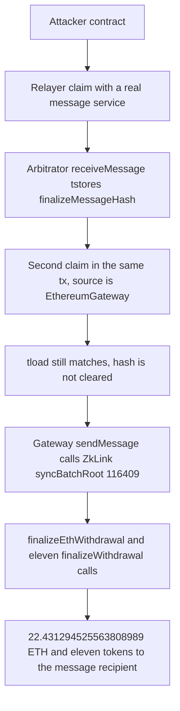

# zkLink Nova — Transient finalizeMessageHash Reused to Forge a Batch Root

> **Vulnerability classes:** vuln/bridge/replay · vuln/bridge/missing-validation · vuln/logic/incorrect-state-transition

> **Reproduction:** **offline PASS.** Anvil served `anvil_state.json` (killed at [output.txt:893](output.txt)). Two tests passed. Trace: [output.txt](output.txt). Verified Arbitrator implementation: [sources/Arbitrator_7a0bb4](sources/Arbitrator_7a0bb4). Verified relayer: [sources/SyncL2TxHashRelayer_0FDC28](sources/SyncL2TxHashRelayer_0FDC28). Proxy: [sources/ERC1967Proxy_1Ee09A](sources/ERC1967Proxy_1Ee09A). Test: [test/ZkLinkNovaBridge_exp.sol](test/ZkLinkNovaBridge_exp.sol).

---

## Key info

| | |
|---|---|
| **Loss** | Reported about **$783K** across two exploit transactions. This PoC is the first transaction only. It delivers **22.431294525563808989 ETH** plus eleven ERC-20 balances to `0xaCA0655a…5718` ([output.txt:357](output.txt)–[output.txt:379](output.txt)). |
| **Vulnerable contract** | `Arbitrator` proxy [`0x1Ee09A2cAa0813A5183f90F5a6d0E4871f4C6002`](https://etherscan.io/address/0x1Ee09A2cAa0813A5183f90F5a6d0E4871f4C6002), implementation [`0x7a0bb4805ecb7fd3c8dabbe4afa0e91cb1761e34`](https://etherscan.io/address/0x7a0bb4805ecb7fd3c8dabbe4afa0e91cb1761e34) |
| **Public relayer** | `SyncL2TxHashRelayer` [`0x0FDC28e64772a70109d10fd068f859cFa7Dea2c6`](https://etherscan.io/address/0x0FDC28e64772a70109d10fd068f859cFa7Dea2c6). `claimPrimaryChainSyncL2TxHashMessage` is `external` with no caller check. The Arbitrator lists this relayer in `relayers`, so `onlyRelayer` accepts it. |
| **Victims** | `ZkLink` [`0x5fD9F73286b7E8683Bab45019C94553b93e015Cf`](https://etherscan.io/address/0x5fD9F73286b7E8683Bab45019C94553b93e015Cf) (delegatecall impl at the fork `0xeaC8E6c1acBabC7135Fc8357FF2D718a36177Ab7`). `L1ERC20Bridge` [`0xAd16eDCF7DEB7e90096A259c81269d811544B6B6`](https://etherscan.io/address/0xAd16eDCF7DEB7e90096A259c81269d811544B6B6). `EthereumGateway` [`0x83Bc7394738A7A084081aF22EEC0051908c0055c`](https://etherscan.io/address/0x83Bc7394738A7A084081aF22EEC0051908c0055c). |
| **Attacker EOA** | [`0xaCA0655a11200A80d33D0E48786317304cDE5718`](https://etherscan.io/address/0xaCA0655a11200A80d33D0E48786317304cDE5718) (the recipient encoded in the withdrawal messages). Entry contract on the historical tx: `0xD5f162B68a0281686E8Dc76dB8d67d2f3E6Aff07`. A second attacker address is named by SlowMist: `0xDAB137F390dF77caA97fd492540E973fd5e2F8c8`. |
| **Attack tx** | [`0x4f3c23e75b9134e8cae5a462550daad42fbbc19242567fcc34c0a035e297462c`](https://etherscan.io/tx/0x4f3c23e75b9134e8cae5a462550daad42fbbc19242567fcc34c0a035e297462c) |
| **Chain / block / date** | Ethereum (chainId 1) / attack block **26,294,188**, fork **26,294,187** / **28 Oct 2026, 22:21:35 UTC** |
| **Compiler** | Arbitrator impl Solidity **v0.8.25+commit.b61c2a91**, optimizer **on**, **200 runs**. Relayer **v0.8.18+commit.87f61d96**, optimizer **on**, **200 runs**. Proxies **v0.8.20+commit.a1b79de6**, optimizer **on**, **200 runs**. |
| **Bug class** | `claimMessage` stores a transient `finalizeMessageHash` while a source-chain callback runs, then checks it, and never clears it. A second `claimMessage` in the same transaction reuses that hash. The public relayer lets anyone supply the source-service address, so the second call is a direct `EthereumGateway.sendMessage` that runs `ZkLink.syncBatchRoot` for an attacker-chosen root. Withdrawal proofs against that root then pay out. |

---

## TL;DR

zkLink Nova finalizes L2-to-L1 withdrawals by Merkle-proving them against `l2LogsRootHashes` for a batch. Only a gateway-authenticated message may call `syncBatchRoot`. The gateway accepts `sendMessage` from the Arbitrator. The Arbitrator accepts `claimMessage` from a whitelisted relayer. The relayer’s claim function is public.

`claimMessage` sets transient `claiming = 1`, calls whatever address the relayer was given as the source message service, then `tload`s `finalizeMessageHash` and requires it to equal `keccak256(gateway, value, calldata)`. A legitimate claim reaches `receiveMessage`, which `tstore`s that hash. Neither `claiming` nor `finalizeMessageHash` is cleared, and the check does not require that `receiveMessage` ran in **this** invocation.

The attacker calls the relayer once with a real Linea message-service claim. That populates the transient hash and forwards a genuine `syncL2TxHash`. The attacker calls the relayer again in the same transaction, passing `EthereumGateway` as the source service and `sendMessage(syncBatchRoot)` as the claim calldata. The leftover hash still matches the relayer’s expected tuple, so the require passes. The arbitrary call, made with `msg.sender == Arbitrator`, is `EthereumGateway.sendMessage`, which calls `ZkLink.syncBatchRoot(116409, 0x1934a1c3…15ea8, 0)` ([output.txt:477](output.txt)–[output.txt:479](output.txt)). The attacker then `finalizeEthWithdrawal`s **22.431294525563808989 ETH** and `finalizeWithdrawal`s eleven tokens. The proofs verify because the root they were built for is now the stored root.

A second test populates the hash and skips the root install. The first ETH withdrawal reverts ([output.txt:884](output.txt)–[output.txt:886](output.txt)). Suite: **2 passed, 0 failed** ([output.txt:890](output.txt)).

---

## Background

The Arbitrator is a UUPS proxy. Transient variables, which is why this is a same-transaction bug and not a cross-block one:

```solidity
bytes32 private finalizeMessageHash;
uint256 private claiming;
mapping(address relayerAddress => bool isRelayer) public relayers;
```

`onlyRelayer` is `require(relayers[msg.sender])`. `SyncL2TxHashRelayer` is one such relayer. Its only job function:

```solidity
function claimPrimaryChainSyncL2TxHashMessage(
    address _sourceChainCanonicalMessageService,
    bytes calldata _sourceChainClaimCallData,
    address _secondaryChainL1Gateway,
    bytes32 _secondaryChainL2TxHash,
    bytes32 _primaryChainL2TxHash,
    bytes calldata _forwardParams
) external payable {
    bytes memory callData = abi.encodeCall(
        IZkLink.syncL2TxHash, (_secondaryChainL2TxHash, _primaryChainL2TxHash)
    );
    // packs (secondaryGateway, 0, syncL2TxHash calldata) and calls:
    ARBITRATOR.claimMessage{value: msg.value}(
        _sourceChainCanonicalMessageService,
        _sourceChainClaimCallData,
        ARBITRATOR.primaryChainGateway(),
        0,
        abi.encode(gatewayDataList),
        _forwardParams
    );
}
```

Every argument except the constructed `syncL2TxHash` payload is caller-supplied. There is no `msg.sender` check. The first call passes the real canonical message service `0xd19d4B5d358258f05D7B411E21A1460D11B0876F`. The second call passes `EthereumGateway` as that service and a claim payload whose effect is `sendMessage` of `syncBatchRoot`.

`syncBatchRoot` on this fork writes batch **116409** and moves `totalBatchesExecuted`-style storage from **116408** to **116409** ([output.txt:482](output.txt)). The root installed is `0x1934a1c3012c75044c93af32f9e2693f56ee3682393623a0f41fec237f915ea8`. The withdrawal messages and four-node Merkle proofs in the test are the historical ones. They are not forged inside the PoC by writing storage. `finalizeEthWithdrawal` / `finalizeWithdrawal` call the live `proveL2MessageInclusion` and accept them only because that root is installed.

The ETH message pays `0x1374bf78660652cdd` wei, which is **22,431,294,525,563,808,989**. The recipient is baked into every message as `0xaCA0655a11200A80d33D0E48786317304cDE5718`. Changing the recipient would break the proofs. The PoC therefore measures that address’s balance delta, not the test contract’s.

SlowMist also reports a second transaction later that night. This folder reconstructs only `0x4f3c23e7…`.

---

## The vulnerable code

Verified `contracts/Arbitrator.sol` in [sources/Arbitrator_7a0bb4](sources/Arbitrator_7a0bb4).

### `receiveMessage` writes the hash and does not clear `claiming`

```solidity
function receiveMessage(uint256 _value, bytes calldata _callData) external payable {
    require(msg.value == _value, "Invalid msg value");
    IL1Gateway gateway = IL1Gateway(msg.sender);
    require(gateway == primaryChainGateway || secondaryChainGateways[gateway], "Invalid gateway");
    uint256 _claiming;
    assembly { _claiming := tload(claiming.slot) }
    require(_claiming == 1, "Claim not from arbitrator");
    bytes32 _finalizeMessageHash = keccak256(abi.encode(msg.sender, _value, _callData));
    assembly { tstore(finalizeMessageHash.slot, _finalizeMessageHash) }
}
```

### `claimMessage` trusts that hash for whatever it just called

```solidity
function claimMessage(
    address _sourceChainCanonicalMessageService,
    bytes calldata _sourceChainClaimCallData,
    IL1Gateway _sourceChainL1Gateway,
    uint256 _receiveValue,
    bytes calldata _receiveCallData,
    bytes calldata _forwardParams
) external payable nonReentrant onlyRelayer {
    assembly { tstore(claiming.slot, 1) }
    Address.functionCall(_sourceChainCanonicalMessageService, _sourceChainClaimCallData);
    bytes32 _finalizeMessageHash;
    assembly { _finalizeMessageHash := tload(finalizeMessageHash.slot) }
    require(
        _finalizeMessageHash == keccak256(abi.encode(_sourceChainL1Gateway, _receiveValue, _receiveCallData)),
        "Incorrect finalize data"
    );
    // if source gateway is the primary gateway, decode _receiveCallData and sendMessage each item
    // else sendMessage _receiveCallData through primaryChainGateway
    // neither tstore is cleared
}
```

Two gaps sit next to each other:

- `Address.functionCall` will call **any** contract with **any** calldata. On the second claim that target is `EthereumGateway` and the calldata drives `sendMessage` → `ZkLink.syncBatchRoot`. The call’s `msg.sender` is the Arbitrator, which is who the gateway already trusts.
- The hash compared afterwards is global transient storage, not a value returned by this call. If `receiveMessage` does not run, the previous claim’s hash is still there. The relayer passes the same `(primaryGateway, 0, syncL2TxHash payload)` tuple it used for the legitimate claim, so the require succeeds.

`nonReentrant` does not cross two external calls from the attacker. Each `claimMessage` finishes, the lock drops, and the transient slots live until the transaction ends.

The gateway implementation source is not in this bundle (the fetched gateway artifact is the ERC1967 proxy). The trace is the evidence that `claimMessage`’s external call becomes `EthereumGateway.sendMessage` and then `ZkLink.syncBatchRoot` ([output.txt:475](output.txt)–[output.txt:479](output.txt)).

---

## Root cause


## Secondary analysis (@GoPlusSecurity)

> missing access control on authorized relayer

Source: https://x.com/GoPlusSecurity/status/2116089337641357461


1. **Authentication is a latch, not a per-call proof.** `finalizeMessageHash` means “a gateway just told me this exact payload is the message I am claiming.” Leaving it set means the next claim in the transaction inherits that approval. Transient storage made the bug invisible across transactions and obvious inside one.

2. **The claim target is an argument.** A relayer-gated function that then does `functionCall(callerSuppliedAddress, callerSuppliedBytes)` is an arbitrary call from the Arbitrator’s identity. The hash check was supposed to bind that call to a real message-service callback. It binds the call to whatever hash is still in the slot.

3. **The whitelisted relayer is permissionless.** `onlyRelayer` is necessary and not sufficient. `SyncL2TxHashRelayer.claimPrimaryChainSyncL2TxHashMessage` forwards attacker-chosen source service, claim calldata, and gateway. Anyone who can send a transaction can drive the Arbitrator.

4. **The bridge treats `syncBatchRoot` as authenticated because of who called the gateway.** Once the Arbitrator can be aimed at `sendMessage`, the L2 log root is attacker input, and the Merkle verifier does the rest. The proofs in this PoC are valid against the installed root. They are not valid against the previous root, which is what `testWithoutRootInstallReverts` shows.

---

## Preconditions

- `relayers[SyncL2TxHashRelayer]` is true, and the relayer function has no caller restriction.
- The attacker can include two `claimMessage` calls in one transaction so transient storage survives the first and is still set for the second.
- One genuine source-chain claim must succeed first, to store a hash the second call can reuse. The PoC uses the historical claim calldata, not a mocked callback.
- `EthereumGateway.sendMessage`, when called by the Arbitrator, will invoke the ZkLink function encoded in the message. The trace shows that for `syncBatchRoot`.
- Batch **116409** is the next batch the contract will accept (`116408 → 116409` in storage). The attacker’s root and the withdrawal proofs are built for that batch index.
- The L1 escrow and the ERC-20 bridge hold the balances. No flash loan, no stolen validator key, no forged SNARK. The Merkle proofs are real proofs of the attacker’s own tree.

---

## Attack walkthrough

Offline fork of block **26,294,187**. `testExploit` gas **3,762,815**. `testWithoutRootInstallReverts` gas **2,757,347**.

1. **Seed the latch.** `Attacker._populate` calls `SyncL2TxHashRelayer.claimPrimaryChainSyncL2TxHashMessage` with the real message proxy `0xd19d4B5d…0876F` and the historical claim bytes ([output.txt:427](output.txt)). The relayer calls `Arbitrator.claimMessage`. The callback path ends in `EthereumGateway.sendMessage` of `syncL2TxHash(0x25754f57…ffadc, 0xe9ec340b…6ba52)` ([output.txt:453](output.txt)–[output.txt:456](output.txt)). `ZkLink` emits `SyncL2TxHash` and stores the primary hash ([output.txt:457](output.txt)–[output.txt:459](output.txt)). `receiveMessage` has stored `finalizeMessageHash` for that payload. The function returns without clearing it.

2. **Reuse the latch to write the root.** The second `claimPrimaryChainSyncL2TxHashMessage` passes `EthereumGateway` as the source service ([output.txt:468](output.txt)). `claimMessage` on impl `0x7a0Bb480…` ([output.txt:474](output.txt)) calls `EthereumGateway.sendMessage(0, syncBatchRoot calldata)` ([output.txt:475](output.txt)–[output.txt:476](output.txt)). `ZkLink.syncBatchRoot(116409, 0x1934a1c3012c75044c93af32f9e2693f56ee3682393623a0f41fec237f915ea8, 0)` delegatecalls `0xeaC8E6c1…` ([output.txt:477](output.txt)–[output.txt:478](output.txt)). The event and the two storage writes are [output.txt:479](output.txt)–[output.txt:482](output.txt): the root slot becomes `0x1934a1c3…15ea8`, and slot 309 moves **116408 → 116409**. The leftover hash still matches, so `claimMessage` also forwards the original `syncL2TxHash` again ([output.txt:487](output.txt)) and returns.

3. **Withdraw ETH.** `finalizeEthWithdrawal(116409, 0, 1, message, 4-node proof)` ([output.txt:500](output.txt)). The message prefix `6c0960f9` is the ETH withdrawal, amount `0x1374bf78660652cdd`, recipient `0xaCA0655a…`. The call succeeds. The negative-control test issues this same call without step 2 and reverts at [output.txt:884](output.txt) (`Revert xx` from the ZkLink impl).

4. **Withdraw the eleven tokens.** `L1ERC20Bridge.finalizeWithdrawal` for message indexes 1 through 11, batch 116409 ([output.txt:513](output.txt), [output.txt:532](output.txt), [output.txt:551](output.txt), [output.txt:570](output.txt), [output.txt:589](output.txt), [output.txt:606](output.txt), [output.txt:623](output.txt), [output.txt:640](output.txt), [output.txt:659](output.txt), [output.txt:678](output.txt), [output.txt:695](output.txt)). Each delegatecalls the bridge implementation and returns success. Amounts logged at [output.txt:715](output.txt)–[output.txt:817](output.txt), matching the summary:

| Token | Amount |
|---|---:|
| ETH | 22.431294525563808989 |
| pufETH `0xD9A44285…06a72` | 245.737898851061074796 |
| ezETH `0xbf5495Ef…d2110` | 12.569253862270157793 |
| USDC `0xA0b86991…06eB48` | 18,113.448053 |
| rsETH `0xA1290d69…9e5A7` | 6.866471599990000000 |
| STONE `0x71229856…5bD3C` | 6.299750644063014297 |
| WBTC `0x2260FAC5…2C599` | 0.17360197 |
| USDT `0xdAC17F95…31ec7` | 3,360.898152 |
| mswETH `0x32bd822d…6D678` | 2.482619199006740438 |
| mstETH `0x49446A08…96Bc0` | 2.637205770100000000 |
| wstETH `0x7f39C581…E2Ca0` | 0.465958551040794797 |
| rswETH `0xFAe103DC…a6c0` | 0.500000001000000018 |

5. **Assertions.** `assertEq` on the ETH delta and on each token delta ([output.txt:715](output.txt) onward). `[PASS] testExploit()` ([output.txt:355](output.txt)). `[PASS] testWithoutRootInstallReverts()` ([output.txt:823](output.txt)). Suite **ok, 2 passed** ([output.txt:890](output.txt)).

No `vm.mockCall`, no `vm.store`, no `vm.prank` of the gateway or the bridge. The root is written by `syncBatchRoot` on the live contract.

---

## Diagrams



---

## Remediation

- Clear both transient slots before `claimMessage` returns, including on the failure path. `tstore(finalizeMessageHash, 0)` and `tstore(claiming, 0)` after the check. Set them only around the source-service call.
- Bind the hash to this invocation. `receiveMessage` should store a fresh nonce, or `claimMessage` should require that `receiveMessage` incremented a counter during the `functionCall` just performed. A hash left from an earlier call must fail.
- Stop calling a caller-supplied address from the Arbitrator. The source message service should be a stored gateway, and the calldata should be the canonical claim function, not arbitrary bytes.
- `SyncL2TxHashRelayer` should not be a public arbitrary-forwarder. If it must be permissionless, it should hardcode the message service and refuse any claim calldata that is not the expected claim selector.
- `syncBatchRoot` should authenticate the batch through the proof system or a validator quorum, not through “the gateway was called by the Arbitrator.” A gateway function that executes whatever calldata the Arbitrator forwards is only as strong as `claimMessage`.
- After the incident the right operational step is to pause withdrawals and replace the Arbitrator implementation. That does not unwind batch 116409’s root or the transfers already finalized. Those need a separate recovery path.

---

## How to reproduce

Offline, from the registry root. Anvil loads `anvil_state.json`. The test forks `http://127.0.0.1:8545` at block **26,294,187**. Cancun is required for the transient-storage opcodes in the Arbitrator. The historical command line is `forge test --evm-version cancun -vvvvv`. The registry runner:

```bash
_shared/run_poc.sh 2026-10-ZkLinkNovaBridge_exp -vvvvv
```

Expect `[PASS] testExploit()` with `ETH drained to attacker : 22431294525563808989`, eleven matching token lines, `[PASS] testWithoutRootInstallReverts()`, and `Suite result: ok. 2 passed`. The checked-in run finished in **3.14s** ([output.txt:890](output.txt)). No archive RPC is required.

*Reference: https://x.com/SlowMist_Team/status/2115635114638250409*


## References

- https://x.com/blockaid_/status/2115630787169050800 (@blockaid_ secondary analysis)

- https://x.com/blockaid_/status/2115630789647868103 (@blockaid_ secondary analysis)

- https://x.com/Phalcon_xyz/status/2115671779717083260 (@Phalcon_xyz secondary analysis)

- https://x.com/DefimonAlerts/status/2115672412486344960 (@DefimonAlerts secondary analysis)

- https://x.com/exvulsec/status/2115677325752946703 (@exvulsec secondary analysis)

- https://x.com/Phalcon_xyz/status/2115741196752765359 (@Phalcon_xyz secondary analysis)

- https://x.com/GoPlusSecurity/status/2116089327172170186 (@GoPlusSecurity secondary analysis)

- https://x.com/GoPlusSecurity/status/2116089332431978854 (@GoPlusSecurity secondary analysis)

- https://x.com/GoPlusSecurity/status/2116089337641357461 (@GoPlusSecurity secondary analysis)

- https://x.com/GoPlusSecurity/status/2116089340103442574 (@GoPlusSecurity secondary analysis)

- https://x.com/SlowMist_Team/status/2116523371911692616 (@SlowMist_Team secondary analysis)
