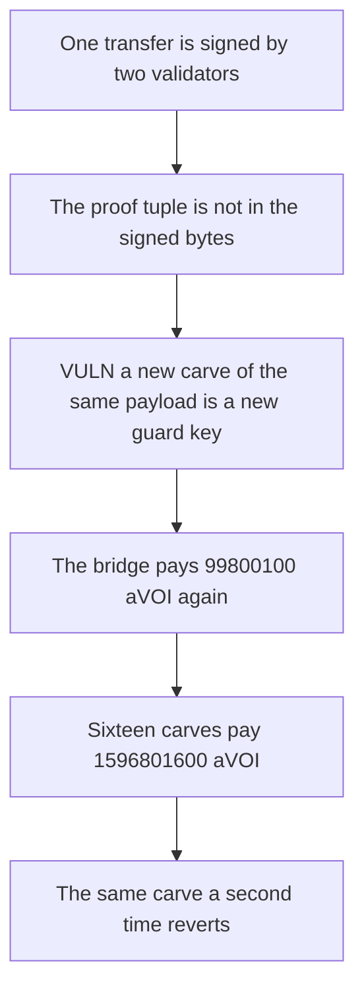

# Aramid — one signed bridge transfer is paid once for every proof carve

> **Vulnerability classes:** vuln/bridge/claim-replay · vuln/auth/unsigned-field
> **Reproduction:** the PoC compiles and runs in an isolated Foundry project at [this project folder](.). Full verbose trace: [output.txt](output.txt). The trace forks Base at block 60,542,657 and `[PASS] testExploit`.

---

## Key info

| | |
|---|---|
| **Loss** | **1,596,801,600 aVOI** released by claiming one authorized transfer 16 times. The signed recipient then sells it for **3,564.801457 USDC** |
| **Bridge** | Aramid proxy [`0xc7faa8f8c6d9dc05abf3c5aa741a38f9a6d1c263`](https://basescan.org/address/0xc7faa8f8c6d9dc05abf3c5aa741a38f9a6d1c263) |
| **Token** | aVOI [`0xb40c776253c4bbc18a9e635acc183359e5fa22f9`](https://basescan.org/address/0xb40C776253c4BbC18A9e635aCC183359e5fa22f9) |
| **Recipient** | [`0x99ed4bed57855bccdd1cf2127220c3119ec21ba4`](https://basescan.org/address/0x99Ed4BeD57855bCCDd1CF2127220C3119ec21Ba4) |
| **First claim** | [`0x08f1a363ad7611801860c8b06638de4322c85970faf0a4b3cbd38fd2328d618b`](https://basescan.org/tx/0x08f1a363ad7611801860c8b06638de4322c85970faf0a4b3cbd38fd2328d618b) |
| **Chain / block / date** | Base / fork block **60,542,657** / 2026-11-21 |

## TL;DR

`claim` takes a transfer id, the source transaction, a proof tuple, the chain id, the token, the amount, the recipient, a note, and the validator signatures. The two signatures authenticate the transfer fields and not the proof tuple. The duplicate-claim guard hashes data that includes the decoded proof. A fresh submitter keeps the signed fields and the two signatures, and changes only how the same 78-byte payload is split across the proof tuple. Each split is a new guard key. Each claim still pays 99,800,100 aVOI to the signed recipient.

Sixteen splits release 1,596,801,600 aVOI. Submitting the first split again reverts, so the guard is on and is keyed on the proof. The forge test then sells the recipient's aVOI into the Uniswap v3 pool for 3,564.801457 USDC.

## The call

```solidity
(bool ok,) = BRIDGE.call(_buildClaim(k)); // @> VULN: k only changes the unsigned proof carve
```

## Diagrams



## How to reproduce

Offline, from this folder:

```bash
bash ../_shared/run-poc/run_poc.sh 2026-11-Aramid_exp -vv
```

`testExploit` asserts the bridge and the recipient both move 1,596,801,600 aVOI, the repeated carve reverts, and the pool swap returns USDC.
