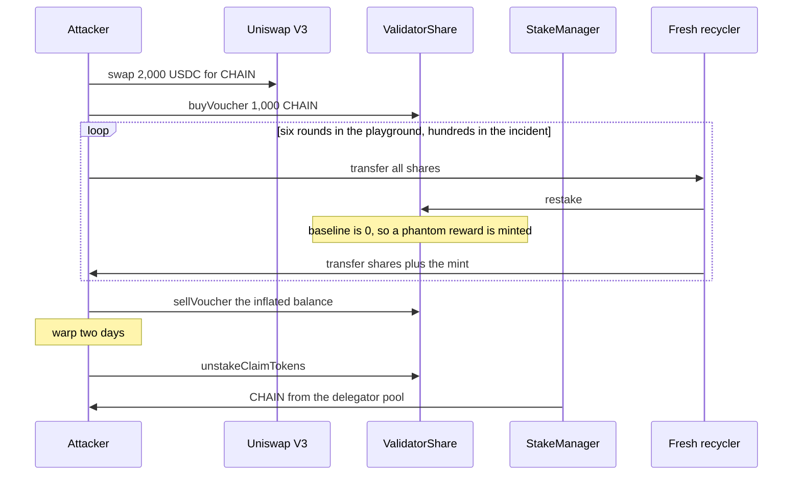

# Chain Games — `ValidatorShare.restake` mints a reward to a recipient whose baseline is still zero

> **Vulnerability classes:** vuln/logic/reward-calculation · vuln/logic/missing-check
> **Reproduction:** the PoC compiles and runs in an isolated Foundry project at [this project folder](.). Full verbose trace: [output.txt](output.txt). The trace forks Polygon at block 97,338,783. `[PASS] testExploit` drains the on-chain amount. `[PASS] testPlaygroundRounds` claims the six-round slice the playground replays.

---

## Key info

| | |
|---|---|
| **Incident loss** | **36,007,148.334503496028863428 CHAIN** pulled from the StakeManager, matching the exploit transfer to the wei. Reported about **$20K**. A 1,000 CHAIN voucher was the real stake |
| **Playground slice** | Six `restake` rounds turn that 1,000 CHAIN into **1,191.076927986984455860** shares, which the claim pays in full. The full incident is the same loop run until the 36M figure |
| **CHAIN** | [`0xd55fce7cdab84d84f2ef3f99816d765a2a94a509`](https://polygonscan.com/address/0xd55fce7cdab84d84f2ef3f99816d765a2a94a509) |
| **StakeManager** | [`0x1cb1f66bde215161d4b6598ddc2defbbc009c5a4`](https://polygonscan.com/address/0x1cb1f66bde215161d4b6598ddc2defbbc009c5a4) |
| **ValidatorShare** | [`0x4b197ce70af7faece9544ef29b76c1cccd54d7ac`](https://polygonscan.com/address/0x4b197ce70af7faece9544ef29b76c1cccd54d7ac), validator id 13 |
| **USDC/CHAIN pool** | [`0xa4e9cff312f719bf663cd88d2118aaa16a0b574f`](https://polygonscan.com/address/0xa4e9cff312f719bf663cd88d2118aaa16a0b574f), Uniswap V3, 0.3% |
| **Attacker EOA** | [`0x571d0ec17d84fdee89f5c9cf6b2fd930205e776f`](https://polygonscan.com/address/0x571d0ec17d84fdee89f5c9cf6b2fd930205e776f) |
| **Attacker contract** | [`0xc11dce2b74ce1717909c4c8d95e32b4cec5691fe`](https://polygonscan.com/address/0xc11dce2b74ce1717909c4c8d95e32b4cec5691fe) |
| **Exploit tx** | [`0x3705970a2eb947041640522d36d34822fc6a0eed3d0a9f05fff986da273019b4`](https://polygonscan.com/tx/0x3705970a2eb947041640522d36d34822fc6a0eed3d0a9f05fff986da273019b4) |
| **Chain / block** | Polygon / fork block **97,338,783** / 2026-11-15 |
| **Bug class** | Reward owed is `(rewardPerShare - initialRewardPerShare[account]) * balance`. A fresh recipient keeps the baseline at 0 |

## TL;DR

Chain Games runs a fork of Polygon's ValidatorShare delegated staking for the CHAIN token. `restake` reinvests a delegator's accrued liquid rewards into new shares. The reward is the growth of `rewardPerShare` since that account's `initialRewardPerShare`.

Shares moved by ERC20 `transfer` do not set the recipient's baseline. A contract created in the same transaction still has `initialRewardPerShare` of 0, while the validator's `rewardPerShare` is already large. `restake` therefore mints a reward that no new stake backed. Sending the whole balance through a new contract each round compounds at about 2.96% with no cap. The inflated shares are then sold into an unbond, and after the withdrawal delay `unstakeClaimTokens` pays them from the delegator pool.

The claim path itself still requires a matured unbond. `testControl_noInflationNoClaim` calls `unstakeClaimTokens` with no unbond and reverts `Incomplete withdrawal period`. The bug is the mint in `restake`, not a missing check on the claim.

The 1,000 CHAIN stake is bought on the real USDC/CHAIN pool. Only the USDC seed is a `deal`. The incident loop is about 225M gas, which a browser replay cannot run, so the playground does six rounds, warps two days, and claims 1,191.08 CHAIN. `testExploit` still runs the loop out to the on-chain 36,007,148 CHAIN figure.

## The mint

```solidity
// ShareRecycler — the throwaway recipient
// @> VULN: a fresh holder keeps initialRewardPerShare at 0, so restake mints a phantom reward
vs.restake();
vs.transfer(back, vs.balanceOf(address(this)));
```

## Diagrams



## Remediation

1. On `transfer`, set the recipient's `initialRewardPerShare` to the current `rewardPerShare`, or pay the accrued reward to the sender before the shares move.
2. Cap `restake` at the rewards actually accounted to that validator since the last checkpoint, and reject a baseline of 0 on an account that did not buy the voucher.
3. The withdrawal delay is not the bug. A claim of an unbond that `restake` inflated is still insolvent.

## How to reproduce

Offline, from this folder:

```bash
bash ../_shared/run-poc/run_poc.sh 2026-11-ChainGames_exp -vv
```

`testExploit` asserts the drained CHAIN equals `36_007_148_334503496028863428`. `testPlaygroundRounds` asserts six rounds claim more than the 1,000 CHAIN stake.
