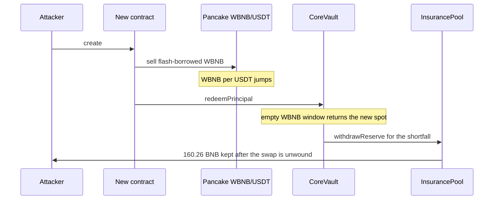

# CoreVault — redemption pays the Pancake spot when the WBNB window is empty

<!-- non-defihacklabs -->

> **Vulnerability classes:** vuln/oracle/spot-price · vuln/defi/price-manipulation
> **Reproduction:** the PoC compiles and runs in an isolated Foundry project at [this project folder](.). Full verbose trace: [output.txt](output.txt). The trace forks BNB Chain at block 131,507,809 and `[PASS] testExploit` pays the attacker 160.257898629710162994 BNB. The insurance pool loses 259.092783959966824034 BNB.

---

## Key info

| | |
|---|---|
| **Loss** | **259.092783959966824034 BNB** leaves InsurancePool. The attacker keeps **160.257898629710162994 BNB** after unwinding the swap |
| **CoreVault** | [`0x302f5084ba0e4a2d4de5e6bc5dd5247028f5d674`](https://bscscan.com/address/0x302f5084ba0e4a2d4de5e6bc5dd5247028f5d674), proxy to `0x11d9df62e9c2919cbe583387473c36d0b894fe21` |
| **InsurancePool** | [`0xf40e0d525003fb6c6a9a7d79734a87a465053df1`](https://bscscan.com/address/0xf40E0d525003FB6C6a9a7D79734a87a465053Df1) |
| **Attacker** | [`0xd3565b191b28b49cc517189b984dacdb1ff05304`](https://bscscan.com/address/0xD3565b191b28B49Cc517189B984dacDB1FF05304) |
| **Attack tx** | [`0x072a10a579e2a8afa26a681205a2aaaa38f74bcb9d1064b12bd9e9ebe2c598b3`](https://bscscan.com/tx/0x072a10a579e2a8afa26a681205a2aaaa38f74bcb9d1064b12bd9e9ebe2c598b3), creation, block 131,507,810 |
| **Chain / block / date** | BNB Chain / fork block **131,507,809** / 2026-11-03 |

## TL;DR

The incident transaction is a contract creation. The constructor flash-borrows WBNB, sells it into the Pancake WBNB/USDT pair, and redeems a CoreVault position in the same transaction. `redeemPrincipal` converts the USD principal into BNB with `OracleLib.getAccountingPrices`.

That function writes the current Pancake spot into `wbnbAvgWindow` and then uses the window average. The window stores one sample every three minutes, and an empty window returns the spot itself. A spot that was just moved by the constructor therefore becomes the redemption price. `Treasury.payoutBnb` pulls whatever the treasury does not already hold from `InsurancePool.withdrawReserve`.

The three-source median in `_selectWbnbPerUsd` is not the function this redemption calls. The accounting path never consults the TWAP.

## The price

`getAccountingPrices` pushes the live spot, then reads the average. `_avgTimeWindow` returns that spot when the window has never been filled.

```solidity
_updateAccountingSnapshots(s);
uint256 avgW = wbnbPerUsd > 0 ? wbnbPerUsd : _avgWbnbPerUsdView(s);
wbnbPerUsd = avgW;
```

```solidity
if (w.filled == 0) return fallbackSpot;
```

`_redeemPrincipalCore` multiplies the USD principal by that rate and asks the treasury to pay BNB.

## Diagrams



## Remediation

1. Do not let `getAccountingPrices` treat an empty or just-written window as a price. If `wbnbAvgWindow.filled` is below 3, revert the redemption.
2. Ignore a sample written in the same transaction as the redemption.
3. Cap the redemption rate by a previously stored observation that the caller cannot update in the same call.

## How to reproduce

Offline, from this folder:

```bash
bash ../_shared/run-poc/run_poc.sh 2026-11-CoreVault_exp -vv
```

`testExploit` creates the incident contract from its public init code. `testWrapperPaysAttacker` does the same creation from a second contract and checks that the BNB still arrives at the attacker.
