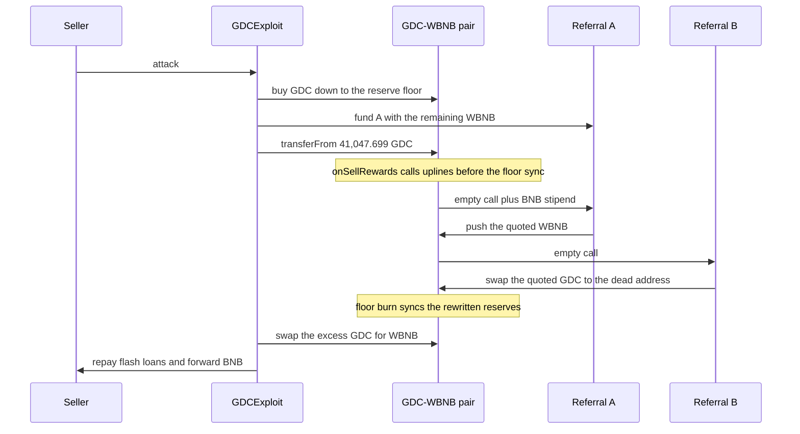

# GDC — referral callbacks rewrite the pair reserves before the floor burn syncs them

> **Vulnerability classes:** vuln/reentrancy/cross-contract · vuln/oracle/spot-price · vuln/logic/price-calculation
> **Reproduction:** the PoC compiles and runs in an isolated Foundry project at [this project folder](.). Full verbose trace: [output.txt](output.txt). The trace forks BNB Chain at block 132,546,182 and `[PASS] testExploit`. `evm_version` is `prague`.

---

## Key info

| | |
|---|---|
| **Profit** | **37.745954125452158109 BNB** to the seller in this reconstruction. The pair loses **51.225608092426029503 WBNB**. The on-chain transaction netted about **50.009 BNB**. Reported loss about **51.22 WBNB** |
| **GDC** | [`0x39a90d082e19bd2ac30da6964d3d2fda50077777`](https://bscscan.com/address/0x39a90d082e19bd2ac30da6964d3d2fda50077777), unverified |
| **GDC/WBNB pair** | [`0xe3349ca6ac1656e02b20b8d5a4c095e28255eb0a`](https://bscscan.com/address/0xe3349ca6ac1656e02b20b8d5a4c095e28255eb0a) |
| **GDCMain** | [`0x8955be303f033a837f7c3c407e0b2b3f9bc4fd5c`](https://bscscan.com/address/0x8955be303f033a837f7c3c407e0b2b3f9bc4fd5c) |
| **Referrals** | [`0xd3ba7d944544d3416131663919580e039294130e`](https://bscscan.com/address/0xd3ba7d944544d3416131663919580e039294130e) |
| **Attacker EOA** | [`0x09343312e8a2fd4f8c8ee130a7715587ab21125f`](https://bscscan.com/address/0x09343312e8a2fd4f8c8ee130a7715587ab21125f) |
| **Exploit tx** | [`0x1427d8e6f543710413886a1624e08f0b1cff8e62e9aa3e00eb04a61b86c30872`](https://bscscan.com/tx/0x1427d8e6f543710413886a1624e08f0b1cff8e62e9aa3e00eb04a61b86c30872) |
| **Chain / block** | BNB Chain / fork block **132,546,182** / 2026-11-09 |
| **Bug class** | `onSellRewards` calls the seller's uplines, with a BNB stipend, before the reserve-floor burn syncs. The uplines are EIP-7702 accounts that push WBNB in and swap GDC out |

## TL;DR

Selling GDC into its Pancake pair pays referral rewards in the middle of the sell. The token looks up the seller's uplines and calls each of them with empty calldata and a BNB stipend, before it burns the pair down to a reserve floor and syncs. Whoever sits on those upline addresses can run arbitrary code against the pair while the sell is still open.

The attacker EOA is already bound, so `bindReferral` on that address reverts. A fresh seller binds two uplines. Each upline has enough deposited downlines to qualify (`effectiveReferralCount` 1 and 3). The uplines are EIP-7702 delegations, reconstructed here as `ReferralPush` and `ReferralSwap` rather than replayed bytecode. Referral A quotes the post-tax reserves and pushes only the WBNB whose Pancake output leaves the sold GDC plus 1,000 wei. Referral B swaps that quoted GDC to the dead address. The floor burn then syncs the rewritten reserves. The exploit swaps the excess GDC balance for WBNB.

The sell consumes **41,047.699284897040065420 GDC** the attacker EOA already held. The test moves that balance. It does not mint it. The receipt and the sell are separated by a block and 31 seconds, because a same-block transfer reverts `SameBlockTrade`.

The playground copies the callback runtime onto the upline addresses (`copyCode` stands in for EIP-7702) and rolls the block between the receipt and the sell. The token is unverified, so the marked line is the `transferFrom` into the pair that fires the callbacks.

## The sell

```solidity
// @> VULN: the sell's referral callbacks rewrite the pair reserves before the floor burn syncs
require(IERC20(address(GDC)).transferFrom(owner, address(PAIR), SELL), "sell");
```

`ReferralPush.fallback` is the level-1 upline. `ReferralSwap.fallback` is level 2. Both check the live pair and run before the floor burn.

## Diagrams



## Remediation

1. Do not call referral hooks while a sell is open. Pay them after the pair reserves are synced, or pull the rewards from a balance the hook cannot change.
2. If a hook must run mid-sell, give it no gas and no value, and ignore the pair's balances until the sell's own transfer is accounted.
3. A reserve floor that syncs whatever balance it sees will ratify a callback that just moved those reserves. Snapshot the reserves before the external calls.

## How to reproduce

Offline, from this folder. The project `evm_version` is `prague`:

```bash
bash ../_shared/run-poc/run_poc.sh 2026-11-GDC_exp -vv
```

`testExploit` asserts the pair loses `51.225608092426029503` WBNB, the seller gains `37.745954125452158109` BNB, and the GDC consumed equals the sell amount.
