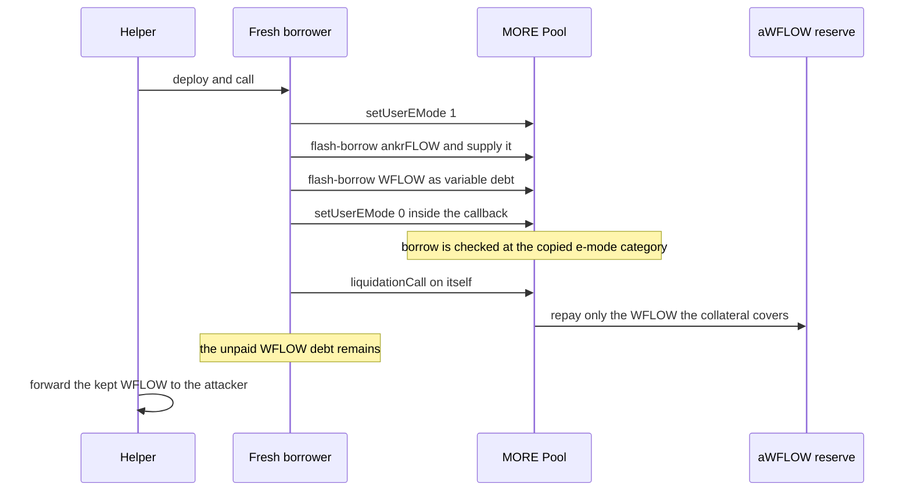

# MORE Markets — flash loan borrows at a stale e-mode category

<!-- non-defihacklabs -->

> **Vulnerability classes:** vuln/logic/stale-parameter · vuln/defi/liquidation
> **Reproduction:** the PoC compiles and runs in an isolated Foundry project at [this project folder](.). Full verbose trace: [output.txt](output.txt). The trace forks Flow EVM at block 85,326,750 and `[PASS] testExploit` moves 4,547,469.353476318970231022 WFLOW to the attacker.

---

## Key info

| | |
|---|---|
| **Loss** | **4,547,469.353476318970231022 WFLOW** to the attacker in this transaction. The aWFLOW reserve falls by **5,924,534.690155713161770772 WFLOW**. Blockaid put the whole incident, across about eleven transactions, near **$308K** |
| **Pool** | MORE Pool [`0xbc92aac2dbbf42215248b5688eb3d3d2b32f2c8d`](https://evm.flowscan.io/address/0xbC92aaC2DBBF42215248B5688eB3D3d2b32F2c8d), proxy to Pool `0x91eb147463a84112a57dad27a180cdfdd628806b` |
| **Reserve** | mFlowWFLOW aToken [`0x02bf4bd075c1b7c8d85f54777eaaa3638135c059`](https://evm.flowscan.io/address/0x02BF4bd075c1b7C8D85F54777eaAA3638135c059) |
| **Attacker** | [`0xe1ea6f2365215389f9dcd50a51c974313bf6785c`](https://evm.flowscan.io/address/0xe1eA6F2365215389f9DCd50a51c974313BF6785C) |
| **Helper** | [`0x9a8cc604b3534eaa1a8627c1d6f6084857bf2765`](https://evm.flowscan.io/address/0x9a8cC604b3534eAA1A8627c1D6f6084857Bf2765) |
| **Attack tx** | [`0xdf9e3ed4858103569f684166d9833e1980b6ba96334c9a8ec172b4e2aa1d15d8`](https://evm.flowscan.io/tx/0xdf9e3ed4858103569f684166d9833e1980b6ba96334c9a8ec172b4e2aa1d15d8), block 85,326,751 |
| **Chain / block / date** | Flow EVM / fork block **85,326,750** / 2026-11-16 |

## TL;DR

MORE is an Aave V3 fork. `Pool.flashLoan` copies the borrower's e-mode category into the flash-loan parameters before it runs the callback. A flash loan opened with `interestRateMode = 2` does not ask for the tokens back. After the callback it books them as variable debt, and it checks that debt against the copied category.

The helper's callback calls `setUserEMode(0)` before that booking. The borrow is still allowed at the e-mode loan-to-value. `liquidationCall` then reads the live category, which is 0, so the position is under the normal liquidation threshold. Liquidation burns the ankrFLOW collateral and repays only as much WFLOW as that collateral covers. The unpaid WFLOW stays with the borrower and is withdrawn from the reserve.

One round of the traced call borrows 17,805,278.511233457984911430 WFLOW against 15,000,000 ankrFLOW, repays 17,318,726.216895982259318145 WFLOW, and seizes 14,915,094.339622641509433962 ankrFLOW. The helper repeats that on a fresh borrower until 4,547,469.353476318970231022 WFLOW has reached the attacker.

## The calls

`Pool.flashLoan` snapshots the category, then `FlashLoanLogic` books the debt with that snapshot. `liquidationCall` reads storage again.

```solidity
userEModeCategory: _usersEModeCategory[onBehalfOf],
```

```solidity
BorrowLogic.executeBorrow(
    ...
    userEModeCategory: params.userEModeCategory,
```

```solidity
userEModeCategory: _usersEModeCategory[user],
```

## Diagrams



## Remediation

1. Read `_usersEModeCategory` again after the flash-loan callback, and pass that value into `executeBorrow`.
2. Do not open debt at an e-mode loan-to-value when the stored category is 0.
3. A liquidation that seizes collateral must leave no debt the seized collateral did not pay for. Add a post-liquidation check that the user's health factor is at least 1, or that the debt decreased by the full borrowed amount when the caller just opened it.

## How to reproduce

Offline, from this folder:

```bash
bash ../_shared/run-poc/run_poc.sh 2026-11-MORE_exp -vv
```

`testExploit` calls the incident helper with the original calldata and asserts the attacker's WFLOW gain and the reserve's WFLOW loss.
